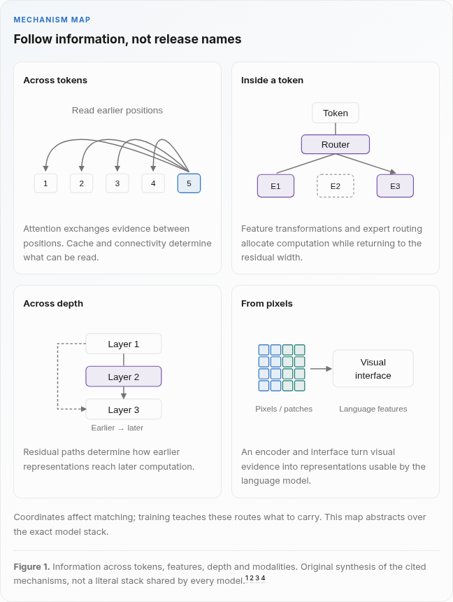

# Architecture synthesis and visual review

## Executive answer

The expanded model catalog needs a mechanism map, not another release timeline.
The architecture section now separates history, coordinates, capacity, depth
and visual evidence. A reader can follow a shared operation into a model study
without treating every improvement as a replacement for the whole Transformer.
This is an editorial synthesis of inspected public reports, not an independent
performance evaluation or exhaustive release survey.

The site has three complementary entry points: one complete foundations
walkthrough, cross-model Architectural Evolution pages, and model-specific
deep dives. The existing release artwork and full foundations figures remain.
Seven evolution pages include a new depth and residual-path study.

## Visual overview

<!-- visual-id: V002 -->

Figure 1. Independent information-flow map. Its routes are illustrative, not a
literal universal model stack. Attention, feature transformation, depth reads
and visual entry have different contracts.[^S001][^S004][^S023][^S017]

The visual manifest records eleven code-native views and three
original source figures. Every published diagram has a visible text equivalent,
claim-local citations, sequential numbering and a distinct teaching purpose.
The mathematical illustrations do not present toy cell counts as measured
latency, storage ratios or benchmark results.

## Key findings

1. Efficient execution, reduced KV heads, latent history, selected reads and
   recurrence address different costs. Dense exact arithmetic is not made
   linear by avoiding its full score matrix.[^S002][^S003][^S004][^S006][^S013]
2. A hybrid has several memory lifetimes. Fixed recurrent state or a bounded
   local window does not remove its global layers' growing history.[^S009][^S010][^S011]
3. Coordinates, accepted length and successful use of evidence are separate
   questions. GLM's two learned coordinates describe blank infilling, not image
   axes; DCA remaps distance, rather than compressing a KV record.[^S014][^S034][^S035]
4. A feature gate computes and combines branches; an expert router chooses
   separate FFNs. Balancing methods and shared experts differ by release.[^S018][^S019][^S004][^S005][^S020]
5. Depth deserves its own axis. Ordinary residual accumulation, constrained
   multiple streams, depth attention and read/write gates create different
   routes and overheads.[^S001][^S022][^S023][^S024]
6. Contrastive representations, learned visual queries, projection and depth
   injection have different purposes. Their training stage and visual budget
   must be part of the explanation.[^S025][^S026][^S027][^S028][^S017]

## Detailed analysis

### Memory and attention

The memory page begins with four explicit contracts: per-position keys/values,
compressed per-position latents, selected historical reads, and recurrent state.
It then separates FlashAttention's exact execution schedule from changes to
what is retained or read. The local KV count includes layer, batch, retained
position, KV head, head-width and element-size factors. It counts only those
tensors, not model process memory.[^S002][^S003]

DeepSeek-V2's original head/latent comparison is reproduced with its MIT
documentation notice. The surrounding prose restores the positional key that
a simplified content illustration can hide. The causal linear recurrence
defines state shapes and normalization assumptions. Mamba and KDA are not
presented as equivalent additive recurrences.[^S004][^S036][^S006][^S008][^S009]

Sparse selection retains a separate index cost. GLM-5 token selection and
MiniMax group-specific block selection illustrate distinct mechanisms. The
Kimi/Gemma hybrid comparison makes recurrent, local and global layer symbols
explicit and does not assign one layer's state bound to a whole model.[^S012][^S013][^S009][^S010]

### Position, visibility and usable context

The rotation diagram holds content vectors and relative offset fixed while
shifting both positions. Its equation follows from orthogonality; it is not a
complete-model invariance claim. YaRN includes frequency adaptation, attention
scaling and further training. DCA has a different distance-remapping contract.
Stacked local attention can offer an indirect route without proving that a
specific distant detail survives it.[^S014][^S015][^S035][^S007]

The visibility distinction also applies before causal decoding. BERT, T5 and
original GLM have different input/target contracts. GLM's span location and
intra-span progress coordinates are not modern multimodal RoPE.[^S031][^S032][^S034]

For video, sampling decides which events remain visible. Qwen2.5-VL elapsed-time
positions and Qwen3-VL timestamp text/interleaving then locate the retained
evidence. Better coordinates cannot restore a discarded frame.[^S016][^S017]

### Capacity and depth

The SwiGLU illustration exposes both computed projections, SiLU, multiplication
and the output projection. Equal-width gated and conventional FFNs are not a
matched parameter comparison; the local three-versus-two projection count
explains the two-thirds width adjustment used in the GLU experiments.[^S018]

Mixtral's original routing figure shows parallel selected experts and their
weighted combination. DeepSeek shared experts and V3 selection biases, Qwen3's
absence of shared experts, and GLM-4.5's separately trained specialist policies
prevent a single generic notion of an expert from covering everything.[^S019][^S004][^S005][^S020][^S021]

The depth page distinguishes a stable ideal bypass from the entire nonlinear
network. mHC's doubly stochastic mixing has bounded ideal properties, while
practical projection is numerical. Attention Residuals read earlier depth
representations for the current token, not previous sequence tokens. Their
block form addresses retained-source and pipeline costs. Qwen's four-branch
gated design does not implement unrestricted bypass remixing.[^S022][^S023][^S024]

### Visual representations

CLIP is not a generative decoder. BLIP-2's original bridge shows the causal and
encoder-decoder branches, the learned queries and frozen backbones. Original
LLaVA linear projection and LLaVA-1.5 MLP projection remain distinct. Qwen3-VL's
side depth routes are schematic selected depths, not invented layer IDs.[^S025][^S026][^S027][^S028][^S017]

The patch-merging example counts geometry with divisible dimensions and no
extra crops or delimiters. Doubling both dimensions quadruples the patch and
merged-token counts at the same merge ratio. Gemma's fixed count per view does
not imply a fixed aggregate count after adding views.[^S029][^S030][^S010]

## Counterevidence and uncertainty

Qwen3.8-Next's read shortcut can look acceptable in early training metrics yet
degrade later quality. MiniMax Sparse Attention's long-context aggregate scores
coexist with subtask regressions. These author-reported negative results limit
general superiority claims.[^S024][^S013]

No weights were run, hardware benchmarked, results independently replicated or
proprietary interiors reconstructed here. Model-study links preserve exact
artifact and implementation boundaries. Global cache growth, numerical
projection approximations, expert communication, missing visual evidence and
training changes remain visible rather than being hidden inside one efficiency
or capability label. R1 is explicitly a training example on a pretrained
backbone, not a new attention mechanism.[^S033]

The new comparative diagrams are independent synthesis. They supplement,
rather than replace, original architecture artwork in the model studies.
Only three already reviewed source derivatives are additionally reused in these comparisons:
V2 under its documentation MIT grant, Mixtral under CC BY 4.0 and the BLIP-2
published figure under CC BY 4.0. Existing exact crop/provenance records remain.
The raw GitHub license request failed in the web tool; a direct read of the
same pinned public license succeeded. No inference about report artwork rights
is made from a model weight license.

## Implications

Teach one mechanism at a time, show its operation or state boundary, then link
to concrete models. Keep equations numbered and symbols defined. Report active
work, stored weights, retained state, communication and quality separately.
Preserve diagram explanations in Markdown so agent readers receive the same
important assumptions as people reading HTML.

The research agenda proposes controlled comparisons rather than announcing
experiments. A release earns a new mechanism explanation when it adds a route,
a meaningful combination, reproducible implementation evidence or counterevidence.
The conclusion remains revisable, not a prediction of the next dominant model.

## Open questions and future research

- Which hybrid ratios preserve multi-fact retrieval under matched training and
  serving budgets, including global cache costs?
- When do residual-source retention and communication outweigh improvements in
  optimization or final behavior?
- Which visual token or depth budgets preserve fine detail under contradictory
  or missing evidence, at matched resolution and training conditions?
- Which mechanisms remain effective across independent checkpoints, tasks and
  supported runtime backends?

These are proposed investigations, not commitments to monitor or benchmark.

## Sources

The source ledger contains inspected primary reports, exact editions and section
locators. Claims record limits and evidence edges. The visual manifest records
editable code or reproduced assets, rights, numbered captions and actual review.

[^S001]: Vaswani et al. [Attention Is All You Need](https://arxiv.org/html/1706.03762v7). Section 3: stack, attention, FFNs, residuals and position; inspected October 10, 2026.
[^S002]: Ainslie et al. [GQA](https://arxiv.org/html/2305.13245v3). Section 2: query groups and shared KV heads; inspected October 10, 2026.
[^S003]: Dao et al. [FlashAttention](https://arxiv.org/html/2205.14135v2). Sections 2 and 3: tiling, exact softmax and recomputation; inspected October 10, 2026.
[^S004]: DeepSeek-AI. [DeepSeek-V2](https://arxiv.org/html/2405.04434v1). Sections 2.1 and 2.2, Appendix B: latent content, positional keys and experts; inspected October 10, 2026.
[^S005]: DeepSeek-AI. [DeepSeek-V3 Technical Report](https://arxiv.org/html/2412.19437v1). Section 2.1.2: selection biases, unmodified mixture weights and sequence balance; inspected October 10, 2026.
[^S006]: Katharopoulos et al. [Transformers are RNNs](https://arxiv.org/html/2006.16236v3). Sections 3.2 and 3.3, equations 8 to 12: normalized causal recurrence; inspected October 10, 2026.
[^S007]: Jiang et al. [Mistral 7B](https://arxiv.org/html/2310.06825v1). Section 2: sliding window, rolling cache and depth reach; inspected October 10, 2026.
[^S008]: Gu and Dao. [Mamba](https://arxiv.org/html/2312.00752v2). Section 3: selective state dynamics and scan; inspected October 10, 2026.
[^S009]: Kimi Team. [Kimi Linear](https://arxiv.org/html/2510.26692v1). Sections 3, 4 and 6: KDA, delta updates and 3:1 hybrid; inspected October 10, 2026.
[^S010]: Gemma Team. [Gemma 3 Technical Report](https://arxiv.org/html/2503.19786v1). Section 2: 5:1 local/global layers, 256 vision tokens and pan-and-scan; inspected October 10, 2026.
[^S011]: MiniMax. [MiniMax-01](https://arxiv.org/html/2501.08313v1). Section 2.2: seven lightning layers per global softmax layer; inspected October 10, 2026.
[^S012]: GLM-5 Team. [GLM-5](https://arxiv.org/html/2602.15763v1). Sections 2.1.1 and 2.1.2: DSA and efficient attention comparisons; inspected October 10, 2026.
[^S013]: MiniMax. [MiniMax Sparse Attention](https://arxiv.org/html/2606.13392v2). Sections 2.2, 3 and 5; Table 3: group-specific selection, index overhead, task tradeoffs; inspected October 10, 2026.
[^S014]: Su et al. [RoFormer](https://arxiv.org/html/2104.09864v5). Sections 3.1 and 3.2: query/key rotations and relative dot products; inspected October 10, 2026.
[^S015]: Peng et al. [YaRN](https://arxiv.org/html/2309.00071v2). Section 3: frequency regimes, attention scaling and further training; inspected October 10, 2026.
[^S016]: Qwen Team. [Qwen2.5-VL Technical Report](https://arxiv.org/html/2502.13923v1). Sections 2.1.2 and 2.1.3: dynamic sampling and absolute-time temporal positions; inspected October 10, 2026.
[^S017]: Qwen Team. [Qwen3-VL Technical Report](https://arxiv.org/html/2511.21631v1). Section 2: DeepStack, interleaved MRoPE and timestamp text; inspected October 10, 2026.
[^S018]: Noam Shazeer. [GLU Variants Improve Transformer](https://arxiv.org/html/2002.05202v1). Section 2, equations 5 and 6; section 3: width adjustment and matched experiments; inspected October 10, 2026.
[^S019]: Jiang et al. [Mixtral of Experts](https://arxiv.org/html/2401.04088v1). Section 2.1, Figure 1: selected softmax, two of eight SwiGLU experts; inspected October 10, 2026.
[^S020]: Qwen Team. [Qwen3 Technical Report](https://arxiv.org/html/2505.09388v1). Section 2: dense/MoE models and absence of shared experts in Qwen3 MoE; inspected October 10, 2026.
[^S021]: Zhipu AI. [GLM-4.5](https://arxiv.org/html/2508.06471v1). Section 3: specialized policies followed by unified self-distillation; inspected October 10, 2026.
[^S022]: Xie et al. [mHC: Manifold-Constrained Hyper-Connections](https://arxiv.org/html/2512.24880v1). Sections 3 and 4: unconstrained mixing, doubly stochastic bypass and Sinkhorn; inspected October 10, 2026.
[^S023]: Kimi Team. [Kimi K3: Open Frontier Intelligence](https://arxiv.org/html/2607.24653v1). Section 2.2, equations 8 to 11: full and block attention across depth; inspected October 10, 2026.
[^S024]: Qwen Team. [On the Design of Qwen3.8-Next Architecture](https://arxiv.org/html/2608.30320v1). Section 2.2: four gated branches, reads/writes and top-two read negative results; inspected October 10, 2026.
[^S025]: Radford et al. [Learning Transferable Visual Models From Natural Language Supervision](https://arxiv.org/html/2103.00020v1). Section 2: contrastive image/text representations; inspected October 10, 2026.
[^S026]: Li et al. [BLIP-2](https://arxiv.org/html/2301.12597v3). Sections 3.1 to 3.3, Figure 3: 32 queries and frozen generative backbones; inspected October 10, 2026.
[^S027]: Liu et al. [Visual Instruction Tuning](https://arxiv.org/html/2304.08485v2). Section 4.1: linear projection into language embedding space; inspected October 10, 2026.
[^S028]: Liu et al. [Improved Baselines with Visual Instruction Tuning](https://arxiv.org/html/2310.03744v2). Section 3.3: two-layer MLP connector in LLaVA-1.5; inspected October 10, 2026.
[^S029]: Dosovitskiy et al. [An Image is Worth 16x16 Words](https://arxiv.org/html/2010.11929v2). Section 3.1: patch embeddings and patch-count dimensions; inspected October 10, 2026.
[^S030]: Qwen Team. [Qwen2-VL](https://arxiv.org/html/2409.12191v1). Section 2.1: adjacent 2x2 feature merging and variable visual tokens; inspected October 10, 2026.
[^S031]: Devlin et al. [BERT](https://arxiv.org/html/1810.04805v2). Section 3: bidirectional Transformer encoder; inspected October 10, 2026.
[^S032]: Raffel et al. [Exploring the Limits of Transfer Learning with a Unified Text-to-Text Transformer](https://arxiv.org/html/1910.10683v4). Architecture section and section 3.2: encoder-decoder visibility contracts; inspected October 10, 2026.
[^S033]: DeepSeek-AI. [DeepSeek-R1](https://arxiv.org/html/2501.12948v1). Section 2: reasoning RL on a pretrained backbone; inspected October 10, 2026.
[^S034]: Du et al. [GLM: General Language Model Pretraining with Autoregressive Blank Infilling](https://arxiv.org/html/2103.10360v2). Sections 2.1 and 2.2: visibility mask, span order and learned two-coordinate positions; inspected October 10, 2026.
[^S035]: Qwen Team. [Qwen2.5-1M Technical Report](https://arxiv.org/html/2501.15383v1). Section 5.1: intra, inter and successive-chunk remapped positions; inspected October 10, 2026.
[^S036]: DeepSeek. [DeepSeek-V2 documentation license](https://raw.githubusercontent.com/deepseek-ai/DeepSeek-V2/ec98ee3cbffc32104cd55dba8af884b3d772602a/LICENSE-CODE). Complete MIT license and associated documentation grant; inspected October 10, 2026.
