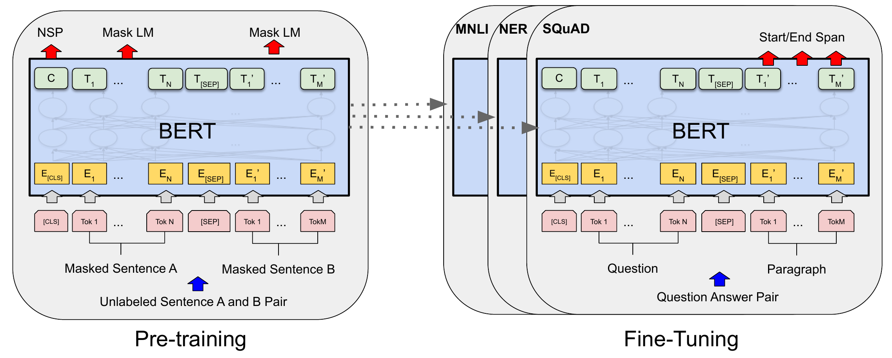
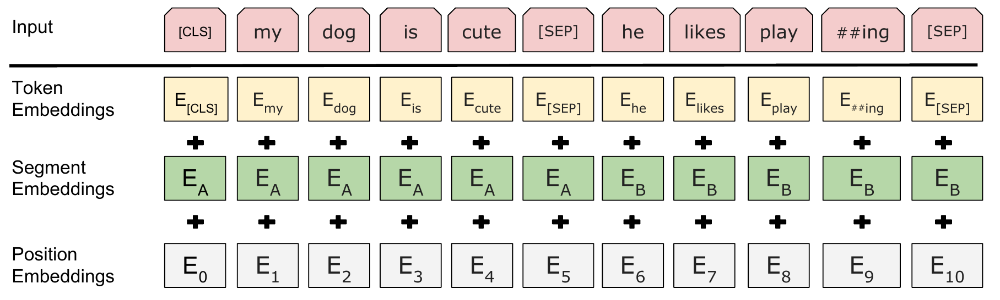

# BERT

## Executive answer

[Technical report](https://arxiv.org/abs/1810.04805v2) · [Hugging Face: google-bert/bert-base-uncased](https://huggingface.co/google-bert/bert-base-uncased)

BERT learns to read a whole passage before deciding what its words mean. It hides selected tokens during pretraining and predicts them from both sides. The resulting encoder can then be adapted to classification, token labeling or answer span extraction with a small task head.[^report]

## Visual overview

Purposeful figures below cover the input contract, distinctive mechanism or bounded evidence; their captions identify provenance and scope.

## Key findings

- **Context from both directions.** Every encoder layer can combine evidence before and after a token, unlike a causal language decoder.[^report]
- **One backbone, many supervised tasks.** Transfer the pretrained encoder and update it with a task specific output layer rather than design a new network for every task.[^report]
- **A useful contrast to generative LLMs.** BERT produces contextual representations, not an instruction following next token assistant. Its released checkpoints and code make that distinction concrete.[^release]

Representative checkpoint: original **BERT-Base Uncased**, with its hosted masked language model configuration. Report v2, released artifact configuration, license and targeted Transformers functions checked October 10, 2026. No checkpoint executed.[^config][^code]

## Detailed analysis

## Model in numbers

| Dimension | Value and scope |
| --- | --- |
| Model size | About 110 million parameters for BERT-Base; 12 layers, width 768 and 12 attention heads. BERT-Large is a separate 340 million parameter variant.[^report] |
| Pretraining corpus | BooksCorpus: 800 million words; English Wikipedia: 2.5 billion words. These are source corpus words, not the number of WordPiece tokens processed over training.[^report] |
| Training schedule | One million updates, batch 256 sequences; 90% of steps at length 128, then 10% at length 512.[^report] |
| Training compute | BERT-Base: four days on four Cloud TPUs, 16 TPU chips in the report's accounting. No FLOP total reported.[^report] |
| Context and vocabulary | 512 learned positions; 30,522 vocabulary entries in the selected uncased configuration.[^config] |
| Adaptation data | Task dependent labeled datasets, not a universal instruction tuning corpus.[^report] |

## What changed

A left to right language model cannot use later words when forming a token's representation. That is a poor fit when the task is to understand an already available passage. BERT changes the training problem so that bidirectional attention is useful without letting the network simply copy every target from its input. The central contribution is the combination of this objective with transfer learning across many language understanding tasks.[^report]

## Architecture

Input text becomes WordPiece IDs with special boundary tokens. A sentence pair is packed as `[CLS] A [SEP] B [SEP]`. Each position adds a token embedding, a learned position embedding and a segment embedding identifying A or B. The encoder returns one contextual vector per position.[^report][^code]

The original architecture view shows what transfers from pretraining to each downstream task.

<!-- visual-id: V101 -->

**Figure 1.** BERT pretraining and task adaptation. Reproduced from Devlin et al., Figure 1, NAACL 2019; figure crop, [CC BY 4.0](https://creativecommons.org/licenses/by/4.0/).[^venue]

The dotted arrows in Figure 1 transfer pretrained parameters, not predictions. The downstream panels share the encoder design but attach different task heads; fine tuning updates the encoder as well as the selected head.

<!-- visual-id: V102 -->

**Figure 2.** Three embeddings form each input vector. Reproduced from Devlin et al., Figure 2, NAACL 2019; figure crop, [CC BY 4.0](https://creativecommons.org/licenses/by/4.0/).[^venue]

Figure 2 shows addition, not concatenation. Segment A and B identify the two packed spans, while position indices continue across their separator; both spans still inhabit one sequence.

For batch `B` and padded input length `T`, the hidden stream has shape `B × T × 768`. Each head has width 64; the GELU FFN expands to 3,072 and returns to 768. The inspected implementation adds each attention or FFN result to its residual input **before** LayerNorm. This is post normalization, unlike the pre normalization common in later causal models.[^config][^code]

The padding mask prevents reading padding. It is not a causal mask: real tokens may read both earlier and later real tokens. For generic attention and tensor contracts, see [Transformer Foundations](/architectures/foundations/).

## Masked prediction with bidirectional context

Select 15% of WordPiece positions as prediction targets. Of those selected positions, replace 80% with `[MASK]`, 10% with a random token and leave 10% unchanged. Thus “15% selected” does not mean “15% visibly replaced by MASK.” Loss is computed on the selected targets, not every position.[^report]

Let `x` be the original sequence, `x̃` its corrupted input and `M` the selected positions. An explanatory objective is:

$$
\mathcal{L}_{\mathrm{MLM}}=-\frac{1}{|M|}\sum_{i\in M}\log p_\theta(x_i\mid\widetilde{x})
\tag{1}
$$

Equation (1) describes masked prediction, with the original tokens supplying labels and the corrupted sequence supplying context. The paper combines the mean MLM loss with a next sentence prediction loss.[^report]

The masked prediction head is more than a bare vocabulary projection. The inspected implementation transforms each token state through a width-preserving linear layer, GELU and LayerNorm, then projects to vocabulary logits with an output bias. The vocabulary projection shares its weights with the input token embedding table. This head trains contextual states to predict selected tokens; downstream task heads have a different contract.[^code]

The original selection samples WordPiece positions uniformly, including individual pieces of a split word. It is not whole-word masking. The paper's A and B spans can each contain several real sentences, and examples are drawn at document level rather than by shuffling isolated sentences.[^report]

The original next sentence task presents a genuine following text span half the time and a randomly sampled span half the time. A classifier over the `[CLS]` representation predicts the relationship. This objective aims to train sentence pair understanding; it is not equivalent to next token generation.[^report]

The tradeoff is training efficiency and distribution mismatch. Only selected positions receive the MLM prediction loss, and `[MASK]` is absent in normal downstream inputs. Random replacements and unchanged targets reduce the latter mismatch, but do not make pretraining identical to downstream use.[^report]

## Training and adaptation

Pretraining uses Adam with learning rate 0.0001, 10,000 warmup steps, linear decay, weight decay 0.01 and dropout 0.1. Short sequences dominate early training to reduce attention cost; the final longer sequence phase trains the remaining position embeddings. The shorter schedule matters when interpreting the paper's nominal maximum batch token count.[^report]

For downstream tasks, all encoder parameters are fine tuned. Classification reads `[CLS]`; tagging attaches a predictor to token states; extractive QA predicts start and end positions in the passage. These are different heads and labeled objectives. They are not a shared chat model or a promise that the raw `[CLS]` vector is an optimal sentence embedding.[^report]

Fine tune the encoder or freeze it as a feature extractor?

The main recipe fine tunes the whole network, but Section 5.3 also tests frozen features. On CoNLL-2003 named-entity recognition, concatenating BERT-Base's last four hidden layers and training a separate two-layer BiLSTM reaches 96.1 development F1, compared with 96.4 for fine tuning BERT-Base. These are case-preserving models, averaged over five random restarts, not results for the selected uncased MLM checkpoint.[^report]

Freezing avoids a separate encoder update for every task, but still requires training and evaluating the downstream head. This experiment does not show that an untrained head or raw CLS vector already solves the task.

Artifact and implementation identity

The hosted configuration defines the selected model. Its `BertForMaskedLM` identity describes a masked prediction wrapper; it does not imply that every downstream head is present. The hosted card identifies itself as written by Hugging Face, not by the original BERT authors.[^config][^card]

Targeted inspection uses Transformers v4.57.1: `BertEmbeddings`, `BertSelfOutput`, `BertIntermediate`, `BertOutput` and `BertLMPredictionHead`. No code excerpt is copied. Source figures use the separately licensed ACL edition. The original release states Apache 2.0 for both its code and pretrained models.[^code][^release]

## Inference

For classification or extraction, tokenize the complete input, run the encoder once and apply the trained task head. For a fill mask example, inspect the MLM distribution at the masked position. There is no normal causal decode loop that progressively extends a KV cache: adding words can change every existing token's bidirectional representation.[^code]

Uncased tokenization lowercases text and strips accent markers in the original release. This simplifies lexical variation but can discard useful evidence for tasks where capitalization or accents matter. Use the tokenizer matched to the checkpoint.[^release]

## Evaluation and ablations

The clearest mechanism evidence is the controlled pretraining task study, not a headline from the largest model. Table 5 holds the BERT-Base architecture, pretraining data and fine tuning scheme fixed:[^report]

| Configuration | SQuAD 1.1 development F1 | QNLI development accuracy |
| --- | --- | --- |
| BERT-Base, MLM plus NSP | 88.5 | 88.4 |
| Bidirectional MLM, no NSP | 87.9 | 84.9 |
| Left to right LM, no NSP | 77.8 | 84.3 |

These are author reported results under the paper's conditions, not scores for the unadapted hosted checkpoint. Removing NSP tests its contribution within this recipe. Comparing the last two rows changes the conditioning pattern **and** prediction objective, so it should not be described as an isolated attention mask experiment. The evidence supports bidirectional pretraining for the studied understanding tasks, not superiority on every possible task.[^report]

Appendix C.2 checks the masking mixture. With its frozen-feature NER evaluation, the 80/10/10 recipe scores 94.9 versus 94.0 when every selected position becomes MASK. Fine-tuned results are less sensitive in this study. The comparison supports reducing the input mismatch for this setting; it does not establish one masking ratio as optimal for every encoder or task.[^report]

## Counterevidence and uncertainty

BERT-Base Uncased is an English representation model with a 512 position configuration. It is not a long document reader, multimodal model or instruction aligned assistant. Its pretraining sources can carry social bias, and the hosted card illustrates gendered fill mask completions.[^config][^card]

Its original NSP ablation does not establish that NSP is necessary for all later encoder recipes. A fair modern comparison would control corpus, training exposure, masking procedure and adaptation settings. Likewise, a pretrained encoder needs task validation before treating its features as a retrieval embedding.

## Implications

The transferable idea is to choose an objective that matches the information available at use time. Full passage understanding benefits from bidirectional context; causal generation has a different contract. Continue with [T5](/architectures/models/t5/) for an encoder and decoder that express downstream tasks as generated text, or [GPT-2](/architectures/models/gpt-2/) for causal decoding.

## Sources

[^report]: Jacob Devlin et al. [BERT: Pre-training of Deep Bidirectional Transformers for Language Understanding](https://arxiv.org/abs/1810.04805v2), 2019 version 2. Sections 3 to 5, Tables 5 and 7, Appendices A.2 and C.2, and Table 8.

[^config]: Google BERT. [BERT-Base Uncased configuration](https://huggingface.co/google-bert/bert-base-uncased/blob/86b5e0934494bd15c9632b12f734a8a67f723594/config.json). Inspected October 10, 2026.

[^card]: Hugging Face. [BERT-Base Uncased model card](https://huggingface.co/google-bert/bert-base-uncased/blob/86b5e0934494bd15c9632b12f734a8a67f723594/README.md), description and bias examples.

[^release]: Google Research. [Original BERT release](https://github.com/google-research/bert/blob/eedf5716ce1268e56f0a50264a88cafad334ac61/README.md), pretrained models and tokenization; [Apache 2.0 license](https://github.com/google-research/bert/blob/eedf5716ce1268e56f0a50264a88cafad334ac61/LICENSE).

[^code]: Hugging Face. [BERT implementation](https://github.com/huggingface/transformers/blob/8cb5963cc22174954e7dca2c0a3320b7dc2f4edc/src/transformers/models/bert/modeling_bert.py), Transformers v4.57.1, targeted functions listed above.

[^venue]: Jacob Devlin et al. [BERT: Pre-training of Deep Bidirectional Transformers for Language Understanding](https://aclanthology.org/N19-1423/), NAACL 2019, Figures 1 and 2, printed pages 4173 and 4175. ACL Anthology grants [CC BY 4.0](https://creativecommons.org/licenses/by/4.0/) to ACL materials published from 2016 onward.

## Open questions and future research

See coverage-audit.md for the mechanism-by-mechanism audit, exact source locators, justified omissions and remaining artifact-access gaps. No weights or runtime benchmarks were executed. Renewed rendered and export QA passed; see the revision 3 presentation record.

## What changed in this revision

Revision 3: MLM prediction-head contract and tied vocabulary weights; uniform subword masking and document spans; frozen-feature transfer with its case-preserving evaluation boundary; masking-mixture counterevidence. Earlier evidence and visual-review history remain in the ledgers.

## Revision 3 presentation verification

106 automated tests, zero Astro diagnostics, the static build and all 43 docs lint checks passed. The collection passed 81 fresh browser views; this page was checked at 1440px light, 390px light and 320px dark, with desktop focus, active family navigation, caption order, anchors, image decoding, resource cards and no page overflow. Complete source figures fit desktop, while narrow frames support keyboard panning and full-size access. Search and Markdown/MDX exports preserve citations, figures and source links. All 66 model figure renders were inspected, with full-size review of new dense diagrams. See state/presentation-qa.json for exact page checksums and evidence. No model benchmark was reproduced. Existing bundler and redirect warnings remain.
