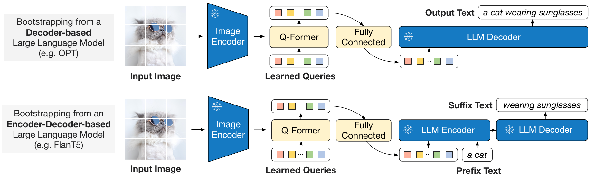
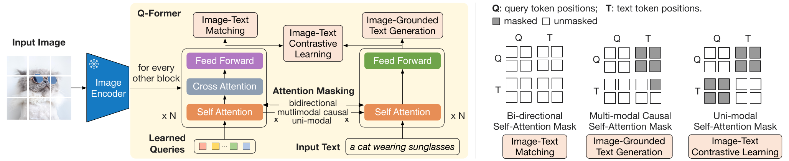

# BLIP-2

## Executive answer

[Technical report](https://arxiv.org/abs/2301.12597v3) · [Hugging Face: Salesforce/blip2-opt-2.7b](https://huggingface.co/Salesforce/blip2-opt-2.7b)

BLIP-2 gives a pretrained language model a small set of learned visual
representations instead of retraining the whole system. A Querying Transformer,
or Q-Former, reads a frozen image encoder and turns its features into a
compact prefix that a frozen language model can use.[^paper]

## Key findings

- Added penultimate image features and query-specific Q-Former layer implementation.
- Completed first-stage score, negative mining and DEC generation details.
- Added the actual CapFilt pipeline and question-conditioned VQA finetuning boundary.

## Visual overview

<!-- visual-id: V003 -->

<!-- visual-id: V004 -->

Original report crops retain their verified, separately recorded grants. Independently authored SVGs use the repository MIT license. See coverage-audit.md and public/figures/model-studies/blip-2/SOURCES.md for each inclusion/omission decision. New page browser and export review passed.

## Detailed analysis

[Technical report](https://arxiv.org/abs/2301.12597v3) · [Hugging Face: Salesforce/blip2-opt-2.7b](https://huggingface.co/Salesforce/blip2-opt-2.7b)

BLIP-2 gives a pretrained language model a small set of learned visual
representations instead of retraining the whole system. A Querying Transformer,
or Q-Former, reads a frozen image encoder and turns its features into a
compact prefix that a frozen language model can use.[^paper]

## Highlights

- **Learn the bridge.** The expensive image and language backbones remain
  frozen during multimodal pretraining; the interface learns to connect them.
- **Ask the image with 32 learned queries.** The language model receives a
  fixed number of visual vectors rather than every image patch.
- **Align before generating.** A representation learning stage teaches the
  queries to extract language relevant evidence before a generative stage
  connects them to the language model.[^paper]

The useful community lesson is modularity: stronger existing visual or language
backbones can be reused through a trained interface. Public BLIP-2 weights and
LAVIS code make the design inspectable, but the components have separate terms
and the dataset is not a complete released training package.[^card][^license]

Study scope: report and appendix, configuration and processor artifacts, and
targeted LAVIS training and generation methods. No checkpoint execution.
Selected evidence checked October 10, 2026.

## Model in numbers

Representative checkpoint: **Salesforce/blip2-opt-2.7b**, the pretrained
ViT-g and OPT variant, not a COCO captioning or VQA finetuned checkpoint.

| Dimension | Value and scope |
| --- | --- |
| Model size | Report Table 2 gives about **3.8B total parameters** and **107M trainable parameters** for ViT-g with OPT-2.7B in the generative stage. The full first stage Q-Former is reported as 188M; trainable counts are stage dependent.[^paper][^code] |
| Interface | **32 queries** at width **768**, projected to OPT width **2,560**.[^paper][^config] |
| Data | **129M images** across the disclosed pretraining collection. CapFilt retains two candidate captions per image and samples one; this is not 258M unique images.[^paper] |
| Training schedule | **250K representation steps**, then **80K generative steps**. ViT-g stage one uses batch 1,680; the OPT generative stage uses batch 1,920.[^paper] |
| Input boundary | Released processor resizes to **224 × 224**; the selected vision configuration uses **14 × 14** patches.[^config][^processor] |
| Compute | The selected OPT checkpoint's run cost is **undisclosed**. The report's less than 6 plus 3 days on 16 A100 40GB GPUs describes its largest ViT-g and FlanT5-XXL example, not this OPT run.[^paper] |

## A bottleneck between two frozen backbones

A 224 × 224 image forms a 16 × 16 patch grid. With a class token, the selected
vision path has **257 positions**, each at width **1,408**. The report
uses the vision backbone's penultimate layer rather than its final layer;
the selected conversion records 39 vision blocks for that truncated ViT-g
path. The class feature remains in this input to Q-Former.[^paper][^config]
Learned query
embeddings repeatedly attend to these image features through Q-Former cross
attention, interleaved every other block. The resulting 32 vectors, each at
width 768, are linearly projected into the OPT embedding space.[^paper][^config]

<!-- visual-id: V003 -->

**Figure 1.** Generative learning through visual queries. Li et al., ICML 2023, Figure 3; cropped, [CC BY 4.0](https://creativecommons.org/licenses/by/4.0/).[^figure-source]

The snowflakes in Figure 1 mark frozen weights. The top branch is the selected
OPT-style decoder; the bottom branch illustrates the separate FlanT5 variant.
The Q-Former and projection learn the interface in both. This bridge is a
**learned information bottleneck**. Query count fixes
the number of language input positions, even if the visual encoder produces
more features. Compression saves language context and computation, but can
discard details needed for dense transcription or unusually specific questions.
That is an architectural tradeoff, not proof that this checkpoint fails a
particular document benchmark.

For this image, the transition is **257 vision positions → 32 query outputs
→ 32 language prefix positions**. The class position belongs to the vision
sequence; it is not an extra language token. The 32 prefix vectors are
continuous embeddings, not text tokenizer IDs.[^config][^code]

## Why the first stage uses three objectives

Q-Former shares self attention layers between query and text computation, but
changes the allowed interactions for each objective. The mask is part of the
learning problem, not just an implementation detail. In the inspected
implementation, query and text paths share self attention but use separate
feed forward paths. Query path weights are initialized from the corresponding
BERT weights where available; newly added cross attention is initialized
separately.[^paper][^qformer-code]

<!-- visual-id: V004 -->

**Figure 2.** One Q-Former, three interaction patterns. Li et al., ICML 2023, Figure 2; cropped, [CC BY 4.0](https://creativecommons.org/licenses/by/4.0/).[^figure-source]

Read the mask panels in Figure 2 as **query rows attending to key columns**.
White cells permit attention; gray cells block it. The query and text streams
share self attention, but only learned queries cross attend to the image.
The three masks impose the information routes summarized below.[^paper]

| Objective | Allowed interaction and purpose |
| --- | --- |
| Image and text contrastive learning | Queries read the image; text is encoded separately. Query and text cannot see each other. The maximum query to text similarity supplies the image score, with other batch pairs as negatives. |
| Image grounded text generation | Queries see each other and the image, but not text. Each text token sees all queries and preceding text. Language prediction forces visual evidence to pass through the queries. |
| Image and text matching | Queries and text interact bidirectionally. A classifier averages query logits to judge matched versus hard negative pairs. |

All three objectives update the first stage Q-Former while the vision backbone
stays frozen. The report initializes Q-Former from BERT base, with new cross
attention layers initialized separately. The learned queries are parameters,
not question tokens supplied by a user.[^paper]

How the scores, negatives and text targets are built

The first stage code projects each of the 32 query outputs and the text's
**CLS representation** into normalized 256 dimensional vectors. The largest
query to text cosine score supplies each image and text pair's contrastive
score; a learned temperature scales it. This is a separate matching space,
not OPT's 2,560 dimensional input space.[^qformer-code]

For image and text matching, the code samples negative images and captions
from softmax weighted contrastive scores after masking the matched pair.
Hard negative mining therefore biases sampling toward confusing examples;
it does not always select only the single highest scoring negative. A two
class head scores the query outputs, averages their logits and applies
cross entropy.[^qformer-code]

Image grounded generation replaces the initial CLS token with a **DEC token**.
The text predicts the caption through the causal query and text mask in
Figure 2. The first stage implementation sums contrastive, matching and text
generation losses. These objectives train what the compressed visual queries
retain before a large language model is connected.[^paper][^qformer-code]

## Training a visual prefix for generation

In stage two, the Q-Former and projection learn to condition a frozen language
model. The selected OPT implementation removes unused first stage text
embeddings, text feed forward paths and prediction head, retaining the query
paths. This explains why the generative bridge's 107M trainable count should
not be substituted for the full first stage Q-Former's 188M.[^code] For the selected OPT decoder, visual vectors precede caption embeddings
and the loss predicts caption text. In the inspected LAVIS code, visual prefix
positions, padding and any fixed prompt are excluded from loss; this does not
exclude them from attention or gradient transmission.[^code]

$$
\mathcal L_{\mathrm{gen}}
=-\sum_{t=1}^{T}\log p_{\theta_{\mathrm{frozen}},\,\phi}
\left(y_t\mid Z_{\phi}(I),y_{\lt t}\right).
\tag{1}
$$

Here $I$ is the image,
$Z_{\phi}(I)$ is the learned visual prefix,
$\phi$ denotes trainable bridge parameters and
$\theta_{\mathrm{frozen}}$ denotes the fixed
language weights. Equation (1) is a compact restatement of the reported
generative objective. Freezing the language model avoids updating its weights,
but differentiation through its computation is still needed to train the
prefix.[^paper][^code]

The FlanT5 branch is different: visual queries and a text prefix enter its
encoder, and its decoder predicts the suffix. Do not apply OPT's causal prefix
layout or context accounting unchanged to that encoder and decoder variant.
Later task finetuning also changes the frozen modules and image resolution;
the appendix's 364 pixel captioning and 490 pixel VQA settings are not the
224 pixel pretrained processor studied here.[^paper]

The reported shared pretraining settings use AdamW, peak learning rate
**0.0001**, weight decay **0.05**, **2,000 warmup steps** and cosine decay.
Frozen vision and OPT weights use FP16. The training images use random resized
crops and horizontal flips; the released inference processor uses its fixed
resize and normalization instead.[^paper][^processor]

### Caption quality is part of the recipe

CapFilt does more than attach one generated caption to each image. BLIP-large
generates **10 candidates**; CLIP ViT-L/14 ranks those and the original caption.
The two highest ranked captions are retained, and training randomly samples
one for that image. This makes generation, filtering and variation part of
the supervision pipeline. The 129M image count is not a count of unique
generated captions.[^paper]

## Inference contract

The original LAVIS path normalizes image features, expands the learned queries
for the batch, runs Q-Former and projects its outputs. It concatenates those
embeddings with the OPT prompt, supplies the combined attention mask, then
calls language generation. Standard autoregressive decoding extends the
language history after this visual prefix.[^code]

In this selected pretrained OPT path, **the visual queries are extracted
without reading the user's question**. The question enters as a language
prompt after that fixed visual prefix. The 32 queries are therefore not
question specific retrieval instructions.[^code]

Task finetuning changes which question reaches the image

The report's separate VQA finetuning feeds question text into Q-Former as
well as the language model. Query and question self attention can then guide
which image features cross attention reads. That is a different visual
extraction contract from the selected zero shot OPT path, not an automatic
feature of every BLIP-2 checkpoint.[^paper]

Captioning and VQA finetuning update Q-Former and the image encoder while
keeping the language model frozen, with 364 and 490 pixel image settings
respectively. Retrieval finetuning instead uses the first stage model without
a language generator: contrastive similarity retrieves candidates and the
matching head reranks them. Specify the task variant before comparing costs
or scores.[^paper]

The selected Hugging Face conversion also records 32 query positions and an
image token index. Its processor revision matters because wrapper APIs may
represent placeholder positions differently from LAVIS's direct embedding
concatenation. This study verifies the interface and relevant configuration,
not a complete Transformers generation trace.[^config][^processor]

No frame sampler, temporal positions or native video training contract is
established for this selected checkpoint. Feeding frames as independent images
would be a different system, not evidence of video understanding from BLIP-2's
published recipe.

## Evidence for the bridge

These are author reported results under the paper's conditions.

| Question | Evidence and interpretation |
| --- | --- |
| Does the selected pretrained model answer unseen VQA tasks? | ViT-g with OPT-2.7B reports **52.3 VQAv2 test-dev accuracy**, **31.7 OK-VQA test accuracy** and **34.6 GQA test-dev accuracy** in Table 2. Zero shot VQA uses the question and answer prompt, beam width 5 and length penalty −1.[^paper] |
| Is representation learning necessary? | Figure 5 removes stage one before generative learning and shows lower zero shot VQA performance for the tested OPT and FlanT5 setups. This supports the staged interface under those settings, not an optimality claim for all adapters.[^paper] |
| Does the generative objective help retrieval representations? | After COCO finetuning, Table 6 compares ITC plus ITM against adding ITG: image to text R@1 rises **84.5 → 85.4**, and text to image R@1 **67.2 → 68.3**. This uses the first stage model without an LLM, not the released OPT generator.[^paper] |

The often quoted VQAv2 gain over Flamingo80B comes from **ViT-g with
FlanT5-XXL**, not the 2.7B OPT checkpoint. Likewise, trainable parameter savings
do not equal the same reduction in inference memory: the frozen backbones
still exist and execute.[^paper]

## Limits and reusable lessons

The report does not find improved VQA from supplying extra in context VQA
examples, and connects this to its single image and text pair pretraining
format. It documents generation errors involving incorrect knowledge and
reasoning, and inherited language model risks. A frozen backbone is reusable,
not automatically trustworthy.[^paper][^card]

The BLIP-2 card tags its release MIT and LAVIS code is BSD 3 Clause, while
the inherited OPT card separately flags noncommercial terms. These records
do not establish one unrestricted license for every combined component;
check the intended checkpoint and backbone terms before reuse.[^license]

The durable lesson is to **train an interface for the evidence you want the
language model to use**. The query bottleneck controls language cost, while
its objectives determine what survives compression. Compare with
[LLaVA](/architectures/models/llava/), which passes a larger patch sequence
through a simpler projector and tunes the language model itself.

## Counterevidence and uncertainty

The selected OPT path differs from FlanT5. Frozen weights still execute. Stage dependent trainable counts and component license restrictions are retained.

## Implications

Measure what the learned query bottleneck preserves for the target task, not just its parameter savings.

## Open questions and future research

- The selectedOPTtrainingFLOPs/GPUhoursareundisclosed.
- Backbone-specificreuse terms need reviewbeforedeployment.

## What changed in this revision

- Added penultimate image features and query-specific Q-Former layer implementation.
- Completed first-stage score, negative mining and DEC generation details.
- Added the actual CapFilt pipeline and question-conditioned VQA finetuning boundary.
- Compared report, appendices and targeted source code against every major technique axis in coverage-audit.md.
- Preserved prior source, claim and run history; appended new evidence records.
- New revision3 page validation and browser/export gates passed root QA; no model benchmark was executed.

## Sources

[^paper]: Junnan Li et al. [BLIP-2: Bootstrapping Language-Image Pre-training with Frozen Image Encoders and Large Language Models](https://arxiv.org/html/2301.12597v3), 2023, sections 3 to 5, Tables 2 and 6, Figure 5 and task finetuning appendix.
[^code]: Salesforce. [BLIP-2 OPT implementation](https://github.com/salesforce/LAVIS/blob/05cb670f47296522e24e7727e366b4a997d28582/lavis/models/blip2_models/blip2_opt.py), inspected October 10, 2026. Targeted constructor, forward and generate inspection; removal of unused first stage text modules explains the stage dependent trainable count.
[^config]: Salesforce. [Pretrained OPT-2.7B configuration](https://huggingface.co/Salesforce/blip2-opt-2.7b/blob/59a1ef6c1e5117b3f65523d1c6066825bcf315e3/config.json); inherited vision and Q-Former defaults checked in [Transformers v4.57.1 configuration](https://github.com/huggingface/transformers/blob/8cb5963cc22174954e7dca2c0a3320b7dc2f4edc/src/transformers/models/blip_2/configuration_blip_2.py).
[^processor]: Salesforce. [BLIP-2 processor artifacts](https://huggingface.co/Salesforce/blip2-opt-2.7b/tree/59a1ef6c1e5117b3f65523d1c6066825bcf315e3), preprocessor_config.json and processor_config.json, inspected October 10, 2026.
[^card]: Salesforce and Hugging Face. [BLIP-2 OPT-2.7B model card](https://huggingface.co/Salesforce/blip2-opt-2.7b/blob/59a1ef6c1e5117b3f65523d1c6066825bcf315e3/README.md). The card identifies its Hugging Face authorship and pretrained variant.
[^license]: Salesforce. [LAVIS BSD 3 Clause license](https://github.com/salesforce/LAVIS/blob/05cb670f47296522e24e7727e366b4a997d28582/LICENSE.txt); Meta and Hugging Face. [OPT-2.7B model card](https://huggingface.co/facebook/opt-2.7b), license metadata checked October 10, 2026. This is a record of separate release terms, not legal clearance for deployment.

[^figure-source]: Junnan Li, Dongxu Li, Silvio Savarese and Steven Hoi. [BLIP-2: Bootstrapping Language-Image Pre-training with Frozen Image Encoders and Large Language Models](https://proceedings.mlr.press/v202/li23q.html), ICML 2023, PMLR 202, Figures 2 and 3. Extracted from the [published PDF](https://proceedings.mlr.press/v202/li23q/li23q.pdf), pages 3 and 4, at 300 dpi. Cropped to artwork; content unchanged. Both the selected [arXiv v3 license link](https://arxiv.org/abs/2301.12597v3) and PMLR's [publication agreement](https://proceedings.mlr.press/pmlr-license-agreement.pdf) establish [CC BY 4.0](https://creativecommons.org/licenses/by/4.0/) for the report, separately from LAVIS, OPT and model artifact licenses.

[^qformer-code]: Salesforce. [First stage Q-Former training](https://github.com/salesforce/LAVIS/blob/05cb670f47296522e24e7727e366b4a997d28582/lavis/models/blip2_models/blip2_qformer.py), constructor and forward; [Q-Former architecture](https://github.com/salesforce/LAVIS/blob/05cb670f47296522e24e7727e366b4a997d28582/lavis/models/blip2_models/Qformer.py), BertLayer and query specific feed forward methods. Inspected October 10, 2026 without execution.

## Presentation verification

Historical revision2 validation/browser evidence is retained in state/presentation-qa-revision-2.json and run R005. It does not prove the new revision3 page. Local new SVG previews were inspected where added; full integrated desktop/mobile/theme/focus and export checks passed.

## Revision 3 presentation verification

106 automated tests, zero Astro diagnostics, the static build and all 43 docs lint checks passed. The collection passed 81 fresh browser views; this page was checked at 1440px light, 390px light and 320px dark, with desktop focus, active family navigation, caption order, anchors, image decoding, resource cards and no page overflow. Complete source figures fit desktop, while narrow frames support keyboard panning and full-size access. Search and Markdown/MDX exports preserve citations, figures and source links. All 66 model figure renders were inspected, with full-size review of new dense diagrams. See state/presentation-qa.json for exact page checksums and evidence. No model benchmark was reproduced. Existing bundler and redirect warnings remain.
