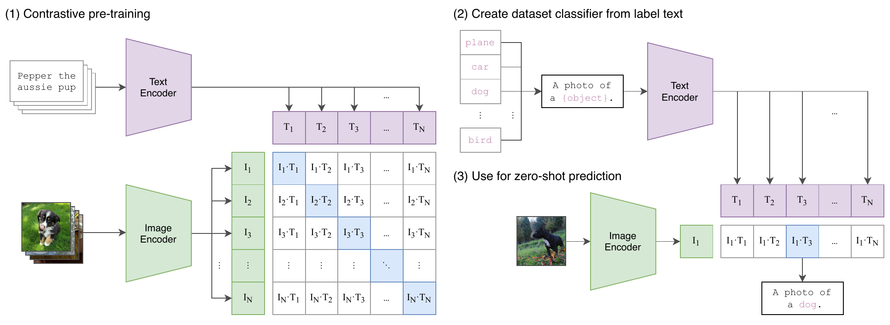
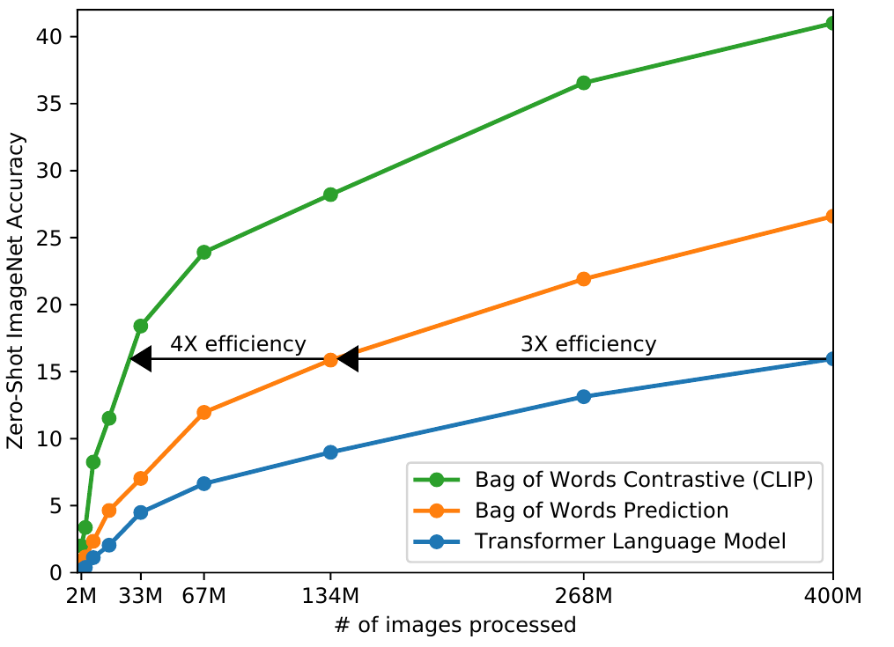

# CLIP

## Executive answer

[Technical report](https://arxiv.org/abs/2103.00020v1) · [Hugging Face: openai/clip-vit-base-patch32](https://huggingface.co/openai/clip-vit-base-patch32)

CLIP learns to place an image and its description near each other in a shared
representation space. Instead of learning one fixed list of class labels, it
can score descriptions supplied at inference time. It is an embedding and
matching model, not a chatbot or a model that generates captions.[^paper]

## Key findings

- Corrected Appendix F to Appendix I for the training recipe.
- Added dataset query balancing, released tokenizer and scale boundaries.
- Added the precise prompt ensemble equation and preprojection probe/robustness distinction.

## Visual overview

<!-- visual-id: V003 -->

<!-- visual-id: V004 -->

Original report crops retain their verified, separately recorded grants. Independently authored SVGs use the repository MIT license. See coverage-audit.md and public/figures/model-studies/clip/SOURCES.md for each inclusion/omission decision. New page browser and export review passed.

## Detailed analysis

[Technical report](https://arxiv.org/abs/2103.00020v1) · [Hugging Face: openai/clip-vit-base-patch32](https://huggingface.co/openai/clip-vit-base-patch32)

CLIP learns to place an image and its description near each other in a shared
representation space. Instead of learning one fixed list of class labels, it
can score descriptions supplied at inference time. It is an embedding and
matching model, not a chatbot or a model that generates captions.[^paper]

## Highlights

- **Language specifies the task.** A class name inside a useful description
  becomes a candidate classifier without fitting a new output head.
- **Match the pair, not every word.** Contrastive learning asks which image
  belongs with which text, avoiding the full caption generation problem.
- **Two independent encoders.** Images and descriptions can be encoded and
  cached separately, which makes the interface useful for retrieval.[^paper][^code]

CLIP is worth studying because it separates visual representation learning
from the downstream label set. Its released encoders also provide a concrete
starting point for generative systems such as [LLaVA](/architectures/models/llava/),
whose report explicitly uses a CLIP vision backbone.[^llava]

Study scope: report and relevant appendices, released configuration, model
card, and targeted inference code inspected. No weights loaded or benchmark
executed. Selected evidence checked October 10, 2026.

## Model in numbers

Representative checkpoint: **CLIP ViT-B/32**, with the original OpenAI
implementation and the corresponding Hugging Face conversion.

| Dimension | Value and scope |
| --- | --- |
| Model size | About **151.3M parameters**, derived from the inspected architecture, including both encoders, projections and learned logit scale. It is dense, not an expert model.[^config][^code] |
| Training data | **400M image and text pairs** in WIT; **32 epochs**. This is 12.8B pair presentations by multiplication, not 12.8B distinct images.[^paper] |
| Input and output | **224 × 224** image crop, **32 × 32** patches, **512** dimensional shared embeddings.[^config][^processor] |
| Text boundary | **77 sequence positions**, including start and end tokens, in released code. The report prose states 76; the study uses the released code's boundary.[^code][^paper] |
| Training compute | ViT-B/32 accelerator hours and FLOPs are **undisclosed** in the inspected report. The published 256 V100 GPUs for 12 days describes the larger ViT-L/14, not this checkpoint.[^paper] |

Parameter count derivation

This is an architecture count, not a loaded checkpoint measurement. With bias
terms included, one attention and FFN block contains
$12d^2+13d$ parameters in the inspected implementation.
The vision encoder has 12 blocks at width 768, its patch convolution,
class and position embeddings, two outer norms and a projection to 512.
The text encoder has 12 blocks at width 512, a 49,408 entry vocabulary,
77 position embeddings, final norm and a projection to 512. Adding the learned
logit scale gives **151,277,313** parameters under these counting assumptions.[^config][^code]

## Two encoders meet in a similarity matrix

An image is resized, center cropped, converted to RGB and normalized. ViT-B/32
turns the crop into a patch sequence and uses the final class representation.
Separately, byte pair tokenization prepares a description; a causal text
Transformer produces its final end token representation. Linear projections
map both representations to the same width.[^code][^processor]

<!-- visual-id: V003 -->

**Figure 1.** Contrastive learning and zero-shot transfer. Radford et al., ICML 2021, Figure 1; cropped, [CC BY 4.0](https://creativecommons.org/licenses/by/4.0/).[^figure-source]

Read Figure 1 from training on the left to inference on the right. The blue
diagonal identifies observed pairs in the batch. At inference, candidate class
descriptions supply reusable text embeddings; the image selects among them.
The branches are independent encoders, not a language decoder cross attending
to image features. For a 224 × 224 crop, the vision path has
$(224/32)^2=49$ patches and one class position, for
**50 encoder positions**. These collapse to one image embedding; they do not
become 50 tokens in a text generation context.[^config][^code]

Both encoders use learned position embeddings, pre normalization residual
attention blocks and a QuickGELU FFN. The vision attention is unrestricted
within the image sequence. The text attention is causal, but its selected
end representation summarizes the preceding description. Causal attention
alone does not make this a next token generation model.[^code]

The released tokenizer raises an error when the start token, text and end
token exceed 77 positions unless truncation is requested. Truncation preserves
an end token in the last position. The implementation selects the end token
using its token ID, which is the highest ID in this vocabulary, not by taking
the largest hidden feature or pooling the sequence.[^code]

## The contrastive objective

For a batch of $N$ matched pairs, let
$u_i$ and $v_i$ be unit
normalized image and text embeddings. The learned positive scale
$\alpha$ sharpens or softens their cosine scores.
The two directions ask an image to identify its text and a text to identify
its image.[^paper]

$$
\begin{aligned}
s_{ij}&=\alpha\,u_i^\top v_j,\\
\mathcal L&=-\frac{1}{2N}\sum_{i=1}^{N}
\left[\log\frac{e^{s_{ii}}}{\sum_j e^{s_{ij}}}
+\log\frac{e^{s_{ii}}}{\sum_j e^{s_{ji}}}\right].
\end{aligned}
\tag{1}
$$

The diagonal identifies the observed pair; other batch pairings provide
negative candidates. Unlike caption prediction, the model need not assign
probability to every word in a caption. The tradeoff is that the learned
output is a compatibility score, not a free form explanation. The
$N\times N$ comparison matrix also makes large batch
training a systems problem; the authors shard similarity computation across
GPUs.[^paper]

## Training the representations

The report trains both encoders from scratch rather than freezing an existing
language or image model. WIT collection uses text queries to cover visual
concepts, using 500,000 queries and collecting up to 20,000 pairs per query.
This encourages broad coverage and approximate query balance; it does not
establish a uniform distribution over real world concepts. WIT itself was not
released. The image augmentation is a
random square crop, while the paired text supplies the language signal.[^paper][^card]

For ViT-B/32, the published supplement's **Appendix I, Tables 18 and 20**, gives Adam with decoupled weight decay, a peak learning
rate of **0.0005**, weight decay **0.2**, **2,000 warmup iterations**, then
cosine decay. The global batch is **32,768 pairs**. Training uses mixed
precision and gradient checkpointing; the temperature is learned and its
effective logit scale is capped at 100 during training.[^paper][^supplement]

The scale in Equation (1) is the exponential of a learned log parameter.
The released inference forward method exponentiates that parameter without
applying the training cap again. A training stabilization rule and an
inference operation are not necessarily the same contract.[^code]

This is contrastive pretraining. There is no instruction SFT or preference
stage in the studied CLIP recipe. Fitting a linear probe later is a downstream
evaluation procedure, not evidence that the released encoder underwent that
training.[^paper]

## Inference and retrieval

For classification, encode descriptions such as a photo of a bicycle,
normalize the candidate text vectors, and compare them with the normalized
image vector. Softmax over the candidate scores yields a distribution over
**that candidate set**, not a calibrated probability that the description is
true in the world. Adding or changing candidate descriptions changes the
classification problem.[^code][^card]

For retrieval, precompute image or text embeddings and rank by cosine
similarity. A search index and its approximate nearest neighbor settings are
separate infrastructure, not part of CLIP's network. There is no autoregressive
generation loop or decoder KV cache in this inference contract.

Prompting matters because a bare label can be ambiguous. The paper uses
task appropriate descriptions and averages normalized representations from
multiple prompts before forming the classifier. Each prompt embedding is
normalized first; their mean is then normalized again to form one class vector.
This is **embedding averaging, not averaging softmax probabilities**.[^supplement]

$$
w_c=\operatorname{normalize}\!\left(\frac{1}{K}\sum_{k=1}^{K}\operatorname{normalize}(g(p_k(c)))\right)
\tag{2}
$$

Here, $p_k(c)$ is one description of class
$c$, $g$ is the text encoder
and $K$ is the number of prompts. The resulting class
vectors can be cached. A useful production lesson is to evaluate the label
wording and candidate set, not just the checkpoint.

## Evidence and its limits

<!-- visual-id: V004 -->

**Figure 2.** A controlled learning-efficiency comparison. Radford et al., ICML 2021, Figure 2; cropped, [CC BY 4.0](https://creativecommons.org/licenses/by/4.0/).[^figure-source]

The horizontal axis in Figure 2 counts **image presentations**, not unique
training images or wall-clock time. The arrows compare progress at the marked
accuracy level; they do not establish a universal 12-fold speedup for every
CLIP configuration. This experiment motivates the contrastive objective,
not a serving-latency claim.[^paper]

These are author reported results, not measurements reproduced here.

| Question | Reported evidence and conditions |
| --- | --- |
| Does the selected checkpoint transfer without an ImageNet classifier fit? | ViT-B/32 obtains **63.2% ImageNet top 1** in Appendix B's zero shot table. Do not substitute the larger ViT-L/14 at 336 pixels, which reports 76.2%.[^paper] |
| Does task wording matter? | Section 3.1.4 reports that a photo template improves ImageNet accuracy by **1.3 percentage points**; using 80 prompt templates adds about 3.5 points. These are the paper's prompting comparisons, not fresh estimates for every variant.[^paper] |
| Is matching more efficient than caption prediction in the tested setup? | Figure 2 compares learning curves: the bag of words baseline learns ImageNet transfer about 3 times faster than the tested caption model, and contrastive matching about 4 times faster again. This is a controlled research comparison, not a universal serving latency claim.[^paper] |

Zero shot means no task specific classifier training, not that the researchers
never used validation feedback. The report acknowledges repeated validation
queries during development. Its overlap analysis uses a separate duplicate
detector and finds small aggregate shifts in tested datasets, but unknown
detector recall prevents this from proving absence of contamination.[^paper]

Linear probes and robustness answer different questions

The supplement's linear probe protocol uses **features before the shared
space projection** for CLIP ViTs, then fits regularized logistic regression
with validation selected hyperparameters. For ViT-B/32 that feature has width
768, rather than the 512 dimensional matching embedding. It is a supervised
feature evaluation, not the zero shot classifier above.[^supplement]

In a separate **ViT-L/14 at 336 pixels** experiment, fitting an ImageNet
linear probe raises ImageNet accuracy from 76.2% to 85.4%, or 9.2 percentage
points, while average accuracy on the studied out of distribution datasets
slightly declines. This is counterevidence to treating better in distribution
accuracy as automatically better robustness. It is not a measurement of the
selected ViT-B/32 checkpoint.[^supplement]

## Limitations and lessons

CLIP can miss counts, subtle categories and truly unfamiliar distributions.
Its card documents demographic and category design biases and limits intended
use to settings with appropriate evaluation. Internet scale does not remove
these issues, and a retrieval score is not grounded reasoning or reliable OCR
transcription.[^card][^paper]

The transferable idea is **a task interface learned through language**, with
efficiently reusable independent representations. A generative VLM must solve
another problem: preserve useful visual details while feeding a language
generator. Continue with [BLIP-2](/architectures/models/blip-2/) for a learned
query bottleneck, or [LLaVA](/architectures/models/llava/) for visual patches
inside a decoder's sequence.

## Counterevidence and uncertainty

WIT is not publicly released. B/32 compute is not disclosed; larger encoder compute and accuracy must not be transferred. Candidate sets and templates change zero shot predictions.

## Implications

Treat embedding retrieval as a distinct interface from generative image understanding.

## Open questions and future research

- ViT-B32specific trainingFLOPs oracceleratorhours are notdisclosed.
- No checkpoint orretrievalbenchmarkexecuted.

## What changed in this revision

- Corrected Appendix F to Appendix I for the training recipe.
- Added dataset query balancing, released tokenizer and scale boundaries.
- Added the precise prompt ensemble equation and preprojection probe/robustness distinction.
- Compared report, appendices and targeted source code against every major technique axis in coverage-audit.md.
- Preserved prior source, claim and run history; appended new evidence records.
- New revision3 page validation and browser/export gates passed root QA; no model benchmark was executed.

## Sources

[^paper]: Alec Radford et al. [Learning Transferable Visual Models From Natural Language Supervision](https://arxiv.org/html/2103.00020v1), 2021, sections 2, 3.1.4, 5 and 6. Architecture and evaluation variants are kept distinct.
[^code]: OpenAI. [CLIP implementation](https://github.com/openai/CLIP/tree/d05afc436d78f1c48dc0dbf8e5980a9d471f35f6/clip), inspected October 10, 2026. Targeted reading of VisionTransformer.forward, ResidualAttentionBlock, CLIP.encode_text, CLIP.forward, the image transform and tokenize; no execution.
[^config]: OpenAI. [ViT-B/32 configuration](https://huggingface.co/openai/clip-vit-base-patch32/blob/3d74acf9a28c67741b2f4f2ea7635f0aaf6f0268/config.json), inspected October 10, 2026.
[^processor]: OpenAI. [ViT-B/32 image preprocessing](https://huggingface.co/openai/clip-vit-base-patch32/blob/3d74acf9a28c67741b2f4f2ea7635f0aaf6f0268/preprocessor_config.json), inspected October 10, 2026.
[^card]: OpenAI. [CLIP model card](https://github.com/openai/CLIP/blob/d05afc436d78f1c48dc0dbf8e5980a9d471f35f6/model-card.md) and [MIT license](https://github.com/openai/CLIP/blob/d05afc436d78f1c48dc0dbf8e5980a9d471f35f6/LICENSE), inspected October 10, 2026. Public weights and inference code are released; WIT is not. Licensing this release does not license arbitrary training images or paper artwork.
[^llava]: Haotian Liu et al. [Visual Instruction Tuning](https://arxiv.org/html/2304.08485v2), 2023, section 4.1, using CLIP ViT-L/14 as the vision backbone.

[^figure-source]: Alec Radford et al. [Learning Transferable Visual Models From Natural Language Supervision](https://proceedings.mlr.press/v139/radford21a.html), ICML 2021, PMLR 139, Figures 1 and 2. Extracted from the [published PDF](https://proceedings.mlr.press/v139/radford21a/radford21a.pdf), pages 2 and 3, at 300 dpi. Cropped to artwork; diagram and data unchanged. PMLR's [publication agreement](https://proceedings.mlr.press/pmlr-license-agreement.pdf), clauses 2 and 3, grants [CC BY 4.0](https://creativecommons.org/licenses/by/4.0/) with attribution and a link to the original publication. This permission is separate from CLIP's code and weight terms.

[^supplement]: Alec Radford et al. [Published supplementary material](https://proceedings.mlr.press/v139/radford21a/radford21a-supp.pdf), ICML 2021, Appendix A.3 on linear probes, Appendix B on zero shot evaluation and prompt ensembles, Appendices D and H.5 on robustness, and Appendix I, Tables 18 and 20, on training hyperparameters. Inspected October 10, 2026.

## Presentation verification

Historical revision2 validation/browser evidence is retained in state/presentation-qa-revision-2.json and run R005. It does not prove the new revision3 page. Local new SVG previews were inspected where added; full integrated desktop/mobile/theme/focus and export checks passed.

## Revision 3 presentation verification

106 automated tests, zero Astro diagnostics, the static build and all 43 docs lint checks passed. The collection passed 81 fresh browser views; this page was checked at 1440px light, 390px light and 320px dark, with desktop focus, active family navigation, caption order, anchors, image decoding, resource cards and no page overflow. Complete source figures fit desktop, while narrow frames support keyboard panning and full-size access. Search and Markdown/MDX exports preserve citations, figures and source links. All 66 model figure renders were inspected, with full-size review of new dense diagrams. See state/presentation-qa.json for exact page checksums and evidence. No model benchmark was reproduced. Existing bundler and redirect warnings remain.
