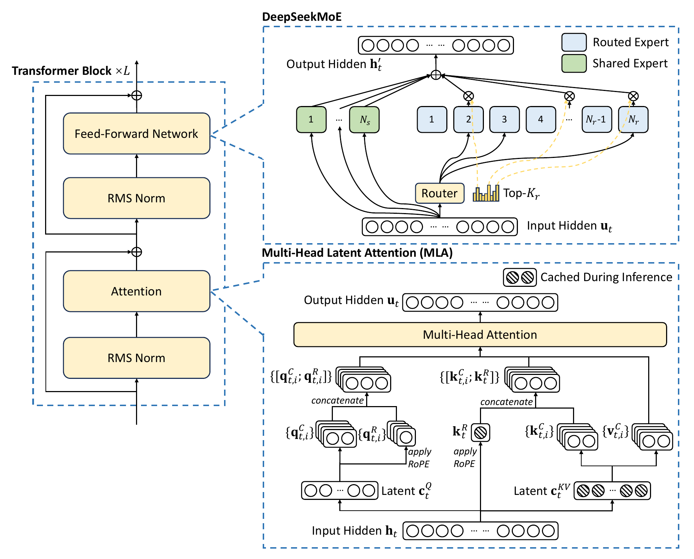
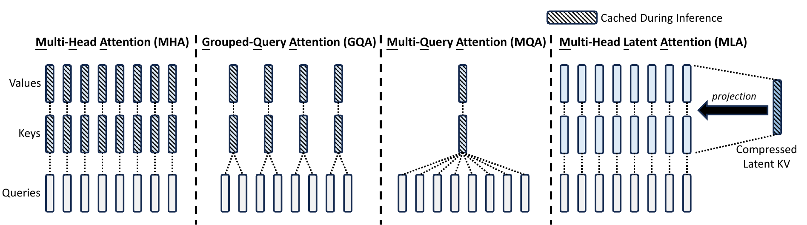

## Executive answer

[Technical report](https://arxiv.org/pdf/2405.04434v1) · [Hugging Face: deepseek-ai/DeepSeek-V2](https://huggingface.co/deepseek-ai/DeepSeek-V2)

DeepSeek-V2 makes a large language model cheaper in two different places: it compresses the history attention reads, and selects only a small part of its expert capacity for each token. These are separate savings, in attention state and in feed forward computation, not one trick that makes every cost disappear.[^report]

## Visual overview

Replaced the repetitive cache card with the licensed source attention comparison; added absorbed score and output equations, query compression versus KV caching, assignment dropping exceptions and balanced compute versus traffic. Source crops and native SVGs were inspected as assets. Fresh integrated HTML/mobile/theme/export verification passed.

## Key findings

- **Store a latent memory instead of full keys and values.** Multi-head Latent Attention, or MLA, preserves a compact representation from which attention can operate, reducing the ideal cache without sharing all heads into one.[^report]
- **Use many small experts selectively.** Two shared experts supply common computation; six routed experts selected from 160 supply token specific capacity in each expert layer.[^config]
- **Design around communication as well as arithmetic.** Routing limits the devices a token visits; balancing losses and training token dropping address bottlenecks that sparse parameter counts alone miss.[^report]

For builders, its useful lesson is that model quality, active computation, cache memory, and communication should be designed together. Public weights and configuration make that design inspectable; they do not disclose the complete training corpus or reproduce the authors' optimized serving system.[^repo]

Study scope: the May 2024 report, relevant attention appendices, official base configuration, licenses, and targeted attention code. No checkpoint executed. Evidence checked October 10, 2026.

## Detailed analysis

### Model in numbers

Representative checkpoint: **DeepSeek-V2 Base**, not V2 Lite or later V2.5.

| Dimension | Value and scope |
| --- | --- |
| Parameters | 236B total; 21B active per token as reported, including the common network and selected expert computation.[^report] |
| Pretraining | 8.1T training tokens; the report does not establish an equally large count of unique documents.[^report] |
| Alignment | 1.5M SFT instances: 1.2M helpfulness and 0.3M safety; RL rollout volume undisclosed.[^report] |
| Compute | 172.8K H800 GPU hours per trillion training tokens in the reported setup; not a fully itemized project cost.[^report] |
| Context | Initial training at 4K; extension training at 32K; reported retrieval evaluation to 128K. Configured maximum: 163,840 positions.[^report][^config] |

### Architecture

Tokenization produces integer IDs, followed by a 5,120 wide embedding stream. Sixty decoder blocks apply normalized causal MLA and normalized feed forward computation with residual paths. The first block uses a dense FFN; the remaining blocks use experts. An untied output head predicts the next token.[^config][^code]

<!-- visual-id: V005 -->

**Figure 1.** MLA and shared plus routed experts. Reproduced from the release documentation's Figure 2, under [MIT terms](/figures/model-studies/deepseek-v2/NOTICE.md).[^architecture]

[Figure 1](#figure-1) expands one residual block into its two distinctive operations. At upper right, shared experts always contribute while the router selects other experts. At lower right, the hatched symbols identify the compact content latent and positional key retained by optimized MLA, not every expanded head specific key and value.[^architecture]

### How MLA compresses history

Ordinary attention keeps per head keys and values for every past token. MLA instead jointly compresses content keys and values into a latent vector. Let the hidden state be $h_t\in\mathbb{R}^{5120}$ and the normalized latent be $c_t\in\mathbb{R}^{512}$. Ignoring normalization in this compact notation, the content paths are:[^report]

$$
c_t=W^{DKV}h_t,\qquad k_t^C=W^{UK}c_t,\qquad v_t^C=W^{UV}c_t
\tag{1}
$$

The important inference observation is associativity. For head $i$, absorb the key up projection into the current content query. The score for current position $t$ and cached position $j$ becomes:[^mla]

$$
\ell_{t,j,i}=\frac{((W_i^{UK})^{\top}q_{t,i}^{C})^{\top}c_j+(q_{t,i}^{R})^{\top}k_j^{R}}{\sqrt{128+64}},\qquad a_{t,j,i}=\operatorname{softmax}_{j\le t}(\ell_{t,j,i})
\tag{2}
$$

After attention, mix the cached latents first, then apply the value and output projections. With $W_i^O$ denoting the output projection's head slice:[^mla]

$$
u_t=\sum_i W_i^O W_i^{UV}\left(\sum_{j\le t}a_{t,j,i}c_j\right)
\tag{3}
$$

The fixed projection products can be prepared independently of the token history. The model therefore need not reconstruct all old head specific keys and values merely to read them. This algebra does not remove the query's search over past positions; it changes the representation that search reads.[^mla]

RoPE complicates this because position dependent rotations do not commute freely with the content projections. V2 therefore uses separate positional queries and a shared positional key. The attention score combines a content dot product with a positional dot product. Only the 512 dimensional content latent and the 64 dimensional positional key must be retained in the ideal cache. Separately, queries use a 1,536 dimensional low rank latent to reduce training activation memory; that query latent is not another per token history cache.[^mla][^config]

<!-- visual-id: V006 -->

**Figure 2.** Different ways to retain attention history. Reproduced intact from V2 documentation, Figure 3, under [MIT terms](/figures/model-studies/deepseek-v2/NOTICE.md).[^comparison]

[Figure 2](#figure-2) contrasts sharing KV heads with jointly compressing KV content. It is a simplified content view: the separate positional key required by V2's complete MLA is shown in [Figure 1](#figure-1), and included in the count below.[^comparison][^mla]

$$
N_{\mathrm{cache}}=(512+64)\times60=34{,}560\quad\text{elements per token}
\tag{4}
$$

Equation (4) is a local derivation from the released dimensions, excluding metadata, alignment, backend workspaces, and quantization overhead. Two byte storage would imply 69,120 bytes per token across layers, not the full model memory. The authors' headline cache reduction also compares to a different model and serving setup; it is not simply this calculation.[^config][^report]

Why the released attention implementation needs a caveat

The inspected `DeepseekV2Attention.forward` expands the latent through `kv_b_proj`, constructs `key_states` and `value_states`, and passes those expanded states to `past_key_value.update`. This path demonstrates MLA's network computation, but does not implement the ideal latent only cache described above. Kernel and backend selection therefore matter before quoting memory savings for an actual deployment.[^code]

### Fine grained experts and hardware constraints

The router scores 160 candidate experts, while two shared experts always run. Finer experts give the router more combinations for a fixed active budget; shared experts aim to avoid relearning common knowledge in every routed expert. In this checkpoint each expert has an intermediate width of 1,536.[^report][^config]

Sparse routing is not free. Expert weights are distributed across devices, and tokens must travel to the selected experts. V2 limits each token to at most three expert device groups. Expert, device, and communication balancing losses discourage collapsed routing and overloaded devices. With capacity factor 1.0, training may drop low affinity expert assignments on an overloaded device. Ten percent of training sequences avoid dropping, and evaluation never drops assignments. Device compute balance and communication balance are separate: evenly counted expert work does not ensure evenly received dispatch traffic. These are expert assignment policies, not deletion of tokens from the language sequence.[^routing]

### Training and alignment

The pretraining corpus combines sources with cleaning and quality filtering, increasing Chinese coverage relative to the earlier DeepSeek 67B corpus. The disclosed recipe uses AdamW, a peak learning rate of 0.00024, warmup followed by step decays, and a batch that grows from 2,304 to 9,216 sequences. Training uses pipeline, expert, and ZeRO data parallelism on H800 hardware.[^report]

After pretraining, YaRN extends the positional range. Additional training uses 1,000 steps at 32K sequence length, rather than training every example at 128K. SFT then uses the 1.5M instance dataset for two epochs. The report distinguishes the SFT checkpoint from the later RL checkpoint.[^report]

GRPO samples a group of responses, measures their rewards, and uses relative group scores instead of a learned critic baseline. V2 first aligns reasoning, then combines helpfulness, safety, and rule based rewards for preference alignment. The report describes reward models initialized from the SFT model, with code feedback and mathematical labels used to construct preferences. It does not reveal a complete reproducible reward dataset or all mixture coefficients.[^report]

### Inference and evidence

The base checkpoint is a text completion model, not automatically the chat RL model. Tokenizer and stop conventions belong to the selected artifact. Prefill computes states for the prompt; decoding extends the causal history one token at a time. MLA still attends over a growing prefix: cache compression is not constant memory attention.[^config][^code]

The authors' serving result uses FP8 weights and an average six bit KV cache on eight H800 GPUs, with prompt and output length distributions drawn from the earlier deployed service. Its reported 5.76 times maximum generation throughput relative to DeepSeek 67B includes model and system changes. It is not single user latency, nor a hardware independent MLA speedup.[^report]

The more targeted attention evidence is Appendix C. The authors compare internal MoE models with MLA and MHA at approximately 16B and 250B total scales, trained on 1.33T and 420B tokens respectively. Large model MMLU accuracy rises from 57.5 to 59.0 in their five shot setup while cache elements fall substantially. The parameter budgets and active counts differ, including 25.0B versus 21.5B active at the larger scale, and these are not the final released V2 checkpoint.[^report]

Alignment also has tradeoffs. In Table 3, HumanEval pass@1 rises from 76.8 for SFT to 81.1 for RL, while five shot MMLU falls from 78.4 to 77.8. These author reported results show why preference optimization should not be described as improving every capability.[^report]

### Limits and transferable lessons

The corpus, full training code, and optimized serving environment are not reproduced by the model release. Retrieval success at 128K does not guarantee robust reasoning over arbitrary 128K documents. Public weights use the DeepSeek Model License with use restrictions; repository code uses MIT. Neither license establishes rights to redistribute the underlying training data.[^license][^repo]

The general lesson is to separate **stored capacity**, **active computation**, **retained history**, and **communication**. DeepSeek-V2 changes all four budgets in specific ways. Read [DeepSeek-V3](/architectures/models/deepseek-v3/) next for routing without the main balancing auxiliary loss, and [Transformer Foundations](/architectures/foundations/) for the attention and residual contracts beneath these changes.

## Counterevidence and uncertainty

The page preserves source-specific model/recipe/harness conditions and contrary results. [Coverage audit](coverage-audit.md) records each essential technique, source locator, addition and justified omission. No checkpoint execution or independent speed/benchmark reproduction was performed.

## Implications

Replaced the repetitive cache card with the licensed source attention comparison; added absorbed score and output equations, query compression versus KV caching, assignment dropping exceptions and balanced compute versus traffic.

## Open questions and future research

Fresh integrated browser and export checks for revision 3 passed. Report omissions and runtime reproduction gaps remain scoped in the coverage audit rather than filled with estimates.

## What changed in this revision

Revision 3 broadens mechanism depth rather than adding decorative figure quotas. Complete report and relevant appendix/code review, exact source locators, independent visual inspection and an adversarial protocol/number pass are recorded below.

## Sources

[^report]: DeepSeek-AI. [DeepSeek-V2: A Strong, Economical, and Efficient Mixture-of-Experts Language Model](https://arxiv.org/pdf/2405.04434v1), May 7, 2024. Sections 2 to 4; Appendices B, C and F. Original report version inspected October 10, 2026.

[^config]: DeepSeek-AI. [DeepSeek-V2 Base configuration](https://huggingface.co/deepseek-ai/DeepSeek-V2/blob/4461458f186c35188585855f28f77af5661ad489/config.json), inspected October 10, 2026.

[^code]: DeepSeek-AI. [DeepSeek-V2 modeling implementation](https://huggingface.co/deepseek-ai/DeepSeek-V2/blob/4461458f186c35188585855f28f77af5661ad489/modeling_deepseek.py), `DeepseekV2Attention.forward`, `DeepseekV2DecoderLayer`, and `DeepseekV2ForCausalLM`; same artifact revision. No runtime test.

[^repo]: DeepSeek-AI. [DeepSeek-V2 release repository](https://github.com/deepseek-ai/DeepSeek-V2/tree/ec98ee3cbffc32104cd55dba8af884b3d772602a); release artifacts and code license.

[^license]: DeepSeek-AI. [DeepSeek Model License](https://github.com/deepseek-ai/DeepSeek-V2/blob/ec98ee3cbffc32104cd55dba8af884b3d772602a/LICENSE-MODEL), Section III and Attachment A; inspected October 10, 2026.

[^architecture]: DeepSeek-AI. [DeepSeek-V2 release documentation](https://raw.githubusercontent.com/deepseek-ai/DeepSeek-V2/ec98ee3cbffc32104cd55dba8af884b3d772602a/deepseek-v2-tech-report.pdf), Figure 2, page 5. Reproduced intact with surrounding prose and caption removed. The repository [MIT grant](https://github.com/deepseek-ai/DeepSeek-V2/blob/ec98ee3cbffc32104cd55dba8af884b3d772602a/LICENSE-CODE) explicitly covers associated documentation; it is not inferred from the weights license.

[^mla]: DeepSeek-AI. [DeepSeek-V2 report](https://arxiv.org/pdf/2405.04434v1), Sections 2.1.2–2.1.3, Equations (9)–(18), and Appendix B. The absorbed score and output above restate the headwise computation; normalization is suppressed in Equation (1), not removed from the model.

[^routing]: DeepSeek-AI. [DeepSeek-V2 report](https://arxiv.org/pdf/2405.04434v1), Sections 2.2.2–2.2.3 and 3.1.2: device limited routing, three balancing terms, capacity and no dropping exceptions.

[^comparison]: DeepSeek-AI. [V2 release documentation](https://raw.githubusercontent.com/deepseek-ai/DeepSeek-V2/ec98ee3cbffc32104cd55dba8af884b3d772602a/deepseek-v2-tech-report.pdf), Figure 3, PDF page 7. The same repository [MIT documentation grant](https://github.com/deepseek-ai/DeepSeek-V2/blob/ec98ee3cbffc32104cd55dba8af884b3d772602a/LICENSE-CODE) applies. Entire artwork, labels and legend retained; only surrounding prose and caption removed.

## Revision 3 presentation verification

106 automated tests, zero Astro diagnostics, the static build and all 43 docs lint checks passed. The collection passed 81 fresh browser views; this page was checked at 1440px light, 390px light and 320px dark, with desktop focus, active family navigation, caption order, anchors, image decoding, resource cards and no page overflow. Complete source figures fit desktop, while narrow frames support keyboard panning and full-size access. Search and Markdown/MDX exports preserve citations, figures and source links. All 66 model figure renders were inspected, with full-size review of new dense diagrams. See state/presentation-qa.json for exact page checksums and evidence. No model benchmark was reproduced. Existing bundler and redirect warnings remain.
