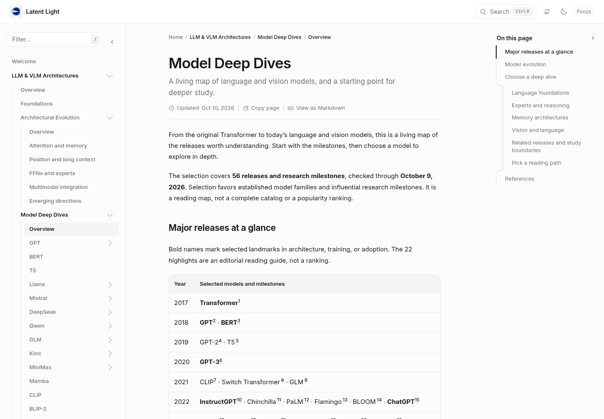

# Report-backed family coverage expansion

## Executive answer

The catalog now contains **41 full model studies**, with **16 additions** across Qwen, GLM, Gemma, OpenAI and MiniMax. Each addition has an original report link, a named representative Hugging Face artifact, defining highlights, scoped numbers, mechanisms, disclosed training, inference state and evidence limitations. Each also has a full source-grounded canonical report. This is a curated learning collection, not an exhaustive or popularity-ranked release census.[^local]

## Visual overview

<!-- visual-id: V001 -->

**Figure 1.** Family navigation preserves every individual study route. This actual UI capture illustrates integration, not model ancestry.[^local]

## Key findings

- New Qwen studies cover a strong dense recipe, visual windows and time coordinates, million-token DCA, then recurrence, sparse lookup, gated residual paths and n-gram memory.
- GLM now traces original infilling and 130B stability, 9B tool interfaces, 4.5 expert reasoning, and 4.1V/4.5V visual representation with curriculum RL.
- Gemma covers the original 7B/2B attention contrast, Gemma 2's normalization, attention scores and distillation, and Gemma 4's input interfaces and cache-aware drafting. Existing Gemma 3 remains.
- OpenAI's gpt-oss study includes 120b and 20b, MXFP4 experts, mixed attention, learned sinks, reasoning effort and Harmony tool handoffs.
- MiniMax 01, M1, M2 and M3 form a nonmonotonic design history: hybrid recurrence, reasoning RL, full-attention agents, then learned sparse lookup. No one memory design is presented as best for every task.

Each bullet summarizes the linked inspected report/artifact studies below; precise editions, source locators, uncertainty and counterevidence remain in those reports.

## Detailed analysis

### Added studies

| Study and full canonical report | Primary resource | Representative artifact | Numbered figures |
| --- | --- | --- | --- |
| [Qwen2.5](../qwen2-5/report.md) | [Exact report](https://arxiv.org/pdf/2412.15115v2) | [Model repository](https://huggingface.co/Qwen/Qwen2.5-7B-Instruct) | 1 |
| [Qwen2.5-VL](../qwen2-5-vl/report.md) | [Exact report](https://arxiv.org/pdf/2502.13923v1) | [Model repository](https://huggingface.co/Qwen/Qwen2.5-VL-7B-Instruct) | 1 |
| [Qwen2.5-1M](../qwen2-5-1m/report.md) | [Exact report](https://arxiv.org/pdf/2501.15383v1) | [Model repository](https://huggingface.co/Qwen/Qwen2.5-7B-Instruct-1M) | 2 |
| [Qwen3.8-Flash-Next](../qwen3-8-flash-next/report.md) | [Exact report](https://arxiv.org/pdf/2608.30320v1) | [Model repository](https://huggingface.co/Qwen/Qwen3.8-Flash-Next) | 3 |
| [GLM and GLM-130B](../glm/report.md) | [Exact report](https://arxiv.org/pdf/2103.10360v2) | [Model repository](https://huggingface.co/zai-org/glm-10b) | 3 |
| [GLM-4](../glm-4/report.md) | [Exact report](https://arxiv.org/pdf/2406.12793v2) | [Model repository](https://huggingface.co/zai-org/glm-4-9b-chat) | 2 |
| [GLM-4.5](../glm-4-5/report.md) | [Exact report](https://arxiv.org/pdf/2508.06471v1) | [Model repository](https://huggingface.co/zai-org/GLM-4.5) | 4 |
| [GLM-4.1V and GLM-4.5V](../glm-4-v/report.md) | [Exact report](https://arxiv.org/pdf/2507.01006v3) | [Model repository](https://huggingface.co/zai-org/GLM-4.1V-9B-Thinking) | 3 |
| [Gemma](../gemma/report.md) | [Exact report](https://arxiv.org/abs/2403.08295v4) | [Model repository](https://huggingface.co/google/gemma-7b) | 2 |
| [Gemma 2](../gemma-2/report.md) | [Exact report](https://arxiv.org/abs/2408.00118v3) | [Model repository](https://huggingface.co/google/gemma-2-9b) | 2 |
| [Gemma 4](../gemma-4/report.md) | [Exact report](https://arxiv.org/abs/2607.02770v2) | [Model repository](https://huggingface.co/google/gemma-4-31B-it) | 3 |
| [gpt-oss](../gpt-oss/report.md) | [Exact report](https://arxiv.org/pdf/2508.10925v1) | [Model repository](https://huggingface.co/openai/gpt-oss-120b) | 2 |
| [MiniMax 01](../minimax-01/report.md) | [Exact report](https://arxiv.org/pdf/2501.08313v1) | [Model repository](https://huggingface.co/MiniMaxAI/MiniMax-Text-01) | 1 |
| [MiniMax M1](../minimax-m1/report.md) | [Exact report](https://arxiv.org/pdf/2506.13585v1) | [Model repository](https://huggingface.co/MiniMaxAI/MiniMax-M1-80k) | 3 |
| [MiniMax M2 Series](../minimax-m2/report.md) | [Exact report](https://arxiv.org/pdf/2605.26494v2) | [Model repository](https://huggingface.co/MiniMaxAI/MiniMax-M2.7) | 2 |
| [MiniMax M3 and Sparse Attention](../minimax-m3/report.md) | [Exact report](https://arxiv.org/pdf/2606.13392v2) | [Model repository](https://huggingface.co/MiniMaxAI/MiniMax-M3) | 1 |

### Why these are distinct studies

The selection prioritizes explainable technical changes, not every checkpoint name. Qwen2.5-VL is separate from Qwen2.5 because visual geometry and temporal position are distinct input contracts; Qwen2.5-1M has a long-context training and serving mechanism. GLM-130B is studied beside original GLM with its access and normalization changes explicit. GLM-4.1V/4.5V and MiniMax M2 generations share report-level evidence, so related variants are scoped inside a study rather than replicated as thin pages.

Report size labels, stored tensors and active per-token paths remain separate. A context configuration does not establish useful quality at that length. No total training cost is inferred from GPU count alone; no processed-token budget is called unique data. Full-history, selected sparse and recurrent states have different storage and read costs. These distinctions shape the explanations and number tables.

### Skeptical review changed the MiniMax/OpenAI drafts

- [gpt-oss](../gpt-oss/report.md): Cross-review verified head/sink dimensions, exact activation clamps and sigmoid scale, policy/tool continuation reasoning retention, post-training quantization and scoped distillation evidence. Official Harmony and reference implementation re-inspected; active tool loops preserve current reasoning while completed old turns remove it.
- [minimax-01](../minimax-01/report.md): Cross-review corrected Global Router to actual cross-EP-group dispatch, sampling-weight transitions and unresolved vision token accounting; added five-phase short/long SFT-DPO-RL schedule. Original methods and Table 7 directly re-inspected.
- [minimax-m1](../minimax-m1/report.md): Cross-review added 16 off-policy update rounds, 40K to 80K staged curriculum, difficulty filtering, synthetic-reasoning downsampling, longer negative-sample imbalance and combined sample/token normalization. Core CISPO equation is explicitly not the entire 80K recipe. Online GenRM length-bias recalibration and rule-first task curriculum added after direct section inspection.
- [minimax-m2](../minimax-m2/report.md): Cross-review corrected total-parameter attribution and hybrid-design scope, jointly learned routing shifts with reduced—not eliminated—balancing loss. Added human-steered operational self-evolution and scoped 22-competition, three-24-hour-trial MLE evaluation, not autonomous weight self-improvement.
- [minimax-m3](../minimax-m3/report.md): Cross-review checked detached KL, local-block slot budget, 109B experiment versus 428B release, quadratic index cost and kernel-only speedups. Actual processing wrapper confirms visual token counts. Added seven configured MTP modules and smaller-pilot block-size/sink/value-head ablations without backend claims.

### Purposeful visual coverage

The 16 additions contain 35 numbered figures: 28 original report crops and seven independent explanations. Original architecture figures are used wherever the inspected report supplies a useful one. Native maps cover missing contracts rather than trace the authors' artwork. No AI image generation was needed for these technical figures.[^local]

CC BY report grants are kept separate from model and code licenses. Integrated photos, GUI examples or illustrations are separately bounded when their origin is not established. Restricted report excerpts have specific public research/criticism assessments, not invented license grants. Exact PDF hashes, crop rectangles, original figure/page and notices are recorded in each model's source and visual files. Public assets contain bounded figures, not full reports.

### Verification

122 site tests pass, zero Astro diagnostics, 59-page static build and 59-doc lint clean. Fresh browser regression checks cover all 41 model pages plus the catalog and Foundations at 1440 px light, 390 px light and 320 px dark (129 views), reduced motion, desktop focus, active family navigation, figure order, loaded images and local anchors; narrow figures remain keyboard-pannable and link to full-size originals. All 41 Markdown/MDX exports and both agent manifests checked; representative search queries resolve. All 35 new desktop figure renders received manual contact-sheet review; dense focus/mobile views and resource-card/catalog layout received additional manual inspection. A final M3 citation cleanup passed another three browser views and all export/search checks. Existing bundler directive and philosophy-redirect indexing warnings remain. No model execution or benchmark reproduction.[^local]

The 28 original crops were manually checked against source pages by their researcher; the parent inspected corrected MiniMax/GPT crops again. All 35 desktop figure renders were manually reviewed after build. Dense Qwen focus, GLM dark-mobile, Gemma MTP mobile, M3 resource cards and catalog sidebar views were additionally inspected. These are presentation checks, not evidence of model accuracy or serving performance.

## Counterevidence and uncertainty

Qwen3.8-Next principally discloses a backbone and pretraining architecture, not the whole released multimodal alignment recipe. MSA experiments use 109B models; public M3 is 428B. Their 3T budgets and kernel measurements are not transferred to released M3. Gemma 4 front-end choices are separate variants, not universal 31B capabilities. GLM's early bidirectional visible-context mask is not assigned to later causal GLM-4.

Not every named release has been converted into a page. Official Qwen3-Next, Qwen3.5 and Gemma 3n documentation was identified, but a matching generation-wide formal technical report was not established in this bounded audit. This is not proof that none exists; Qwen3.5-Omni has a differently scoped report. GLM-4.6V additions in later GLM-V editions remain outside the selected v3 study. Existing Gemma 3, Qwen3, Qwen2-VL, Qwen3-VL and GLM-5 are preserved.

Publisher benchmark results depend on checkpoints, harnesses, sampling, tools, judges and compute. Reported latency reductions retain their kernel versus end-to-end and hardware scopes. Open weights do not establish fully open training data or code. Public code was read as evidence but never executed; weights were not downloaded.

## Implications

Readers can compare answers to the same engineering questions: where capacity lives, what history is retained, how visual evidence becomes tokens, how reward data teaches behavior, and what serving must preserve. Family groups improve navigation without changing stable URLs. A new generation gets a study when evidence adds a distinct lesson; it does not overwrite older historical contracts.

## Open questions and future research

- Revisit Qwen2, Llama 2, BLOOM and OLMo after establishing generation, report and artifact scope.
- Explore documentation-based studies for Qwen3-Next, Qwen3.5 and Gemma 3n without inventing a complete formal report.
- Select a later GLM-V edition before adding GLM-4.6V coverage.
- Independently measure serving, cache, prefill/decode and reward-model failure modes only under a separately authorized runtime workflow.
- Refresh licenses and reuse assessments when artifacts, publication context or commercial use change. No automatic update job is configured.

## Sources

Primary evidence and claim-local citations are preserved in every full study and its state/sources.jsonl. Integration-source records distinguish main-agent inspection from the three authorized family agents. Local inventory and actual QA artifacts support catalog counts and presentation claims; they are not evidence of model performance.

[^local]: Local [public catalog source](../../../../src/content/docs/architectures/models/index.mdx), [browser checks](browser-qa.json), validation output (`validation.log`, local-only; checksum retained in `state/sources.jsonl`), per-model visual/source ledgers and [coverage register](../coverage.md). Inspected 2026-10-10; no remote publication claim.
