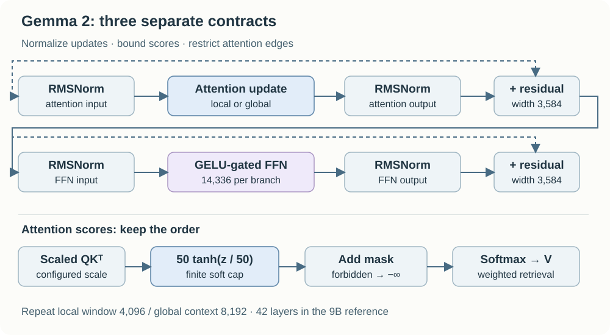
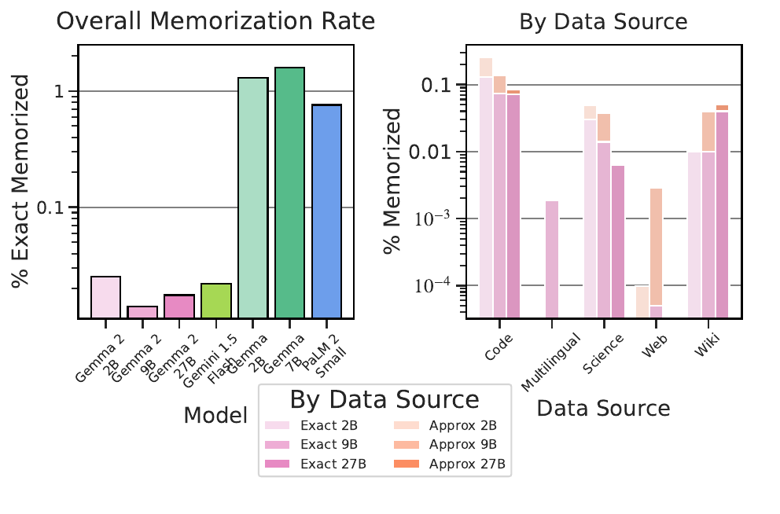

# Gemma 2

## Executive answer

9B pretrained recipe and implementation; scoped2B and27B contrasts. This is a full generation study grounded in inspected public sources. It distinguishes mechanisms, measurements, calculations and remaining omissions. Browser/export integration review passed; no model execution is claimed.

[Technical report](https://arxiv.org/abs/2408.00118v3) · [Representative model repository](https://huggingface.co/google/gemma-2-9b)

## Visual overview

The architecture view and original report excerpts are integrated into the explanation below rather than duplicated. All essential crop labels and native SVG rasters were manually inspected. Responsive presentation and agent exports passed the separate integration gate.

## Key findings

- Gemma 2 9B has 42 layers, residual 3584,16 query and 8 KV heads width 256.
- Report counts sum to approximately 9.242B total 9B weights.
- 9B trains on 8T tokens with 4096 TPUv 4 chips;2B uses 2T and 27B13T.
- 2B/9B pretraining minimizes teacher/student distributional cross-entropy;27B is not distilled.

## Detailed analysis

Gemma 2 asks a practical question: can a small deployed model learn more from each training position, rather than improve only by seeing more tokens? It pairs teacher-distribution training for its smaller sizes with a decoder designed around predictable state and numerical ranges. The value is the combination, not one exotic new block.[^report][^card]

## Highlights

- **Distillation is the pretraining target, not only a final compression step.** The 2B and 9B students learn teacher probabilities; 27B follows a different, non-distilled pretraining path.[^report]
- **Local and global layers alternate.** A 4,096-token local window saves state in half the stack; global layers still retain full context.[^config]
- **Soft caps are computational semantics.** Attention logits and vocabulary logits are bounded separately. A backend that omits the transform is implementing a different forward pass.[^code]
- **Public weights have specific terms.** Gemma Terms apply to weights; Apache 2.0 inference code and CC BY 4.0 report figures are separate grants.[^card][^terms][^report]

Scope: **9B pretrained decoder and training recipe**, with 2B internal distillation ablations and 27B differences explicitly marked. Report v3, official reference configurations and Transformers v4.57.1 attention/normalization/cache paths inspected October 10, 2026. Gated weight configuration not accessed; no checkpoint or benchmark executed.

## Model in numbers

Representative checkpoint: **google/gemma-2-9b**.

| Dimension | Value and scope |
| --- | --- |
| Total weights | 8.324B non-embedding plus 0.918B embeddings; **9.242B** derived total[^report] |
| Pretraining exposure | 8T tokens for 9B; 2B uses 2T, 27B uses 13T; not unique-corpus sizes[^report] |
| Hardware | 4,096 TPUv4 chips for 9B; full-run duration and FLOPs undisclosed[^report] |
| Decoder | 42 layers, width 3,584; sixteen query heads and eight KV heads, each width 256[^config] |
| Attention span | 8,192 context; alternating 4,096 local windows and full-context layers[^config] |
| FFN branch | 14,336 per gate/value branch in the official 9B reference; report Table 1 lists 28,672; executable branch width is the implementation contract[^config][^report] |

## Architecture: distinct constraints at distinct points

The decoder embeds text, repeats forty-two residual blocks, then normalizes and predicts vocabulary logits. Each attention and FFN update is normalized both before its computation and after it, before residual addition. The FFN uses approximate GELU gating, not SwiGLU.[^code]

<!-- visual-id: V001 -->

**Figure 1.** Original implementation trace. Masking follows the attention soft cap; the two residual branches retain separate normalization paths.[^config][^code]

Figure 1 separates three ideas that are easily conflated. Normalization rescales intermediate vectors. Soft-capping bounds logits. A local mask removes disallowed edges. They act on different objects and are not interchangeable ways to “make attention stable.”

### Soft-capping must not weaken the mask

For a finite score z, the reported transformation is:[^report]

$$
\operatorname{cap}_c(z)=c\tanh(z/c)\tag{1}
$$

The function is approximately linear near zero and saturates smoothly near plus or minus c. Its derivative approaches zero for extreme values, so it does more than rescale a softmax temperature. The 9B reference uses c = 50 for attention scores and c = 30 for output logits.[^config]

The inspected eager path first scales the QK product, applies the cap, then adds the mask and computes softmax in float32. Applying the cap **after** an additive negative-infinity mask would map the forbidden score to a finite negative value. It would no longer be a strict prohibition. Backend ordering is therefore part of correctness, not a cosmetic refactor.[^code]

The query scale is also a configuration value in the implementation. Do not replace it with an assumed head-width formula for every size: Google's 27B reference uses a query pre-attention scalar of 144 even though its head width is 128.[^config][^code]

### Hybrid attention saves only the local half

With equal KV dimensions, twenty-one layers store at most W positions and twenty-one store T positions. An ideal bounded-cache comparison with an all-global stack is:[^config]

$$
\frac{M_{\mathrm{hybrid}}}{M_{\mathrm{all-global}}}=\frac{T+\min(T,W)}{2T}\tag{2}
$$

For the trained 8,192 context and W = 4,096, the derived ratio is **0.75**, not 0.5. The ratio approaches one half only when context greatly exceeds the window, which is not evidence that this checkpoint supports such longer contexts. GQA separately halves KV heads relative to sixteen-head MHA. Storage gains from head sharing and attention span have different causes.[^config]

The generic library's alternating-mask and cache interfaces establish computation. Actual resident memory depends on the backend's allocation and truncation policy; no memory measurement is claimed here.[^code]

## Training: richer supervision at every position

The distinction between a one-hot target and a teacher distribution is the central training lesson. The first says which continuation occurred. The second also communicates alternatives and relative confidence. The reported student cross-entropy can be written:[^report]

$$
\mathcal{L}_{\mathrm{KD}}=-\sum_t\sum_v p_T(v\mid x_{\lt t})\log p_S(v\mid x_{\lt t})\tag{3}
$$

p_T and p_S are teacher and student next-token distributions. Unlike simply generating a synthetic answer and treating its tokens as hard labels, this objective preserves distributional information. It also requires teacher computations or stored targets; a cheaper deployed student does not imply cheap student training.

The card describes web documents, code and science articles, primarily English, with filtering and decontamination. It does not provide a reproducible corpus or the full final teacher-training setup.[^card]

Post-training adds synthetic and human examples, supervised response learning, preference optimization and model averaging. The report also discusses teacher supervision on the student's own distribution. That is a separate post-training description, not evidence that every pretraining sequence was generated on-policy. The RL algorithm is not specified sufficiently to call it PPO, DPO or GRPO.[^report]

For reproduction, record the teacher, target retention policy, distribution temperature, examples and sequence weighting. These are open questions for this release rather than a license to fill the gaps with a familiar recipe.

## Inference: match the release, layer and conversation

Use the base checkpoint for continuation, or the matched instruction checkpoint and chat template for dialogue. Turn markers and stopping belong to that variant. The report describes an end-of-turn plus EOS convention for its instruction formatting; do not copy a later Gemma 4 template into Gemma 2.[^report][^card]

Prefill constructs local and global masks separately. The inspected cache receives newly rotated keys and values for each layer. During decode, global history remains accessible while local layers enforce their bounded view. RoPE offsets must continue from the prefix rather than restart at zero for each new token.[^code]

Shrinking the window is possible as an experimental serving choice, but it changes the model's view. The report's 9B perplexity test finds 1.63 at windows 4,096 and 2,048, and 1.64 at 1,024. It is not an application-quality or latency guarantee, so a production reduction requires separate task tests.[^report]

## Evidence: what the ablations actually isolate

| Test | What is held or changed | What the result supports |
| --- | --- | --- |
| Teacher targets | Internal 2B, 500B-token training, with or without a 7B teacher | Three-benchmark mean 60.3 versus 67.7 supports distillation in that experiment, not a measured final 9B gain[^report] |
| Head sharing | Internal 9B MHA versus GQA | Four-benchmark means 50.3 versus 50.8 support a small quality difference under that comparison[^report] |
| Local window | Inference-time 9B window change | Reported validation perplexity changes little; downstream retrieval or instruction robustness was not established[^report] |

The final 9B differs from its predecessor in depth, attention, supervision and training exposure. Comparing complete checkpoint scores cannot attribute the entire gain to distillation. The controlled student experiment is stronger evidence for that narrower claim.

<!-- visual-id: V002 -->

**Figure 2.** Prompted memorization under the authors’ test, not all leakage risks. Reproduced from Gemma Team, report v3 Figure 1, p. 9; figure crop, [CC BY 4.0](https://creativecommons.org/licenses/by/4.0/).[^report]

Figure 2 adds a different evaluation boundary. The test prompts a training-text prefix and measures matching continuations. Low rates under this protocol do not prove resistance to every adversarial prompt, membership inference or sensitive-data extraction strategy. The logarithmic axes and sampled source mix also matter when comparing bars.[^report]

## Limitations and reusable lessons

The full teacher, data mixture, optimization settings, preference data and training duration remain incompletely disclosed. Gated checkpoint files were not inspected. Runtime code was traced but not benchmarked. Weight terms are the Gemma Terms, not automatically the code's Apache license.[^terms]

**Distillation changes the information in a target.** **Mask, normalization and cap are different contracts.** **Quantify the window saving at the actual context.** These lessons transfer beyond one family without implying that its reported ablations reproduce elsewhere.

Continue with [Gemma 3](/architectures/models/gemma-3/) for more local layers and visual inputs, or [Gemma 4](/architectures/models/gemma-4/) for further separation of model weights, shared state and draft decoding.

## Counterevidence and uncertainty

- This is not a measured final9B causal gain.
- Internal comparison; not application latency.
- Task accuracy and serving latency are not established by this table.
- Teacher supervision on student distribution is a post-training description.
- Protocol-specific results.

## Implications

Use the chosen release and configuration as the interface contract. A report objective is not a complete reproducible recipe; a code trace is not measured runtime; full-system scores do not identify a unique architecture cause.

## Open questions and future research

- Which undisclosed data and optimization choices materially affect the published system?
- What memory,latency and task quality do the selected backend and checkpoint actually achieve?
- Complete parent responsive/export verification before recording presentation as fully reviewed.

## Sources

[^report]: Gemma Team, Google DeepMind. [Gemma 2: Improving Open Language Models at a Practical Size](https://arxiv.org/abs/2408.00118v3), 2024, report v3. Tables 1–3 and 6–11, §§2–5 and 7, original Figure 1. Paper artwork CC BY 4.0; copyright Google DeepMind.
[^card]: Google. [Gemma 2 9B model card](https://huggingface.co/google/gemma-2-9b), pretrained checkpoint; public documentation and gated access inspected October 10, 2026.
[^config]: Google. [Gemma PyTorch reference configuration](https://github.com/google/gemma_pytorch/blob/014acb7ac4563a5f77c76d7ff98f31b568c16508/gemma/config.py), get_config_for_2b_v2, get_config_for_9b and get_config_for_27b; inspected October 10, 2026. Separate branches, caps and attention schedules.
[^code]: Hugging Face. [Gemma 2 implementation](https://github.com/huggingface/transformers/blob/v4.57.1/src/transformers/models/gemma2/modeling_gemma2.py), Transformers v4.57.1. eager_attention_forward, Gemma2Attention, Gemma2DecoderLayer and Gemma2Model; score ordering and cache/mask paths inspected, not executed.
[^terms]: Google. [Gemma Terms of Use](https://ai.google.dev/gemma/terms), checked October 10, 2026. Weight access/redistribution terms are separate from Apache software and CC paper figures.

## Completed integration review

122 site tests pass, zero Astro diagnostics, 59-page static build and 59-doc lint clean. Fresh browser regression checks cover all 41 model pages plus the catalog and Foundations at 1440 px light, 390 px light and 320 px dark (129 views), reduced motion, desktop focus, active family navigation, figure order, loaded images and local anchors; narrow figures remain keyboard-pannable and link to full-size originals. All 41 Markdown/MDX exports and both agent manifests checked; representative search queries resolve. All 35 new desktop figure renders received manual contact-sheet review; dense focus/mobile views and resource-card/catalog layout received additional manual inspection. Existing bundler directive and philosophy-redirect indexing warnings remain. No model execution or benchmark reproduction.

Primary report, selected artifact, uncertainty and useful source figures are documented above and in the coverage audit.
