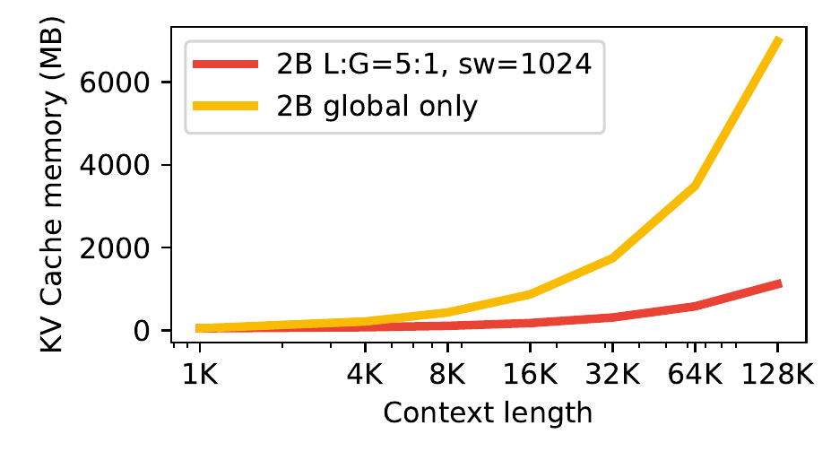
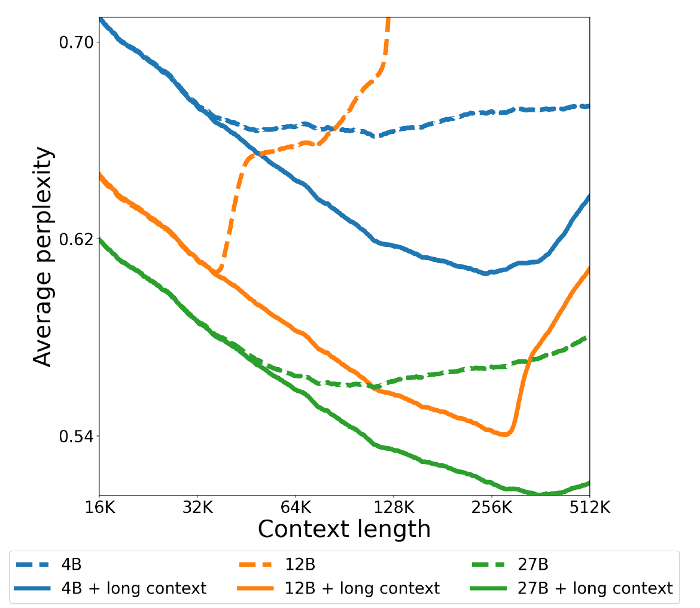

# Gemma 3

## Executive answer

[Technical report](https://arxiv.org/abs/2503.19786v1) · [Hugging Face: google/gemma-3-27b-it](https://huggingface.co/google/gemma-3-27b-it)

Gemma 3 is an open-weight family designed to combine useful language and image understanding with manageable deployment costs. Its distinctive combination is frequent local attention, occasional global attention, knowledge distillation, and a visual interface that compresses each encoded image view into 256 tokens. It is a good model to study when capability and serving footprint must be designed together.[^1]

## Visual overview

Purposeful figures below cover the input contract, distinctive mechanism or bounded evidence; their captions identify provenance and scope.

## Key findings

- **Long context with fewer full-history layers.** Five local-attention layers alternate with one global layer, reducing the cache burden while retaining periodic global communication.[^1]
- **A compact visual interface.** A shared SigLIP encoder feeds 256 soft image tokens per encoded view into the language decoder. Optional crops recover detail at extra cost.[^1][^5]
- **Distillation at pretraining scale.** Students learn sampled teacher distributions, not only hard next-token targets.[^1]
- **Different sizes have different modalities.** The original 1B model is text-only; 4B, 12B, and 27B accept text and images. Public weights use the Gemma Terms, not the software repository’s Apache license.[^1][^2][^3]

## Detailed analysis

## Scope and scale

This study focuses on the **March 2025 Gemma 3 27B** architecture, with the 27B instruction-tuned model anchoring assistant evaluations. It does not treat later 270M additions, Gemma 3n, or newer Gemma generations as part of the original report.[^1][^2]

| Item | Gemma 3 27B |
| --- | --- |
| Reported components | 25,600M non-embedding parameters; 1,416M embeddings; 417M vision encoder |
| Pretraining budget | 14T tokens accounting for a text and image mixture |
| Training hardware | 6,144 TPUv5p chips; duration and total FLOPs undisclosed |
| Context | 128K tokens |
| Visual interface | 896 × 896 encoded views; 256 soft tokens per view |
| Variants | Pretrained and instruction-tuned; raw and quantization-aware checkpoints |
| Model terms | Gemma Terms of Use and incorporated use restrictions |

Counts and hardware are report Tables 1–2. The 14T budget is not an image count or a disclosed text-only corpus size. The selected Hugging Face 27B checkpoint is gated, so its exact config and processor artifact were not directly inspected. Public implementation files were inspected, but generic library defaults are not substituted for inaccessible checkpoint values.[^1][^3][^4][^5][^6]

## Architecture: combine local detail with occasional global exchange

Gemma 3 keeps a decoder-only Transformer with GQA and a gated feed-forward path. It uses RMSNorm around sublayers and QK normalization in place of Gemma 2’s attention soft-capping. Its defining attention change is the **5:1 local-to-global pattern**, beginning with a local layer.[^1][^4]

  **Visual input**

1. **Image and optional crops**: Recover detail when needed
2. **SigLIP encoder**: Each view resized to 896 × 896
3. **Pool and project**: 256 soft tokens per view
4. **Decoder input**: Visual embeddings join text embeddings

**Shared language path**

1. **Text and visual embeddings**: Ordered multimodal context
2. **Five local layers**: Bounded nearby communication
3. **One global layer**: Access earlier context
4. **Generated text**: Repeat mixed-attention blocks

<!-- visual-id: V002 -->
**Figure 1.** Images enter through a compact embedding interface; local and global layers trade cache cost for communication range. Original schematic.[^1][^4][^5]

The image and text streams meet in the decoder input. The 5:1 pattern is repeated across the language stack; the diagram is not a claim that the entire model has only six layers. The output is text, not generated image pixels.

Normalization acts at several different points

The inspected decoder normalizes the input to attention, then normalizes the attention output before adding the residual. It likewise normalizes before the FFN and normalizes its output before the second residual addition. Q and K also receive per-head RMS normalization before RoPE. These are distinct operations: residual-branch normalization controls the update scale, while QK normalization controls query/key magnitudes rather than clipping the final dot-product logits.[^1][^4]

This differs from both a simple pre-norm Llama block and Gemma 2's soft-capped attention. The public implementation trace establishes ordering; it does not substitute for the inaccessible 27B checkpoint's exact hyperparameters or prove an isolated quality gain.

### Why a sparse global schedule helps

Global layers retain history-wide attention. Local layers can retain only a sliding window. Under an ideal bounded-cache implementation, equal layer dimensions, and an exact six-layer cycle, storage relative to all-global attention follows this derived expression:[^1]

$$
\frac{M_{\mathrm{mixed}}}{M_{\mathrm{global}}}\approx\frac{T+5\min(T,W)}{6T}
\tag{1}
$$

T is context length and W is the local window. As T becomes much larger than W, the ratio approaches one sixth. Actual cache allocation, grouped-query dimensions, layer count, and backend support determine realized memory. This is a storage estimate, not a throughput measurement or a guarantee of unchanged quality.

The report’s local-window study uses 1,024-token windows in its illustrated 5:1 architecture. Its perplexity ablations use internal 2B and 9B text models, not the released multimodal 27B checkpoint. The library’s generic 4,096 default must not be mistaken for the released model’s verified window.[^1][^6]

<!-- visual-id: V102 -->

**Figure 2.** Sparse global layers reduce, not remove, cache growth. Reproduced from Gemma Team, Figure 6; figure crop, [CC BY 4.0](https://creativecommons.org/licenses/by/4.0/).[^1]

Figure 2 compares internal 2B text models, not measured memory for the released 27B VLM. The mixed schedule keeps a growing global cache, so it is not constant memory. The report labels the horizontal ticks from 1K to 128K at equal spacing; judge the labeled quantities rather than treating the plotted curve as a uniform linear context axis.

### Long context also needs a training recipe

The report trains at 32K context before extending 4B, 12B, and 27B to 128K late in pretraining. Global layers use a larger RoPE base, 1M instead of 10K, while local layers retain 10K. It also describes rescaling with a factor of eight. Beyond the trained extension, perplexity degrades rapidly; a larger configured position limit is not evidence of reliable longer context.[^1]

<!-- visual-id: V103 -->

**Figure 3.** Position rescaling is part of trained context extension. Reproduced from Gemma Team, Figure 7; figure crop, [CC BY 4.0](https://creativecommons.org/licenses/by/4.0/).[^1]

Compare solid and dashed lines of the same size in Figure 3, not different sizes. The plot reports average perplexity for pretrained models before and after the extension recipe. It is not an instruction quality or needle retrieval measurement, and favorable points beyond 128K do not establish a supported longer context.

## Visual interface: spend tokens where detail matters

The shared roughly 400M SigLIP encoder is first adapted to visual-assistant tasks, then frozen during language-model training. Each image view is resized to 896 × 896. Pooling compresses the encoder output into 256 representations, which are normalized and projected into the language model’s embedding space.[^1][^4]

The inspected projector performs spatial average pooling, RMS normalization, and a learned projection. The model replaces image-placeholder positions with the resulting embeddings and checks that placeholder and feature counts agree. These are soft visual embeddings, not words produced by an OCR engine.[^4]

### Image tokens have a different mask contract

In the inspected Transformers prefill path, image-token type IDs identify contiguous image blocks. The mask permits bidirectional attention **within the same image block**, while ordinary text remains causal. This lets already available patches of one image exchange evidence without letting text read future text or a future image. The allowance is combined with the model's local/global layer masks.[^4]

This is an implementation-specific observation when the wrapper supplies token type IDs and creates its mask. A caller-supplied precomputed mask follows a different branch. The source report does not fully document this mask, so it is not asserted as a separately verified original training detail. “Decoder-only” therefore does not mean every multimodal input position always uses an identical text-only triangle.[^4]

### Pan and Scan buys detail with more views

Resizing a large page or a very wide image to one square can erase small text or distort important detail. Pan and Scan forms non-overlapping crops when the image geometry warrants it, resizes those crops, and encodes them alongside the original image. It is an inference-time option and can be disabled for lower cost.[^1][^5]

**256 is the token count per encoded view, not always per original uploaded image.** With c additional crops, the visual embeddings contribute 256(1 + c) positions, before image delimiters and explanatory text. The inspected processor retains the original view and appends crop views; exact thresholds and crop limits depend on the processor settings.[^5]

For document applications, crop policy is therefore part of the latency, memory, and quality budget. Image resolution at upload alone does not tell you the number of tokens consumed.

## Training: a student distribution, then an assistant

### Pretraining with knowledge distillation

Gemma 3 follows the earlier family’s distillation approach. For each token, it samples 256 teacher logits weighted by teacher probabilities. Unselected vocabulary items receive zero target probability, and the retained distribution is renormalized. The student learns this distribution with cross-entropy.[^1]

$$
\mathcal{L}_{\mathrm{KD}}=-\sum_t\sum_{v\in S_t}\widetilde{p}_{\mathrm{teacher}}(v\mid x_{\lt t})\log p_{\mathrm{student}}(v\mid x_{\lt t})
\tag{2}
$$

This is an explanatory expression for the reported loss: S_t is the sampled vocabulary set and the tilde denotes its renormalized teacher probabilities. A teacher communicates alternatives and relative confidence that a single observed token cannot. The report does not identify every teacher or release a fully reproducible corpus; sharing a tokenizer with Gemini 2.0 does not establish that Gemini 2.0 is the teacher.[^1]

The data includes more multilingual material, monolingual and parallel data, filtering, quality reweighting, sensitive-data removal, and benchmark decontamination. Vision embeddings are precomputed so the frozen encoder need not be run at every language-training step. This moves compute outside the main training loop; it does not make visual preprocessing free.[^1]

### Post-training and quantization

Instruction-tuned models combine distillation from a larger instruction-tuned teacher with reinforcement learning. The report names developments of BOND, WARM, and WARP, and reward signals from human feedback, code execution, and mathematics ground truth. It does not supply enough detail to label this recipe GRPO or to reproduce every training choice.[^1]

Quantization-aware fine-tuning typically takes about 5,000 steps and uses the non-quantized checkpoint’s probabilities as targets. The report considers per-channel int4, per-block int4, and switched FP8 representations. These are trained deployment variants, not a promise that every arbitrary post-hoc quantization preserves quality.[^1]

## Inference: three independent budgets

There are three costs to track: model weights, cached language context, and visual preprocessing plus extra views. Mixed attention helps the second; quantization helps the first; an appropriate crop policy controls the third. None cancels the others.

Use the selected processor and conversation template together. Pretrained and instruction-tuned checkpoints use different termination conventions, and visual placeholders must match image features. Serving code must support each layer’s local or full attention semantics, not apply one uniform mask to the whole stack.[^1][^4]

## Evidence: separate full-model scores from mechanism tests

The report’s zero-shot **27B IT** results include MMLU-Pro 67.5, MATH 89.0, and MMMU validation 64.9. These belong to the complete instruction-tuned system; they do not isolate distillation, local attention, or image pooling as the cause.[^1]

Its internal text-only attention ablations find small perplexity changes across several local/global ratios and window sizes. That supports the chosen efficiency direction within those controlled runs, not identical performance on every downstream workload.[^1]

The visual ablations are more directly interpretable. An internal short-schedule 2B experiment holds the output at 256 image tokens while increasing encoder resolution from 256 to 896. DocVQA rises from 31.9 to 59.8 and TextVQA from 44.1 to 58.0. This tests input detail under the stated experiment, not the released 27B score.[^1]

Long-context benchmark scores add a boundary that perplexity alone misses. Appendix Table 15 reports 27B IT RULER scores of 91.1 at 32K and 66.0 at 128K, and MRCR scores of 63.2 and 59.3 at those lengths. These are author-reported task-specific conditions. Supported 128K input length is not uniform accuracy across lengths or tasks.[^1]

A source inconsistency in the Pan and Scan experiment

Table 8 reports a 27B DocVQA change from 85.6 to 90.4 and InfoVQA from 59.4 to 76.4 with Pan and Scan. Its caption calls the models pretrained checkpoints and specifies four-shot validation; the accompanying paragraph calls the 27B model IT. The gains are reported evidence for cropping, but the checkpoint-status mismatch prevents a clean IT-specific attribution. We retain that uncertainty rather than choose whichever label fits the story.[^1]

## Counterevidence and uncertainty

The exact corpus, image count, teacher identities, full optimization recipe, training duration, and FLOP budget remain undisclosed. Gated checkpoint config and processor artifacts were not accessed; library defaults are not verified checkpoint settings. Pooling can discard visual detail, and cropping adds cost. Local/global attention retains some full-history cache, so long context is not constant-memory inference. The paper’s Pan and Scan checkpoint labels conflict as documented above.[^1]

Gemma weights are subject to the Gemma Terms and incorporated use restrictions. The Apache 2.0 software license does not replace those model terms. Public availability does not remove safety, privacy, or licensing obligations.[^3]

## Implications

**Treat visual tokenization as a resource allocation problem.** A fixed token interface can still benefit from higher-resolution evidence; crops trade extra positions for detail.

**Study the whole memory budget.** Attention scheduling, quantization, and image processing solve different bottlenecks.

**Keep ablations attached to their actual model.** Internal text-only tests explain a design choice but do not prove unchanged multimodal 27B behavior. Compare [Llama 3.1](/architectures/models/llama-3/) for dense global attention and [Mistral 7B](/architectures/models/mistral-7b/) for a different sliding-window design.

## Sources

[^1]: Gemma Team. [Gemma 3 Technical Report](https://arxiv.org/abs/2503.19786v1). Architecture, training, Tables 1–8, attention and visual ablations, Appendix Tables 15 and 19.
[^2]: Google DeepMind. [Gemma 3 model card](https://ai.google.dev/gemma/docs/core/model_card_3). Inspected October 10, 2026; original report scope distinguished from later 270M additions.
[^3]: Google. [Gemma Terms of Use](https://ai.google.dev/gemma/terms). Model terms inspected; separate from software licensing.
[^4]: Hugging Face. [Gemma 3 implementation](https://github.com/huggingface/transformers/blob/8cb5963cc22174954e7dca2c0a3320b7dc2f4edc/src/transformers/models/gemma3/modeling_gemma3.py); projector, embedding injection, decoder, and mask paths inspected. Apache 2.0 code.
[^5]: Hugging Face. [Gemma 3 image processor](https://github.com/huggingface/transformers/blob/8cb5963cc22174954e7dca2c0a3320b7dc2f4edc/src/transformers/models/gemma3/image_processing_gemma3.py), same release; original view, crop selection, and crop accounting inspected.
[^6]: Hugging Face. [Gemma 3 configuration class](https://github.com/huggingface/transformers/blob/8cb5963cc22174954e7dca2c0a3320b7dc2f4edc/src/transformers/models/gemma3/configuration_gemma3.py). same release; generic defaults and local/global pattern inspected, not a gated 27B checkpoint configuration.

## Open questions and future research

See coverage-audit.md for the mechanism-by-mechanism audit, exact source locators, justified omissions and remaining artifact-access gaps. No weights or runtime benchmarks were executed. Renewed rendered and export QA passed; see the revision 3 presentation record.

## What changed in this revision

Revision 3: Exact residual and QK normalization ordering; implementation-scoped bidirectional image-block mask versus causal text; appendix long-context RULER/MRCR evidence separate from supported context. Earlier evidence and visual-review history remain in the ledgers.

## Revision 3 presentation verification

106 automated tests, zero Astro diagnostics, the static build and all 43 docs lint checks passed. The collection passed 81 fresh browser views; this page was checked at 1440px light, 390px light and 320px dark, with desktop focus, active family navigation, caption order, anchors, image decoding, resource cards and no page overflow. Complete source figures fit desktop, while narrow frames support keyboard panning and full-size access. Search and Markdown/MDX exports preserve citations, figures and source links. All 66 model figure renders were inspected, with full-size review of new dense diagrams. See state/presentation-qa.json for exact page checksums and evidence. No model benchmark was reproduced. Existing bundler and redirect warnings remain.
