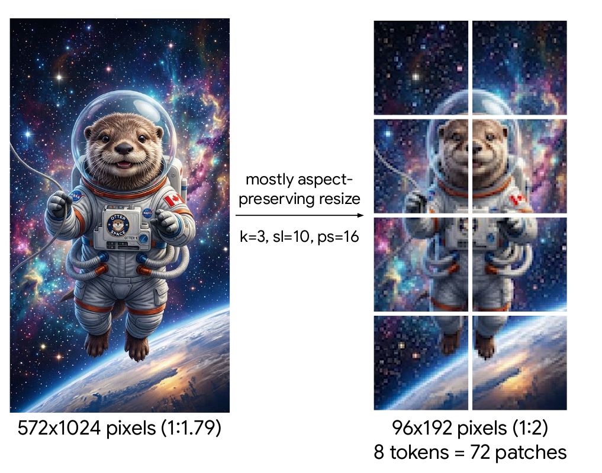
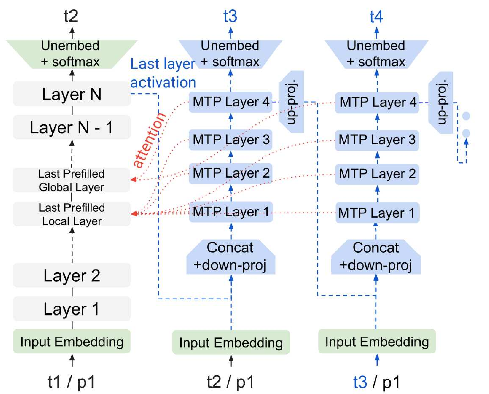

# Gemma 4

## Executive answer

31B IT dimensions and serving interfaces; separateMoE/E/unified contrasts. This is a full generation study grounded in inspected public sources. It distinguishes mechanisms, measurements, calculations and remaining omissions. Browser/export integration review passed; no model execution is claimed.

[Technical report](https://arxiv.org/abs/2607.02770v2) · [Representative model repository](https://huggingface.co/google/gemma-4-31B-it)

## Visual overview

The architecture view and original report excerpts are integrated into the explanation below rather than duplicated. All essential crop labels and native SVG rasters were manually inspected. Responsive presentation and agent exports passed the separate integration gate.

## Key findings

- Gemma 4 31B and 26B-A4B have a 550M vision encoder;12B directly projects raw image/audio;E series use encoders andPLE.
- Selected 31B config has 60 layers,5376 residual width,50 local/10 global layers,window 1024 and 262144 max positions.
- 31B uses 16 local KV heads of 256 dimensions and 4 global KV heads of 512,with 32 query heads.
- Public 31B artifact totals about 31.273B Safetensors parameters;report separately rounds decoder,embedding,vision and drafter components.

## Detailed analysis

Gemma 4 is best understood as a family of deployment choices, not one architecture shrunk to several sizes. It combines dense and expert decoders, several multimodal front ends, mixed attention and a separate drafting head. Its central lesson is to optimize weights, input representation and cached state as different parts of the system.[^report][^card]

## Highlights

- **One family, multiple input interfaces.** 31B and 26B-A4B use a vision encoder; 12B projects raw image patches and audio chunks into the decoder; E2B and E4B have smaller vision/audio encoders and per-layer embeddings.[^card]
- **Global state uses shared representations.** Larger models reuse a pre-position key representation as values and rotate only part of its dimensions. This is not ordinary GQA or identical post-RoPE K and V arrays.[^config][^code]
- **Drafting reads the target's state.** A separate autoregressive MTP head consumes target activations and KV history, rather than independently prefilling a second full model.[^report]
- **The weight license changes.** Gemma 4 weights are Apache 2.0. Earlier Gemma custom terms must not be carried over by family name.[^card][^weights]

Scope: **31B instruction-tuned** model anchors dimensions and inference. The 26B-A4B public configuration supplies an explicitly separate expert contrast; E series and unified 12B are report/card-level comparisons. Report v2, the selected artifact config and targeted preprocessing/attention/pooling/mask code inspected October 10, 2026. No weights, speculative benchmark or training run executed.

## Model in numbers

| Dimension | Value and scope |
| --- | --- |
| 31B components | Report: 29.290B decoder non-embedding, 1.410B embeddings and 0.550B vision encoder; optional 0.500B drafter separate[^report] |
| Decoder contract | 60 layers, residual width 5,376; 50 local and 10 global layers; local window 1,024[^config] |
| Context | 262,144 configured positions for the selected checkpoint; report evaluates specific long-context tasks, not uniform accuracy[^config] |
| Data scale | January 2025 source cutoff; exact token exposure, image/audio counts and post-training sample counts undisclosed[^card][^report] |
| Compute | 10,240 TPUv6e chips for 31B pretraining; duration and full FLOPs undisclosed[^report] |
| Expert contrast | 26B-A4B: about 3.8B activated; 128 routed experts, eight selected per token plus a shared path, from its separate config/card[^moe][^card] |
| License | Apache 2.0 weights; Apache 2.0 implementation; CC BY 4.0 paper artwork with embedded illustration scope checked separately[^weights][^code][^report] |

The component counts are not a claim that the optional drafter is always resident or invoked. Published card counts use other boundaries, and the selected artifact's Safetensors total is about 31.273B; keep that artifact total separate from rounded report component sums.[^weights]

## Architecture: select a path before counting tokens

<!-- visual-id: V001 -->

**Figure 1.** Original family map. Input interfaces and optional drafting are separate from the chosen decoder size.[^report][^card][^config]

For 31B, an image is resized and patchified, a 27-layer vision Transformer encodes it, spatial pooling reduces positions, and a multimodal embedder maps features to the 5,376-wide text stream. The model checks feature/placeholder agreement before injecting those features. Text tokenization is another input path; output remains text. The report says the separate vision and audio encoder weights are frozen during pretraining. That boundary does not establish that every component stays frozen in all later adaptation.[^config][^code][^report]

The decoder retains pre- and post-sublayer RMSNorm, QK normalization and a GELU-gated FFN. Its public configuration has sixteen local KV heads of width 256, but only four global KV heads of width 512; there are 32 query heads. Different layer types therefore differ in both history span and projection dimensions.[^config]

### The MoE variant is not a smaller dense 31B

The separately inspected 26B-A4B configuration enables expert blocks in a 30-layer decoder. In the inspected implementation, the router normalizes the residual input, produces expert probabilities, chooses top-k, renormalizes selected weights and applies learned per-expert scales. Routed expert output is combined with the dense shared FFN path. “Eight active experts” is not “eight complete decoders.”[^moe][^code]

A 3.8B active count describes per-token computation, not total resident weights. Routing, batching, expert placement and communication can dominate serving cost; the active count alone is not a measured 4B-equivalent latency.

## Visual tokens: preserve geometry within a budget

The processor chooses a resized grid whose dimensions are multiples of a pooled patch unit. For the encoded 31B interface, encoder patches are 16 pixels across and pooling groups 3×3 patches; one output region spans 48×48 pixels. The inspected processor computes an aspect-preserving scale, rounds down to this grid and handles extreme aspect ratios explicitly.[^processor]

<!-- visual-id: V002 -->

**Figure 2.** 72 encoder patches become eight decoder positions. Reproduced from Gemma Team, report v2 Figure 2, p. 16; figure crop, [CC BY 4.0](https://creativecommons.org/licenses/by/4.0/), embedded illustration scope recorded.[^report]

Figure 2 uses a **toy ten-token budget**, not a deployable default. Its 96×192 resized image contains 6×12 encoder patches; 3×3 pooling gives 2×4 output regions. This is a clear distinction between raw patches and language-sequence positions. The actual processor supports budgets 70, 140, 280, 560 and 1,120.[^processor]

The representative configuration uses 280 default soft tokens per image. A budget is a ceiling; aspect-ratio rounding can yield fewer valid regions, and batching can add padded encoder slots. Delimiters and text consume additional sequence positions. Do not estimate context from upload resolution alone.[^config][^processor]

The 12B interface changes where perception is learned

The unified 12B takes 48×48×3 raw image patches and linearly projects them, adding coordinate embeddings before normalization. Audio comes as 40 ms chunks at 16 kHz, or 640 waveform samples per chunk, projected directly to the decoder. Those sizes describe the 12B raw input path, not 31B encoder patches or E series Mel features.[^report]

Removing a pretrained modality encoder reduces a distinct parameter/interface boundary, but does not remove perceptual computation. The decoder must learn from projected raw evidence. A useful unanswered question is how this trade changes adaptation data and visual-detail robustness; released system scores do not isolate that cause.

## Cached state: three different forms of sharing

**GQA shares KV heads across query heads.** **Cross-layer sharing lets later layers read another layer's stored state.** **Key/value representation sharing derives K and V from one projection.** These operations should be counted separately.

The 31B configuration enables key/value representation sharing, uses a 25% rotary portion in global heads and sets cross-layer shared-layer count to zero. E series cross-layer sharing described by the report is therefore not part of this 31B trace.[^config]

In the inspected implementation, the value representation is taken from the key projection **before** key normalization and RoPE. Key and value branches then undergo their own transformations. A global query reads position-bearing keys while retrieving differently transformed values. Consequently, the report shorthand “values=keys” must not be interpreted as equality of the final cached arrays.[^code]

For an ideal specialized cache, a shared base vector plus a rotated p-fraction can replace two full-width vectors. The derived dimension ratio is:[^report][^config]

$$
\frac{d+pd}{2d}=\frac{1+p}{2}=0.625\quad\text{for }p=0.25\tag{1}
$$

This explains a 37.5% **global representation** reduction under those assumptions. It is not a 37.5% reduction of total serving memory. The inspected general cache still receives separate transformed keys and values; this study does not demonstrate that the backend implements the ideal packed storage. Weight memory, local layers, batch size and allocation remain separate costs.[^code]

For multimodal prefill, the inspected mask also distinguishes layer types: global layers remain causal; local layers combine the sliding window with an allowance for bidirectional communication inside the same visual block. The block allowance must not override the window boundary. This is an implementation observation, not a newly inferred original training recipe.[^code]

## Training and post-training: what is disclosed

The public card describes multimodal web, code, mathematical and perceptual data and its filtering. It does not supply token exposure totals or a reproducible full dataset. Similarity to Gemma 3's approach does not establish identical teachers, target sampling or reward algorithms.[^card]

The report describes pretraining, an instruction-tuning process with optional thinking traces, and quantization-aware variants. Mobile quantization and blockwise Q4_0 have different weight/activation representations. The report also introduces per-block scalar scaling to keep activation ranges within fp16. Weight format, activation format and those scales are distinct numerical contracts. The optional drafter is trained as part of the model family, but the complete loss schedule and teacher/reward recipe are not disclosed.[^report]

Thinking is a format and inference-budget choice as well as a learned capability. The inspected official documentation requires the matched conversation template and thinking toggle rather than a natural-language request alone. The report distinguishes PT stopping at an EOS token from IT ending with a turn token. A tool-call token sequence requests external execution; the network does not itself book a ticket or access a database.[^card][^report]

## Drafting: reuse expensive target work

<!-- visual-id: V003 -->

**Figure 3.** The drafter reads target state rather than prefilling another full model. Reproduced from Gemma Team, report v2 Figure 1, p. 3; figure crop, [CC BY 4.0](https://creativecommons.org/licenses/by/4.0/).[^report]

Figure 3 distinguishes **proposal** from accepted output. The drafter uses its own embedding/projection and small Transformer while cross-attending to the target's available cache. For 31B the four-layer drafting block has width 1,024, three local layers and one global layer. Its proposed tokens still need a target-verification algorithm; the figure is not a proof that all proposals are correct or accepted.[^report]

The small E-series drafters use another efficiency trick: select token clusters before projecting to the vocabulary. The reported final projection drops from 262,000 to 4,096 candidates with similar acceptance under the authors’ test. That is an E-series head design, not a 31B vocabulary change or an independently reproduced speedup.[^report]

The expected benefit depends on acceptance rate, draft length, target batching and verification overhead. A large model and its drafter must also agree on positions and which state corresponds to accepted rather than rejected tokens. No fixed speedup follows from the head's parameter count, and no speculative backend was executed here.

## Evidence: separate resolution, reasoning and context

| Question | Author-reported comparison | What not to conclude |
| --- | --- | --- |
| Does more visual detail help? | 31B thinking, InfographicVQA: 82.8 at 280 tokens versus 92.0 at 1,120; report Tables 6/12[^report] | This is a resolution-budget comparison, not an encoder-free 12B ablation |
| Does long-context input remain useful? | 31B non-thinking, RULER accuracy 96.8 at 32K and 96.4 at 128K; Table 9[^report] | Other tasks, 256K lengths and application quality need separate evidence |
| Do all family architectures reach the same result? | Official card reports differences among dense, expert and E series on matched listed tasks[^card] | Scores alone do not isolate KV representation sharing, QAT or routing |

The report's main reasoning table mostly enables thinking, while its Gemma 3 comparison is non-thinking. That is a real released-system comparison but not a controlled architecture-only test. Its displayed Arena ordering is a dated June 2026 snapshot, not a current rank.[^report]

## Limitations and lessons

Pretraining exposure, exact multimodal mixture, teachers, reward algorithms, full optimization and drafter acceptance/latency are incomplete. Config and code inspection establishes interfaces, not quality or kernel support. General Transformers code has evolved after release; its documented trace is not automatically the authors' optimized training or serving backend.

**Choose the checkpoint before the multimodal interface.** **Count input tokens after projection/pooling.** **Distinguish sharing a representation from sharing an allocated cache.** **Keep speculative proposal and verified output separate.** These are portable systems lessons, not claims of universal Gemma 4 superiority.

Compare [Gemma 3](/architectures/models/gemma-3/) for the prior pooling/cache trade, [DeepSeek-V3](/architectures/models/deepseek-v3/) for a different MTP training design, and [Qwen3-VL](/architectures/models/qwen3-vl/) for a different variable-resolution visual interface.

## Counterevidence and uncertainty

- Reported similar acceptance is not an independently measured speedup.
- Not an encoder-free architecture-only ablation.
- No universal256K application accuracy claim.
- Report artwork and embedded illustration rights remain separate.
- No template file executed;tools require an external orchestrator.

## Implications

Use the chosen release and configuration as the interface contract. A report objective is not a complete reproducible recipe; a code trace is not measured runtime; full-system scores do not identify a unique architecture cause.

## Open questions and future research

- Which undisclosed data and optimization choices materially affect the published system?
- What memory,latency and task quality do the selected backend and checkpoint actually achieve?
- Complete parent responsive/export verification before recording presentation as fully reviewed.

## Sources

[^report]: Gemma Team, Google DeepMind. [Gemma 4 Technical Report](https://arxiv.org/abs/2607.02770v2), 2026, report v2. §§2–3, Tables 1–3, 6, 9 and 12, Figure 1 and Figure 2, Appendix Algorithm 1. Paper artwork CC BY 4.0; source crops retain copyright and embedded-illustration caveats.
[^card]: Google DeepMind. [Gemma 4 model card](https://ai.google.dev/gemma/docs/core/model_card_4), updated July 30, 2026; model variants, terms, modalities, thinking/format and evaluation inspected October 10, 2026.
[^weights]: Google. [Gemma 4 31B IT model repository](https://huggingface.co/google/gemma-4-31B-it), public weights and Apache 2.0 terms, Safetensors inventory inspected October 10, 2026. No weight download.
[^config]: Google. [Gemma 4 31B IT configuration](https://huggingface.co/google/gemma-4-31B-it/blob/842da3794eaa0b77d5f08bae87a17459d91ff475/config.json), selected artifact. Layer types, dimensions, head sharing, positions, visual defaults and zero cross-layer shared count inspected.
[^moe]: Google. [Gemma 4 26B-A4B IT configuration](https://huggingface.co/google/gemma-4-26B-A4B-it/blob/main/config.json), separately inspected October 10, 2026. Thirty layers, 128 experts and eight routed selections; not the 31B config.
[^code]: Hugging Face. [Gemma 4 implementation](https://github.com/huggingface/transformers/blob/c48824e840247c860e394bcc58aa35dfffa9e67f/src/transformers/models/gemma4/modeling_gemma4.py), October 2026 implementation trace. Gemma4TextAttention, Gemma4TextRouter, Gemma4TextDecoderLayer, Gemma4VisionPooler, multimodal embedding and create_masks_for_vision. Read, not executed.
[^processor]: Hugging Face. [Gemma 4 image processor](https://github.com/huggingface/transformers/blob/c48824e840247c860e394bcc58aa35dfffa9e67f/src/transformers/models/gemma4/image_processing_gemma4.py), same source revision. Aspect-ratio resizing, grid rounding, supported budgets, patching and padding inspected; report's toy 10-token example is not a production setting.

## Completed integration review

122 site tests pass, zero Astro diagnostics, 59-page static build and 59-doc lint clean. Fresh browser regression checks cover all 41 model pages plus the catalog and Foundations at 1440 px light, 390 px light and 320 px dark (129 views), reduced motion, desktop focus, active family navigation, figure order, loaded images and local anchors; narrow figures remain keyboard-pannable and link to full-size originals. All 41 Markdown/MDX exports and both agent manifests checked; representative search queries resolve. All 35 new desktop figure renders received manual contact-sheet review; dense focus/mobile views and resource-card/catalog layout received additional manual inspection. Existing bundler directive and philosophy-redirect indexing warnings remain. No model execution or benchmark reproduction.

Primary report, selected artifact, uncertainty and useful source figures are documented above and in the coverage audit.
