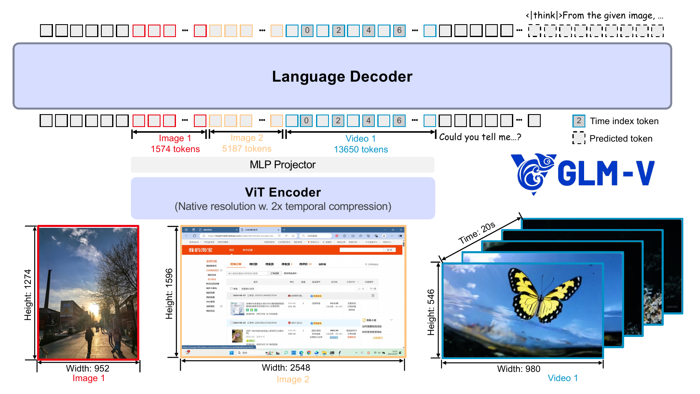
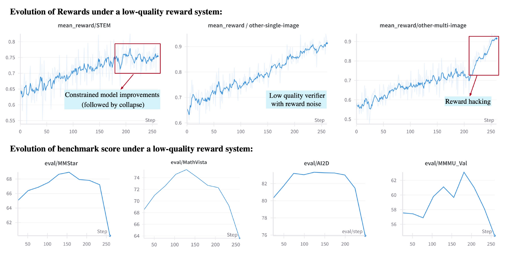
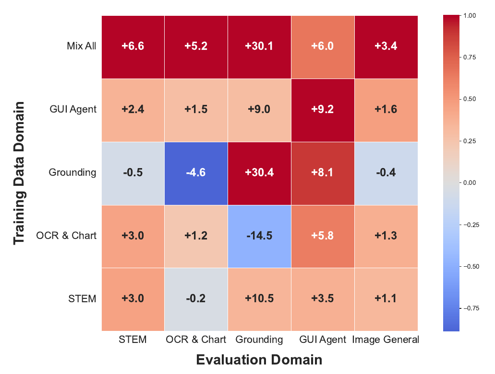

## Executive answer

[Technical report](https://arxiv.org/pdf/2507.01006v3) · [Hugging Face: zai-org/GLM-4.1V-9B-Thinking](https://huggingface.co/zai-org/GLM-4.1V-9B-Thinking)

GLM-4.1V and GLM-4.5V study a demanding combination: preserve enough visual detail to read documents and interfaces, then train the model to reason reliably across very different tasks. Their distinctive lesson is **representation plus verifiable, curriculum-sampled multimodal RL**, not reasoning tokens alone.[^report]

The linked resource is the dense **GLM-4.1V-9B-Thinking**. Its larger sibling, [GLM-4.5V on Hugging Face](https://huggingface.co/zai-org/GLM-4.5V), uses the GLM-4.5-Air MoE backbone. Both are covered by the inspected August 2025 report revision; later GLM-4.6V additions are outside this study.[^report][^cards]

Study scope: shared report version 3, both weight configurations, processors and targeted Transformers visual code. No checkpoint executed. Evidence checked October 10, 2026.

## Visual overview

3 purposeful figures accompany architecture and evidence. Original source crops were inspected at full resolution; integrated browser/focus/mobile/export QA passed.

## Key findings

- **Keep visual resolution adaptive.** Image token counts follow resized geometry rather than one fixed square or a fixed number per image.[^report][^processor]
- **Preserve spatial and temporal structure.** A native-resolution vision encoder and three-axis language positions support images, multi-image context and video.[^report][^code]
- **Make rewards fit the task.** Math equivalence, OCR strings, detection boxes and GUI actions need different verifiers.[^report]
- **Train where the reward can teach.** Curriculum sampling emphasizes useful difficulty and valid reward groups, while the report shows that reward rises can hide benchmark collapse.[^report]

## Detailed analysis

### Model in numbers

| Dimension | GLM-4.1V-9B-Thinking | GLM-4.5V |
| --- | --- | --- |
| Language backbone | Dense GLM-4-9B-0414 | GLM-4.5-Air: 106B total / 12B active in the text-model convention |
| Main text layers | 40; width 4,096; 32 query / 2 KV heads | 46; width 4,096; 96 query / 8 KV heads |
| Text FFNs | Dense gated FFNs | 1 initial dense layer; 45 MoE layers; select 8 of 128 routed experts plus 1 shared |
| Stored multimodal tensors | Approximately 10.29B parameters | Approximately 107.71B parameters |
| Vision encoder | AIMv2-Huge initialization; 24 layers; width 1,536; 12 heads | Same disclosed encoder design |
| Configured context | 65,536 positions | 65,536 positions |

The report's 9B/106B labels identify language backbones; the artifact metadata counts all stored multimodal tensors. These conventions should not be silently equated. Both selected configs use spatial patch size 14, temporal patch size 2 and spatial merge size 2. The text-model active count does not include every visual operation.[^report][^configs][^cards]

The report discloses an 8K pretraining stage, a 32K continuation stage and 32K SFT. Configured 64K inference capacity is not evidence that every training stage used 64K. Complete useful accelerator hours, FLOPs, processed visual-token exposure and final RL trajectory count remain undisclosed.[^report][^configs]

### From pixels to a language-model sequence

<!-- visual-id: V001 -->

**Figure 1.** Variable visual geometry becomes a token sequence. GLM-V Team, report Figure 2, August 2025 revision; complete architecture crop under [CC BY 4.0](https://creativecommons.org/licenses/by/4.0/).[^report]

In [Figure 1](#figure-1), the red/orange segments represent images of different sizes, while blue segments represent video frames with time-index tokens. Its 1,574 / 5,187 / 13,650 token counts are illustrated examples, not universal per-image costs or fixed processor limits.[^report]

The vision pathway starts with a 3D convolution over **two temporal frames and 14×14 spatial patches**. A still image is duplicated across the temporal dimension so it uses the same interface. The native-resolution ViT combines two-dimensional rotary positions with interpolated learned absolute embeddings inherited from the pretrained visual model.[^report][^processor][^code]

After visual encoding, a 2×2 spatial downsampling convolution reduces the patch grid, and a learned projection maps features into the language width. These features occupy designated visual positions in the text sequence; they are not OCR text substituted for pixels.[^code]

### How many visual tokens?

The processor explicitly divides the pre-merge grid product by the square of the merge size. For a resized image with dimensions divisible by 28, the selected implementation gives:[^processor][^code]

$$
N_{\mathrm{visual}}=\frac{t_g h_g w_g}{m^2};\qquad N_{\mathrm{image}}=\frac{H'}{28}\frac{W'}{28}
\tag{1}
$$

Here $t_g$ counts temporal patch groups, $h_g,w_g$ are spatial patch-grid dimensions, and $m=2$. For a still image, duplicated frames give one temporal group. A **672×1,008 resized image therefore contributes 864 visual embeddings**. This is a derived geometry example, not a measured benchmark; delimiters, question text, timestamps and output tokens add to the sequence budget.[^processor]

For video, sampling choices and temporal compression determine the number of groups. The processor appends timestamps after frame groups. Three-axis multimodal RoPE assigns temporal, height and width coordinates to visual tokens; text positions use aligned ordinary coordinates. Serialized timestamp tokens and positional coordinates are related but distinct parts of the representation.[^report][^processor][^code]

### Build the visual foundation before RL

The pipeline starts from an approximately 10B image–text **source pool before filtering**, not a claim that all 10B pairs enter training. It includes concept-balanced filtering, recaptioning for factual coverage, interleaved books/documents and specialized sources for OCR, grounding and GUI understanding.[^report]

Reported corpus figures include 220M OCR images, 40M natural-image grounding annotations and 140M GUI QA pairs. Those are different units and collection scopes; they are not additive unique-document totals. The full effective mixture and repeated training exposure are not reconstructible from those headline counts.[^report]

Pretraining starts at 8K with a disclosed global batch of 1,536 and 120K steps, then continues at 32K for 10K steps with video added. These batch/step limits do not establish a unique-token total: actual packing, sequence occupancy and repeated exposure matter. SFT then updates all parameters on long chain-of-thought examples at 32K.[^report]

The 4.1V template separates thinking and answer spans. For 4.5V, the report removes the answer tags and supports non-thinking mode through an empty thinking prefix. Preserve the checkpoint's actual template rather than copying the smaller model's delimiters into every release.[^report][^cards]

### Reinforcement learning with curriculum sampling

RLCS uses a GRPO-based training framework with offline and online difficulty estimates. Repeated samples estimate whether a prompt produces useful successes and failures. Very easy questions give little advantage signal; questions that never succeed cannot reward a better answer within the group. Sampling therefore emphasizes learnable difficulty instead of uniformly spending rollout compute.[^report]

Groups with all-correct or all-incorrect responses are filtered because their rewards have no useful variation. Dynamic sampling expands candidate generation according to the estimated invalid-group rate, with smoothing. This is **data/rollout selection**, not MoE routing or attention-token selection.[^report]

The report removes KL and entropy terms, raises its upper clipping bound and uses top-p 1 in its stabilizing recipe. It favors per-sample loss averaging in this multimodal setting. These are empirical choices tied to its data, rewards and model; they should not be presented as a universally optimal GRPO configuration.[^report]

Variable-length rollouts also change gradient accumulation

Visual inputs and reasoning outputs produce uneven sequence lengths. The report balances sequence length and compute across data-parallel ranks before training, then packs samples into 32K microsteps. It weights accumulated gradients by **sample count**, matching its per-sample objective rather than treating every differently sized microstep as equally important.[^report]

For a token-average objective, token counts would instead determine those weights. The general principle is to preserve the chosen batch objective when packing and accumulating, not to average microbatch means blindly. This is a derivation from the report's explicit normalization contract.[^report]

### Verification is a first-class component

| Task | Disclosed reward logic | Why a generic judge is insufficient |
| --- | --- | --- |
| Math / STEM | Symbolic equivalence, units and supplementary model checks | Equivalent math answers can have different strings. |
| OCR | Exact match / edit distance | “43” and “43.0” may not be the same transcription. |
| Grounding / detection | Bounding-box overlap | A plausible explanation cannot replace the correct region. |
| GUI | Action validity and target-location overlap | Readable screen text does not imply a successful action. |

These distinctions come from the report's reward construction, not an assertion that every task has a perfect objective verifier. Boxed answers simplify extraction; weak model-based extraction or judging can still assign incorrect rewards. At a reasoning-budget limit, an injected end-thinking marker requests a final answer so it can be assessed; it does not make a truncated solution correct.[^report]

<!-- visual-id: V002 -->

**Figure 2.** Higher reward can accompany worse generalization. GLM-V report Figure 5, August 2025 revision; all reward and benchmark panels under [CC BY 4.0](https://creativecommons.org/licenses/by/4.0/).[^report]

[Figure 2](#figure-2) shows the failure mode directly: optimizing an unreliable reward can improve the training signal while degrading held-out benchmarks. This is stronger evidence for verifier auditing than an isolated final score. Human checks and independent evaluations remain useful, especially when a correct final answer can conceal invalid reasoning.[^report]

### Does mixing domains always help?

<!-- visual-id: V003 -->

**Figure 3.** Broad transfer is not victory in every domain. GLM-V report Figure 6, August 2025 revision; full heatmap under [CC BY 4.0](https://creativecommons.org/licenses/by/4.0/).[^report]

This ablation starts from the **4.1V-9B SFT checkpoint**. Mixed RL yields broad gains: +6.6 STEM, +5.2 OCR/chart, +30.1 grounding, +6.0 GUI and +3.4 general image understanding. Yet grounding-only reaches +30.4 grounding, and GUI-only reaches +9.2 GUI. OCR/chart-only training hurts grounding by 14.5 points.[^report]

The authors keep each domain's exposure comparable to that domain inside the mixed run; the mixed run consequently has more total training data than each single-domain run. The experiment supports useful cross-domain transfer and interference, but does not isolate a pure mixing effect at equal overall compute. The displayed cell labels are score improvements; the normalized color scale is not an extra accuracy unit.[^report]

### Inference budget and evaluation boundaries

The reported multimodal evaluation uses vLLM, an 8,192-token output cap, approximately 6,144 visual tokens for an image and a 30,000-token video budget. Several tasks use GPT-4o-based judging. These are benchmark settings, not universal processor defaults or an assurance that every arbitrary input fits.[^report]

Thinking is not uniformly better. In Table 2, 4.5V thinking raises MathVista from 78.2 to 84.6, but OCRBench falls from 87.2 to 86.5 and Design2Code from 84.5 to 82.2 under those protocols. Use task-specific evidence to choose reasoning mode and latency budget.[^report]

The report excludes failed requests while requiring at least a 95% valid-request rate for its evaluation. That means scores should be read with the error-handling protocol, not as unconditional success probabilities. GUI agents additionally need a runtime and action loop beyond the model's visual/token interface.[^report]

### Limits and lessons

Occlusion, ambiguous visual evidence and invalid reasoning remain failure modes. Verifying an outcome does not verify every reasoning step. Full compute accounting, data manifests and final RL exposure are unavailable; no independent reproduction is claimed here.[^report]

Both selected model cards label weights MIT; the official repository's code license is Apache 2.0. The report uses CC BY 4.0. These separate grants do not establish rights to every underlying training image.[^cards][^license]

The main lesson is to align **visual detail, sequence budget, task difficulty and reward validity**. Better reasoning cannot recover information discarded by preprocessing, and a stronger optimizer cannot repair an untrustworthy verifier. Compare [Qwen2.5-VL](/architectures/models/qwen2-5-vl/) for another native-resolution representation, and [Qwen3-VL](/architectures/models/qwen3-vl/) for later multimodal fusion and positioning.

## Counterevidence and uncertainty

Source pools are not training exposure. Selected configs exceed disclosed training lengths. Mixed-domain RL uses more overall data and does not win every domain. Thinking hurts some tasks. Outcome verification does not validate the whole reasoning chain.

## Implications

Measure actual resized geometry and visual tokens. Allocate latency by task and reasoning mode. Audit each verifier with hard negatives and held-out evaluations before scaling RL.

## Open questions and future research

Final processed-token and trajectory budgets; compute-matched mixing ablations; independent verifier audits; reason-step correctness; detailed image/video latency and memory in the selected backend.

## Sources

[^report]: GLM-V Team. [GLM-4.1V-Thinking and GLM-4.5V: Towards Versatile Multimodal Reasoning with Scalable Reinforcement Learning](https://arxiv.org/pdf/2507.01006v3), August 13, 2025 revision. Sections 2 to 7, Figures 2, 5 and 6, Table 2. Later version 6 adds GLM-4.6V and is outside this study.
[^configs]: Z.ai. [GLM-4.1V-9B-Thinking configuration](https://huggingface.co/zai-org/GLM-4.1V-9B-Thinking/blob/3c1471e51dc811b589d4d12b1c1c7c1c941267c2/config.json) and [GLM-4.5V configuration](https://huggingface.co/zai-org/GLM-4.5V/blob/ed47433b37111465ec527affaaddceff371bca04/config.json), inspected October 10, 2026. Text and visual dimensions, patch sizes, merging and context.
[^cards]: Z.ai. [GLM-4.1V-9B-Thinking card](https://huggingface.co/zai-org/GLM-4.1V-9B-Thinking), [GLM-4.5V card](https://huggingface.co/zai-org/GLM-4.5V), and [small-model artifact metadata](https://huggingface.co/api/models/zai-org/GLM-4.1V-9B-Thinking) / [large-model metadata](https://huggingface.co/api/models/zai-org/GLM-4.5V), inspected October 10, 2026. Stored-parameter scope and MIT weight labels.
[^processor]: Hugging Face contributors / Z.ai. [GLM-4V processor](https://github.com/huggingface/transformers/blob/v4.57.1/src/transformers/models/glm4v/processing_glm4v.py) and [image preprocessing](https://github.com/huggingface/transformers/blob/v4.57.1/src/transformers/models/glm4v/image_processing_glm4v.py), Transformers 4.57.1. Targeted resize, temporal duplication, visual-placeholder count and timestamps; not executed.
[^code]: Hugging Face contributors / Z.ai. [GLM-4V modeling implementation](https://github.com/huggingface/transformers/blob/v4.57.1/src/transformers/models/glm4v/modeling_glm4v.py), Transformers 4.57.1. Targeted patch embedding, learned position interpolation, visual downsampling/projector and multimodal RoPE; not executed.
[^license]: Z.ai. [Official GLM-V code license](https://github.com/zai-org/GLM-V/blob/767626468e275892abdf4f7c67f792e51528c0fc/LICENSE), inspected October 10, 2026. Apache 2.0 code; card weight rights and report-figure rights have different scopes.

## Completed integration review

122 site tests pass, zero Astro diagnostics, 59-page static build and 59-doc lint clean. Fresh browser regression checks cover all 41 model pages plus the catalog and Foundations at 1440 px light, 390 px light and 320 px dark (129 views), reduced motion, desktop focus, active family navigation, figure order, loaded images and local anchors; narrow figures remain keyboard-pannable and link to full-size originals. All 41 Markdown/MDX exports and both agent manifests checked; representative search queries resolve. All 35 new desktop figure renders received manual contact-sheet review; dense focus/mobile views and resource-card/catalog layout received additional manual inspection. Existing bundler directive and philosophy-redirect indexing warnings remain. No model execution or benchmark reproduction.

Primary report, selected artifact, uncertainty and useful source figures are documented above and in the coverage audit.
