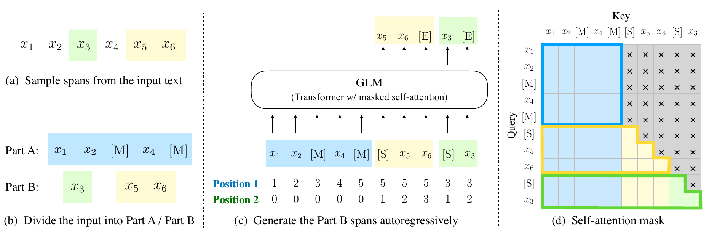
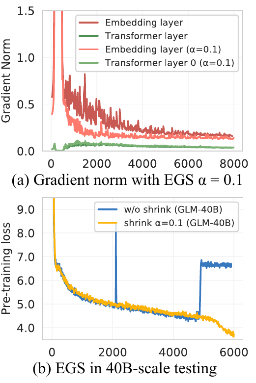
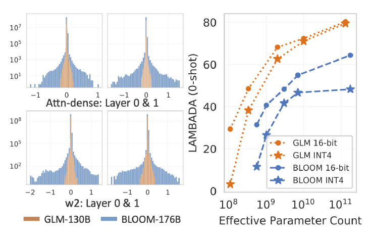

## Executive answer

[Technical report](https://arxiv.org/pdf/2103.10360v2) · [Hugging Face: zai-org/glm-10b](https://huggingface.co/zai-org/glm-10b)

Original GLM asks a useful question: can one network understand visible context in both directions, yet generate missing text one token at a time? Its answer is **autoregressive blank infilling**. GLM-130B carries that objective into a bilingual 130B model, where numerical stability and practical inference become central engineering problems.[^original][^130b]

This page studies two related releases, not one checkpoint. The Hugging Face resource above is **original GLM-10B**, not GLM-130B. The separate [GLM-130B technical report](https://arxiv.org/pdf/2210.02414v2) and [official release repository](https://github.com/zai-org/GLM-130B) document the 130B model and its download instructions.[^artifact][^release]

Study scope: original GLM report, March 2022 revision; GLM-130B report, October 2023 revision; selected released configurations and licenses. No checkpoint executed. Evidence checked October 10, 2026.

## Visual overview

3 purposeful figures accompany architecture and evidence. Original source crops were inspected at full resolution; integrated browser/focus/mobile/export QA passed.

## Key findings

- **Bidirectional context, causal answers.** Observed text can interact freely, while missing spans are generated without seeing future target tokens.[^original]
- **An objective is not a permanent architecture.** Original GLM uses two learned position coordinates; GLM-130B switches to one-dimensional RoPE. Later causal GLM models should not inherit the original mask by name alone.[^original][^130b]
- **Scaling exposes numerical bottlenecks.** GLM-130B reports embedding-gradient spikes, failed normalization trials and a simple gradient shrink intervention.[^130b]
- **Quantization depends on the trained model.** Its weight distributions permit useful INT4 results, but the report does not establish that all models quantize equally well.[^130b]

## Detailed analysis

### Model in numbers

| Dimension | Original GLM / GLM-10B | GLM-130B |
| --- | --- | --- |
| Parameters | Report experiments span 110M to 515M; the linked release is a separate 10B checkpoint.[^original][^artifact] | 130B dense bilingual model, not an expert model.[^130b] |
| Architecture | Released 10B config: 48 layers, width 4,096, 64 attention heads.[^artifact] | 70 layers, width 12,288, 96 heads, FFN inner width 32,768.[^release] |
| Training data | Original controlled experiments use BooksCorpus/Wikipedia; released 10B card names The Pile. A verified processed-token total for that artifact is not supplied here.[^original][^artifact] | Approximately 400B processed tokens, roughly balanced between English and Chinese.[^130b] |
| Training compute | Complete accelerator hours and FLOPs for the selected 10B artifact undisclosed in the inspected card. | Reported 60-day training window on 96 DGX-A100 nodes, eight 40GB GPUs each: 768 GPUs. This is not an exact useful GPU-hour ledger.[^130b] |
| Sequence contract | Linked 10B config: 1,024 positions, with task-dependent mask choices. Longer spans in the paper do not imply an unlimited released context.[^original][^artifact] | 2,048-token training sequence length; do not confuse weight quantization with longer context.[^130b][^release] |

### Blank infilling, step by step

Imagine a sentence with two missing spans. A conventional causal model cannot look to the right of a missing span. A masked encoder can look both ways, but its usual token-classification objective does not naturally generate an unknown-length answer. GLM keeps the useful parts of both contracts.[^original]

<!-- visual-id: V001 -->

**Figure 1.** Bidirectional context with autoregressive missing spans. Du et al., original GLM report Figure 2, March 2022 revision; figure-only crop under [CC BY 4.0](https://creativecommons.org/licenses/by/4.0/).[^original]

Read [Figure 1](#figure-1) in four steps:[^original]

1. Sample spans and replace each with a single mask token. The remaining observed sequence is **Part A**.
2. Move the missing spans into **Part B**, shuffle their order, and mark each span's beginning and end.
3. Let Part A attend to all of Part A, but never to the hidden targets in Part B.
4. Let each Part B token attend to all of Part A and previously generated Part B tokens. It cannot see future target tokens, even inside its own span.

The report writes the span-order objective as:[^original]

$$
\mathbb{E}_{z\sim\mathcal{Z}_m}\!\left[\sum_{i=1}^{m}\log p_\theta\!\left(s_{z_i}\mid x_{\mathrm{corrupt}},s_{z_{\lt i}}\right)\right]
\tag{1}
$$

Here $z$ permutes the missing spans, and each span probability factorizes autoregressively over its tokens. The mask prevents label leakage; shuffling changes which recovered spans can provide context for other spans.[^original]

**Two positions solve two different questions.** The first coordinate identifies the span's mask location in the corrupted sequence. The second identifies progress within that span, with zero for observed Part A tokens. The original implementation uses learned position embeddings; this is not the same mechanism as modern rotary positions.[^original][^code]

Short spans are sampled with Poisson mean 3, covering about 15% of the input. Longer document blanks cover 50% to 100% of the input, teaching continuation; sentence-level blanks teach conditional generation. Changing the mask distribution changes the tasks the model practices.[^original]

### What the original ablation actually establishes

In Table 6, the 340M GLM-Large experiment averages 77.0 on SuperGLUE; removing span shuffling gives 68.5, and replacing cloze-style fine-tuning with classification gives 70.0. These are controlled experiments at that size and setting, not measurements of the linked 10B artifact.[^original]

There is a tradeoff, not universal dominance. Adding the document objective slightly reduces GLM-Large's SuperGLUE average from 77.0 to 75.7, while enabling useful language modeling. At equal model size, that multitask model does not match the causal GPT baseline's language modeling performance; the report's larger models narrow or reverse the gap. The objective's value depends on the downstream task and budget.[^original]

### Scaling the objective to GLM-130B

GLM-130B preserves short blank recovery and long continuation, but changes its positional and numerical design. It uses **one-dimensional RoPE and GeGLU**, not the original learned two-coordinate scheme. For short spans it discards the intra-span coordinate; for long end spans it continues ordinary positions beyond the visible prefix. The causal target mask already provides token-order constraints.[^130b]

Its training mixtures have two different denominators. About **95% of training tokens** are self-supervised and 5% come from 74 instruction-style datasets. Within the self-supervised recipe, 30% of sequences use short-span masks and 70% use a long end-span mask. Calling this entirely instruction-free pretraining would be incorrect.[^130b]

Normalization, precision and distributed training

The report describes more than 30 unsuccessful large-scale normalization trials before its adopted DeepNorm-style post-LN design. This rescales the residual path and initializes selected projections accordingly. It is a report-specific stability intervention, not evidence that ordinary pre-LN is always unstable.[^130b]

Training uses FP16 forward/backward operations with FP32 master weights and optimizer states. Four-way tensor parallelism, eight pipeline stages and data parallelism distribute the workload. The reported hardware/model FLOP utilization values are 43.3% and 32.5%, under the authors' definitions; they are not wall-clock percentages that can be transferred to a different kernel stack.[^130b]

The architecture ablation in Appendix B.3 is a **110M** test: perplexity falls from 24.58 to 22.95 with RoPE, and then to 22.31 with GeGLU. This supports a design choice at small scale, not a full 130B factorial ablation.[^130b]

### A small intervention for a large instability

The team noticed embedding-gradient spikes preceding loss spikes and NaNs. Rather than change the forward embeddings, it shrinks the gradient entering the embedding layer:[^130b]

$$
e'=\alpha e+(1-\alpha)\operatorname{stopgrad}(e),\qquad \alpha=0.1
\tag{2}
$$

The forward value remains $e$, but the derivative with respect to it is multiplied by 0.1. This is neither freezing embeddings nor shrinking their forward activations.[^130b]

<!-- visual-id: V002 -->

**Figure 2.** Shrink the gradient, not the embedding value. GLM-130B report Figure 4, October 2023 revision; both panels retained, under [CC BY 4.0](https://creativecommons.org/licenses/by/4.0/).[^130b]

The lower plot in [Figure 2](#figure-2) is explicitly a **40B-scale test**. It strengthens the stability argument without isolating every cause of the final 130B run's success. The transferable lesson is to locate the numerical bottleneck before applying a global intervention.[^130b]

### Inference and INT4: what becomes smaller

<!-- visual-id: V003 -->

**Figure 3.** Weight distributions affect quantization loss. GLM-130B report Figure 5, October 2023 revision; complete histogram and accuracy panels under [CC BY 4.0](https://creativecommons.org/licenses/by/4.0/).[^130b]

The disclosed path stores weights in INT4 and retains FP16 activations, dequantizing weights for FP16 computation. It is **weight-only quantization**, not an all-INT4 execution claim. The authors relate its small quality loss to relatively narrow, symmetric weight distributions; that is evidence about their model, not a universal architectural guarantee.[^130b]

Table 2 reports five-shot MMLU at 44.75 for FP16 and 44.80 for INT4, but zero-shot LAMBADA drops from 80.21 to 79.47. The latter is a 0.74 percentage-point drop. “Little loss” is more accurate than “lossless.”[^130b]

Reported weight memory is approximately 70GB, including overhead. Full runtime memory also includes KV cache, activations, buffers and parallel communication. The demonstrated four-RTX-3090 setup is tied to the authors' inference stack, not a hardware guarantee for any present-day backend.[^130b]

### Evidence limits and release boundaries

The 130B attribution study that compares bidirectional context and instruction-style pretraining uses an **English-only 10B model**, not retrained 130B variants. Some instruction-mixture gains are concentrated in similarity/coreference tasks and some tasks regress. Treat that as a mechanistic lead with a scale limitation.[^130b]

The official 130B weight license restricts use to noncommercial research, while its code is Apache 2.0. The inspected original GLM-10B card does not establish the same license grant. Public weights, code rights and report-figure rights are separate questions.[^release][^artifact]

Open reproduction questions include the exact training exposure for the selected original 10B artifact, complete compute accounting, and independent verification of INT4 behavior under a modern serving stack. Neither this study nor the inspected artifact check runs the model.

### Lessons

GLM is a useful reminder that **attention visibility, target order and positional representation are separate design decisions**. GLM-130B then shows that scaling an objective requires numerical and systems work, not just more parameters. Continue to [GLM-4](/architectures/models/glm-4/) to see a later causal, grouped-query checkpoint rather than assuming the original blank-infilling contract persists.

## Counterevidence and uncertainty

Small-model ablations do not isolate the final 130B causal effects. Original GLM trades objectives against downstream specialization; INT4 is not lossless on every test. Weight, code and report rights differ.

## Implications

Separate attention visibility, target order and position mechanisms when comparing objectives. Diagnose numerical bottlenecks locally. Quantization and inference costs must be measured in the actual backend.

## Open questions and future research

Exact selected original 10B training exposure; complete 130B compute accounting; scale-transfer of small ablations; modern backend INT4 replication.

## Sources

[^original]: Zhengxiao Du, Yujie Qian, Xiao Liu et al. [GLM: General Language Model Pretraining with Autoregressive Blank Infilling](https://arxiv.org/pdf/2103.10360v2), March 17, 2022 revision, ACL 2022. Sections 2 and 3, Figures 2 and 4, Tables 1 and 6.
[^130b]: Aohan Zeng, Xiao Liu, Zhengxiao Du et al. [GLM-130B: An Open Bilingual Pre-Trained Model](https://arxiv.org/pdf/2210.02414v2), October 25, 2023 revision, ICLR 2023. Sections 2 to 5; Figures 4 and 5; Table 2; Appendices B.3, B.8 and B.9.
[^artifact]: THUDM / Z.ai. [Original GLM-10B card](https://huggingface.co/zai-org/glm-10b) and [released configuration](https://huggingface.co/zai-org/glm-10b/blob/696788d4f82ac96b90823555f547d1e754839ff4/config.json), inspected October 10, 2026. The resource is GLM-10B, not GLM-130B.
[^code]: THUDM. [Original GLM implementation](https://github.com/THUDM/GLM/blob/4f61ed7237a3b0187f4d62062429348276a78c84/model/modeling_glm.py), inspected October 10, 2026. Targeted input, position and mask interfaces; not executed.
[^release]: Z.ai / THUDM. [GLM-130B official repository](https://github.com/zai-org/GLM-130B), [model configuration](https://github.com/zai-org/GLM-130B/blob/212215c54f8a9da2deed51455868305235664370/configs/model_glm_130b.sh), [weight license](https://github.com/zai-org/GLM-130B/blob/212215c54f8a9da2deed51455868305235664370/MODEL_LICENSE) and [code license](https://github.com/zai-org/GLM-130B/blob/212215c54f8a9da2deed51455868305235664370/LICENSE), inspected October 10, 2026.

## Completed integration review

122 site tests pass, zero Astro diagnostics, 59-page static build and 59-doc lint clean. Fresh browser regression checks cover all 41 model pages plus the catalog and Foundations at 1440 px light, 390 px light and 320 px dark (129 views), reduced motion, desktop focus, active family navigation, figure order, loaded images and local anchors; narrow figures remain keyboard-pannable and link to full-size originals. All 41 Markdown/MDX exports and both agent manifests checked; representative search queries resolve. All 35 new desktop figure renders received manual contact-sheet review; dense focus/mobile views and resource-card/catalog layout received additional manual inspection. Existing bundler directive and philosophy-redirect indexing warnings remain. No model execution or benchmark reproduction.

Primary report, selected artifact, uncertainty and useful source figures are documented above and in the coverage audit.
