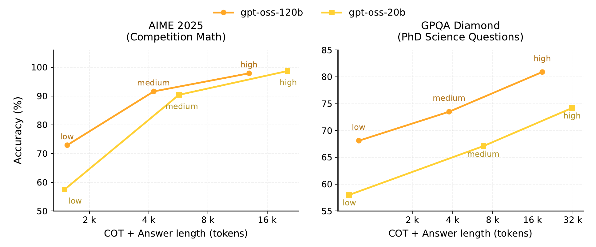

# gpt-oss

## Executive answer

gpt-oss makes a reasoning and tool use model available as downloadable weights, rather than only as a hosted service. Its interesting engineering question is how to combine substantial stored capacity with a smaller active computation and a practical deployment footprint.[^report]

[Technical report](https://arxiv.org/pdf/2508.10925v1) · [Hugging Face: openai/gpt-oss-120b](https://huggingface.co/openai/gpt-oss-120b)

## Visual overview

<!-- visual-id: V001 -->
![Decoder block: Residual stream: Width 2,880; RMSNorm + attention: Local / full layers alternate; Residual addition: Retain the input path; RMSNorm + MoE: Four selected experts; Residual addition: Continue to next layer. 36 blocks in 120b; 24 in 20b. All attention remains causal.
Efficiency levers: MoE routing: Reduce active FFN work; GQA + local layers: Reduce attention/cache costs; MXFP4 experts: Reduce stored weight bytes. These are different savings. None removes all weights, all full-history cache, or the cost of long generation.](visuals/figure-1.png)

<!-- visual-id: V002 -->

## Key findings

- **Sparse capacity, compact active path.** The two models select four experts per token. The 120b release stores about 116.8B parameters but activates about 5.1B per token per forward pass.[^report]
- **Memory efficiency is designed into the release.** Alternating local and full attention, GQA and MXFP4 expert weights address different parts of inference cost.[^report]
- **Reasoning is an interface, not just more tokens.** Low, medium and high effort, Harmony channels and tool handoff delimiters form a structured model contract.[^report][^card]
- **Useful disclosure, not a complete recipe.** The model card describes architecture, compute, evaluation and safety, but not a fully reproducible dataset or RL implementation.[^report]

## Detailed analysis

gpt-oss makes a reasoning and tool use model available as downloadable weights, rather than only as a hosted service. Its interesting engineering question is how to combine substantial stored capacity with a smaller active computation and a practical deployment footprint.[^report]

### Highlights

- **Sparse capacity, compact active path.** The two models select four experts per token. The 120b release stores about 116.8B parameters but activates about 5.1B per token per forward pass.[^report]
- **Memory efficiency is designed into the release.** Alternating local and full attention, GQA and MXFP4 expert weights address different parts of inference cost.[^report]
- **Reasoning is an interface, not just more tokens.** Low, medium and high effort, Harmony channels and tool handoff delimiters form a structured model contract.[^report][^card]
- **Useful disclosure, not a complete recipe.** The model card describes architecture, compute, evaluation and safety, but not a fully reproducible dataset or RL implementation.[^report]

Study scope: the August 2025 model card, public 120b configuration, model card and license. The linked document is a substantive **model card**, not a separately named technical report. Both sizes are covered; exact implementation dimensions below use 120b. Evidence checked October 10, 2026. No weights or inference code executed.

### Model in numbers

| Dimension | 120b | 20b |
| --- | --- | --- |
| Total / active parameters | 116.83B / 5.13B | 20.91B / 3.61B |
| Layers / experts | 36 / 128, top four | 24 / 32, top four |
| Published checkpoint size | 60.8 GiB | 12.8 GiB |
| Context | 131,072 positions | 131,072 positions |
| Pretraining data | Trillions of text tokens; exact count and mixture undisclosed | Same disclosure boundary |
| Training compute | 2.1 million H100 hours | Almost ten times fewer; no exact number stated |

Parameter counts and checkpoint sizes come from Table 1, not the rounded model names. Active counts include the output projection, but exclude input embeddings. Accelerator hours are not dollars or hardware independent FLOPs. The model card associates the compute with the training run without giving a stage by stage cost split.[^report]

### Architecture: three separate efficiency levers

<!-- visual-id: V001 -->
![Decoder block: Residual stream: Width 2,880; RMSNorm + attention: Local / full layers alternate; Residual addition: Retain the input path; RMSNorm + MoE: Four selected experts; Residual addition: Continue to next layer. 36 blocks in 120b; 24 in 20b. All attention remains causal.
Efficiency levers: MoE routing: Reduce active FFN work; GQA + local layers: Reduce attention/cache costs; MXFP4 experts: Reduce stored weight bytes. These are different savings. None removes all weights, all full-history cache, or the cost of long generation.](visuals/figure-1.png)

**Figure 1.** Three complementary efficiency mechanisms. Independent explanation of the model card and released configuration; the report has no corresponding architecture figure.[^report][^config]

Pre-normalization RMSNorm precedes attention and MoE. Attention projects the 2,880 dimensional residual stream into 64 query heads of width 64, with eight KV heads. The concatenated query width is therefore 4,096, **not** the residual width; the output projection maps it back. Each full layer attends to the causal prefix, while alternating local layers use a 128 token window.[^report][^config]

The router selects the four highest scoring experts and applies softmax only over those selected scores. The 120b network has 128 experts per MoE layer; 20b has 32. The card notes that its SwiGLU differs from the usual textbook form through clamping and a skip term within the activation. The reference code caps the gate above seven, clamps the linear branch to minus seven through seven, and computes the gated product with a plus one on the linear branch. Its sigmoid coefficient is 1.702. This is not another outer residual stream addition; ordinary SwiGLU is not checkpoint equivalent.[^report][^code]

RoPE with YaRN extends full layer positions to 131,072. Each attention head also has a learned denominator bias: it provides an option to allocate probability mass to no value token. This is an attention sink mechanism, not an extra token whose value must be appended to the input.[^report][^config]

### Quantization and the real memory boundary

Quantization is included in post training, and the official card states that the reported evaluations use the same MXFP4 format. MXFP4 stores expert weights at about 4.25 bits per parameter, including block scale overhead. Experts contain more than 90% of parameters, so quantizing this path greatly reduces the checkpoint footprint. The released configuration excludes attention, routers, embeddings and the output head from that quantization.[^report][^config]

OpenAI describes 120b fitting on an 80 GB GPU and 20b operating with as little as 16 GB memory. Those are deployment footprint claims, **not a guarantee of full context, arbitrary batch size or every backend**. KV cache, activations, runtime buffers and unsupported low precision kernels can change the requirement. Full attention layers still retain token growing history; local layers can use bounded history in a suitable implementation.[^report][^card]

### Training and what remains undisclosed

Pretraining uses text only, with emphasis on STEM, coding and general knowledge. The knowledge cutoff is June 2024. Training uses H100 GPUs, PyTorch, expert optimized Triton kernels and FlashAttention. The exact corpus, token count, optimizer schedule and data mixture are not supplied.[^report]

Post training teaches chain of thought reasoning and tool use with RL techniques described as similar to OpenAI o3. The arXiv abstract also mentions distillation; the PDF body does not give a corresponding recipe.[^abstract] It does **not** identify GRPO, PPO or a complete reward recipe, so this study does not fill those gaps with a familiar algorithm. Reasoning levels are trained behaviors selected through the system prompt, rather than three different parameter checkpoints.[^report]

### Harmony: the agent boundary matters

The o200k_harmony BPE vocabulary contains 201,088 tokens. Harmony distinguishes roles, message channels, recipients, turn endings and control handoffs. Analysis, final answers and tool invocations are separate structured messages, not arbitrary prose tags. The model learns the priority order system, developer, user, assistant and tool.[^report][^card]

The model can emit a browser, Python or developer function request. **An external harness must execute it and return the tool observation.** Downloading weights does not grant network access or provide a secure sandbox. Remove reasoning from completed prior assistant turns, but preserve it while continuing an active tool interaction. Message end, completed assistant turn and tool handoff are distinct delimiters; treating all three as one end token breaks the loop.[^harmony] A generic chat template or incorrect handoff handling can break the trained behavior.[^report]

Structured output capability similarly needs the appropriate format and serving support. It is not evidence that every locally generated answer will satisfy a schema without validation.[^card]

### Evidence for adjustable reasoning

<!-- visual-id: V002 -->

**Figure 2.** Reasoning effort trades tokens for accuracy on two benchmarks. Original model card Figure 3, cropped to the complete plots; CC BY 4.0.[^report]

[Figure 2](#figure-2) measures average chain of thought **plus answer** length. It supports a test time accuracy versus generation budget tradeoff on these tasks, not a universal latency curve or a guarantee that high effort helps every request. The broader benchmark comparisons use pass@1 and specified reasoning levels; some math results allow tools while a comparison model's result does not. Compare matched tool conditions, not headline bars alone.[^report]

The card's safety evaluations include jailbreak resistance, instruction hierarchy, hallucinations and adversarial fine tuning. Open weights allow later modification, so published default safety behavior is not a system level guarantee after fine tuning or arbitrary tool integration.[^report]

### Limits and reusable lessons

This is a text model, not a VLM. Its released weights and inference components are Apache 2.0, with a separate usage policy referenced by the model card; the report artwork uses CC BY 4.0. Public weights do not make the training corpus or complete RL stack public.[^license][^report]

The transferable lesson is to study **the network, representation format and execution harness together**. Sparse FFNs make stored capacity affordable to activate; quantization makes it cheaper to hold; a correct agent protocol makes its trained skills usable. Continue to [MiniMax M1](/architectures/models/minimax-m1/) for a more explicit policy optimization recipe.

[^report]: OpenAI. [gpt-oss-120b & gpt-oss-20b Model Card](https://arxiv.org/pdf/2508.10925v1), August 2025. Sections 2 to 5, Tables 1 and 3, Figures 1 to 3 and Appendix 1. Exact report inspected October 10, 2026.
[^config]: OpenAI. [Released 120b configuration](https://huggingface.co/openai/gpt-oss-120b/blob/b5c939de8f754692c1647ca79fbf85e8c1e70f8a/config.json). Shapes, layer patterns, positions and quantization inspected; no runtime executed.
[^card]: OpenAI. [Official 120b model card](https://huggingface.co/openai/gpt-oss-120b/blob/b5c939de8f754692c1647ca79fbf85e8c1e70f8a/README.md) and [official repository](https://github.com/openai/gpt-oss). Interface, deployment and release scope inspected October 10, 2026.
[^license]: OpenAI. [Released checkpoint license](https://huggingface.co/openai/gpt-oss-120b/blob/b5c939de8f754692c1647ca79fbf85e8c1e70f8a/LICENSE), Apache 2.0. [Report figure attribution and extraction record](/figures/model-studies/gpt-oss/SOURCES.md).

[^harmony]: OpenAI. [Harmony response format](https://developers.openai.com/cookbook/articles/openai-harmony), message endings and handling reasoning output in subsequent sampling. Official guide inspected October 10, 2026.
[^code]: OpenAI. [Reference attention and activation implementation](https://github.com/openai/gpt-oss/blob/main/gpt_oss/torch/model.py), sdpa and swiglu functions inspected October 10, 2026; not executed.
[^abstract]: OpenAI. [arXiv model card abstract](https://arxiv.org/abs/2508.10925v1), distillation statement in the metadata, distinct from the PDF training disclosure.

## Counterevidence and uncertainty

Measured versus rounded parameter names; active-count definition; mixed-attention cache; MXFP4 exclusions; training-hour scope; unspecified RL algorithm; Harmony handoffs and external execution. This is a model card, not a separately named report.

## Implications

Separate mechanism, selected artifact, experiment and system; missing recipes and unexecuted runtime remain explicit.

## Open questions and future research

Application robustness, unreleased data/rewards and runtime reproduction require separate work.

## Sources

Full claim-local references above; exact report and immutable artifacts in state/sources.jsonl.

## What changed in this revision

New full study and original excerpts. Technical and rights review complete; integrated presentation QA passed.

## Completed integration review

122 site tests pass, zero Astro diagnostics, 59-page static build and 59-doc lint clean. Fresh browser regression checks cover all 41 model pages plus the catalog and Foundations at 1440 px light, 390 px light and 320 px dark (129 views), reduced motion, desktop focus, active family navigation, figure order, loaded images and local anchors; narrow figures remain keyboard-pannable and link to full-size originals. All 41 Markdown/MDX exports and both agent manifests checked; representative search queries resolve. All 35 new desktop figure renders received manual contact-sheet review; dense focus/mobile views and resource-card/catalog layout received additional manual inspection. Existing bundler directive and philosophy-redirect indexing warnings remain. No model execution or benchmark reproduction.

Cross-review verified head/sink dimensions, exact activation clamps and sigmoid scale, policy/tool continuation reasoning retention, post-training quantization and scoped distillation evidence. Official Harmony and reference implementation re-inspected; active tool loops preserve current reasoning while completed old turns remove it.
