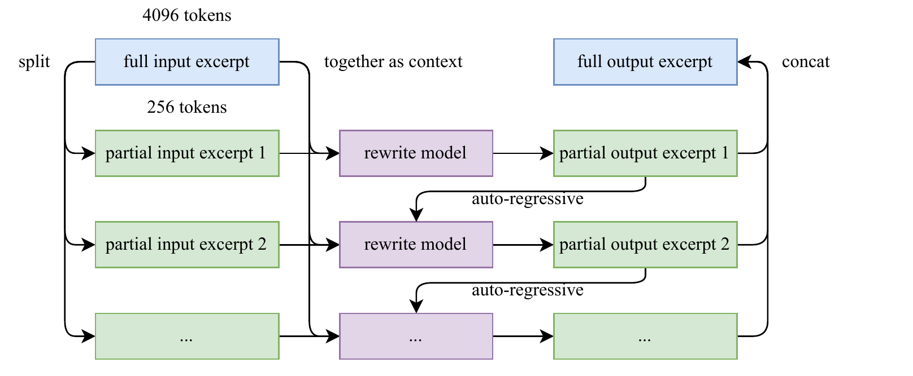
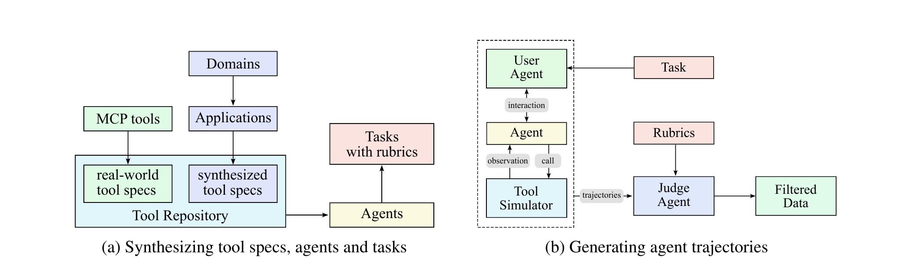

## Executive answer

[Technical report](https://arxiv.org/pdf/2507.20534v1) · [Hugging Face: moonshotai/Kimi-K2-Instruct](https://huggingface.co/moonshotai/Kimi-K2-Instruct)

Kimi K2 asks how to train a much larger pool of experts without making every token equally expensive. Its answer combines a familiar sparse decoder with an unusual optimizer safeguard, more varied presentations of training material, and post training that teaches the model to act through tools.[^report]

## Visual overview

Added source chunk-rephrasing figure with fidelity boundary and max-two-production-rewrite distinction; sparsity/head tradeoffs; synchronous colocated engines, checkpoint refresh and partial agent trajectories. Source crops and native SVGs were inspected as assets. Fresh integrated HTML/mobile/theme/export verification passed.

## Key findings

- **Stabilize the optimizer, not just the forward pass.** MuonClip constrains growing attention logits by rescaling selected query and key weights after an optimizer step.[^report]
- **Expand capacity through sparse experts.** The model stores about a trillion parameters but activates roughly 33B for a token, with MLA controlling attention cache size.[^report]
- **Train decisions in environments.** Synthetic tool trajectories, executable verifiers, and a learned self critic provide different forms of feedback. They are complementary, not equally reliable ground truth.[^report]

The public weights and technical report make these choices inspectable. This is an open weight release with a **modified MIT license**, not a complete open training dataset or unrestricted standard MIT grant.[^repo][^license]

Study scope: original July 2025 report, relevant optimizer and tool formatting appendices, original K2 Instruct artifact and licenses. This page does not cover K2 Thinking or K2-Instruct-0905. No checkpoint executed. Evidence checked October 10, 2026.

## Detailed analysis

### Model in numbers

Representative checkpoint: **Kimi-K2-Instruct**, the original nonthinking instruction model.

| Dimension | Value and scope |
| --- | --- |
| Parameters | Table 2 reports 1.04T total and 32.6B active. The abstract rounds these to 1T and 32B.[^report] |
| Pretraining | Headline 15.5T processed tokens. The recipe separately describes 400B annealing tokens and an additional 60B long context tokens; do not treat the headline as a unique corpus size.[^report] |
| Tool synthesis | More than 3,000 real MCP tools plus about 20,000 synthetic tools are described. These counts are tool interfaces, not training trajectories or verified tasks.[^report] |
| Compute | Full training FLOPs and accelerator hours are not disclosed in the report. A model parallel group of 256 GPUs describes placement, not the total run budget.[^report] |
| Context | Main pretraining at 4,096 tokens; long context training at 32K with YaRN extension to 128K. Released maximum position setting is 131,072.[^report][^config] |

### Architecture: more experts, similar active work

The decoder has 61 layers and a residual width of 7,168. Its first FFN is dense. Other layers combine one shared expert with eight selected experts from 384 routed experts, each with intermediate width 2,048. MLA uses 64 attention heads, a 512 dimensional KV latent, and a decoupled 64 dimensional RoPE key. Compared with DeepSeek-V3, the design expands the expert pool while reducing the attention head count.[^report][^config]

The important distinction is **stored capacity versus per token computation**. A larger pool permits more specialist weights without executing every expert, but all those weights still need storage and suitable placement. Dispatch, communication, and uneven expert loads remain real costs. Unlike V3, K2 does not group its expert selection into node limited routing. Compressed MLA cache also grows with context; it is not recurrent fixed memory.[^report]

Why increase sparsity but reduce attention heads?

The small scale sparsity experiments hold eight active experts and one shared expert fixed while varying total experts. At validation loss 1.5, the fitted optimum for sparsity 48 needs 1.15 times less FLOPs than sparsity 32. This is a scaling fit, not a measured full K2 versus V3 training cost.[^scaling]

A separate head count study finds only 0.5–1.2% lower validation loss from doubling heads under its iso token comparisons. The report estimates that increasing 64 to 128 heads at 128K context, keeping 384 experts, adds 83% inference FLOPs. K2 therefore spends more capacity on stored experts and less arithmetic on attention heads; communication and weight storage still constrain the choice.[^scaling]

### MuonClip: control a failure mode after the update

Muon orthogonalizes momentum based matrix updates. At larger scale, the authors observed exploding pre softmax query key scores with ordinary Muon. RMS normalization of the input does not directly bound the spectral norms of the learned query and key projections. MuonClip therefore adds QK-Clip after the optimizer's weight update.[^report]

<!-- visual-id: V005 -->

### Figure 1

**Figure 1.** MuonClip's post update safeguard. Original explanatory diagram informed by the report's Algorithm 1 and Appendix D.[^report]

### Meaning

Training step: Forward and backward: Record each head's largest attention score; Muon update: Momentum, orthogonalization, scale and weight decay; QK-Clip: Rescale only heads above threshold; Next forward pass: Apply the rescaled projections. The clipping changes weights after the update. It is not a soft cap inserted into the current attention softmax.

Report and rendered page retain the adjacent explanation. Source asset inspection is not HTML/browser QA.

For a head with recorded maximum score $S_{\max}^{h}$, define:[^report]

$$
\gamma_h=\min\left(1,\frac{\tau}{S_{\max}^{h}}\right),\qquad \tau=100
\tag{1}
$$

The content query and key projection factors are each multiplied by $\sqrt{\gamma_h}$. Their dot product therefore scales by $\gamma_h$. The head specific rotary query factor receives $\gamma_h$; the shared rotary key projection is left unchanged. This respects MLA's shared positional path rather than blindly multiplying every Q and K weight by the same factor.[^report]

The safeguard is selective and can become inactive. It controls weight growth using the observed batch; it does not promise that a different next batch can never exceed the threshold. Appendix D reports that 12.7% of heads triggered clipping at least once during the initial 70,000 steps, then all heads eventually fell below the threshold. A separate 3B total, 0.5B active experiment with a more aggressive threshold of 30 found negligible loss differences. That bounded experiment supports the safeguard's feasibility; it does not isolate every contributor to the final trillion parameter model.[^report]

### Data and training recipe

K2 rephrases selected knowledge and mathematics material to expose the same information through different styles and perspectives. Generation proceeds over chunks, with checks for fidelity to the source. The goal is to reduce repetitive presentations, not license arbitrary hallucinated facts as pretraining data.[^report]

<!-- visual-id: V006 -->

**Figure 2.** Rephrase chunks without losing the wider context. Reproduced intact from report Figure 4, under [CC BY-NC-ND 4.0](https://creativecommons.org/licenses/by-nc-nd/4.0/).[^rephrasing]

[Figure 2](#figure-2) retains the full 4,096 token excerpt as context while rewriting 256 token chunks sequentially. Earlier rewritten chunks condition later ones. Fidelity checking remains a separate quality control step; the diagram is not a guarantee that generation preserves every fact.[^rephrasing]

One early knowledge experiment contrasts repeating raw documents, repeating one rewrite, and using multiple distinct rewrites. SimpleQA rises from 23.76 to 27.39 to 28.94 in that setup. The production knowledge corpora are rephrased at most twice, rather than applying the ten rewrite experimental condition to every corpus. Those are recipe comparisons on an internal experimental model; they do not establish a universal advantage for synthetic data or attribute the full K2 gain to rephrasing.[^report]

The main recipe uses 4K sequences, a 67M token global batch, weight decay 0.1, and MuonClip. After 500 warmup steps, learning rate stays at 0.0002 for the first 10T tokens, then decays across 5.5T tokens. Annealing and long context activation lower it further to 0.000007.[^report]

Precision and parallelism are distinct from the optimizer

The reported training system combines 16 way pipeline parallelism, 16 way expert parallelism, and ZeRO-1 data parallelism. It overlaps communication with an interleaved pipeline schedule and offloads activations to CPU memory. Selective recomputation protects scarce device memory.[^report]

FP8 is used to **store selected activations**, not for the report's training matrix computation. The authors explicitly avoid FP8 computation after observing quality risks in preliminary studies. The released Instruct artifact's quantization metadata is an inference storage choice, not evidence that the pretraining run used the same arithmetic.[^report][^config]

### Post training: grounded practice and a critic

<!-- visual-id: V007 -->

**Figure 3.** Tool interfaces become filtered trajectories. Reproduced intact from the report's Figure 8, under [CC BY-NC-ND 4.0](https://creativecommons.org/licenses/by-nc-nd/4.0/).[^report]

[Figure 3](#figure-3) shows two different creation steps. On the left, real MCP tools and generated interfaces define the available action space, which supports task and rubric generation. On the right, a user agent, task agent, and tool simulator produce an interaction history; a separate rubric judge filters it. A simulated observation is not an independently executed real world outcome.[^report]

Tool synthesis first builds interfaces and state transitions, then agent tasks with rubrics, then multi step interactions between user, agent and tool simulator. A judge filters trajectories. Real executable environments provide additional coding and software engineering experience. Simulated tool state is useful coverage, but its fidelity must be tested before transferring a policy to real systems.[^report]

RL mixes tasks with verifiable answers and less directly verifiable tasks. Code can use execution checks; instruction tasks can combine programmatic and judge checks. A learned self critic produces pairwise rubric based judgments for broader behavior and is refined using signals from verifiable tasks. Its judgments remain model generated preferences, not independent truth.[^report]

K2 uses the policy optimization method from Kimi K1.5, rather than simply labeling all group sampled reasoning training “GRPO.” A simplified form of the report's objective is:[^report]

$$
\mathcal{L}(\theta)=\mathbb{E}\!\left[\left(r_i-\bar r-\tau\log\frac{\pi_\theta(y_i\mid x)}{\pi_{\mathrm{old}}(y_i\mid x)}\right)^2\right]
\tag{2}
$$

Here $\bar r$ is the group reward baseline and $\tau$ controls regularization, distinct from the clipping threshold in Equation (1). The report also describes task dependent token budgets, truncation penalties, auxiliary pretraining loss to resist forgetting, and temperature scheduling. These choices affect exploration and response cost.[^report]

### RL systems: synchronized learning, partial trajectories

K2's training and inference engines are **colocated and synchronized**, unlike GLM-5's continuously decoupled actors. A controller alternates rollout and learning on the same workers. Training parameters are offloaded during generation; a checkpoint engine streams and reshards updated parameters for the inference replicas. The authors report a full refresh in less than 30 seconds in their system, not a universal bandwidth requirement or latency promise.[^rlsystems]

Agent tasks can wait on environment services for a long time. Independent environment services and many concurrent rollouts reduce idle GPU time. Partial rollout pauses unfinished long trajectories and resumes them in a later RL iteration rather than waiting for every straggler. That scheduling optimization does not mean the entire learner and actor system is fully asynchronous.[^rlsystems]

### Inference, evidence and limits

Tool calls are serialized model outputs. An application still needs to parse them, authorize operations, execute tools, and return results using the release's conversation format. A strong tool benchmark is not permission to expose unrestricted shell or network access.[^report][^repo]

The main evaluation is nonthinking, generally with an 8K output limit; the SWE-bench Agentless setup uses 16K. Repeated run averages and best of multiple attempts must not be mixed. For example, the report's SWE-bench agent result rises from 65.8 in a single attempt to 71.6 with an internal verifier selecting among attempts. That gain includes extra test time search and selection.[^report]

The modified MIT license requires prominent Kimi K2 attribution for qualifying commercial products above specified monthly user or revenue thresholds. Read the exact grant before deployment. The release does not disclose all data, complete training code, or total project cost.[^license][^repo]

The reusable lesson is to connect capacity, training stability, and feedback quality. More experts require a robust optimizer and communication system; more synthetic experience requires fidelity controls; more agentic behavior requires grounded execution and careful evaluation. Continue to [Kimi Linear](/architectures/models/kimi-linear/) for a different strategy: changing the memory carried across long sequences.

## Counterevidence and uncertainty

The page preserves source-specific model/recipe/harness conditions and contrary results. [Coverage audit](coverage-audit.md) records each essential technique, source locator, addition and justified omission. No checkpoint execution or independent speed/benchmark reproduction was performed.

## Implications

Added source chunk-rephrasing figure with fidelity boundary and max-two-production-rewrite distinction; sparsity/head tradeoffs; synchronous colocated engines, checkpoint refresh and partial agent trajectories.

## Open questions and future research

Fresh integrated browser and export checks for revision 3 passed. Report omissions and runtime reproduction gaps remain scoped in the coverage audit rather than filled with estimates.

## What changed in this revision

Revision 3 broadens mechanism depth rather than adding decorative figure quotas. Complete report and relevant appendix/code review, exact source locators, independent visual inspection and an adversarial protocol/number pass are recorded below.

## Sources

[^report]: Kimi Team. [Kimi K2 Technical Report](https://arxiv.org/pdf/2507.20534v1), July 28, 2025. Sections 2 to 4, Algorithm 1, Table 2, and Appendices A, D and E. Original version inspected October 10, 2026.

[^config]: Moonshot AI. [Original Kimi-K2-Instruct configuration](https://huggingface.co/moonshotai/Kimi-K2-Instruct/blob/fd1984e2b7a3350dbf7305fe73a4ede25c14de50/config.json), inspected October 10, 2026.

[^repo]: Moonshot AI. [Kimi K2 release and tool usage](https://github.com/MoonshotAI/Kimi-K2/tree/1b4022bbb7187cf4011a8bdf0b4cd10e2daa26c4), pinned repository, inspected October 10, 2026. Current documentation also includes later variants; this study uses the original model and report.

[^license]: Moonshot AI. [Modified MIT license](https://github.com/MoonshotAI/Kimi-K2/blob/1b4022bbb7187cf4011a8bdf0b4cd10e2daa26c4/LICENSE), inspected October 10, 2026.

[^scaling]: Kimi Team. [Kimi K2 report](https://arxiv.org/pdf/2507.20534v1), Section 2.3, Table 2, Figures 5 and 6: sparsity fits, head count comparisons and 128K inference FLOP estimate.

[^rephrasing]: Kimi Team. [Kimi K2 report](https://arxiv.org/pdf/2507.20534v1), Section 2.2, Figure 4, PDF page 6, and Table 1. Figure reproduced without adaptations under exact v1 CC BY-NC-ND 4.0; [notice](/figures/model-studies/kimi-k2/NOTICE.md). Reuse is noncommercial; future monetization requires review.

[^rlsystems]: Kimi Team. [Kimi K2 report](https://arxiv.org/pdf/2507.20534v1), Sections 3.3.1–3.3.4: synchronized colocated engines, checkpoint refresh and partial agent rollouts.

## Revision 3 presentation verification

106 automated tests, zero Astro diagnostics, the static build and all 43 docs lint checks passed. The collection passed 81 fresh browser views; this page was checked at 1440px light, 390px light and 320px dark, with desktop focus, active family navigation, caption order, anchors, image decoding, resource cards and no page overflow. Complete source figures fit desktop, while narrow frames support keyboard panning and full-size access. Search and Markdown/MDX exports preserve citations, figures and source links. All 66 model figure renders were inspected, with full-size review of new dense diagrams. See state/presentation-qa.json for exact page checksums and evidence. No model benchmark was reproduced. Existing bundler and redirect warnings remain.
