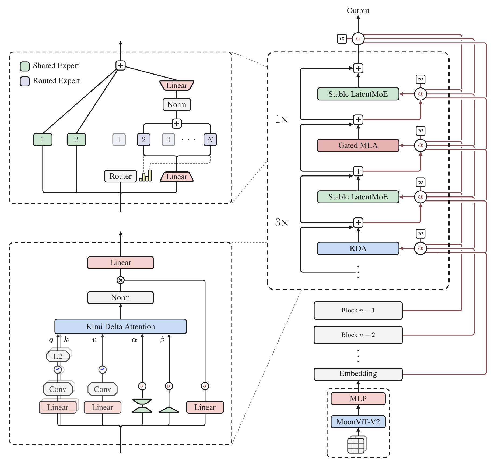
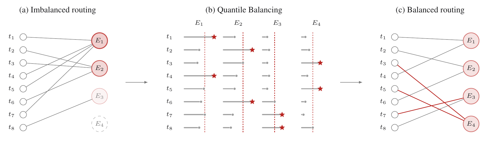
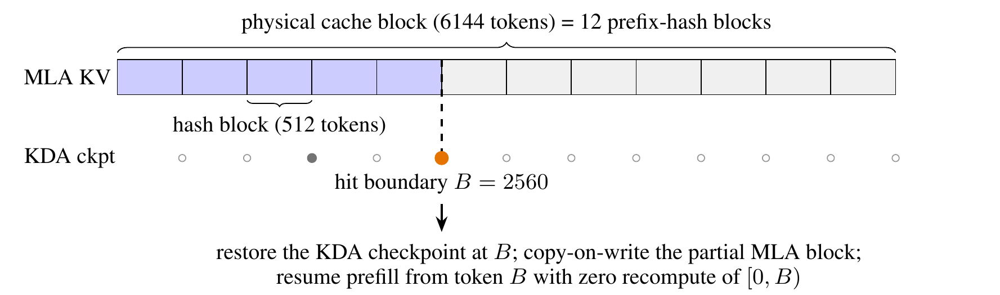

## Executive answer

[Technical report](https://raw.githubusercontent.com/MoonshotAI/Kimi-K3/3cb39dfd32e51c3328e2e4b4af21341247d06c43/k3_tech_report.pdf) · [Hugging Face: moonshotai/Kimi-K3](https://huggingface.co/moonshotai/Kimi-K3)

Kimi K3 expands more than model size. It changes how information moves across a long sequence, across network depth, and through sparse experts. Native vision and deployment aware post training then connect that foundation to long running agents that can inspect their own visual work.[^report]

## Visual overview

Added exact quantile margin/cutoff update and licensed original figure; clipped nine-teacher OPD equation; draft feature-fusion/acceptance-overlap objective; licensed fine-grained prefix-caching figure; MoonEP execution balancing and fleet cache affinity/admission boundaries. Source crops and native SVGs were inspected as assets. Fresh integrated HTML/mobile/theme/export verification passed.

## Key findings

- **Three directions of information flow.** KDA and gated MLA mix tokens; Attention Residuals mix representations across depth; Stable LatentMoE expands specialist capacity in a narrower routed space.[^report]
- **Vision from the start.** Images and video share a vision encoder trained jointly from scratch with the language backbone, rather than attached through a later alignment stage.[^report]
- **Train for deployment conditions.** Post training uses quantized experts in both training and rollouts, and consolidates nine domain and reasoning effort teachers into one policy.[^report]

Its value for architecture research is this integration of memory, depth, width, numerical stability, and agent systems. The public weights are governed by the **custom Kimi K3 License**, with conditions for qualifying commercial services. “Open weight” is more accurate than implying a standard permissive open source license.[^license][^repo]

Study scope: pinned official July 2026 technical report, architecture and deployment sections, relevant activation and routing appendices, released configuration, selected custom code, and license. No checkpoint executed. Evidence checked October 10, 2026.

## Detailed analysis

### Model in numbers

Representative checkpoint: **moonshotai/Kimi-K3**, the released native multimodal model with quantized routed experts.

| Dimension | Value and scope |
| --- | --- |
| Parameters | Table 1 gives 2.78T total and 104.2B active; the abstract rounds to 2.8T and 104B. The vision encoder is separately listed as 401M parameters.[^report] |
| Backbone | 93 layers, width 7,168; 69 KDA and 24 gated MLA layers. The first FFN is dense.[^report][^config] |
| Training data | Text covers web, code, mathematics and knowledge; vision includes documents, OCR, video and rendered code. Total processed tokens and unique corpus size are not disclosed in the inspected report.[^report] |
| Compute | Complete training FLOPs, accelerator hours and financial cost are not disclosed. The reported approximately 2.5 times scaling efficiency is a fitted comparison of combined recipes, not an isolated layer speedup.[^report] |
| Context | Curriculum: 8K then 64K during pretraining, 256K then 1M during cooldown. Config supports 1,048,576 positions; selected agent evaluations use compaction before that limit.[^report][^config] |
| Precision | Post training uses MXFP4 routed expert weights and MXFP8 activations; nonexpert components and shared experts remain higher precision.[^report][^config] |

### A map of the computation

Text embeddings and projected visual features enter one backbone. Each layer mixes tokens, then channels through experts. Block Attention Residuals determine which preceding depth representations each module consumes. These mechanisms solve different bottlenecks; none is a substitute for the other two.[^report]

<!-- visual-id: V004 -->

**Figure 1.** Token, depth, and expert mixing. Reproduced from the report's Figure 2, under the [Kimi K3 documentation grant](/figures/model-studies/kimi-k3/NOTICE.md).[^report][^license]

In [Figure 1](#figure-1), the lower right vision path projects into the same embedding stream as text. Read the backbone upward: three KDA layers are followed by one gated MLA layer, each paired with an expert FFN. Twenty three such groups and a final MLA give 69 KDA and 24 MLA layers. The red connections retrieve representations across **depth**, not past token positions; the upper left inset narrows only the routed expert path while shared experts retain full width.[^report][^config]

### Sequence length: refine the hybrid memory

K3 retains the corrective, channel decayed recurrence of [Kimi Linear](/architectures/models/kimi-linear/). KDA stores a fixed shape matrix per head, whereas global MLA still retains sequence growing history. The hybrid therefore reduces cache growth without eliminating it.[^report]

One consequential change is a **lower bound on log decay**. Earlier KDA used an unbounded negative Softplus mapping. K3 instead uses:[^report]

$$
g_t=g_{\min}\operatorname{sigmoid}(e^A z_t),\qquad \alpha_t=e^{g_t},\qquad g_{\min}=-5
\tag{1}
$$

For a 16 token tile, cumulative log decay is above minus 80. The reciprocal rescaling used in chunkwise computation therefore remains within BF16's dynamic range. This permits dense Tensor Core operations for diagonal tiles that previously needed an explicit position pair path. It is an algorithm and kernel co design choice, not merely clipping activations after an overflow.[^report]

KDA also replaces its low rank output gate with a full rank, input dependent sigmoid gate. Global MLA uses NoPE and a similar channel gate. KDA provides position sensitive ordered recurrence; global MLA provides unrestricted content lookup without RoPE rescaling. “NoPE” does not mean the model discards sequence order.[^report][^config]

### Depth: retrieve from block representations

Ordinary residual addition accumulates module outputs into one running vector. Attention Residuals retain alternative representations and learn how much of each to use. For a token, a module's learned pseudo query scores RMS normalized source representations; a softmax weights the original values.[^report]

$$
a_i=\operatorname{softmax}_i\!\left(w^{\top}\operatorname{RMSNorm}(b_i)\right),\qquad h=\sum_i a_i b_i
\tag{2}
$$

Equation (2) describes the aggregation principle, not every implementation detail. The pseudo query is a learned module parameter; content dependent keys make the weights vary with the token. This is attention over **depth**, not another search over the token history.[^report][^code]

The full form would keep every module output alive. K3 uses Block AttnRes: local outputs are summed within blocks, while preceding block representations and the current partial block sum are selectively combined. Twelve layer blocks yield eight backbone blocks, with a partial final block; counting the embedding source gives nine depth sources at the end. This limits storage and cross pipeline communication relative to the full form.[^report][^config]

### Width: make a larger expert pool trainable

Stable LatentMoE separates the residual width from the routed expert width. Two shared experts receive the full representation. Routed experts operate after projection into 3,584 dimensions; 16 of 896 are selected per token. The aggregate is RMS normalized before expansion back to 7,168 dimensions.[^report][^config][^code]

$$
u=\sum_{i\in\mathcal{E}(x)}p_i E_i(W_{\downarrow}x),\qquad y=\sum_{j=1}^{2}E_j^{\mathrm{shared}}(x)+W_{\uparrow}\operatorname{RMSNorm}(u)
\tag{3}
$$

That normalization reduces sensitivity to scale variation in the routed branch. It does not make sparse routing free: expert dispatch multiplicity and weight traffic still matter.[^report]

**Quantile Balancing** adjusts selection biases from the distribution of routing score margins, rather than using a fixed size bias step. The target load is the batch token count times routes per token divided by expert count. Histograms estimate global batch quantiles without gathering all scores. The update applies to the next step; frozen biases are used at inference. Bias affects selection, not the normalized mixture weights.[^report]

<!-- visual-id: V005 -->

**Figure 2.** Quantile balancing chooses the next selection bias. Reproduced intact from report Figure 5 under the [K3 documentation grant](/figures/model-studies/kimi-k3/NOTICE.md).[^quantile]

[Figure 2](#figure-2) shows a toy eight token, four expert, top one case, not K3's real 16 of 896 router. Each token's top 17th biased score provides the exclusion cutoff in the actual model. The margin between an expert's raw score and that cutoff defines the next bias:[^quantile]

$$
\widehat b_j^{(t+1)}=-\operatorname{quantile}_{1-k/n}(s_{:,j}-\alpha^{(t)}),\qquad b_j^{(t+1)}=\widehat b_j^{(t+1)}-\operatorname{mean}(\widehat b^{(t+1)})
\tag{4}
$$

Subtracting a common mean does not change top k selection. The no ties derivation holds token cutoffs fixed; practice estimates global quantiles with pooled histograms. It does **not promise exactly equal future batch loads**, since the bias is applied only to the next batch.[^quantile]

SiTU-GLU bounds the multiplicative activation

SwiGLU multiplies two unbounded factors, which can create outliers. K3 smoothly caps the linear part of its Swish gate and the up branch separately:[^report]

$$
\operatorname{SiTU}(x)=\left[\beta_1\tanh\!\left(\frac{W_gx}{\beta_1}\right)\odot\sigma(W_gx)\right]\odot\left[\beta_2\tanh\!\left(\frac{W_ux}{\beta_2}\right)\right]
\tag{5}
$$

With caps 4 and 25, each activation coordinate is bounded by 100 in magnitude. Near the origin, scaled tanh is approximately linear, preserving SwiGLU's local behavior. This bounds the activation before the expert's output projection, **not the final expert output or residual stream**. Appendix B establishes the bound and limiting behavior.[^report][^code]

### Native vision and training

MoonViT-V2 is a 27 layer, approximately 0.4B vision Transformer with RMSNorm and bias free projections. Images and video share parameters, with spatial and temporal attention plus temporal pooling. Two by two spatial downsampling reduces visual token count fourfold before projection. Language and vision train jointly from scratch under next token prediction.[^report][^config]

The authors compare this initialization with a contrastively pretrained vision encoder and report steadier gradients with comparable evaluated vision quality. This is evidence within their recipe, not proof that visual pretraining is universally unnecessary.[^report]

Pretraining uses Per-Head Muon: attention momentum matrices are orthogonalized separately by head rather than as one full matrix. The recipe retains the K2 weight clipping safeguard, uses quantile load balancing, cosine decay with 1% warmup, and weight decay 0.1. Peak learning rate, total tokens and complete mixture proportions are not fully disclosed.[^report]

Long context data is filtered for duplication and structural quality, then augmented with tasks requiring evidence distributed across the full sequence. NoPE avoids positional parameter rescaling, but successful 1M use still requires a training curriculum and suitable data.[^report]

### Post training and deployment are coupled

SFT establishes agent behavior using verified trajectories and human review. RL trains general, general agent, and coding agent policies at low, high and max reasoning effort: nine teachers in total. Multi-Teacher On-Policy Distillation consolidates their behavior using teacher versus student log probability ratios on student generated tokens, with clipping for stability.[^report]

The dense teacher signal is a clipped, detached log probability ratio on the student's sampled token, conditioned on the chosen domain and effort:[^posttraining]

$$
r_{\mathrm{OPD},t}=\operatorname{clip}\!\left(\operatorname{stopgrad}\!\left[\log\frac{\pi_{\mathrm{teacher}}^{(d,e)}(y_t\mid x,y_{\lt t})}{\pi_\theta(y_t\mid e,x,y_{\lt t})}\right],-R_{\max},R_{\max}\right)
\tag{6}
$$

The authors found no clear advantage from their top k distribution distillation alternative. This finding is scoped to their setting, not a statement that richer distribution targets never help.[^posttraining]

Long rollouts pause and resume across optimization iterations rather than forcing every step to wait for stragglers. The policy algorithm uses per token regularization to tolerate stale trajectories. Per problem token budgets penalize excessive reasoning or accumulated agent output. A generative reward model judges less verifiable tasks using rubrics, while executable environments supply stronger checks where possible.[^report]

Quantization aware training covers SFT and RL, with the same expert precision in training and rollouts. The report also fine tunes an MTP layer into an EAGLE-3 style speculative draft. The draft combines outputs from the first, fourth and final AttnRes blocks. A projection initialized as [0 0 I] starts with the final feature alone. The target is frozen; the draft and feature projection train through seven unrolled steps, using earlier draft outputs after the first. Instead of a KL surrogate, its loss directly rewards target/draft overlap:[^draft]

$$
\mathcal L_{\mathrm{LK}}=-\log\sum_{x\in V}\min(p(x),q(x))
\tag{7}
$$

Here both distributions use temperature 1, with no auxiliary ground truth cross entropy in this fine tuning objective. The inspected main artifact has `num_nextn_predict_layers: 0`; ordinary loading must not be described as automatically executing the reported draft.[^draft][^config]

The serving system manages recurrent KDA states and MLA history together. Prefix reuse requires both at the same token boundary. Speculative rejection cannot simply undo an in place recurrent update, so the reported kernel retains compact projected draft inputs and replays accepted prefixes to reconstruct state. This is a distinct serving challenge introduced by recurrent memory.[^report]

<!-- visual-id: V006 -->

**Figure 3.** Reuse requires both memory types at one boundary. Reproduced intact from report Figure 12 under the [K3 documentation grant](/figures/model-studies/kimi-k3/NOTICE.md).[^serving]

[Figure 3](#figure-3) decouples a 6,144 token allocation page from 512 token hash endpoints. In the illustrated request, 2,800 matching tokens give a 2,560 token hit because that endpoint has both MLA history and a KDA checkpoint. A hash match without all KDA cache groups is insufficient. The cached recurrent snapshot is copied into a private running state; partially shared MLA pages use copy on write.[^serving]

Why runtime load balance is another mechanism

Quantile balancing changes router preferences between training batches. MoonEP instead changes **where selected expert work executes**: it plans redundant experts per current microbatch, prefetches weights, and reduces their gradients to home ranks. Its bound permits at most E/R redundant slots per rank to construct a balanced plan under the report's assumptions. Aggregate rank balance does not imply uniform token counts across individual experts or no scheduling overhead.[^infrastructure]

Serving adds cache affinity and admission budgets. Sessions hash to a primary and secondary cluster; the secondary must rebuild a prefix after failover, not assume it already mirrors the cache. Separate budgets prevent a burst of million token prompts from consuming all short request capacity. Prefix reuse, expert routing, and request scheduling solve different bottlenecks.[^serving]

### Read the evidence with its conditions

The approximately 2.5 times scaling efficiency comparison changes architecture, data, optimization and tuned schedules together. It is not an isolated estimate of KDA, AttnRes, or latent experts. In particular, independently tuned cosine and WSD schedules are compared rather than reusing one schedule's favorable hyperparameters.[^report]

Main K3 evaluations use max effort and temperature 1.0. Single step reasoning and vision generally use top-p 0.95; agent tasks use 1.0. Coding results vary by harness, and Terminal-Bench reports the best result across harnesses. Some baseline runs include fallbacks or safety interventions. These conditions qualify a universal ranking claim.[^report]

BrowseComp's headline result uses context compaction at 300K; without compaction and using the full 1M window, the report gives 90.4. A supported context length and a particular evaluation's actively retained context are different quantities. Several external scores are leaderboard snapshots from July 2026, not continuously updated comparisons.[^report]

### Limits and lessons

This remains a very large stored model. Sparse active computation, latent experts and four bit weights reduce different costs; none implies a small hardware footprint or a disclosed total project budget. The custom inference code also explicitly lacks training support in its sparse expert forward path.[^report][^code]

The Kimi K3 License adds attribution conditions for large commercial products and a separate agreement requirement for qualifying Model as a Service businesses, with specified exceptions. Review the exact definitions before deployment; do not substitute the terms of K2 or Kimi Linear.[^license]

The enduring lesson is to co design representation and execution. Better information flow creates new state, communication and numerical requirements. K3's most instructive ideas are the concrete responses: bounded decay for kernels, bounded expert activations, selective depth access, precision matched post training, and token boundary aware serving.

## Counterevidence and uncertainty

The page preserves source-specific model/recipe/harness conditions and contrary results. [Coverage audit](coverage-audit.md) records each essential technique, source locator, addition and justified omission. No checkpoint execution or independent speed/benchmark reproduction was performed.

## Implications

Added exact quantile margin/cutoff update and licensed original figure; clipped nine-teacher OPD equation; draft feature-fusion/acceptance-overlap objective; licensed fine-grained prefix-caching figure; MoonEP execution balancing and fleet cache affinity/admission boundaries.

## Open questions and future research

Fresh integrated browser and export checks for revision 3 passed. Report omissions and runtime reproduction gaps remain scoped in the coverage audit rather than filled with estimates.

## What changed in this revision

Revision 3 broadens mechanism depth rather than adding decorative figure quotas. Complete report and relevant appendix/code review, exact source locators, independent visual inspection and an adversarial protocol/number pass are recorded below.

## Sources

[^report]: Kimi Team. [Kimi K3: Open Frontier Intelligence](https://raw.githubusercontent.com/MoonshotAI/Kimi-K3/3cb39dfd32e51c3328e2e4b4af21341247d06c43/k3_tech_report.pdf), July 2026 technical report pinned to repository. Sections 2 to 6, Table 1, and Appendices B to D. Inspected October 10, 2026.

[^config]: Moonshot AI. [Kimi K3 configuration](https://huggingface.co/moonshotai/Kimi-K3/blob/f831ab66814297da540d832a5235f8e904f29d06/config.json), inspected October 10, 2026.

[^code]: Moonshot AI. [Released backbone implementation](https://huggingface.co/moonshotai/Kimi-K3/blob/f831ab66814297da540d832a5235f8e904f29d06/modeling_kimi_linear.py), functions `_apply_attn_res`, `SituAndMul`, and `KimiSparseMoeBlock.forward`; selected cache and attention paths. Static inspection October 10, 2026, not execution or complete serving reproduction.

[^repo]: Moonshot AI. [Official Kimi K3 release](https://github.com/MoonshotAI/Kimi-K3/tree/3cb39dfd32e51c3328e2e4b4af21341247d06c43), inspected October 10, 2026.

[^license]: Moonshot AI. [Kimi K3 License](https://github.com/MoonshotAI/Kimi-K3/blob/3cb39dfd32e51c3328e2e4b4af21341247d06c43/LICENSE), Sections 1 to 4, inspected October 10, 2026.

[^quantile]: Kimi Team. [K3 report](https://raw.githubusercontent.com/MoonshotAI/Kimi-K3/3cb39dfd32e51c3328e2e4b4af21341247d06c43/k3_tech_report.pdf), Section 2.3.3, Equation (14), Figure 5 on PDF page 8, Appendices C–D. Exact documentation reuse grant retained beside the unchanged figure.

[^posttraining]: Kimi Team. [K3 report](https://raw.githubusercontent.com/MoonshotAI/Kimi-K3/3cb39dfd32e51c3328e2e4b4af21341247d06c43/k3_tech_report.pdf), Sections 4.1.2–4.1.3, Equation (15): partial rollouts, token budgets, nine teachers and clipped OPD reward.

[^draft]: Kimi Team. [K3 report](https://raw.githubusercontent.com/MoonshotAI/Kimi-K3/3cb39dfd32e51c3328e2e4b4af21341247d06c43/k3_tech_report.pdf), Section 4.1.4, Equation (16): quantization aware draft fine tuning, feature initialization, seven step training and acceptance overlap loss.

[^serving]: Kimi Team. [K3 report](https://raw.githubusercontent.com/MoonshotAI/Kimi-K3/3cb39dfd32e51c3328e2e4b4af21341247d06c43/k3_tech_report.pdf), Sections 5.4.1–5.4.3, Figure 12 on PDF page 23: joint cache lookup, checkpoint consistency, replay and cluster scheduling. Figure reproduced unchanged under the K3 documentation grant.

[^infrastructure]: Kimi Team. [K3 report](https://raw.githubusercontent.com/MoonshotAI/Kimi-K3/3cb39dfd32e51c3328e2e4b4af21341247d06c43/k3_tech_report.pdf), Section 5.2.1 and Appendix E: MoonEP balancing bound, planning, redundant experts and gradient return.

## Revision 3 presentation verification

106 automated tests, zero Astro diagnostics, the static build and all 43 docs lint checks passed. The collection passed 81 fresh browser views; this page was checked at 1440px light, 390px light and 320px dark, with desktop focus, active family navigation, caption order, anchors, image decoding, resource cards and no page overflow. Complete source figures fit desktop, while narrow frames support keyboard panning and full-size access. Search and Markdown/MDX exports preserve citations, figures and source links. All 66 model figure renders were inspected, with full-size review of new dense diagrams. See state/presentation-qa.json for exact page checksums and evidence. No model benchmark was reproduced. Existing bundler and redirect warnings remain.
