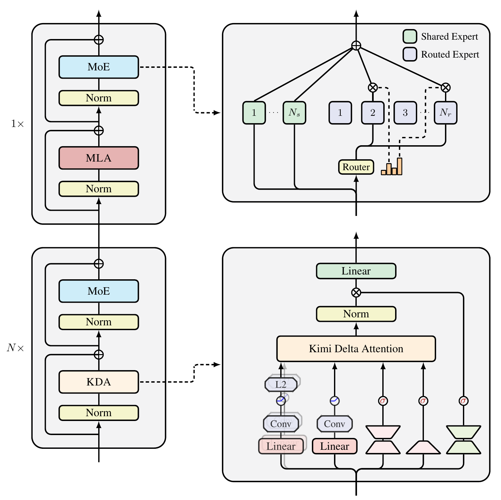
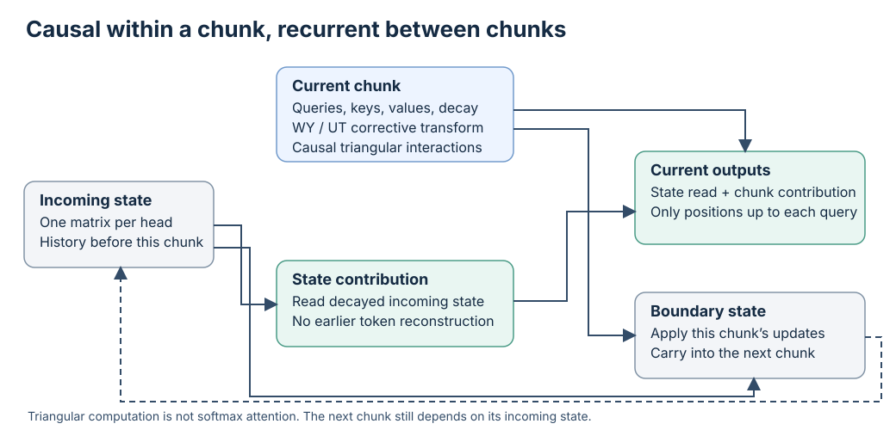

## Executive answer

[Technical report](https://arxiv.org/pdf/2510.26692v1) · [Hugging Face: moonshotai/Kimi-Linear-48B-A3B-Instruct](https://huggingface.co/moonshotai/Kimi-Linear-48B-A3B-Instruct)

Kimi Linear replaces most token history lookups with a small memory that updates as tokens arrive. It retains occasional global attention for information that compressed memory may lose. The central question is not whether attention disappears, but how much exact history a language model needs at each layer.[^report]

## Visual overview

Added an independent causal chunk/interchunk-state diagram, WY/UT details, constrained DPLR savings, explicit kernel complexity and local fast-memory learning interpretation; sharpened hybrid-ratio generalization/runtime tradeoff. Source crops and native SVGs were inspected as assets. Fresh integrated HTML/mobile/theme/export verification passed.

## Key findings

- **Forget at channel resolution.** Kimi Delta Attention (KDA) gives different memory channels different retention rates, rather than one decay value for an entire head.[^report]
- **Correct existing associations.** The delta rule writes the difference between a new value and what memory currently predicts for its key.[^report]
- **Preserve a global path.** A roughly three to one mixture of KDA and MLA balances efficient recurrent memory against direct access to earlier tokens.[^report]

The release includes Base and Instruct weights, custom model code, and public KDA kernel implementations. Its controlled comparisons make it valuable for studying attention alternatives, but the results do not prove that recurrent memory dominates full attention for every task or scale.[^report][^repo]

Study scope: October 2025 report, recurrence derivation and final checkpoint appendix, pinned Instruct configuration, cache and attention code, and license. No checkpoint or kernel executed. Evidence checked October 10, 2026.

## Detailed analysis

### Model in numbers

Representative checkpoint: **Kimi-Linear-48B-A3B-Instruct**. Distinguish this release from the report's matched 1.4T token experimental models.

| Dimension | Value and scope |
| --- | --- |
| Parameters | About 48B total and 3B active per token. Stored parameters remain much larger than the active computation.[^report] |
| Pretraining | 5.7T processed tokens for the released model; 1.4T for the controlled MLA and GDN hybrid comparisons. Neither is a unique data volume.[^report] |
| Compute | Total accelerator hours and full run FLOPs are not disclosed. Scaling experiments report relative efficiency, not a complete training cost.[^report] |
| Context | Pretraining begins at 4,096 tokens. The final release supports 1,048,576 positions and Appendix D evaluates RULER at 1M.[^report][^config] |
| Layer composition | Released config: 27 layers, 20 KDA and 7 full MLA, with global attention at the final layer.[^config] |

### Architecture

<!-- visual-id: V005 -->

**Figure 1.** The hybrid decoder and KDA module. Reproduced from the release documentation's Figure 3, under [MIT terms](/figures/model-studies/kimi-linear/NOTICE.md).[^architecture]

[Figure 1](#figure-1) is a layerwise hybrid, not two parallel networks. Three normalized KDA and expert block pairs alternate with one normalized MLA and expert block pair. The lower right inset shows local convolutions on queries and keys, distinct retention and write gates, and a gated normalized readout. Each global MLA layer can still access earlier token history directly.[^architecture][^report]

### Memory that forgets and corrects

A single KDA head carries a matrix $S_t\in\mathbb{R}^{d_k\times d_v}$. Think of it as a learned associative memory: a query reads a value, while a key identifies the association to update. KDA first decays the old state, then corrects the predicted value at the current key.[^report]

$$
\widetilde S_{t-1}=\operatorname{Diag}(\alpha_t)S_{t-1},\qquad S_t=\widetilde S_{t-1}+\beta_t k_t\left(v_t-\widetilde S_{t-1}^{\top}k_t\right)^{\top},\qquad o_t=S_t^{\top}q_t
\tag{1}
$$

Equation (1) is an algebraic rearrangement of the report's recurrence. The vector $\alpha_t$ controls retention for each key channel; scalar $\beta_t$ controls write strength. The term inside parentheses is the prediction error. A plain additive memory would keep stacking key value associations; this corrective write can revise an association already represented in memory.[^report]

<!-- visual-id: V006 -->

### Figure 2

**Figure 2.** Recurrent memory and direct history lookup. Original explanatory diagram informed by the recurrence and hybrid design.[^report][^config]

### Meaning

KDA layer: Prior matrix state: 128 × 128 per head; Channel decay: Choose which channels persist; Corrective write: Update the current key's value; Query read: Read the updated state. The updated state becomes the prior state for the next token. Its shape does not grow with history.
Periodic MLA layer: Previous token history: Retained keys and values; Global attention: Direct content lookup; Output representation: Mix retrieved values. This cache still grows with sequence length. The hybrid is not an entirely fixed memory model.

Report and rendered page retain the adjacent explanation. Source asset inspection is not HTML/browser QA.

Queries and keys pass through short convolutions, Swish, and L2 normalization. Normalized keys help keep the corrective update stable. Low rank projections produce the channel decay and output gate; a headwise RMSNorm and sigmoid output gate control the readout. This memory is input dependent, not a fixed average over the past.[^report]

### From sequential recurrence to efficient kernels

The recurrence is sequential across tokens, but training need not execute one tiny operation at a time. KDA groups tokens into chunks: a recurrent state carries earlier chunk information, while a causal triangular computation handles interactions within a chunk in parallel. A specialized triangular transform incorporates the corrective writes.[^report]

The transition matrix has a diagonal plus low rank form, but its two low rank factors are tied to the write key and decay: one is proportional to the key, the other to the key multiplied by retention. In the chunk formulation, a WY representation packs the corrective transforms; a lower triangular UT transform produces pseudo values that incorporate earlier writes. This is not ordinary softmax attention on the chunk.[^chunks]

<!-- visual-id: V007 -->

**Figure 3.** Parallel inside a causal chunk, recurrent across chunks. Independent mechanism diagram of Equations (8)–(9).[^chunks]

[Figure 3](#figure-3) has two contributions: the decayed incoming state carries earlier chunks; a causal triangular computation handles the current chunk. Updating the boundary state is still necessary before the next chunk. Log space relative decay and secondary tiles protect small cumulative retention ratios. Tying the low rank factors removes two of the general DPLR secondary matrices and approximately three matrix multiplications in the reported comparison.[^chunks]

This is why “linear attention” describes scaling with sequence length, not absence of a nonlinear model or zero matrix work. With fixed head dimensions, the recurrent state is bounded; projections, experts, convolution states, and global attention layers still cost computation and memory.[^report]

Complexity and the memory learning interpretation

For one head with width $d_h$, fixed chunk size $C=64$, and sequence length $T$, the report's kernel estimate is:[^complexity]

$$
\operatorname{FLOPs}_{\mathrm{KDA}}=6Td_h^2+3TCd_h+TC^2,\qquad \operatorname{FLOPs}_{\mathrm{full}}\approx2T^2d_h
\tag{2}
$$

This count excludes projections, experts, output gating, local convolutions and the hybrid's global layers. Fixed C and head width make the KDA kernel linear in T; they do not make the **whole hybrid decoder** entirely linear in T.[^complexity]

The corrective write also has a local learning view. On the already decayed state, descend the squared prediction error $\tfrac{\beta_t}{2}\lVert v_t-\widetilde S_{t-1}^{\top}k_t\rVert^2$ by one unit step to recover Equation (1)'s rank one correction. The state is an input dependent fast memory, not a new optimizer update to the model's learned parameters during every decode token.[^complexity]

### The released decoder and its actual cache

The residual width is 2,304. KDA has 32 heads with key and value dimensions of 128. The first FFN is dense; the artifact selects eight routed experts from 256 and adds one shared expert, each with intermediate width 1,024. The report's phrase “including one shared expert” is ambiguous about that count; configuration and forward code explicitly execute the shared branch in addition to the eight selected routes.[^config][^code][^report]

Global MLA layers use NoPE: there is no explicit rotary position transformation. KDA's ordered recurrence, decay, and local convolutions provide position sensitive computation. Removing RoPE from the global path does not make the whole model insensitive to token order.[^report][^code]

The custom cache stores recurrent matrices and convolution state for KDA, alongside token growing keys and values for global layers. The inspected Transformers implementation expands MLA content into head specific keys and values before cache update. Therefore its memory use must not be equated with an ideal latent only MLA cache without inspecting the serving backend.[^code]

The code dispatches short inputs to a fused recurrent KDA kernel and longer inputs to the chunk kernel. Training is restricted to the chunk path. These are implementation observations, not measured performance on this machine.[^code]

### Training and post training

The matched experiments use identical 1.4T token data from the K2 corpus, 4K contexts, MuonClip, a WSD schedule, peak learning rate 0.0011, and 32M token global batches. The final model expands token exposure to 5.7T and extends context to 1M. Full data mixture proportions and total run cost are not supplied.[^report]

SFT combines broad instruction learning with targeted reasoning data. RL concentrates on math, code, and STEM, selecting tasks of moderate starting difficulty. An auxiliary pretraining loss helps preserve general behavior. The report follows the K1.5 policy algorithm, with truncated importance sampling for training versus rollout precision mismatch, adaptive KL penalty, and adjusted numbers of updates per iteration.[^report]

### What the comparisons establish

The 1.4T comparison controls architecture scale and training recipe, varying the token mixer. Kimi Linear improves MMLU-Pro from MLA's 47.2 to 51.0; EvalPlus is 60.2 versus GDN hybrid's 63.1. It performs better across many tested tasks, not every column. Temperature is 1.0, with repeated averages for high variance evaluations.[^report]

Small model ablations use the same FLOP budget and hyperparameters. The 7:1 ratio has similar training but worse validation loss than 3:1; the 1:1 ratio has similar validation loss but higher inference overhead. This is a capacity/generalization/runtime tradeoff, not a universal rule that 25% global layers is optimal. Removing the sigmoid gate or local convolution also harms that experiment. The claim that NoPE provides a better distributed positional bias is an author interpretation of comparisons, not a separately proven explanation.[^report]

The final 5.7T Instruct model reports RULER 94.8 at 1M. Its comparison with 16B Moonlight changes total capacity as well as attention, so it is less clean as an isolated attention ablation than the matched 1.4T study.[^report]

Read the speed and cache headline with its conditions

Figure 7 measures batch size one. At 1M context it shows roughly 2.9 times faster prefill and about 2.3 times faster decoding than the full MLA comparison. The roughly six times headline also uses increased batching made possible by memory savings; Section 6 describes the 6.3 times case as a theoretical decoding speedup. It is not a six times latency promise for every request.[^report]

“Up to 75%” cache reduction describes replacing most full history layers. The released 27 layer pattern has a final extra global layer, and recurrent and convolution state remain. Actual bytes depend on precision, cache layout, batch size, and backend. The paper does not fully specify a reproducible hardware and kernel environment for every plotted efficiency comparison.[^report][^config][^code]

### Limits and reusable lessons

Finite memory may lose exact details or competing associations, which motivates retaining global lookup. A 1M context score does not guarantee reliable recall of arbitrary information at that length. Efficient recurrent kernels also complicate prefix reuse, branching, and speculative decoding because state must correspond to the correct token boundary.[^report][^code]

The repository uses MIT and the official model card labels the weights MIT. Public weights and kernel code do not make the full dataset or training stack available.[^license][^card]

For builders, the useful pattern is **compress where possible, retain exact access where necessary, and validate the boundary**. Continue to [Kimi K3](/architectures/models/kimi-k3/) to see how this memory design interacts with depth mixing, expert width, native vision and deployment precision.

## Counterevidence and uncertainty

The page preserves source-specific model/recipe/harness conditions and contrary results. [Coverage audit](coverage-audit.md) records each essential technique, source locator, addition and justified omission. No checkpoint execution or independent speed/benchmark reproduction was performed.

## Implications

Added an independent causal chunk/interchunk-state diagram, WY/UT details, constrained DPLR savings, explicit kernel complexity and local fast-memory learning interpretation; sharpened hybrid-ratio generalization/runtime tradeoff.

## Open questions and future research

Fresh integrated browser and export checks for revision 3 passed. Report omissions and runtime reproduction gaps remain scoped in the coverage audit rather than filled with estimates.

## What changed in this revision

Revision 3 broadens mechanism depth rather than adding decorative figure quotas. Complete report and relevant appendix/code review, exact source locators, independent visual inspection and an adversarial protocol/number pass are recorded below.

## Sources

[^report]: Kimi Team. [Kimi Linear: An Expressive, Efficient Attention Architecture](https://arxiv.org/pdf/2510.26692v1), October 30, 2025. Sections 3 to 7, Tables 1 to 5, Figures 1 and 7, and Appendices B to D. Original version inspected October 10, 2026.

[^config]: Moonshot AI. [Kimi-Linear-48B-A3B-Instruct configuration](https://huggingface.co/moonshotai/Kimi-Linear-48B-A3B-Instruct/blob/e1df551a447157d4658b573f9a695d57658590e9/config.json), inspected October 10, 2026.

[^code]: Moonshot AI. [Custom model and cache implementation](https://huggingface.co/moonshotai/Kimi-Linear-48B-A3B-Instruct/blob/e1df551a447157d4658b573f9a695d57658590e9/modeling_kimi.py), classes `KimiDynamicCache`, `KimiMLAAttention`, `KimiDeltaAttention`, and `KimiMoE`, inspected October 10, 2026. Static code inspection only.

[^repo]: Moonshot AI. [Kimi Linear release](https://github.com/MoonshotAI/Kimi-Linear/tree/8c1d85eb6b5f8fcefb15758691b0ce50b0827ce3), inspected October 10, 2026.

[^license]: Moonshot AI. [MIT license](https://github.com/MoonshotAI/Kimi-Linear/blob/8c1d85eb6b5f8fcefb15758691b0ce50b0827ce3/LICENSE), inspected October 10, 2026.

[^card]: Moonshot AI. [Official model card](https://huggingface.co/moonshotai/Kimi-Linear-48B-A3B-Instruct/blob/e1df551a447157d4658b573f9a695d57658590e9/README.md), release inventory and license metadata, inspected October 10, 2026.

[^architecture]: Kimi Team. [Kimi Linear release documentation](https://raw.githubusercontent.com/MoonshotAI/Kimi-Linear/8c1d85eb6b5f8fcefb15758691b0ce50b0827ce3/tech_report.pdf), Figure 3, page 6. Repository [MIT grant](https://github.com/MoonshotAI/Kimi-Linear/blob/8c1d85eb6b5f8fcefb15758691b0ce50b0827ce3/LICENSE) explicitly includes associated documentation; the report and matching architecture asset reside there. Artwork unchanged; surrounding prose and caption removed. The arXiv edition's CC BY-NC-ND grant is not the reproduction basis.

[^chunks]: Kimi Team. [Kimi Linear report](https://arxiv.org/pdf/2510.26692v1), Sections 3.1–3.2 and 6.2, Equations (3)–(9), Listing 8 and Appendix B: WY/UT chunk transforms and constrained DPLR simplification. The native figure omits normalization and local projection operators, shown in Figure 1.

[^complexity]: Kimi Team. [Kimi Linear report](https://arxiv.org/pdf/2510.26692v1), Section 6.3, Equations (13)–(14), and Table 7: kernel FLOP accounting and decayed-state SGD interpretation. These are not measured complete model costs.

## Revision 3 presentation verification

106 automated tests, zero Astro diagnostics, the static build and all 43 docs lint checks passed. The collection passed 81 fresh browser views; this page was checked at 1440px light, 390px light and 320px dark, with desktop focus, active family navigation, caption order, anchors, image decoding, resource cards and no page overflow. Complete source figures fit desktop, while narrow frames support keyboard panning and full-size access. Search and Markdown/MDX exports preserve citations, figures and source links. All 66 model figure renders were inspected, with full-size review of new dense diagrams. See state/presentation-qa.json for exact page checksums and evidence. No model benchmark was reproduced. Existing bundler and redirect warnings remain.
