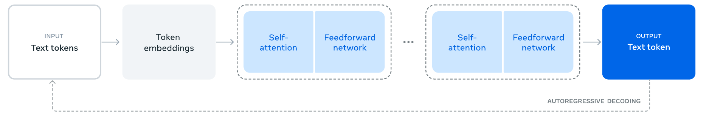
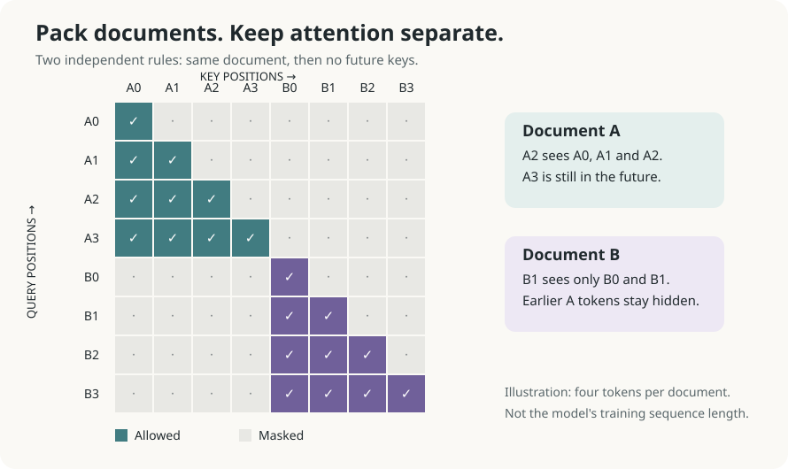
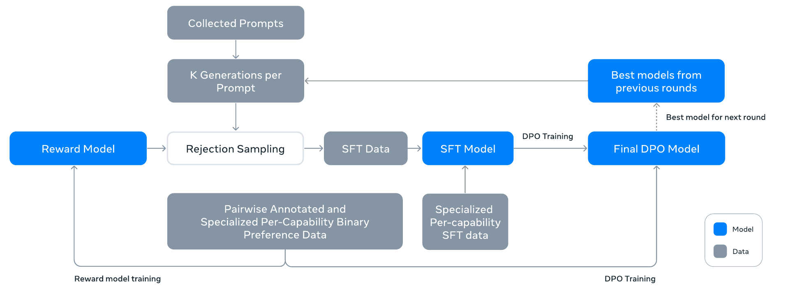

# Llama 3 and 3.1

## Executive answer

Original text-architecture and alignment-loop figures replace the generic overview. The independent packed-document mask remains a different, exact attention-boundary lesson.

[Technical report](https://arxiv.org/abs/2407.21783v3) · [Hugging Face: meta-llama/Llama-3.1-8B-Instruct](https://huggingface.co/meta-llama/Llama-3.1-8B-Instruct)

## Visual overview

<!-- visual-id: V202 -->

<!-- visual-id: V201 -->

<!-- visual-id: V203 -->

## Key findings

- **Continuity, not a new block.** A dense causal decoder combines RMSNorm, RoPE, SwiGLU, and grouped-query attention. The report emphasizes training quality and scale rather than replacing attention.[^1]
- **A broad released family.** Llama 3.1 offers 8B, 70B, and 405B text models in pretrained and instruction-tuned forms, with eight explicitly supported languages.[^2]
- **An iterative alignment pipeline.** Reward modeling, rejection sampling, supervised fine-tuning, and DPO turn a pretrained model into an assistant. This is not simply one final instruction dataset.[^1]
- **Useful, but not unrestricted.** Weights are available under the custom Llama 3.1 Community License, not an Apache or MIT weight license.[^3]

## Detailed analysis

Llama 3 shows how far a fairly familiar Transformer can go when data, training infrastructure, and post-training improve together. The July 2024 Llama 3.1 release added 128K context and a 405B model, while keeping smaller checkpoints available for adaptation and deployment. Its central lesson is a system lesson: strong architecture is necessary, but the surrounding recipe matters just as much.[^1][^2]

### Highlights

- **Continuity, not a new block.** A dense causal decoder combines RMSNorm, RoPE, SwiGLU, and grouped-query attention. The report emphasizes training quality and scale rather than replacing attention.[^1]
- **A broad released family.** Llama 3.1 offers 8B, 70B, and 405B text models in pretrained and instruction-tuned forms, with eight explicitly supported languages.[^2]
- **An iterative alignment pipeline.** Reward modeling, rejection sampling, supervised fine-tuning, and DPO turn a pretrained model into an assistant. This is not simply one final instruction dataset.[^1]
- **Useful, but not unrestricted.** Weights are available under the custom Llama 3.1 Community License, not an Apache or MIT weight license.[^3]

### Scope and scale

This study anchors dimensions and compute to **Llama 3.1 8B**, released July 23, 2024. The report covers both April Llama 3 and July Llama 3.1. Most detailed training discussion defaults to the 405B model unless it states otherwise; those details must not silently become an exact 8B recipe.[^1][^2]

| Item | Llama 3.1 8B |
| --- | --- |
| Parameters | Approximately 8B, dense |
| Decoder | 32 layers; width 4,096; FFN width 14,336 |
| Attention | 32 query heads, 8 KV heads |
| Pretraining scale | About 15T tokens; card describes the family as 15T+ |
| Training compute | 1.46M H100 80GB GPU hours |
| Context | 128K tokens |
| Availability | Pretrained and Instruct weights; custom license and access conditions |

Dimensions come from report Table 3; data, compute, and context come from the official card. GPU hours are accumulated device time, not elapsed wall-clock duration. The report’s 3.8 × 10²⁵ FLOPs belongs to the 405B training run, not the 8B checkpoint.[^1][^2]

The official card and license were inspected at a pinned repository revision. The selected Hugging Face weight repository is access-gated, so its configuration was not directly inspected. No weights were downloaded or benchmarked. Public library code was inspected to trace the relevant decoder and cache contracts.[^2][^3][^4]

### Architecture: keep the decoder, strengthen the system

The text path is tokenizer, embeddings, repeated causal decoder blocks, final normalization, and vocabulary logits. Each block has a pre-normalized attention branch and a pre-normalized SwiGLU branch, both added back to the residual stream. GQA shares keys and values across groups of query heads; it does not remove the distinct query heads.[^1][^4]

<!-- visual-id: V202 -->

**Figure 1.** The text decoder and its generation loop. Reproduced from Abhimanyu Dubey et al., report Figure 1.[^figure-source]

[Figure 1](#figure-1) is the text path, not the report's separate experimental
vision or speech adapters. The dashed return arrow is generation: a selected
output token becomes context for the next step. GQA changes attention storage
and computation; SFT and DPO change how this same network responds to
instructions. Neither explains every improvement on its own.[^1][^4]

### Two practical architectural changes

#### GQA reduces the cache, not the need for evidence

For the 8B model, four query heads share each KV head. Relative to full multi-head attention with 32 KV heads, the raw KV storage is reduced by a factor of four at the same head dimension, batch, context, and precision. That is a derived storage comparison, not a claim of four times faster serving.[^1][^4]

$$
M_{\mathrm{KV}}=2BLTH_{\mathrm{KV}}d_hb
\tag{1}
$$

Here B is batch size, L is layer count, T is cached tokens, and b is bytes per stored value. For L = 32, H_KV = 8, d_h = 128, and two-byte values, a single 128K-token sequence needs about **16 GiB of raw KV tensors**, before allocator overhead, activations, and weights. This estimate makes the tradeoff visible: fewer KV heads help, but a very long context is still expensive. It assumes 128K = 131,072 tokens.[^1]

#### A larger tokenizer spends fewer positions on many texts

The report expands the vocabulary to roughly 128K: about 100K tokens from a tiktoken vocabulary plus 28K additions aimed at non-English text. Its reported English compression improves from 3.17 to 3.94 characters per token. This can reduce sequence length for a given text, but a larger embedding and output vocabulary has its own parameter and compute cost.[^1]

This is a tokenizer tradeoff, not a guarantee that every language or every document gets the same compression benefit.

#### Packed documents need an attention boundary

Pretraining packs documents into long sequences for utilization. The report applies a document mask so a token cannot read an unrelated earlier document in the same packed sequence. Causality and document isolation are two separate tests: a key must be no later than the query **and** belong to the same document. The authors find little effect in ordinary pretraining but consider the boundary important for long-context training.[^1]

<!-- visual-id: V201 -->

**Figure 2.** Pack tokens without mixing their documents. Original illustrative mask based on the reported document isolation rule; four tokens per document are a teaching choice, not the training length.[^1]

In Figure 2, B1 reads B0 and B1, not A0 through A3, even though document A occurs earlier. The figure describes the reported pretraining boundary, not a verified mask for every later training or serving stage.[^1]

### Training: quality and curriculum at scale

#### Pretraining and long-context extension

The report describes filtering, deduplication, quality classifiers, data-mixture experiments, and deliberate increases in useful code and reasoning data. Its detailed 405B run uses about 15.6T tokens and changes the mixture during training. Treat these as family-level design evidence; the exact mixture and a complete reproducible dataset are not released.[^1]

The pipeline combines URL and document deduplication, frequent-line removal, heuristics and model-based quality signals. Its coarse final mixture is about 50% general knowledge, 25% mathematical/reasoning data, 17% code and 8% multilingual data. Those broad categories are a report-level summary of a changing mixture, not a downloadable corpus or a complete 8B sampling recipe.[^1]

Long context is trained rather than obtained merely by changing a configuration limit. For 405B, the report describes six context-extension stages from 8K to 128K, using about 800B additional training tokens. Progress checks include both short-context recovery and long-context retrieval. It uses a larger RoPE base and a staged recipe, not the claim that positional extrapolation alone guarantees useful 128K reasoning.[^1]

#### Post-training is a repeated data-improvement loop

The report’s post-training system alternates SFT and DPO rounds. It trains a reward model on preference data, samples candidate responses from the latest policy, ranks them, and uses selected responses for supervised training. It also builds capability-specific synthetic data for coding, mathematics, multilingual tasks, tool use, and long context.[^1]

<!-- visual-id: V203 -->

**Figure 3.** Data, ranking and policy updates form a loop. Reproduced from Abhimanyu Dubey et al., report Figure 7.[^training-figure]

In [Figure 3](#figure-3), preference data has two roles: training the reward
model and supplying DPO comparisons. Rejection sampling creates supervised
targets rather than performing a policy update itself. The return arrow from
the best prior policy supplies candidates for the next round, which is why
this is an iterative system rather than a single instruction dataset.[^1]

The report repeats this process for **six rounds**, collecting new preferences and synthetic targets from improving policies. Rejection sampling typically generates 10 to 30 responses per prompt and uses the reward model to select a target. Quality and difficulty are balanced rather than simply deleting every hard example that fails a judge: the coding-data discussion reports that overly stringent filtering initially removed challenging prompts and hurt downstream performance.[^1]

The official card reports **over 25M synthetic fine-tuning examples** for the family, in addition to public instruction data. That is an example count, not a disclosed token count or proof that every checkpoint consumed an identical subset.[^2]

Why rejection sampling and DPO solve different problems

Rejection sampling turns a candidate pool into better supervised targets. DPO uses preferred and rejected responses to optimize relative preference against a reference model. One chooses training answers; the other updates the policy with a preference objective. Iteration matters because candidates, reward quality, and failure cases change as the policy improves.[^1]

The card uses RLHF as an umbrella description. The report names DPO in the assistant-training recipe. This does not establish that the released text checkpoints used an online PPO or GRPO rollout loop.[^1][^2]

What is actually optimized in SFT and DPO?

| Stage | Targets and masking | Distinctive reported detail |
| --- | --- | --- |
| SFT | Cross-entropy on response targets; prompt tokens are excluded from the loss. | Selected generations and capability-specific synthetic data supply many targets. |
| DPO | Chosen/rejected response comparisons relative to a reference model. | Special header and termination tokens are excluded from both responses' preference loss. |

The reported DPO recipe sets β to 0.1 and adds a chosen-response negative-log-likelihood term with coefficient 0.2. The first modification avoids formatting-token behavior such as repetition or premature endings; the extra NLL term maintains desired formatting and chosen-response likelihood. These are details of the report's alignment recipe, whose defaults largely describe the largest model, not an independently inspected exact 8B training job.[^1]

Only recent batches are used for DPO, while the reward model uses all available preference data. The report found DPO more economical and better on certain instruction-following measures than explored PPO runs. That is a bounded result, not proof that DPO always beats online RL.[^1]

Preserving long-context behavior through post-training

Synthetic QA targets are created from short chunks but trained with the full long source; hierarchical summaries and repository-level code tasks supply additional long-context examples. About 0.1% of the mixed SFT **examples** are synthetic long-context data, not 0.1% of tokens. Table 7 lists their much longer average contexts. Good long-context SFT allows the authors to use short preference examples without losing tested long-context performance; this does not make long-context alignment automatic.[^1]

### Inference: base models and assistants need different interfaces

A pretrained model continues text. An Instruct model expects the appropriate conversation format, role markers, turn endings, and any tool interfaces. Serving it as plain completion text can change behavior. Tool competence also depends on external tool definitions, execution, and error handling; it is not autonomous action supplied by the weights alone.[^1][^2]

The inspected library path projects Q, K, and V, applies rotary positions, updates the KV cache, computes causal attention, and adds attention and FFN outputs to the residual stream. Its eager path expands shared KV heads for the attention computation. That expansion is an implementation view, not evidence that persistent storage needs to duplicate every KV head.[^4]

For deployment, compare the 8B and 70B variants under the same task, prompt, context distribution, precision, and hardware. A 405B result cannot predict the latency or quality of an 8B service.

405B systems details are not an 8B serving recipe

The largest run combines tensor parallelism across weights, pipeline parallelism across layers, context parallelism across sequence positions and fully sharded data parallelism. These address different axes of scale, not four synonyms for splitting the model.[^1]

The serving discussion places BF16 405B on 16 H100 GPUs with tensor and pipeline parallelism. Its FP8 path quantizes most FFN weights and activations while leaving attention and the first and last layers unquantized; calibrated row-wise scales mitigate outliers. The authors check response-quality distributions as well as benchmark averages because aggregate scores can hide corrupted generations. Those experiments do not establish 8B latency or memory on another backend.[^1]

### Evidence: capability is broader than one leaderboard

The official card’s **base-model** evaluation is a useful reminder that the release is not a uniform score increase. On five-shot MMLU, both April Llama 3 8B and Llama 3.1 8B score 66.7. On three-shot chain-of-thought BIG-Bench Hard, the scores are 61.1 and 64.2. On seven-shot CommonSenseQA, they are 72.6 and 75.0. These are the card’s internal evaluation conditions, not our replications.[^2]

The report supplies wider evaluation of instruction following, coding, multilingual quality, long context, tool use, and safety. Those outcomes reflect combined data, architecture, scale, and post-training. They do not isolate GQA or the larger tokenizer as the cause.[^1]

The most transferable evidence is the workflow: evaluate across capabilities, use targeted data to address weaknesses, and keep short-context performance in view while extending long context.

### Limitations and open questions

The full corpus, exact mixtures, and checkpoint-specific post-training data are not released. Detailed 405B recipes should not be treated as fully specified 8B recipes. The gated checkpoint configuration was not accessed in this review. Long context increases available evidence and cost; it does not guarantee reliable reasoning over every token. Eight supported languages are a bounded support statement, not universal multilingual reliability. Safety tuning does not eliminate hallucination, bias, or prompt-injection risk.[^1][^2]

The Community License includes attribution, acceptable-use, and other conditions, including a separate permission requirement for certain very large services. Check the actual license for a proposed use rather than treating public availability as unrestricted permission.[^3]

### Lessons and related models

**A strong model is a maintained training system.** Llama 3.1 makes the data, evaluation, and alignment loop as important to study as the decoder.

**Efficiency is multidimensional.** GQA reduces KV storage; tokenizer compression reduces positions; neither removes long-context serving costs.

Compare [original LLaMA](/architectures/models/llama/) for the earlier dense recipe, [Mistral 7B](/architectures/models/mistral-7b/) for windowed attention, and [Gemma 3](/architectures/models/gemma-3/) for a different balance of local attention, distillation, and visual input.

[^1]: Dubey et al. [The Llama 3 Herd of Models](https://arxiv.org/abs/2407.21783v3). Sections 2–6; architecture Table 3; document masking Section 3.2; post-training Sections 4.1–4.3 and Table 7; systems and quantization Sections 3.3 and 6.
[^2]: Meta. [Llama 3.1 model card](https://github.com/meta-llama/llama-models/blob/0e0b8c519242d5833d8c11bffc1232b77ad7f301/models/llama3_1/MODEL_CARD.md), accessed October 10, 2026.
[^3]: Meta. [Llama 3.1 Community License](https://github.com/meta-llama/llama-models/blob/0e0b8c519242d5833d8c11bffc1232b77ad7f301/models/llama3_1/LICENSE), same release; custom model license.
[^4]: Hugging Face. [Llama implementation](https://github.com/huggingface/transformers/blob/8cb5963cc22174954e7dca2c0a3320b7dc2f4edc/src/transformers/models/llama/modeling_llama.py)., decoder, attention, rotary, and cache paths inspected; Apache 2.0 code.

[^figure-source]: Abhimanyu Dubey et al. [The Llama 3 Herd of Models](https://arxiv.org/pdf/2407.21783v3#page=4), arXiv v3, Figure 1, p. 4. Artwork retained; surrounding prose and caption omitted. Original copyright retained; [source and reuse record](/figures/model-studies/llama-3/SOURCES.md).
[^training-figure]: Abhimanyu Dubey et al. [The Llama 3 Herd of Models](https://arxiv.org/pdf/2407.21783v3#page=15), arXiv v3, Figure 7, p. 15. Artwork retained; surrounding prose and caption omitted. [Source and reuse record](/figures/model-studies/llama-3/SOURCES.md).

## Counterevidence and uncertainty

Family recipes, selected artifacts, controlled ablations and optimized serving results remain distinct. Undisclosed training details and unexecuted runtime assumptions remain explicit in the analysis. Figure reuse is supported by a specific editorial assessment, not a newly verified artwork license or universal legal conclusion.

## Implications

Original report figures preserve the authors' structure; focused independent diagrams add exact contracts and calculations rather than redraw the same overview.

## Open questions and future research

Undisclosed mixtures and compute, runtime/application validation and future reuse or distribution changes require separate work. No model benchmark was replicated.

## Sources

Complete claim-local references are retained above. Exact source editions, crop geometry, checksums and exception assessments are in state/sources.jsonl and the per-model public SOURCES.md.

## What changed in this revision

2 original figure excerpts added or substituted. Prior figure choices are preserved in coverage-audit-revision-3.md and state/presentation-qa-revision-3.json. Revised guidance recognizes licenses, permission or assessed applicable exceptions without relabeling source artwork MIT. Full validation, fresh responsive/focus browser checks, manual figure review and complete exports passed.
