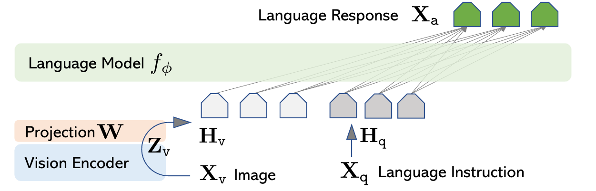
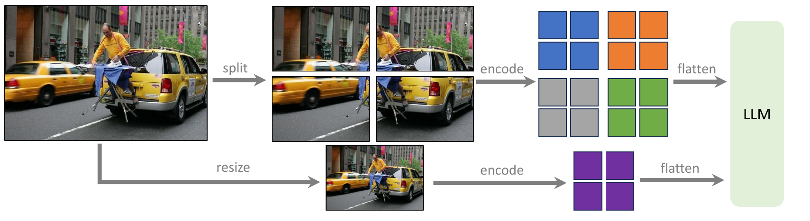
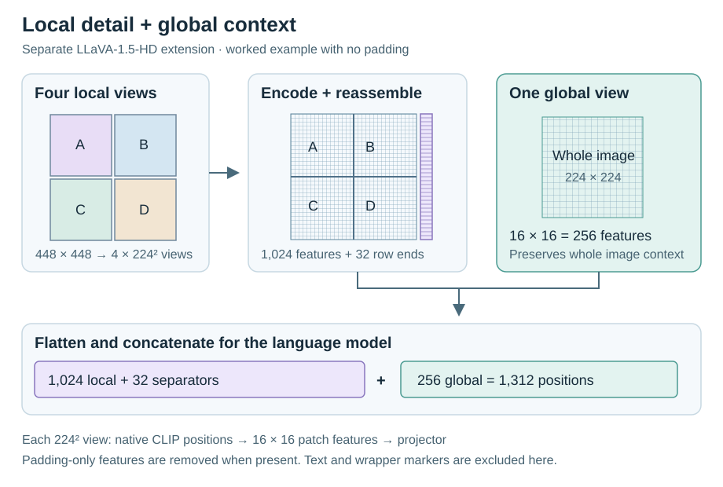
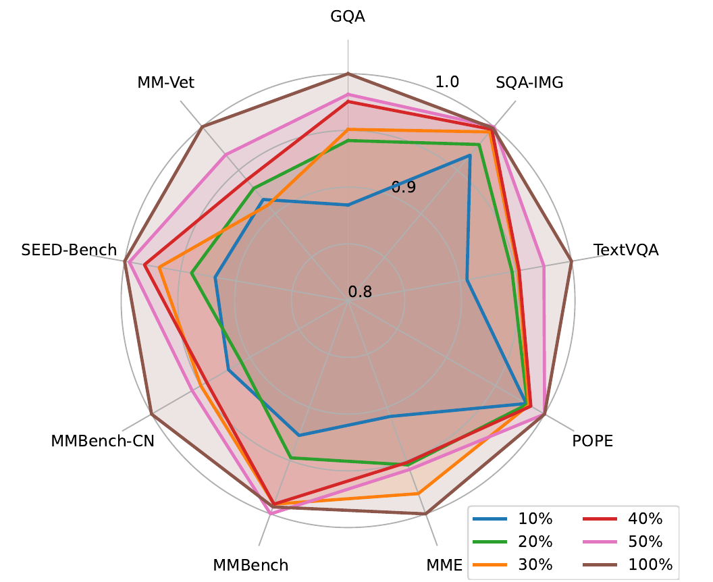

# LLaVA

## Executive answer

The original HD local/global figure complements, rather than replaces, exact row-separator token accounting. Original linear LLaVA, released fixed-resolution 1.5 and experimental HD remain distinct.

[Technical report](https://arxiv.org/abs/2310.03744v2) · [Hugging Face: liuhaotian/llava-v1.5-7b](https://huggingface.co/liuhaotian/llava-v1.5-7b)

## Visual overview

<!-- visual-id: V003 -->

<!-- visual-id: V007 -->

<!-- visual-id: V005 -->

<!-- visual-id: V006 -->

## Key findings

- **A simple visual interface.** Original LLaVA uses a linear projector;
  LLaVA-1.5 strengthens it with a two layer MLP, without a learned query resampler.
- **Instruction data shapes behavior.** The original work generates visual
  conversations from captions and object coordinates. Version 1.5 adds task
  data and explicit response format instructions.
- **A reproducible baseline rather than a new backbone.** Version 1.5 combines
  CLIP, Vicuna, public data mixtures and a compact connector. Its report isolates
  useful changes with staged ablations.[^original][^improved]

## Detailed analysis

LLaVA makes a language assistant read visual patches as part of its input
sequence. A small projector translates a pretrained vision encoder's features
into the language model's embedding space; instruction tuning teaches the
assistant how to answer questions about them.[^original]

### Highlights

- **A simple visual interface.** Original LLaVA uses a linear projector;
  LLaVA-1.5 strengthens it with a two layer MLP, without a learned query resampler.
- **Instruction data shapes behavior.** The original work generates visual
  conversations from captions and object coordinates. Version 1.5 adds task
  data and explicit response format instructions.
- **A reproducible baseline rather than a new backbone.** Version 1.5 combines
  CLIP, Vicuna, public data mixtures and a compact connector. Its report isolates
  useful changes with staged ablations.[^original][^improved]

The design is a useful reference for builders because the multimodal interface
is small enough to trace, while the results show that data composition and
output format can matter as much as a more elaborate connector. Public
weights are available, but their Llama based terms differ from the repository's
Apache 2.0 code license.[^card][^license]

Study scope: original and 1.5 reports with relevant appendices, the released
1.5 configuration, and targeted vision selection, projector and input assembly
code. No checkpoint executed. Selected evidence checked October 10, 2026.

### Model in numbers

Representative checkpoint: **liuhaotian/llava-v1.5-7b**. Historical original
LLaVA settings are named separately rather than mixed into this checkpoint.

| Dimension | Value and scope |
| --- | --- |
| Model size | A **7B class Vicuna language backbone**, plus a CLIP ViT-L/14 vision encoder and projector. The name is not an exact total parameter count for the combined VLM.[^card][^config] |
| Visual input | **336 × 336** padded and resized image; **576 patch features** at width 1,024; two layer projector to language width 4,096.[^config][^code] |
| Alignment data | **558K** filtered image and text pairs for 1.5. Original paper uses **595K** CC3M pairs instead.[^card][^original][^improved] |
| Instruction data | **665K** training conversations in the 1.5 report, mixing visual instructions, academic tasks and language conversation. Counts are mixture samples, not unique images.[^improved] |
| Context | Released config supports **4,096 positions**. Visual patch positions consume this sequence budget; configured capacity does not establish equally reliable answers at every length.[^config][^code] |
| Training compute | The 1.5 recipe reports about **6 hours alignment plus 20 hours instruction tuning on 8 A100 GPUs**. This is the authors' recipe cost, not a measured 7B deployment or total backbone pretraining cost.[^improved] |

### Original LLaVA and version 1.5

The original paper's key contribution is visual instruction tuning. A text
only GPT-4 receives textual captions and object bounding boxes, then generates
conversations, detailed descriptions and reasoning examples. It does **not**
inspect raw pixels during that data generation. This distinction explains why
generated supervision can contain visual omissions or inaccuracies inherited
from the symbolic descriptions.[^original]

| Design choice | Original report | LLaVA-1.5 |
| --- | --- | --- |
| Connector | Linear projection | Two layer MLP with GELU |
| Vision | CLIP ViT-L/14 at 224 pixels | CLIP ViT-L/14 at 336 pixels |
| Language | Original Vicuna based study | Vicuna v1.5, with Llama 2 backbone |
| Data emphasis | 158K generated visual instruction samples | Broader task mixture plus response format prompts |

These distinctions follow the two reports and released card. The separate
1.5-HD extension adds image tiling and global context; its variable resolution
path is not the fixed 336 pixel checkpoint described below.[^original][^improved][^card]

<!-- visual-id: V003 -->

**Figure 1.** The original LLaVA interface. Liu et al., Figure 1; cropped, [CC BY 4.0](https://creativecommons.org/licenses/by/4.0/).[^architecture-figure]

Figure 1 shows the original **linear** projection, marked W. Visual features
and language instructions become neighboring input positions for the language
model. The selected 1.5 checkpoint below retains that basic interface but
uses a two layer MLP and a larger patch grid; the original drawing does not
show those later dimensions.[^original][^improved]

### Pixels become decoder positions

The selected configuration requests aspect ratio padding. The helper pads a
rectangular image to a square using the processor's mean color, then applies
the CLIP image processor. CLIP computes a class position and 24 × 24 patch
positions; the wrapper selects the **penultimate hidden layer** and drops the
class feature.[^config][^code]

The selected 1.5 interface differs from [BLIP-2](/architectures/models/blip-2/):
it does not compress 576 visual features into 32 learned queries. It keeps
one projected vector per selected patch. This gives the decoder more visual
positions but increases its prefill and retained history costs.

For one image, the patch count is
$(336/14)^2=576$. If the tokenized conversation has
$m$ positions including one image placeholder, the
assembled sequence has **m + 575 positions** before padding or truncation.
The placeholder is replaced, not kept in addition to the 576 visual vectors.
The class feature is excluded and there are no learned row separator positions
in this fixed resolution path.[^config][^code]

The projector applies the same MLP independently to each patch vector. For a
row oriented feature matrix $V\in\mathbb R^{576\times1024}$:

$$
H_v=\operatorname{GELU}(VW_1+b_1)W_2+b_2
\tag{1}
$$

Here $W_1\in\mathbb R^{1024\times4096}$ and
$W_2\in\mathbb R^{4096\times4096}$.
The result is $H_v\in\mathbb R^{576\times4096}$.
This is a shape restatement of the inspected builder, not a new spatial
attention module. Including its biases, the connector has **20,979,712**
parameters by direct multiplication and addition.[^code]

The selected language config has 32 layers, 32 query and KV heads, RMSNorm,
SiLU gated FFNs and rotary positions. Visual and text positions proceed through
the same causal decoder. The CLIP encoder has already contextualized image
patches with vision attention, so a causal language mask does not mean each
visual vector contains only earlier image patches.[^config][^code]

### The separate high resolution extension

**LLaVA-1.5-HD is not the fixed 336 pixel checkpoint above.** Its report
uses CLIP's native 224 pixel views: local tiles are encoded independently,
then their patch features are reassembled spatially. Padding only features
are removed, a special separator marks each reconstructed feature row, and
a resized global view supplies whole image context. This avoids interpolating
the vision encoder's position embeddings to an unfamiliar image size.[^improved]

<!-- visual-id: V007 -->

**Figure 2.** The HD extension combines local tiles with a global view. Reproduced from Haotian Liu et al., report Figure 2.[^hd-figure]

The upper path in [Figure 2](#figure-2) preserves local detail; the lower path
preserves whole-image context. The repeated photograph is one input shown at
different scales, not five unrelated training examples. This overview does
not show the row separator cost; [Figure 3](#figure-3) makes that accounting
explicit for a worked input.[^improved]

<!-- visual-id: V005 -->

**Figure 3.** Local detail plus global context. Original worked example of the separate HD extension.[^improved]

For Figure 3, assume a 448 × 448 input, four 224 pixel local views and no
padding to remove. Each view produces 16 × 16 patch features. Reassembly
creates a 32 × 32 grid: **1,024 local features + 32 row separators + 256
global features = 1,312 visual positions**, before text or any wrapper
boundaries. This is an illustrative calculation from Appendix A.1, not a
processor trace or the selected 576 position checkpoint.[^improved]

The extension chooses among predefined tile grids with up to six local views,
balancing preserved detail against wasted padded pixels. It starts with an
aligned 224 pixel connector and adds high resolution instruction tuning rather
than repeating a separate high resolution alignment stage. In the report's
7B high resolution ablation, adding the global view changes GQA 62.9 → 63.8
and MM-Vet 31.9 → 35.1. Those comparisons support global context in that
experiment, not a guarantee that more crops help every image.[^improved]

### Training the connector and assistant

The two stages preserve the frozen vision encoder. Alignment updates only the
connector using caption style targets; instruction tuning then updates the
connector and language backbone. The original report's phrase end to end
finetuning therefore does not mean every component is unfrozen.[^original]

For 1.5, Appendix A gives one epoch in each stage, AdamW, cosine decay,
warmup ratio **0.03** and no weight decay. Alignment uses batch **256** and
learning rate **0.001**; instruction tuning uses batch **128** and learning
rate **0.00002**, with DeepSpeed stages 2 and 3 respectively. These are 1.5
settings, not the original paper's three epoch instruction run.[^improved]

The supervised objective predicts assistant response tokens. Input image
embeddings receive ignored labels in the inspected assembly code; user and
system text provide context rather than visual prediction targets. The MLP
does not reconstruct pixels. No additional multimodal RL or preference
training is specified for this baseline.[^original][^improved][^code]

The 1.5 data mixture combines visual conversation, VQA, OCR, region tasks and
language conversations. QA pairs for an image are grouped into conversations.
Short answer and option letter prompts teach the assistant to vary response
format rather than always produce a long explanation. This is a data and
behavior interface change, not a different attention architecture.[^improved]

### Inference and context accounting

The prompt's image marker identifies where to insert visual features.
After the substitution, the wrapper reconstructs positions and attention
masks, pads batches and may truncate to its configured token limit. Prefill
processes the whole visual and text sequence; causal decoding then predicts
answer tokens while retaining the language history. Image preprocessing and
conversation templates are part of the input contract, not optional decoration.[^code]

The 1.5 paper evaluates with **greedy decoding** and benchmark specific format
prompts. A model asked for a paragraph is not directly comparable with the
same model asked for one word under an exact answer scorer. The selected fixed
image path does not establish a native multiple image or video capability.
Passing frames into a wrapper is not the same as training temporal understanding.
For example, the report's SEED video evaluation uses one middle frame, not a
native temporal encoder or a multi frame sequence.[^improved]

### What the evaluations actually show

All values below are author reported, not reproduced here.

| Question | Evidence and conditions |
| --- | --- |
| Does the selected 7B baseline improve academic tasks? | Table 3 reports **78.5 VQAv2**, **62.0 GQA**, and **58.2 TextVQA**. The table marks VQAv2 and GQA training images or annotations as observed, so these are not clean zero shot task transfer scores.[^improved] |
| Does the stronger connector help before later changes? | In the sequential 7B, 224 pixel ablation, adding the MLP after format prompting changes MME **1323.8 → 1355.2** and MM-Vet **26.3 → 27.8**. Later data and resolution changes have separate rows; final gains cannot all be assigned to the MLP.[^improved] |
| How should the original ScienceQA result be read? | The task finetuned original model reports **90.92%**. **92.53%** uses LLaVA plus a GPT-4 judging ensemble and is not a standalone LLaVA checkpoint score.[^original] |

**TextVQA's published protocol includes OCR text cues.** The report explicitly
uses text recognized by an OCR engine. The pinned evaluation workflow reads
a question file containing those cues and passes its text into the prompt;
the scorer removes OCR cue formatting when recovering the question. The
58.2 score should not be presented as a strictly image only OCR measurement.
The provided shell example selects a 13B checkpoint, so inspecting it is
protocol evidence, not a fresh reproduction of the table's 7B result.[^improved][^evaluation]

The original visual conversation evaluation also uses a GPT-4 judge with
textual descriptions. Its relative response score is not classification
accuracy, and qualitative examples do not establish broad superiority.
Version 1.5's staged ablations provide a better way to ask which change helps,
while still leaving interactions between data, connector, resolution and
language backbone.[^original][^improved]

<!-- visual-id: V006 -->

**Figure 4.** Instruction-mixture subsampling. Liu et al., LLaVA-1.5 report, Figure 4; cropped, [CC BY 4.0](https://creativecommons.org/licenses/by/4.0/).[^efficiency-figure]

Figure 4 compares random subsamples of the 1.5 instruction mixture, not
fractions of all CLIP and language-model pretraining. Each spoke is normalized
to its benchmark's best tested variant; 1.0 is **not 100% task accuracy**.
Section 5.1 reports that the 50% mixture retains more than 98% of the full
mixture's performance. This supports studying data efficiency, not assuming
that an arbitrary half of a new dataset is equally useful.[^improved]

### Limitations and lessons

The report explicitly notes hallucinations, limited multiple image understanding
and domain specific problem solving limits. Fixed resizing can make tiny text
unreadable; retaining more patches cannot recover details discarded during
preprocessing. Version 1.5-HD explores tiling, but that adds another context
and compute tradeoff rather than fixing every failure.[^improved]

Code is Apache 2.0; the selected checkpoint card names the Llama 2 Community
License. Data sources and generated instruction data retain their own terms.
Public weights and readable training code are valuable, but they do not imply
every inherited artifact is unrestricted.[^card][^license]

The durable lesson is to **start with a traceable interface and evaluate the
data behavior it enables**. Continue with [Qwen2-VL](/architectures/models/qwen2-vl/)
for adaptive resolution and explicit spatial and temporal positions, or
[InternVL 3](/architectures/models/internvl-3/) for tiling and a broader training
and inference recipe.

[^original]: Haotian Liu et al. [Visual Instruction Tuning](https://arxiv.org/html/2304.08485v2), 2023, sections 3 to 5 and training appendix. Original linear connector and CC595K recipe kept distinct from version 1.5.
[^improved]: Haotian Liu et al. [Improved Baselines with Visual Instruction Tuning](https://arxiv.org/html/2310.03744v2), 2023, sections 3 to 5, Tables 2 and 3, Appendices A to C. Greedy evaluation and format prompts in Appendix A.
[^config]: Haotian Liu et al. [LLaVA-1.5-7B configuration](https://huggingface.co/liuhaotian/llava-v1.5-7b/blob/4481d270cc22fd5c4d1bb5df129622006ccd9234/config.json), inspected October 10, 2026.
[^code]: LLaVA contributors. [Pinned model code](https://github.com/haotian-liu/LLaVA/tree/c121f0432da27facab705978f83c4ada465e46fd/llava), inspected October 10, 2026. CLIPVisionTower.feature_select, build_vision_projector, process_images and prepare_inputs_labels_for_multimodal. Vision preprocessing checked against [CLIP at 336 pixels](https://huggingface.co/openai/clip-vit-large-patch14-336/blob/ce19dc912ca5cd21c8a653c79e251e808ccabcd1/preprocessor_config.json).
[^card]: Haotian Liu et al. [LLaVA-1.5-7B model card](https://huggingface.co/liuhaotian/llava-v1.5-7b/blob/4481d270cc22fd5c4d1bb5df129622006ccd9234/README.md), training mixture and checkpoint license.
[^license]: LLaVA contributors. [Apache 2.0 repository license](https://github.com/haotian-liu/LLaVA/blob/c121f0432da27facab705978f83c4ada465e46fd/LICENSE), inspected October 10, 2026; the code grant is distinct from inherited checkpoint and dataset terms.

[^architecture-figure]: Haotian Liu, Chunyuan Li, Qingyang Wu and Yong Jae Lee. [Visual Instruction Tuning](https://arxiv.org/abs/2304.08485v2), NeurIPS 2023, Figure 1, [PDF page 4](https://arxiv.org/pdf/2304.08485v2#page=4). The selected arXiv version explicitly links [CC BY 4.0](https://creativecommons.org/licenses/by/4.0/). Extracted at 300 dpi; cropped to artwork, with content unchanged. This is the original linear connector, not a diagram of the selected 1.5 MLP dimensions.
[^efficiency-figure]: Haotian Liu, Chunyuan Li, Yuheng Li and Yong Jae Lee. [Improved Baselines with Visual Instruction Tuning](https://arxiv.org/abs/2310.03744v2), CVPR 2024, Figure 4, [PDF page 7](https://arxiv.org/pdf/2310.03744v2#page=7). The selected arXiv version explicitly links [CC BY 4.0](https://creativecommons.org/licenses/by/4.0/). Extracted at 300 dpi; cropped to the right-hand data-efficiency panel, with axes, legend and data unchanged.

[^evaluation]: LLaVA contributors. [TextVQA evaluation workflow](https://github.com/haotian-liu/LLaVA/blob/c121f0432da27facab705978f83c4ada465e46fd/scripts/v1_5/eval/textvqa.sh), [prompt loading](https://github.com/haotian-liu/LLaVA/blob/c121f0432da27facab705978f83c4ada465e46fd/llava/eval/model_vqa_loader.py) and [TextVQA scorer](https://github.com/haotian-liu/LLaVA/blob/c121f0432da27facab705978f83c4ada465e46fd/llava/eval/eval_textvqa.py), inspected October 10, 2026 without running evaluation. OCR assisted prompt contract distinguished from checkpoint specific score reproduction.

[^hd-figure]: Haotian Liu, Chunyuan Li, Yuheng Li and Yong Jae Lee. [Improved Baselines with Visual Instruction Tuning](https://arxiv.org/pdf/2310.03744v2#page=4), arXiv v2, Figure 2, p. 4. Report artwork is CC BY 4.0; no separate license for its embedded photograph is asserted. The integrated figure is reproduced for analysis under the [documented reuse assessment](/figures/model-studies/llava/SOURCES.md).

## Counterevidence and uncertainty

Family recipes, selected artifacts, controlled ablations and optimized serving results remain distinct. Undisclosed training details and unexecuted runtime assumptions remain explicit in the analysis. Figure reuse is supported by a specific editorial assessment, not a newly verified artwork license or universal legal conclusion.

## Implications

Original report figures preserve the authors' structure; focused independent diagrams add exact contracts and calculations rather than redraw the same overview.

## Open questions and future research

Undisclosed mixtures and compute, runtime/application validation and future reuse or distribution changes require separate work. No model benchmark was replicated.

## Sources

Complete claim-local references are retained above. Exact source editions, crop geometry, checksums and exception assessments are in state/sources.jsonl and the per-model public SOURCES.md.

## What changed in this revision

1 original figure excerpts added or substituted. Prior figure choices are preserved in coverage-audit-revision-3.md and state/presentation-qa-revision-3.json. Revised guidance recognizes licenses, permission or assessed applicable exceptions without relabeling source artwork MIT. Full validation, fresh responsive/focus browser checks, manual figure review and complete exports passed.
