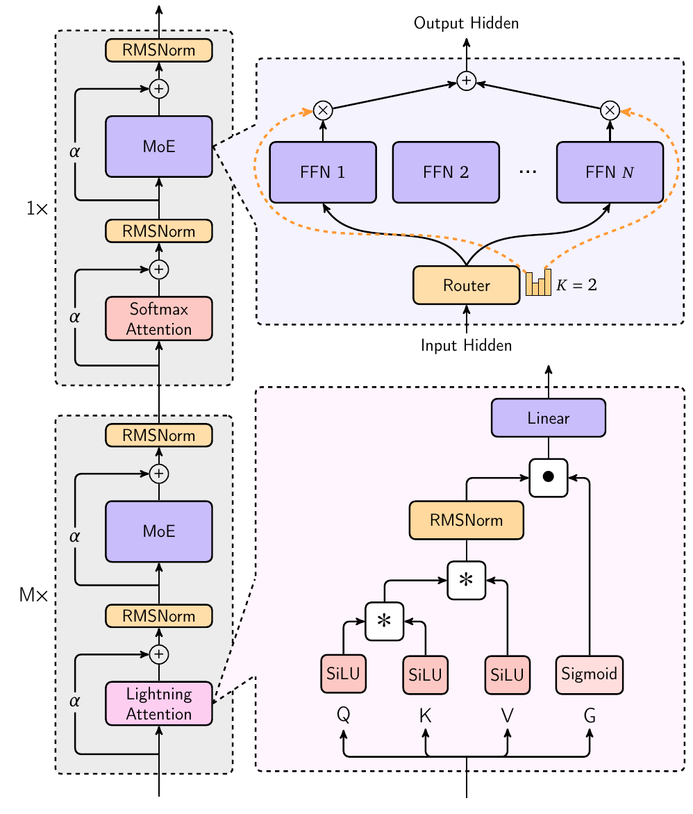

# MiniMax 01

## Executive answer

MiniMax 01 asks how far a model can reduce repeated full history lookup without losing useful long context behavior. It combines mostly recurrent linear attention with occasional exact softmax attention and a large mixture of experts.[^report]

[Technical report](https://arxiv.org/pdf/2501.08313v1) · [Hugging Face: MiniMaxAI/MiniMax-Text-01](https://huggingface.co/MiniMaxAI/MiniMax-Text-01)

## Visual overview

<!-- visual-id: V001 -->

## Key findings

- **Hybrid rather than attention free.** Seven lightning attention layers precede each full attention layer; the final decoder has 80 layers.[^report]
- **Scale stored capacity separately from active work.** Its 32 experts select two per token, yielding 456B total and 45.9B active parameters.[^report]
- **Million token training needs systems work.** Context parallelism, expert communication and a gradual length curriculum matter alongside the mathematical attention change.[^report]
- **The companion VLM is not native multimodal pretraining from step one.** MiniMax VL 01 adds a trained vision encoder and staged alignment to the text backbone.[^report]

## Detailed analysis

MiniMax 01 asks how far a model can reduce repeated full history lookup without losing useful long context behavior. It combines mostly recurrent linear attention with occasional exact softmax attention and a large mixture of experts.[^report]

### Highlights

- **Hybrid rather than attention free.** Seven lightning attention layers precede each full attention layer; the final decoder has 80 layers.[^report]
- **Scale stored capacity separately from active work.** Its 32 experts select two per token, yielding 456B total and 45.9B active parameters.[^report]
- **Million token training needs systems work.** Context parallelism, expert communication and a gradual length curriculum matter alongside the mathematical attention change.[^report]
- **The companion VLM is not native multimodal pretraining from step one.** MiniMax VL 01 adds a trained vision encoder and staged alignment to the text backbone.[^report]

Study scope: January 2025 report and public Text 01 artifact. The main analysis concerns Text 01; a separate section covers the report's VL 01 recipe without treating its token budget as text pretraining. Evidence checked October 10, 2026. No custom model code executed.

### Model in numbers

| Dimension | Value and scope |
| --- | --- |
| Parameters | 456B total, 45.9B active per token; two of 32 experts per layer.[^report] |
| Decoder | 80 layers, residual width 6,144; 64 attention heads of width 128.[^report][^config] |
| Text pretraining | Initial schedule: 7.2T + 3.2T constant phase tokens and 1T decay tokens. Long context stages add 300B, 32B and 26B tokens.[^report] |
| Compute | A full run GPU hour or hardware independent FLOP total is not disclosed.[^report] |
| Context | Trained up to 1M; evaluated up to 4M on simple needle retrieval. The config's 10,240,000 position ceiling is not equivalent evidence.[^report][^config] |
| Companion vision model | ViT L/14 plus adapter and the text backbone; a separate four stage multimodal recipe.[^report] |

These are **processed training tokens**, not unique source data. Do not add text, vision encoder image pair counts and multimodal alignment budgets as though they measured the same quantity.[^report]

### The authors' architecture

<!-- visual-id: V001 -->

**Figure 1.** The hybrid decoder and its modules. Original report Figure 3, cropped to the complete artwork.[^report][^figure]

[Figure 1](#figure-1) shows two token mixers inside one sequential decoder. Each seven to one group is followed by another group, not run as two independent models. Full layers use GQA with eight KV heads and RoPE on half the head dimension. The initial architecture discussion gives a 10,000 RoPE base; the long context curriculum and released artifact use much larger bases, reaching 10M. Those describe different stages, not an unexplained contradiction.[^report][^config]

The expert FFN intermediate width is 9,216. The Global Router adds an allgather of pending expert token counts, then dispatches tokens across different expert parallel groups. It addresses overloaded experts in one group while another group is underused; this is cross group dispatch, not merely aggregated load statistics. DeepNorm residual scaling and post normalization improve stability in the deeper hybrid network. The release's normalization placement differs from a usual pre norm Llama block.[^report][^config]

### Why lightning attention saves repeated history work

Ignoring the production layer's decay, normalization, SiLU and output gate, the report illustrates a linear attention head as an associative matrix state:[^report]

$$
S_t=S_{t-1}+k_tv_t^\top,\qquad o_t=S_t^\top q_t
\tag{1}
$$

Equation (1) is a **simplified explanatory recurrence**, not executable checkpoint math. It replaces storing and rereading every previous KV vector with updating a fixed shape matrix. Unlike softmax attention, the query cannot assign a fresh normalized probability to each individual historical token.[^report]

Training must remain parallel. Lightning divides tokens into chunks: causal interactions within a chunk use matrix multiplication, while contributions from prior chunks arrive through the accumulated state. The report's kernel complexity is $O(nd_h^2+nBd_h)$ for sequence length n, head width $d_h$ and fixed chunk size B. This is not an alternative implementation of identical softmax attention; it is a different token mixer.[^report]

The occasional full attention layers retain direct access to detailed history. Consequently the **hybrid** still has token growing KV cache and quadratic full attention prefill terms. Saying “linear model” does not make its whole computation or memory constant in sequence length.[^report]

### Training: curriculum, data quality and parallelism

Pretraining starts at 8K sequence length with AdamW, beta values 0.9 and 0.95 and weight decay 0.1. Token batch size grows from 16M to 128M using a fitted critical batch size schedule. The team lowers the learning rate after abnormal gradient norms, then performs a decay stage.[^report]

Long context training expands through 128K, 512K and 1M. Each stage retains a short context mixture; the final stage uses 30% short, 30% medium and 40% long data. Data source sampling weights are interpolated during transitions rather than abruptly replaced; this does not mean interpolating model parameters. The data study also distinguishes deduplicated source quality from repetition: a mixture suitable for a short ablation may not remain suitable after multiple epochs at full scale.[^report]

Expert parallel and expert tensor parallel communication overlap reduce sparse FFN overhead. LASP+ parallelizes the linear attention state path; variable length ring attention serves the remaining full attention layers. Those optimizations are specific systems contributions, not guaranteed capabilities of every public serving backend.[^report]

Post training uses reward guided rejection sampling for SFT, DPO preference pairs and online RL. The report calls DPO “offline RL”; more precisely it optimizes fixed preference data without sampling a fresh environment trajectory each update. Correctness, truthfulness, helpfulness and harmlessness use different verification signals. The published description is informative, but not a complete released reward or RL codebase.[^report]

Long context alignment is not just a pretraining extension. Section 5.6 uses five phases: SFT at 8,192 tokens, SFT at 1,032,192, DPO at 8,192, DPO at 1,032,192, then online RL at 8,192. Long SFT contains 50% long prompts; long DPO uses entirely long prompts. The final online RL phase is short context, so it should not be described as million token online RL.[^report]

### The companion vision language model

VL 01 uses a ViT L/14 trained with contrastive and caption objectives, followed by an image adapter into the language model. The encoder is trained at 224 pixels and then 336; these encoder training image pair counts are distinct from multimodal tokens.[^report]

The four stages are modality alignment, instruction based vision learning, real application conversation refinement and preference optimization. Alignment updates the encoder and adapter at fixed 336 resolution with 80B tokens. The next stage opens all parameters with 420B multimodal tokens plus text alignment data; application refinement reports 44.8B tokens; DPO uses 40,000 image text preference examples.[^report]

The report gives a high level 512B token headline elsewhere, but does not reconcile that headline with the detailed stage counts. This study preserves the stage numbers rather than inventing a reconciled single total. It also does not transfer the text model's long context scores into a universal high resolution document guarantee.[^report]

### What the evidence does and does not establish

The report includes scale matched attention comparisons and stability ablations, not only final benchmark rankings. It finds normalization, decay design and hybrid placement important to quality. Yet some experiments use smaller networks and shorter training than the released 456B model. Their causal evidence applies to those settings first.[^report]

Simple needle retrieval reaches high accuracy well before the long context curriculum finishes. The authors themselves say it is too easy to monitor progress and add harder evaluations. Four million token needle success therefore does not establish four million token multi hop reasoning or consistent long document summarization.[^report]

Prefill latency comparisons also mix a custom eight H800 deployment with hosted APIs. They show the authors' observed systems, not a controlled architecture only or equal hardware speed ranking.[^report]

### Limits and the family direction

Text 01 weights use the MiniMax Model License; its code license is separate. Public download does not imply Apache 2.0 weights or a fully open training pipeline.[^license]

The reusable lesson is **compress most history, retain an exact lookup path, and test what compression loses**. Continue to [M1](/architectures/models/minimax-m1/) for reasoning RL on this backbone, then [M2](/architectures/models/minimax-m2/) for the team's later decision to return to full attention. The latter is useful counterevidence to a simple “linear is always better” narrative.

[^report]: MiniMax. [MiniMax 01: Scaling Foundation Models with Lightning Attention](https://arxiv.org/pdf/2501.08313v1), January 14, 2025. Sections 2 to 6, Equations 4 to 9, Tables 5 to 7, Figures 2 and 3 and long context evaluations inspected.
[^config]: MiniMax. [Text 01 released configuration](https://huggingface.co/MiniMaxAI/MiniMax-Text-01/blob/a7351bf2bee0e1253919d349f1ad304e6dac13e9/config.json). Architecture fields, attention pattern, RoPE and position ceiling inspected October 10, 2026.
[^license]: MiniMax. [Model license](https://huggingface.co/MiniMaxAI/MiniMax-Text-01/blob/a7351bf2bee0e1253919d349f1ad304e6dac13e9/LICENSE-MODEL) and [code license](https://huggingface.co/MiniMaxAI/MiniMax-Text-01/blob/a7351bf2bee0e1253919d349f1ad304e6dac13e9/LICENSE-CODE), inspected for the selected release.
[^figure]: [Figure source, crop and specific reuse assessment](/figures/model-studies/minimax-01/SOURCES.md). Copyright remains with MiniMax; no permissive report artwork grant is claimed.

## Counterevidence and uncertainty

Simplified recurrence versus production gates/decay; hybrid full-history cache; initial versus curriculum RoPE; processed-token stages; training/support/position ceilings; separate vision budgets. Introductory vision total and detailed stages not force-reconciled. API/custom-runtime latency is not architecture-only evidence.

## Implications

Separate mechanism, selected artifact, experiment and system; missing recipes and unexecuted runtime remain explicit.

## Open questions and future research

Application robustness, unreleased data/rewards and runtime reproduction require separate work.

## Sources

Full claim-local references above; exact report and immutable artifacts in state/sources.jsonl.

## What changed in this revision

New full study and original excerpts. Technical and rights review complete; integrated presentation QA passed.

## Completed integration review

122 site tests pass, zero Astro diagnostics, 59-page static build and 59-doc lint clean. Fresh browser regression checks cover all 41 model pages plus the catalog and Foundations at 1440 px light, 390 px light and 320 px dark (129 views), reduced motion, desktop focus, active family navigation, figure order, loaded images and local anchors; narrow figures remain keyboard-pannable and link to full-size originals. All 41 Markdown/MDX exports and both agent manifests checked; representative search queries resolve. All 35 new desktop figure renders received manual contact-sheet review; dense focus/mobile views and resource-card/catalog layout received additional manual inspection. Existing bundler directive and philosophy-redirect indexing warnings remain. No model execution or benchmark reproduction.

Cross-review corrected Global Router to actual cross-EP-group dispatch, sampling-weight transitions and unresolved vision token accounting; added five-phase short/long SFT-DPO-RL schedule. Original methods and Table7 directly re-inspected.
