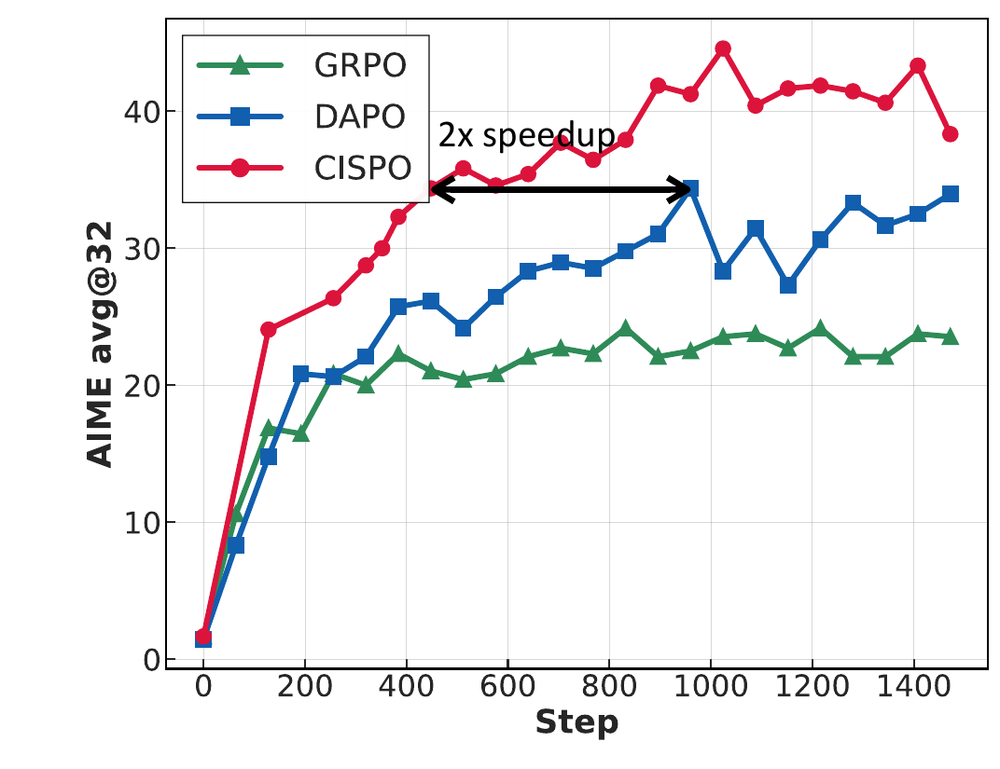
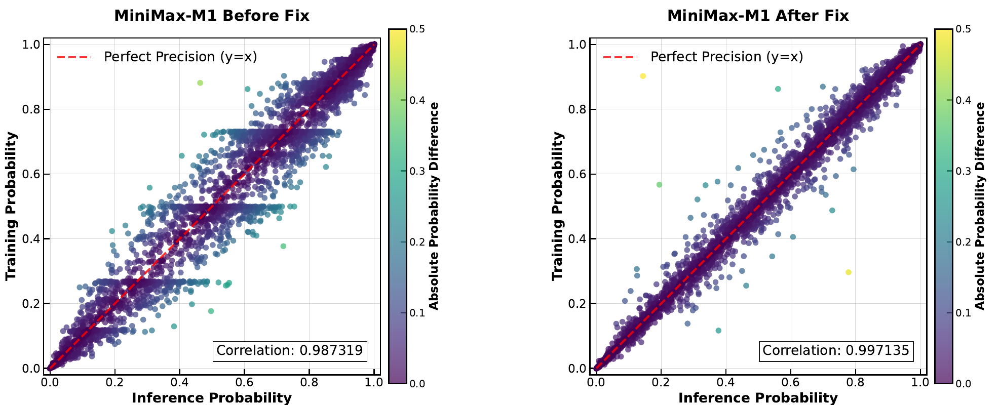

# MiniMax M1

## Executive answer

MiniMax M1 turns the Text 01 hybrid into a long reasoning model. Its main contribution joins two levels: reducing expensive generation with lightning attention, and making online RL continue learning from tokens that conventional clipped policy objectives can stop updating.[^report]

[Technical report](https://arxiv.org/pdf/2506.13585v1) · [Hugging Face: MiniMaxAI/MiniMax-M1-80k](https://huggingface.co/MiniMaxAI/MiniMax-M1-80k)

## Visual overview

<!-- visual-id: V001 -->
![Backbone: Text 01 checkpoint: 456B / 45.9B active; Hybrid attention: Seven lightning, one full; Long rollouts: Reduced attention work. The full layers still retain exact token history. This is not an entirely fixed-memory decoder.
Training: Continue pretraining: 7.5T additional tokens; Cold start SFT: Teach reasoning patterns; CISPO RL: Verifiers + generative rewards; 40K then 80K: Extended thinking budget. Context extension also progresses gradually; input context and generated reasoning length are not interchangeable.](visuals/figure-1.png)

<!-- visual-id: V002 -->

<!-- visual-id: V003 -->

## Key findings

- **Long input and long thinking are different budgets.** M1 supports 1M input context, with released 40K and 80K thinking versions.[^report]
- **CISPO clips weights, not the entire policy update.** Detached, capped importance ratios still scale a log probability gradient for tokens outside the usual PPO trust region.[^report]
- **Numerical agreement is part of RL correctness.** The team fixes training versus rollout probability mismatch by raising the output head precision.[^report]
- **The low cost headline is scoped.** The reported $534,700 estimates the RL run's GPU rental, not foundation model development.[^report]

## Detailed analysis

MiniMax M1 turns the Text 01 hybrid into a long reasoning model. Its main contribution joins two levels: reducing expensive generation with lightning attention, and making online RL continue learning from tokens that conventional clipped policy objectives can stop updating.[^report]

### Highlights

- **Long input and long thinking are different budgets.** M1 supports 1M input context, with released 40K and 80K thinking versions.[^report]
- **CISPO clips weights, not the entire policy update.** Detached, capped importance ratios still scale a log probability gradient for tokens outside the usual PPO trust region.[^report]
- **Numerical agreement is part of RL correctness.** The team fixes training versus rollout probability mismatch by raising the output head precision.[^report]
- **The low cost headline is scoped.** The reported $534,700 estimates the RL run's GPU rental, not foundation model development.[^report]

Study scope: June 2025 report, the released 80K configuration and license. Text 01 supplies the inherited architecture; M1 supplies continued training, CISPO and reasoning evaluations. Evidence checked October 10, 2026. No training or inference run reproduced.

### Model in numbers

| Dimension | Value and scope |
| --- | --- |
| Parameters | 456B total, 45.9B active; 32 experts, top two.[^report] |
| Backbone | 80 layers; seven lightning layers per full attention layer.[^report][^config] |
| Continued pretraining | 7.5T additional tokens on the Text 01 checkpoint, not the complete foundation corpus.[^report] |
| Context and generation | Reported 1M input; 40K / 80K thinking releases. The 40K model is an intermediate training phase.[^report] |
| RL compute | 512 H800 GPUs for three weeks; reported rental estimate $534,700. Pretraining, data and total project costs excluded.[^report] |
| Controlled optimizer test | Qwen2.5 32B base on mathematical RL; separate from the full M1 run.[^report] |

### From foundation model to reasoning policy

<!-- visual-id: V001 -->
![Backbone: Text 01 checkpoint: 456B / 45.9B active; Hybrid attention: Seven lightning, one full; Long rollouts: Reduced attention work. The full layers still retain exact token history. This is not an entirely fixed-memory decoder.
Training: Continue pretraining: 7.5T additional tokens; Cold start SFT: Teach reasoning patterns; CISPO RL: Verifiers + generative rewards; 40K then 80K: Extended thinking budget. Context extension also progresses gradually; input context and generated reasoning length are not interchangeable.](visuals/figure-1.png)

**Figure 1.** The inherited network and new reasoning recipe. Independent map of report Sections 1 to 4; the source report does not supply a new backbone architecture drawing.[^report]

The network retains the Text 01 expert blocks, post normalization and seven to one attention pattern. Lightning layers update recurrent state, while full layers maintain growing KV history. That reduces repeated attention work during long reasoning, but does not remove the FFN, full layer cache or the linear cost of generating each new token.[^report][^config]

Continued pretraining improves natural QA extraction, parsing and deduplication, and increases STEM, code, book and reasoning content to 70%. The report avoids synthetic data **in this continued pretraining corpus**, not throughout all development: RL later includes synthetic logic tasks. A constant learning rate of 8e-5 covers 2.5T tokens, followed by 5T tokens decaying to 8e-6.[^report]

Context grows smoothly from 32K to 1M across four stages, because aggressive length jumps caused gradient explosions. Cold start SFT teaches reflection based reasoning across several domains, with math and code around 60% of examples. Those interventions jointly prepare RL; the final outcome should not be attributed to CISPO alone.[^report]

### CISPO: keep the token's gradient, cap its weight

Let $r_{i,t}=\pi_\theta(o_{i,t}\mid q,o_{i,\lt t})/\pi_{\mathrm{old}}(o_{i,t}\mid q,o_{i,\lt t})$ be the importance ratio. For a positive advantage, PPO's clipped surrogate can become flat once this ratio exceeds its upper bound. M1 observed that rare reflection tokens often crossed that boundary and no longer contributed gradients during later updates on the same rollout batch. The reported setup makes 16 off policy update rounds per generation batch sampled from the old policy, making the probability mismatch increasingly consequential.[^report]

The core CISPO objective uses a token average with a detached clipped weight. This is not the complete final 80K stabilization recipe:

$$
J_{\mathrm{CISPO}}=\mathbb E\left[\frac{1}{\sum_i |o_i|}\sum_i\sum_t\operatorname{sg}(\widehat r_{i,t})\,\widehat A_i\,\log\pi_\theta(o_{i,t}\mid q,o_{i,\lt t})\right]
\tag{1}
$$

$$
\widehat r_{i,t}=\operatorname{clip}(r_{i,t},1-\epsilon_{\mathrm{low}}^{\mathrm{IS}},1+\epsilon_{\mathrm{high}}^{\mathrm{IS}})
\tag{2}
$$

Here sg means stop gradient. Group relative advantages compare response rewards within a prompt's rollout group. The gradient is proportional to the **capped weight times advantage times log probability gradient**, rather than the derivative of a clipped surrogate. Thus a positive weight can still update an out of range token. It is not unbounded REINFORCE: weight clipping changes the estimator and introduces bias.[^report]

The reported implementation effectively removes the lower clipping bound, tunes the upper bound, uses dynamic sampling and a length penalty, and omits a reference KL penalty. The denominator averages across generated tokens, not equally across responses of unequal length. These details affect optimization and should not be dropped from the explanation.[^report]

<!-- visual-id: V002 -->

**Figure 2.** Optimizer comparison on Qwen2.5 32B, not M1. Original report Figure 2.[^report][^figures]

[Figure 2](#figure-2) plots AIME avg@32, rather than pass@1, and supports better score per update under this math RL setup and approximately half the steps to a comparable DAPO score. **Half the update count is not automatically half the wall clock cost**, and does not prove every domain benefits. The controlled proxy model also differs from the released 456B hybrid.[^report]

### When a faster kernel makes the policy wrong

RL ratios assume the rollout policy's probabilities and the trainer's probabilities refer to the same computation. M1 found substantial disagreement even before a meaningful parameter change. Layerwise investigation localized a key problem to large LM head activations; raising the output head to FP32 improved alignment and allowed rewards to grow.[^report]

<!-- visual-id: V003 -->

**Figure 3.** Numerical consistency before and after the LM head fix. Original report Figure 3.[^report][^figures]

The optimizer was also sensitive to AdamW beta settings; the report uses beta1 0.9, beta2 0.95 and epsilon 1e-15. A repetition detector stops generation after 3,000 consecutive tokens each above probability 0.99. This is an explicit rollout rule, not a learned proof that long reasoning is always productive.[^report]

### Extending thinking without collapsing the policy

The 80K version grows its generation window through 40K, 48K, 56K, 64K, 72K and 80K. The 40K policy filters easy problems; harder math and code become more prominent. Synthetic reasoning is downsampled after repetitive, homogeneous outputs destabilize longer training. Perplexity convergence and the 99th percentile of output length guide transitions.[^report]

Negative reward responses became disproportionately longer than positive ones, accumulating large negative gradients late in the sequence. The remedy combines sample level loss with token level normalization, early stops repetitive outputs, and lowers gradient clipping and the upper importance ratio cap. The paper does not give a complete algebraic specification of that combined loss. Equation (1) explains core CISPO, not every final 80K adjustment.[^report]

### Rewards and the actual task mixture

RL mixes verifiable math, executable competition code, 41 synthetic logic tasks and sandboxed real repository software engineering with nonverifiable tasks scored by generative reward models. The latter reward quality cannot be assumed identical to a deterministic test. Software engineering reward depends on the constructed environment and test coverage, not merely plausible code text.[^report]

The model's theoretical attention FLOP curves favor M1 over DeepSeek R1 as generation becomes very long. They are **model calculation estimates**, not measured same hardware end to end request latency. Benchmark comparisons also vary tools and task harnesses. Strong long context recall and tool results coexist with weaker competition math/code relative to some later baselines.[^report]

General reward models introduce a second moving target. The report finds that offline length bias checks can still fail during online RL: the policy earns more reward by writing longer without improving task success. Continuous monitoring triggers reward model recalibration, with additional reward shaping and normalization. RL starts with rule verified reasoning tasks, then gradually mixes general tasks judged by GenRM. A strong offline judge score is not sufficient protection against reward exploitation.[^report]

### Limits and useful lessons

M1 weights use Apache 2.0. The report artwork remains separately copyrighted; the bounded source figures here have their own reuse record.[^license][^figures]

The most useful lesson is that **online RL efficiency requires architecture, estimator and numerical execution to agree**. A clever loss cannot repair inconsistent rollout log probabilities; an efficient token mixer cannot alone supply trustworthy reward or task diversity. Continue to [M2](/architectures/models/minimax-m2/) for asynchronous agent training, scheduling and richer environments.

[^report]: MiniMax. [MiniMax M1: Scaling Test Time Compute Efficiently with Lightning Attention](https://arxiv.org/pdf/2506.13585v1), June 16, 2025. Sections 1 to 5, Equations 1 to 7, Figures 1 to 3 and evaluation protocols inspected.
[^config]: MiniMax. [M1 80K configuration](https://huggingface.co/MiniMaxAI/MiniMax-M1-80k/blob/8d1494b1a260e22040d5b9b2eb332eb44500b34d/config.json), inspected October 10, 2026. Its large position ceiling is distinct from the report's input support claim.
[^license]: MiniMax. [M1 release license](https://huggingface.co/MiniMaxAI/MiniMax-M1-80k/blob/8d1494b1a260e22040d5b9b2eb332eb44500b34d/LICENSE), Apache 2.0.
[^figures]: [Original figure provenance and specific reuse assessments](/figures/model-studies/minimax-m1/SOURCES.md). Two bounded plots support critical discussion of the controlled optimizer test and numerical fix; no permissive report artwork grant is asserted.

## Counterevidence and uncertainty

RL-only rental cost versus foundation and7.5T continued training; capped detached ratio log-gradient versus PPO flat region; Figure2 Qwen2.5-32B AIME avg@32 not finalM1/pass@1/walltime. Numerical rollout/training mismatch and FP32 fix. Synthetic exclusion applies to continued pretraining, not RL.

## Implications

Separate mechanism, selected artifact, experiment and system; missing recipes and unexecuted runtime remain explicit.

## Open questions and future research

Application robustness, unreleased data/rewards and runtime reproduction require separate work.

## Sources

Full claim-local references above; exact report and immutable artifacts in state/sources.jsonl.

## What changed in this revision

New full study and original excerpts. Technical and rights review complete; integrated presentation QA passed.

## Completed integration review

122 site tests pass, zero Astro diagnostics, 59-page static build and 59-doc lint clean. Fresh browser regression checks cover all 41 model pages plus the catalog and Foundations at 1440 px light, 390 px light and 320 px dark (129 views), reduced motion, desktop focus, active family navigation, figure order, loaded images and local anchors; narrow figures remain keyboard-pannable and link to full-size originals. All 41 Markdown/MDX exports and both agent manifests checked; representative search queries resolve. All 35 new desktop figure renders received manual contact-sheet review; dense focus/mobile views and resource-card/catalog layout received additional manual inspection. Existing bundler directive and philosophy-redirect indexing warnings remain. No model execution or benchmark reproduction.

Cross-review added16 off-policy update rounds,40K-to80K staged curriculum, difficulty filtering, synthetic-reasoning downsampling, longer negative-sample imbalance and combined sample/token normalization. Core CISPO equation is explicitly not the entire80K recipe. Online GenRM length-bias recalibration and rule-first task curriculum added after direct section inspection.
