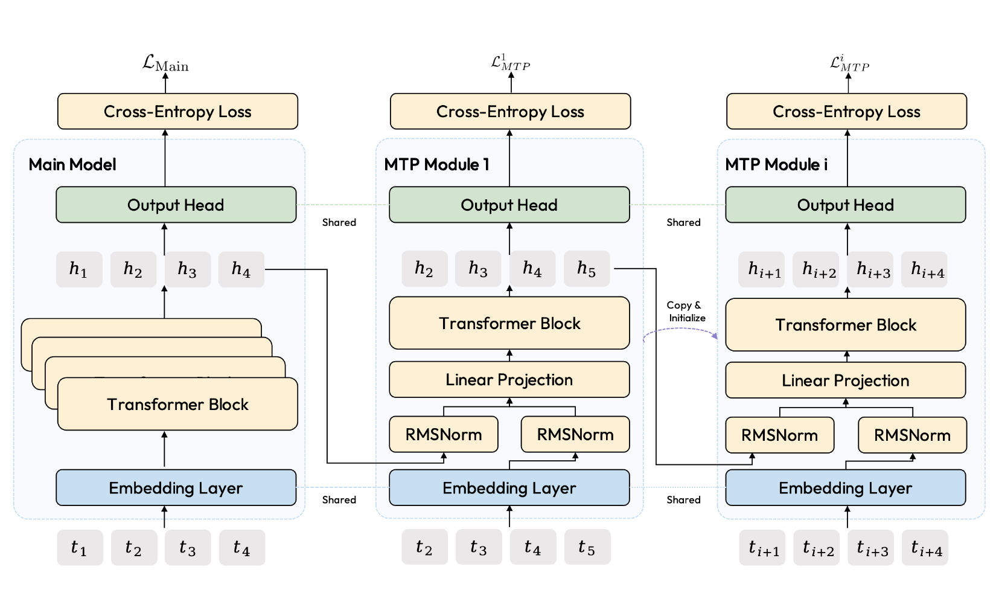
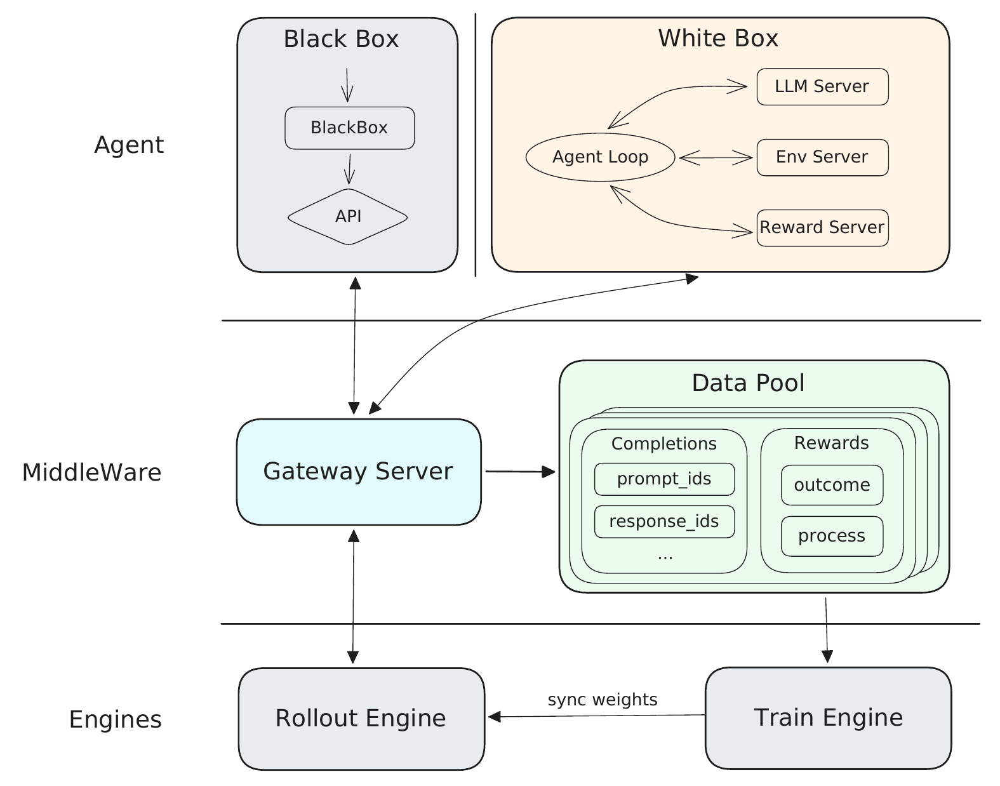

# MiniMax M2 Series

## Executive answer

The M2 series shifts MiniMax's emphasis from very long isolated thinking toward agents that build, search and work through external tools. Its distinguishing idea is a complete learning system: small active expert computation, realistic task environments and asynchronous RL that can handle widely varying rollout durations.[^report]

[Technical report](https://arxiv.org/pdf/2605.26494v2) · [Hugging Face: MiniMaxAI/MiniMax-M2.7](https://huggingface.co/MiniMaxAI/MiniMax-M2.7)

## Visual overview

<!-- visual-id: V001 -->

<!-- visual-id: V002 -->

## Key findings

- **Full attention is a deliberate reversal.** M2 departs from earlier MiniMax hybrid designs after quality and infrastructure concerns surfaced on harder tasks.[^report]
- **More granular experts lower active computation.** The report gives about 229.9B total parameters, with about 9.8B active per token through eight of 256 experts.[^report]
- **Training targets interactions, not just answers.** Interleaved reasoning, tool actions, observations, execution feedback and task duration shape the policy.[^report]
- **Asynchrony needs distribution control.** Forge decouples agents, inference and training; Windowed FIFO reduces stragglers without letting fastest tasks dominate unchecked.[^report]

## Detailed analysis

The M2 series shifts MiniMax's emphasis from very long isolated thinking toward agents that build, search and work through external tools. Its distinguishing idea is a complete learning system: small active expert computation, realistic task environments and asynchronous RL that can handle widely varying rollout durations.[^report]

### Highlights

- **Full attention is a deliberate reversal.** M2 departs from earlier MiniMax hybrid designs after quality and infrastructure concerns surfaced on harder tasks.[^report]
- **More granular experts lower active computation.** The report gives about 229.9B total parameters, with about 9.8B active per token through eight of 256 experts.[^report]
- **Training targets interactions, not just answers.** Interleaved reasoning, tool actions, observations, execution feedback and task duration shape the policy.[^report]
- **Asynchrony needs distribution control.** Forge decouples agents, inference and training; Windowed FIFO reduces stragglers without letting fastest tasks dominate unchecked.[^report]

Study scope: the July 30, 2026 revision of the **M2 series report**, including M2.7 evaluation, and the public M2.7 configuration. M2, M2.1, M2.5 and M2.7 are covered within one family study rather than presented as four independently disclosed architectures. Evidence checked October 10, 2026; no model or agent environment executed.

### Model in numbers

| Dimension | Value and scope |
| --- | --- |
| Parameters | Report family architecture: 229.9B total, 9.8B active per token.[^report] |
| Decoder | 62 layers; width 3,072; 48 query heads and eight KV heads; full causal attention throughout.[^report][^config] |
| Experts | 256 fine grained experts, top eight; released intermediate width 1,536.[^report][^config] |
| Pretraining | 19.9T constant phase + 9.3T decay and context extension = 29.2T processed tokens.[^report] |
| Context | Report trains through 8K, 32K and 192K; M2.7 config allows 204,800 positions. Keep those measures separate.[^report][^config] |
| Multi token prediction | One module initially; expanded to three during continued pretraining.[^report][^config] |
| Compute | Complete pretraining and RL accelerator hours / run FLOPs not disclosed.[^report] |

### Why the attention design changed

M2 uses full attention with GQA and RoPE in all layers. The team reports that earlier efficient attention designs looked competitive on common benchmarks but exposed weaknesses on multi hop reasoning at larger scale. The report also identifies infrastructure gaps around recurrent state precision, prefix reuse and speculative decoding.[^report]

This is important counterevidence, but not a theorem that linear attention cannot work. Data, kernel maturity and task distribution matter. M2's hybrid sliding window ablations lose several retrieval and agent metrics while improving some others; those results explain this particular product choice.[^report]

The MoE path uses smaller experts, sigmoid affinities and per expert routing shifts. Sigmoid avoids the all expert softmax competition; eight selected experts still define a sparse active path. The routing biases are learned jointly with model parameters, rather than updated by a separate utilization heuristic. The report greatly reduces the auxiliary balancing loss; it does not claim to eliminate it. The released checkpoint stores FP8 weights with explicit exclusions and includes QK normalization. Precision format and inference memory are distinct from active parameter count.[^report][^config]

### Multi token prediction: learning and drafting

<!-- visual-id: V001 -->

**Figure 1.** Sequential MTP modules with shared embeddings and output heads. Original series report Figure 2.[^report][^figures]

[Figure 1](#figure-1) is not three parallel guesses from the same hidden state. Each module advances the prediction horizon. Training begins with one module and a loss weight of 0.3, later reduced to 0.1. Expansion to three copies main model weights, briefly freezes the backbone until modules stabilize, then trains jointly. Random initialization converged worse in the reported experiments.[^report]

At inference, a compatible speculative decoder drafts with MTP and verifies through the main model. Correct acceptance and sampling rules matter: the report's quality preservation claim is not permission to accept every draft unconditionally. RL also co-trains draft behavior to reduce mismatch as the main policy changes.[^report]

### The data system is part of the model

Software engineering data begins with permissively licensed repository pull requests, then filters tasks and builds reproducible Docker environments. Agents reconstruct problems and tests; validation removes ambiguous, broken or insufficiently testable cases. A merged pull request alone is not a ready made trustworthy training example.[^report]

Application development uses expert specified tasks, rendered interaction feedback and quality evaluation. Terminal tasks involve executable environments. Cowork expands into web research, documents, spreadsheets and slides with domain appropriate verification. These pipelines mix human specifications, synthetic construction, environment feedback and filtering; the report does not disclose every mixture ratio or final instance count.[^report]

SFT uses rejection sampled and cleaned interleaved trajectories across chat, reasoning, code and cowork. A trajectory alternates thinking, action and observation instead of putting all reasoning in one opening paragraph.[^report]

### Agent RL: optimize the generation boundary

The LLM is the policy. Tool execution, context rewriting, memory and the agent harness are environment dynamics. Each completion is an action given the actual state presented to the model; whole episode outcomes inform credit assignment. This avoids pretending every agent interaction is one unchanged text prefix.[^report]

M2 adapts CISPO with detached importance weights clipped between zero and an upper bound, token normalization and reward to go. Rewards combine intermediate behavior, task quality and relative completion time. Speed is rewarded alongside success, not as a substitute for success. Mixed domain batches and curricula vary task difficulty, context lengths and domain proportions to limit specialization losses.[^report]

<!-- visual-id: V002 -->

**Figure 2.** Forge separates agents, data collection and policy training. Original report Figure 4.[^report][^figures]

White box integrations expose context transformations for reconstruction; black box agents only expose the actual completion requests and observations. The framework can train on those observed states without differentiating through arbitrary tools or context management code. This is an interface separation, not a claim that external actions become differentiable.[^report]

### Async scheduling, shared prefixes and cache locality

Strict FIFO can let one slow trajectory block the queue. Fully greedy completion order overrepresents quick, easy tasks. **Windowed FIFO** permits completed trajectories within a bounded window anchored to the oldest active entry, while blocking completions beyond it. The report uses an example window around 30% of the generation queue: a tuning choice, not a universal constant.[^report]

Prefix tree merging computes a shared prefix once, then branches into separate response segments and computes each sample's loss independently. Equivalence requires the correct causal branch masks and sample metadata; unrelated responses must not attend to one another. The reported “up to 40 times” training speedup is a favorable shared prefix workload, not a blanket whole run gain.[^report]

MTP speculation, prefill/decode disaggregation and a distributed KV pool reduce rollout waste. The actual improvement depends on draft acceptance, expert communication, prefix reuse and request scheduling, so a small active FFN is not enough to predict serving latency.[^report]

### Read the evaluation as a system comparison

The series report compares M2.7 with M2.5 and several hosted baselines under documented harnesses. M2.7 improves Terminal Bench 2.0 from 51.7 to 57.0 and NL2Repo from 26.6 to 39.8, but MMLU Pro falls from 85.2 to 81.8. This is evidence of a changing capability profile, not uniform improvement across every task.[^report]

Software benchmarks depend on tool permissions, tests, context and agent scaffolds. Search and office tasks add browser access, judge quality and potentially proprietary environments. The report documents important evaluations, but independent reproduction and a fully released training platform remain outside this study.[^report]

### Operational self evolution, not autonomous weight improvement

M2.7 also helps debug training runs, change configurations and refine agent scaffolds. Researchers set goals, steer the work and review outputs; the policy acts through a harness. This is an operational development loop, not evidence that the released model independently rewrites or improves its own neural weights.[^report]

The report tests this pattern on 22 MLE Bench Lite competitions, with three independent 24 hour trials, and reports a 66.6% average medal rate. The outcome depends on the task suite, sandbox, tools, scaffold and allowed compute. It supports iterative ML engineering in that setting, not a universal claim of autonomous scientific discovery.[^report]

### Licensing and reusable lessons

The **selected M2.7** checkpoint has a noncommercial custom license: commercial use requires prior authorization. Do not carry another M2 generation's license forward automatically or label all M2 weights MIT. Code, model weights and report artwork are distinct materials.[^license][^figures]

For builders, M2 is a lesson in **aligning the data, environment, scheduler and policy**. A faster queue can silently change the learning distribution; a cleaner benchmark can hide a production quality gap. Continue to [M3](/architectures/models/minimax-m3/) for the next attention redesign and native vision.

[^report]: MiniMax. [The MiniMax M2 Series: Mini Activations Unleashing Max Real World Intelligence](https://arxiv.org/pdf/2605.26494v2), July 30, 2026 revision. Sections 2 to 8, architecture and ablation tables, Figures 2 and 4 to 6 and evaluation protocols inspected.
[^config]: MiniMax. [M2.7 released configuration](https://huggingface.co/MiniMaxAI/MiniMax-M2.7/blob/d494266a4affc0d2995ba1fa35c8481cbd84294b/config.json), inspected October 10, 2026. Family report and representative artifact limits remain separate.
[^license]: MiniMax. [M2.7 checkpoint license](https://huggingface.co/MiniMaxAI/MiniMax-M2.7/blob/d494266a4affc0d2995ba1fa35c8481cbd84294b/LICENSE), inspected for the selected snapshot. This is a source based terms summary, not legal advice.
[^figures]: [Original figures, crops and specific reuse assessments](/figures/model-studies/minimax-m2/SOURCES.md). Copyright remains with MiniMax; no MIT report artwork grant is inferred.

## Counterevidence and uncertainty

Full attention rather than M1hybrid;29.2T stage accounting;192K trained versus204800 artifact ceiling. Sequential MTP and draft verification. Agent/environment boundary not differentiation through tools. FIFO speed-induced distribution bias; causal prefix branches;40x favorable workload not whole run. MMLU-Pro regression. M2.7 terms noncommercial, not MIT.

## Implications

Separate mechanism, selected artifact, experiment and system; missing recipes and unexecuted runtime remain explicit.

## Open questions and future research

Application robustness, unreleased data/rewards and runtime reproduction require separate work.

## Sources

Full claim-local references above; exact report and immutable artifacts in state/sources.jsonl.

## What changed in this revision

New full study and original excerpts. Technical and rights review complete; integrated presentation QA passed.

## Completed integration review

122 site tests pass, zero Astro diagnostics, 59-page static build and 59-doc lint clean. Fresh browser regression checks cover all 41 model pages plus the catalog and Foundations at 1440 px light, 390 px light and 320 px dark (129 views), reduced motion, desktop focus, active family navigation, figure order, loaded images and local anchors; narrow figures remain keyboard-pannable and link to full-size originals. All 41 Markdown/MDX exports and both agent manifests checked; representative search queries resolve. All 35 new desktop figure renders received manual contact-sheet review; dense focus/mobile views and resource-card/catalog layout received additional manual inspection. Existing bundler directive and philosophy-redirect indexing warnings remain. No model execution or benchmark reproduction.

Cross-review corrected total-parameter attribution and hybrid-design scope, jointly learned routing shifts with reduced—not eliminated—balancing loss. Added human-steered operational self-evolution and scoped22-competition/three24h-trial MLE evaluation, not autonomous weight self-improvement.
