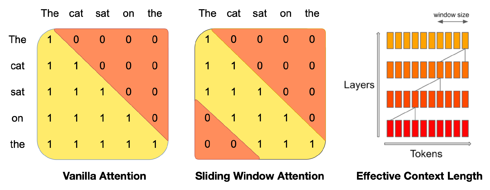
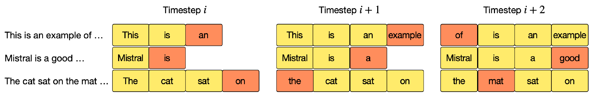
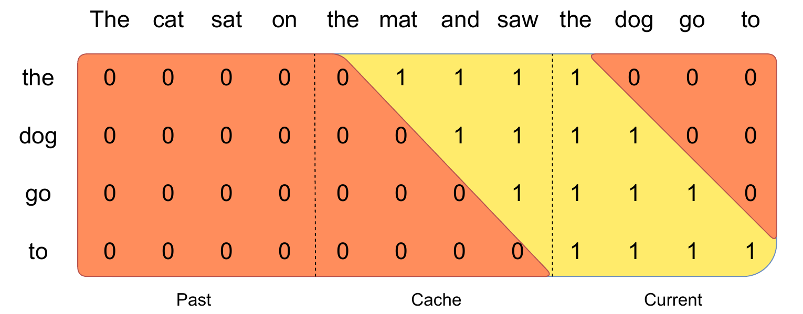

# Mistral 7B

## Executive answer

[Technical report](https://arxiv.org/abs/2310.06825v1) · [Hugging Face: mistralai/Mistral-7B-v0.1](https://huggingface.co/mistralai/Mistral-7B-v0.1)

Mistral 7B is a dense causal language model designed to make a smaller model useful without keeping an ever growing attention history at every layer. Its main architectural lesson is the combination of grouped KV heads and sliding attention: share stored history across query heads, then restrict each layer to a recent window.[^report]

## Visual overview

Purposeful figures below cover the input contract, distinctive mechanism or bounded evidence; their captions identify provenance and scope.

## Key findings

- **Reduce state in two ways.** Eight KV heads serve 32 query heads, while a 4,096 token sliding window bounds the history read by each layer.[^report][^config]
- **Reach beyond one window through depth.** Earlier information can propagate through stacked layers, but a theoretical path is not a guarantee of long range recall.[^report]
- **A released efficiency baseline.** Base and instruction variants were released under Apache 2.0. The original report makes it possible to study a compact model without assuming an undisclosed complete training recipe.[^report][^card]

Representative checkpoint: **Mistral-7B-v0.1 base**. Report v1, immutable configuration, card and targeted Transformers attention/mask code checked October 10, 2026. Not v0.2 or v0.3; no checkpoint executed.[^config][^code]

## Detailed analysis

## Model in numbers

| Dimension | Value and scope |
| --- | --- |
| Model size | Approximately 7 billion parameters, dense; 32 layers and width 4,096.[^report] |
| Attention | 32 query heads, eight KV heads, head width 128; sliding window 4,096.[^config] |
| Context | Report Table 1 lists 8,192. Hosted v0.1 configuration sets max_position_embeddings to 32,768. These are distinct source claims, not interchangeable evidence of useful context.[^report][^config] |
| Pretraining exposure | Token count, complete data mixture and corpus reconstruction are undisclosed in the inspected report.[^report] |
| Training compute | Accelerator hours and FLOP budget are undisclosed in the inspected report.[^report] |
| Instruction data | The report says publicly available instruction datasets were used for the Instruct demonstration; exact size and recipe are undisclosed.[^report] |

## Architecture

Text IDs enter a 32 layer causal decoder. Each block contains attention and a SiLU gated FFN within pre RMSNorm residual updates. The hosted artifact uses 32,000 vocabulary entries, FFN width 14,336 and rotary position. The final norm and output projection produce vocabulary logits.[^config][^code]

<!-- visual-id: V101 -->

**Figure 1.** A local window, a wider dependency path through depth. Reproduced from Jiang et al., Figure 1; figure crop, [CC BY 4.0](https://creativecommons.org/licenses/by/4.0/).[^report]

The middle mask in Figure 1 keeps causality but removes direct access to sufficiently old keys. The right panel shows how information may travel through successive layers. Its illustrative window is three positions, not the checkpoint’s 4,096 token setting.

The source chooses its attention mask from the sliding_window configuration. That makes the model's attention contract explicit; the exact cache eviction behavior still depends on the selected cache/backend implementation. A configuration field is not proof that every serving stack maintains a ring buffer.[^code]

## Two independent memory savings

<!-- visual-id: V102 -->

**Figure 2.** Storage slots wrap; sequence positions do not. Reproduced from Jiang et al., Figure 2; figure crop, [CC BY 4.0](https://creativecommons.org/licenses/by/4.0/).[^report]

Figure 2 uses a four slot toy buffer. A key at position i is stored in slot i mod W; once full, the buffer overwrites old state. Slot reuse must not reset RoPE positions. This is the paper’s cache design, not proof that every backend implements that design.

Grouped query attention shares each KV head among four query heads. For the same sequence length and precision, that stores one quarter as many KV elements as 32 independent KV heads. Query projections and attention outputs still use 32 heads; this is not eight head attention.[^config][^code]

For batch B and T current tokens, projected queries have shape B × 32 × T × 128, while keys and values have shape B × 8 × T × 128. Each KV head serves four distinct query heads. The inspected eager implementation repeats KV for the attention calculation; this temporary view does not require the persistent cache to store 32 KV heads.[^code]

The FFN separately expands each 4,096-wide state into two 14,336-wide branches, multiplies a SiLU-gated branch with the other, then projects back. The attention savings do not remove this dense FFN computation.[^config][^code]

Sliding attention prevents a layer from directly reading the whole past. A rolling cache can reuse storage once positions leave the window. For batch B, L layers, KV head count H, head width d, window W and element size b bytes, a simple KV storage estimate is:

$$
M_{\mathrm{KV}}=2BLH d\min(T,W)b
\tag{1}
$$

The factor two counts keys and values. With B=1, L=32, H=8, d=128, W=4,096 and b=2 for unquantized bf16, Equation (1) gives **0.5 GiB** once the cache is full. This is a local derivation from the configuration, excluding weights, allocator overhead, activations and backend workspace. It is not measured VRAM or an end to end latency claim.[^config]

The two savings multiply for raw KV storage compared with full 32 head history at the same long length. They do not automatically multiply measured throughput: attention kernels, bandwidth, batching and the FFN also matter.

## Depth is not unlimited recall

The report notes that a layer can move information across roughly one window, so a stack of k layers offers a theoretical dependency span on the order of kW. With 32 layers and W=4,096, this is about 131,000 token positions.[^report]

That number is **not the trained context length**. It describes possible information paths through compressed hidden states. A token far outside the current window is no longer directly available as a key at that layer, and a dependency path does not establish reliable retrieval of an arbitrary distant detail. Keep trained length, configured limits and evaluated usefulness separate.

## Training and instruction tuning

The paper does not disclose a full pretraining mixture, token budget or optimization recipe. It does describe the architecture and evaluation, and presents instruction tuning on publicly available Hugging Face datasets as a preliminary demonstration. That supports the possibility of adapting the base model; it does not identify the exact datasets, loss mask, learning rate or example count.[^report]

The base checkpoint is not an assistant. The instruction variant expects its own prompt format, and system prompting changes its behavior. Prompt guardrails and a bounded unsafe prompt evaluation are not a general safety guarantee.[^report][^card]

Source identity and context discrepancy

The inspected Mistral-7B-v0.1 configuration gives window 4,096, max positions 32,768 and rotary base 10,000. The original paper's architecture table lists context 8,192. This study records both rather than silently substitute one for the other.[^config][^report]

Targeted implementation inspection uses Transformers v4.57.1, MistralAttention and MistralModel.forward. The current official inference repository is separately Apache 2.0; it is not asserted to be the original 2023 training implementation.[^code][^release]

## Prefill and decoding

Prefill processes a known prompt. The report describes chunking large prompts so each chunk reads its own causal positions plus a recent cached window. Generation then appends a chosen token, advances its absolute position and updates the recent cache. Cache storage indices and rotary position indices are different: a reused storage slot must not reset the token's position.[^report]

An efficient serving implementation needs a mask and cache that agree at chunk boundaries. The model's 4,096 window does not mean every request must contain exactly 4,096 tokens, nor that attention should ignore causality within a chunk.

<!-- visual-id: V103 -->

**Figure 3.** Prefill combines cached history with a causal current chunk. Reproduced from Jiang et al., Figure 3; figure crop, [CC BY 4.0](https://creativecommons.org/licenses/by/4.0/).[^report]

In Figure 3, the current chunk remains causal even though all its tokens are already known to the server. The cache contributes only keys inside the moving window; the older past contributes none. A prefill kernel must implement both restrictions together.

## Evaluation

Under the paper's own evaluation pipeline, Mistral 7B reaches 60.1% MMLU at five shots versus 55.6% for Llama 2 13B. HumanEval at zero shots is 30.5% versus 18.9%. GSM8K is 52.2% versus 34.3%, but that result uses eight shot prompting and majority selection over eight attempts.[^report]

These are author reported checkpoint comparisons, not isolated GQA or sliding window ablations. The models differ in training as well as architecture. The report's limited settings support its historical efficiency case, not a claim that one attention mechanism caused every gain or that these are current benchmark rankings.

Two reported results whose conditions matter

The report claims a 2× speed improvement at 16K sequence length with a 4,096 window using modified FlashAttention and xFormers. It does not specify enough hardware, precision and batch conditions to turn that into a portable serving promise.[^report]

Its guardrail experiment declines all 175 tested unsafe prompts with the proposed system prompt. On its MT-Bench runs, the mean changes from 6.84 ± 0.07 without that prompt to 6.58 ± 0.05 with it, over ten iterations. This illustrates a bounded safety/utility tradeoff, not complete protection against unsafe requests. These results belong to the Instruct experiment, not the selected base model.[^report]

For reproduction, note that the paper uses a hand-verified MBPP subset and no-context TriviaQA. The latter differs from some Llama 2 report settings. Keeping those benchmark contracts explicit is more useful than treating every displayed score as interchangeable.[^report]

## Counterevidence and uncertainty

The training disclosure is insufficient for an exact reproduction. Sliding attention exchanges direct access to old KV for bounded state; the useful long context limit must be evaluated on the intended task rather than read from a theoretical receptive field.[^report]

Base v0.1, later Mistral releases and instruction variants are distinct artifacts. Context, tokenizer and backend behavior should be rechecked when changing versions. This study has not measured throughput, quality or memory on local hardware.

## Implications

Separate KV head sharing, attention reach and cache implementation. They solve different problems and require different evidence. Continue with [Mixtral](/architectures/models/mixtral/) for conditional FFN computation, or [Attention and memory](/architectures/evolution/attention-and-memory/) for the broader design space.

## Sources

[^report]: Albert Q. Jiang et al. [Mistral 7B](https://arxiv.org/abs/2310.06825v1), 2023 version 1, sections 2 to 5; Tables 1 to 4 and benchmark settings.

[^config]: Mistral AI. [Mistral-7B-v0.1 configuration](https://huggingface.co/mistralai/Mistral-7B-v0.1/blob/27d67f1b5f57dc0953326b2601d68371d40ea8da/config.json).

[^card]: Mistral AI. [Mistral-7B-v0.1 card](https://huggingface.co/mistralai/Mistral-7B-v0.1/blob/27d67f1b5f57dc0953326b2601d68371d40ea8da/README.md), base model identity and Apache 2.0 metadata.

[^code]: Hugging Face. [Mistral implementation](https://github.com/huggingface/transformers/blob/8cb5963cc22174954e7dca2c0a3320b7dc2f4edc/src/transformers/models/mistral/modeling_mistral.py), Transformers v4.57.1, MistralAttention and mask selection in MistralModel.forward.

[^release]: Mistral AI. [Inference repository](https://github.com/mistralai/mistral-inference/blob/9eaeb91c17450e09021b6065a1d5cc69876507c8/README.md) and [Apache 2.0 license](https://github.com/mistralai/mistral-inference/blob/9eaeb91c17450e09021b6065a1d5cc69876507c8/LICENSE). Sources inspected October 10, 2026.

## Open questions and future research

See coverage-audit.md for the mechanism-by-mechanism audit, exact source locators, justified omissions and remaining artifact-access gaps. No weights or runtime benchmarks were executed. Renewed rendered and export QA passed; see the revision 3 presentation record.

## What changed in this revision

Revision 3: GQA tensor shapes and temporary repetition versus cache storage; gated FFN shape trace; scoped speed claim; bounded guardrail/MT-Bench tradeoff and exact benchmark differences. Earlier evidence and visual-review history remain in the ledgers.

## Revision 3 presentation verification

106 automated tests, zero Astro diagnostics, the static build and all 43 docs lint checks passed. The collection passed 81 fresh browser views; this page was checked at 1440px light, 390px light and 320px dark, with desktop focus, active family navigation, caption order, anchors, image decoding, resource cards and no page overflow. Complete source figures fit desktop, while narrow frames support keyboard panning and full-size access. Search and Markdown/MDX exports preserve citations, figures and source links. All 66 model figure renders were inspected, with full-size review of new dense diagrams. See state/presentation-qa.json for exact page checksums and evidence. No model benchmark was reproduced. Existing bundler and redirect warnings remain.
