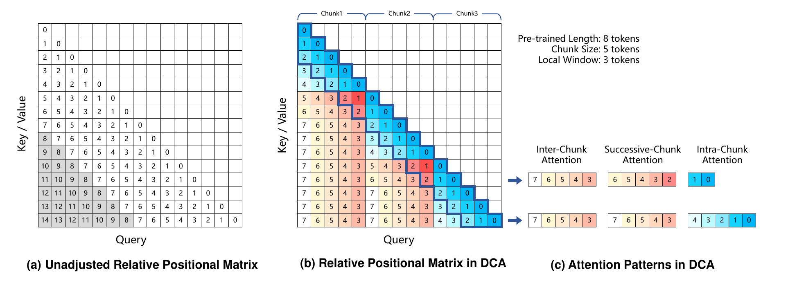
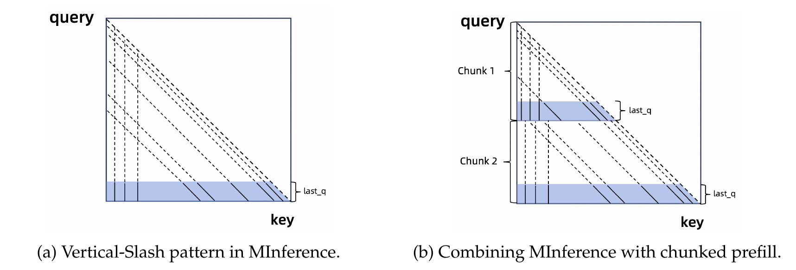

# Qwen2.5-1M

## Executive answer

A million-token system separates 256K training, DCA extrapolation, sparse chunk-aware selection and persistent KV memory.

## Visual overview

<!-- visual-id: V001 -->

**Figure 1.** DCA remaps positional distances without dropping the past. Original report Figure 2.[^figure-dca]

<!-- visual-id: V002 -->

**Figure 2.** Each prefill chunk selects from queries it can already see. Original report Figure 4.[^figure-sparse]

## Key findings

- **Train to 256K, extrapolate beyond it.** Length extension and Dual Chunk Attention play different roles; the reported million-token capability is not a million-token training curriculum.[^training][^dca]
- **Sparse prefill must respect chunking.** Attention patterns are selected from the current chunk's available queries, not from future queries at the end of the entire prompt.[^sparse]
- **Sparse attention does not eliminate memory.** Chunking reduces temporary activation pressure, while the model still retains a long KV history.[^inference]

## Detailed analysis

[Technical report](https://arxiv.org/pdf/2501.15383v1) · [Hugging Face: Qwen/Qwen2.5-7B-Instruct-1M](https://huggingface.co/Qwen/Qwen2.5-7B-Instruct-1M)

A million-token model is not created by changing one context-length setting. Qwen2.5-1M combines progressive long-context training, positional extrapolation and an inference system that avoids performing every attention operation densely.[^report]

### Highlights

- **Train to 256K, extrapolate beyond it.** Length extension and Dual Chunk Attention play different roles; the reported million-token capability is not a million-token training curriculum.[^training][^dca]
- **Sparse prefill must respect chunking.** Attention patterns are selected from the current chunk's available queries, not from future queries at the end of the entire prompt.[^sparse]
- **Sparse attention does not eliminate memory.** Chunking reduces temporary activation pressure, while the model still retains a long KV history.[^inference]

This is a useful systems study: model adaptation, attention approximation, cache size and kernel/backend support must agree before a headline context length becomes practical.

Study scope: report version 1, the **7B Instruct-1M** artifact and its documented custom vLLM inference path. Matched configuration and sparse settings inspected; the ordinary Transformers Qwen2 path was inspected for the compatibility boundary. No model execution or performance measurement here. Evidence checked October 10, 2026.

### Model in numbers

| Dimension | Value and scope |
| --- | --- |
| Released variants | 7B and 14B Instruct-1M; selected 7B card reports 7.61B parameters.[^card] |
| Backbone | Selected 7B: 28 layers, width 3,584, 28 query heads and four KV heads of width 128.[^config] |
| Training length | Progressive extension to 262,144 tokens; total additional training-token exposure is undisclosed.[^training] |
| Artifact context | Maximum 1,010,000; DCA chunk size 262,144, local window 8,192 and RoPE base 10,000,000.[^config] |
| Serving memory | Model-card guidance recommends at least 120 GB aggregate VRAM for a 1M-token 7B request in its documented framework. This is a recommendation, not our measured minimum.[^card] |
| Compute | Full training FLOPs, accelerator hours and exact hardware allocation are undisclosed.[^report] |

### Architecture: the decoder is familiar

The dense causal decoder retains the Qwen2.5 7B architecture: grouped-query attention, RoPE, pre-RMSNorm residual blocks, SwiGLU FFNs and an untied output head. The main changes concern long-context learning and attention/position handling, not a new vision encoder or expert network. Inputs are text; document retrieval and other tools are outside the decoder.[^config][^report]

The ordinary Transformers 4.57.1 Qwen2 attention implementation does not implement the artifact's custom DCA behavior. Reading the same weights with a larger maximum-length field is not evidence that the custom positional and sparse-attention path is active. The model card explicitly documents a Qwen vLLM branch for ultra-long inference.[^code][^card]

### Dual Chunk Attention: change distance, not history

RoPE normally rotates queries and keys according to their positions, so an attention pair depends on their relative distance. Distances far beyond training can become unfamiliar. DCA remaps the positional relationships to ranges the model has learned while preserving useful local continuity.[^dca]

<!-- visual-id: V001 -->

**Figure 1.** DCA remaps positional distances without dropping the past. Original report Figure 2.[^figure-dca]

In [Figure 1](#figure-1), intra-chunk attention follows ordinary local positions. Successive-chunk treatment preserves a short neighborhood across the chunk boundary, avoiding an artificial huge jump between adjacent tokens. Distant chunks use bounded/repeated positional patterns. The selected artifact supplies a 262,144-token chunk and an 8,192-token local window.[^dca][^config]

Two different historical keys can receive similar remapped positional relationships. DCA is therefore an extrapolation compromise, not exact preservation of all million-token absolute distances. It also does not compress the KV cache: a remapped key still occupies a retained history position.[^dca]

### Sparse attention and chunked prefill

MInference's Vertical-Slash patterns combine important key columns with diagonal bands. A small set of query rows estimates which positions matter, and offline profiling assigns head-specific pattern budgets. Dense scoring for all query/key pairs is replaced by selected patterns during the expensive prefill.[^sparse]

The naive selection procedure examines queries near the end of the complete input. A chunked runtime cannot use those future queries while processing an earlier chunk. Qwen2.5-1M instead selects patterns using the last 64 queries of each 32K prefill chunk. This is a systems constraint on information availability, not just a smaller batch.[^sparse]

<!-- visual-id: V002 -->

**Figure 2.** Each prefill chunk selects from queries it can already see. Original report Figure 4.[^figure-sparse]

[Figure 2](#figure-2) explains why the original pattern selector must be adapted. DCA also changes apparent positional relationships. The selection step uses continuous relative positions so distant chunks are not confused by repeated DCA patterns; the final attention computation still uses DCA positions. Selector coordinates and model attention coordinates are different contracts.[^sparse]

### Calibrate retained attention mass

Some heads lose too much useful mass under fixed sparse budgets at very long lengths. The report calibrates those budgets using a million-token sample. For the same query and scores, the retained-mass ratio can be written as:[^sparse]

$$
R=\exp\left(\operatorname{LSE}_{\mathrm{sparse}}-\operatorname{LSE}_{\mathrm{full}}\right)\tag{1}
$$

Here LSE is log-sum-exp over selected or all valid keys. This quantity measures retained unnormalized attention mass, not answer accuracy. Raising a head's budget can improve approximation while increasing compute. Good mass retention still requires downstream evaluation.

### Training and alignment

The long-context continuation inherits earlier 4K and 32K stages, then extends through 65,536, 131,072 and 262,144. The RoPE base increases to 5M and then 10M in the later stages. Long-extension data uses a 75% maximum-length and 25% shorter mixture, rather than applying a single all-long exposure.[^training]

Natural long material includes web, books, arXiv and code repositories. Synthetic tasks include fill-in-the-middle, keyword or position retrieval and reordering. These provide different dependencies rather than only asking the model to find one inserted sentence.[^training]

SFT first preserves general behavior on short data and then mixes short and 262K examples. Synthetic long-document responses use segment reading and Qwen-Agent/RAG-assisted generation. Offline DPO uses shorter preference pairs, up to 8,192 tokens. The report does not describe an online GRPO stage for this specific extension, so the general Qwen2.5 recipe should not be copied over wholesale.[^training]

### Memory and the serving contract

For one million input tokens, batch one and unquantized BF16 KV, a local cache derivation is:[^config]

$$
M_{\mathrm{KV}}=2\times28\times10^6\times4\times128\times2=57{,}344{,}000{,}000\quad\text{bytes}\approx53.4\ \mathrm{GiB}\tag{2}
$$

This excludes model weights, output tokens, temporary buffers and backend overhead. It explains why a 7B model can need far more memory than its weights alone suggest. Chunked prefill reduces temporary activations; it does not remove those 53.4 GiB of idealized KV payload. Quantization or alternative cache formats change the assumption, not the arithmetic.[^inference]

The documented framework uses sparse attention, DCA and length extrapolation together. Its historical requirements include Ampere/Hopper GPUs, CUDA 12.1 or 12.3 and a custom vLLM branch. These are inspected release instructions, not a guarantee of compatibility with every current vLLM version. Backend changes should be tested rather than inferred from a successful model load.[^card]

### Evaluation and speed: keep conditions attached

The report's 7B Instruct-1M scores improve RULER at 128K from ordinary Qwen2.5 with DCA+YaRN at 55.1 to 84.4. LV-Eval at 256K improves from 36.9 to 42.7 against the ordinary model with DCA. LongBench-Chat increases from 7.32 to 8.08. These tests cover different skills and are not all million-token measurements.[^evaluation]

Short-task changes are mixed: MMLU-Pro goes from 56.3 to 54.3, MATH from 75.5 to 72.9, while HumanEval rises from 84.8 to 86.0. The extension does not prove zero short-context regression.[^evaluation]

The authors report 3.2–6.7× time-to-first-token speedups at 1M across their tested configurations, using batch one on H20/A100 systems, 7B tensor-parallel four and 14B tensor-parallel eight. This is a system result, not a portable architectural constant. A cited 14B/H20 latency cannot be presented as the selected 7B checkpoint's latency. Some production optimizations involve BladeLLM; the open custom path should not be assumed to include every measured optimization.[^inference]

### Limits and lessons

Needle-in-a-haystack retrieval is a useful stress test but does not establish reliable synthesis over an entire million-token document. The report shows substantial degradation for unrefined MInference beyond roughly 400K; calibration helps, but sparse approximation remains a tradeoff. Complete training exposure, compute and production-backend internals remain undisclosed.[^sparse][^report]

The durable lesson is that trained length, positional support, sparse approximation, cache memory and runtime kernels are separate dimensions. The [dense Qwen2.5 study](/architectures/models/qwen2-5/) provides the baseline; this extension shows how a familiar decoder becomes a long-context system.

## Counterevidence and uncertainty

- Generic Transformers Qwen2 attention does not implement custom DCA.
- Reported speedups measure complete systems and TP/hardware conditions, not an isolated sparse-attention primitive.
- Long-context extension has mixed short-task changes; retrieval success does not prove million-token synthesis reliability.

## Implications

A million-token system separates 256K training, DCA extrapolation, sparse chunk-aware selection and persistent KV memory. The page separates reported results, selected artifact configuration, read-inspected implementation and local calculations.

## Open questions and future research

- Which undisclosed recipe and dataset decisions matter most for reproduction?
- Does the intended runtime preserve the same positional, cache and processor contracts under current serving implementations? No runtime execution performed in this task.
- Parent integration review must verify responsive rendering, themes, focus view and machine-readable exports before declaring the presentation complete.

## Sources

[^report]: Qwen Team. [Qwen2.5-1M Technical Report, version 1](https://arxiv.org/abs/2501.15383v1), submitted January 26, 2025. The study uses this exact edition.
[^training]: Qwen Team. [Report](https://arxiv.org/pdf/2501.15383v1), §§3–4: progressive pretraining, SFT and DPO.
[^dca]: Qwen Team. [Report](https://arxiv.org/pdf/2501.15383v1), §5.1 and Figure 2: Dual Chunk Attention and positional extrapolation.
[^sparse]: Qwen Team. [Report](https://arxiv.org/pdf/2501.15383v1), §5.2, Figures 3–6: MInference, chunked selection, continuous selector positions and head-budget refinement.
[^inference]: Qwen Team. [Report](https://arxiv.org/pdf/2501.15383v1), §§5.2–5.3 and §6.3: chunking, deployment system and speed experiments.
[^evaluation]: Qwen Team. [Report](https://arxiv.org/pdf/2501.15383v1), §6, Tables 4–6 and long-context evaluation plots. Results and prompt/length conditions are author-reported.
[^card]: Qwen Team. [Selected model card](https://huggingface.co/Qwen/Qwen2.5-7B-Instruct-1M/blob/e28526f7bb80e2a9c8af03b831a9af3812f18fba/README.md): custom branch, requirements and memory guidance. Selected weights are Apache-2.0 licensed; this is not a report-artwork grant.
[^config]: Qwen Team. [Selected configuration](https://huggingface.co/Qwen/Qwen2.5-7B-Instruct-1M/blob/e28526f7bb80e2a9c8af03b831a9af3812f18fba/config.json) and [matched sparse-attention configuration](https://huggingface.co/Qwen/Qwen2.5-7B-Instruct-1M/blob/e28526f7bb80e2a9c8af03b831a9af3812f18fba/sparse_attention_config.json), inspected October 10, 2026.
[^code]: Hugging Face. [Qwen2 implementation, Transformers 4.57.1](https://github.com/huggingface/transformers/blob/v4.57.1/src/transformers/models/qwen2/modeling_qwen2.py). Read inspection establishes that this generic attention path does not implement the custom DCA configuration; no runtime test performed.
[^figure-dca]: Qwen Team. [Report version 1](https://arxiv.org/pdf/2501.15383v1), Figure 2, PDF p. 5. [Original-figure provenance and reuse assessment](/figures/model-studies/qwen2-5-1m/SOURCES.md).
[^figure-sparse]: Qwen Team. [Report version 1](https://arxiv.org/pdf/2501.15383v1), Figure 4, PDF p. 7. Original copyright retained; reproduction is a bounded analytical excerpt, not relicensed artwork. [Asset notice](/figures/model-studies/qwen2-5-1m/SOURCES.md).

## Completed integration review

122 site tests pass, zero Astro diagnostics, 59-page static build and 59-doc lint clean. Fresh browser regression checks cover all 41 model pages plus the catalog and Foundations at 1440 px light, 390 px light and 320 px dark (129 views), reduced motion, desktop focus, active family navigation, figure order, loaded images and local anchors; narrow figures remain keyboard-pannable and link to full-size originals. All 41 Markdown/MDX exports and both agent manifests checked; representative search queries resolve. All 35 new desktop figure renders received manual contact-sheet review; dense focus/mobile views and resource-card/catalog layout received additional manual inspection. Existing bundler directive and philosophy-redirect indexing warnings remain. No model execution or benchmark reproduction.

Primary report, selected artifact, uncertainty and useful source figures are documented above and in the coverage audit.
