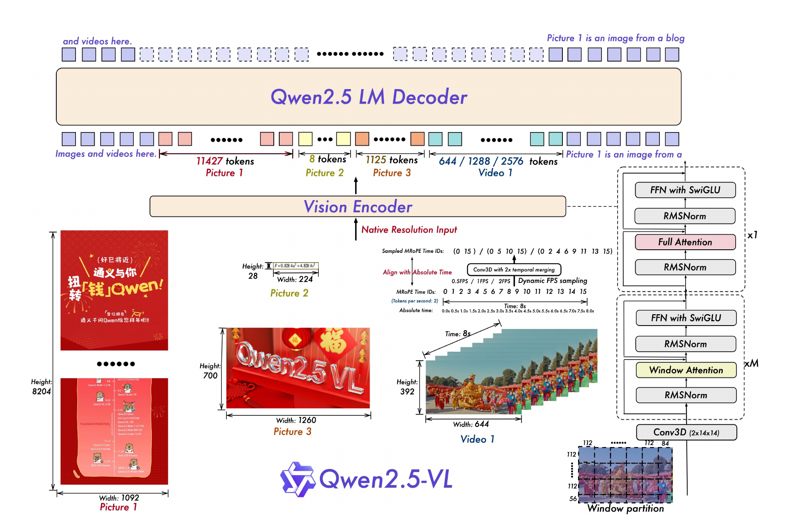

# Qwen2.5-VL

## Executive answer

Most ViT layers are windowed; periodic global layers, patch merging and absolute temporal positions preserve different visual contracts.

## Visual overview

<!-- visual-id: V001 -->

**Figure 1.** Resolution, windowing and video time meet at the decoder. Original report Figure 1.[^figure-source]

## Key findings

- **Windowed vision preserves resolution.** Most ViT layers attend locally; periodic full-attention layers exchange information across the image.[^architecture]
- **Video positions follow elapsed time.** Dynamic FPS training is paired with absolute-time temporal MRoPE positions.[^architecture]
- **Outputs become structured evidence.** Training covers document HTML, tables, chart data, grounded coordinates and action formats, rather than only fluent captions.[^data]

## Detailed analysis

[Technical report](https://arxiv.org/pdf/2502.13923v1) · [Hugging Face: Qwen/Qwen2.5-VL-7B-Instruct](https://huggingface.co/Qwen/Qwen2.5-VL-7B-Instruct)

Qwen2.5-VL aims to read visual information at useful resolution without paying full global-attention cost in every vision layer. It also gives video positions a clock, rather than treating the third frame at every sampling rate as the same moment.[^report]

### Highlights

- **Windowed vision preserves resolution.** Most ViT layers attend locally; periodic full-attention layers exchange information across the image.[^architecture]
- **Video positions follow elapsed time.** Dynamic FPS training is paired with absolute-time temporal MRoPE positions.[^architecture]
- **Outputs become structured evidence.** Training covers document HTML, tables, chart data, grounded coordinates and action formats, rather than only fluent captions.[^data]

For document and agent builders, the interesting change is the combination of visual evidence, location and structured output. Those capabilities are training targets, not guarantees that every generated coordinate or extracted value is correct.

Study scope: original report version 1 and **7B Instruct**. Configuration, processor and model code in Transformers 4.57.1 were read-inspected; no runtime or weights were executed. Report results for 72B are explicitly separated. Evidence checked October 10, 2026.

### Model in numbers

| Dimension | Value and scope |
| --- | --- |
| Released family | 3B, 7B and 72B language-backbone sizes; those names do not itemize the complete multimodal parameter count.[^report] |
| Selected language backbone | 28 layers, width 3,584, 28 query heads and four KV heads.[^config] |
| Vision encoder | 32 layers, width 1,280, 16 heads; 14-pixel spatial patches and temporal patch size two.[^config] |
| Pretraining | 4.1T mixed training tokens across three stages: 1.5T, 2T and 0.6T. Not 4.1T text-only or unique examples.[^training] |
| SFT | About 2M entries, approximately half pure text and half multimodal by entry count, not compute.[^training] |
| Context | Final pretraining stage 32,768; released config maximum 128,000. Model-card guidance distinguishes longer operation from the original 32K training regime.[^training][^config][^card] |
| Compute | Full training FLOPs and accelerator hours are undisclosed.[^report] |

### Architecture: pixels to decoder positions

<!-- visual-id: V001 -->

**Figure 1.** Resolution, windowing and video time meet at the decoder. Original report Figure 1.[^figure-source]

[Figure 1](#figure-1) is best read from pixels upward. The processor resizes while retaining aspect ratio within pixel bounds and makes spatial dimensions compatible with patching and merging. A 3D convolution embeds 2×14×14 tubes. Still images are handled with repeated frames for the temporal patching interface. The ViT performs local/global visual computation; four neighboring spatial features are concatenated and projected to language width. They replace the corresponding image/video placeholder positions in the language embeddings.[^processor][^code]

The selected merger therefore transforms four 1,280-wide features into a 5,120-wide vector, then uses a two-layer MLP to produce one 3,584-wide decoder token. Window reordering is reversed after the merger, so language-facing features retain the appropriate spatial sequence.[^config][^code]

### Windowing changes cost, not the whole model's order

The window size is 112×112 pixels, or 8×8 raw spatial patches. Full attention runs at zero-based vision layers 7, 15, 23 and 31; the other 28 layers use windows. The full layers attend across a frame's spatial patch grid, not indiscriminately across the complete video timeline.[^config][^code]

For an illustrative resized still image of 448×672 pixels, the raw grid is 32×48: 1,536 patch features become 384 decoder tokens after 2×2 merging. Image boundary markers add two positions. This is a local derivation, not a measured example from the report:[^config][^processor]

$$
N_{\mathrm{visual}}=\frac{448}{14}\times\frac{672}{14}\div4=384\tag{1}
$$

Twenty-four complete windows contain 64 patches each. Local attention scores scale with roughly $N\times64$ per local layer, while the four global layers still scale with $N^2$. Windowing reduces most vision-layer work; it does not make the entire vision encoder or language decoder linear.

Report and released configuration are not identical

Report Table 1 lists a ViT intermediate width of 3,456; the selected config contains 3,420. It also distinguishes the report's vocabulary count from the 152,064 allocated decoder embedding/output slots. This page uses artifact dimensions for the computation trace and report values for published experiments. No speculative reconciliation is imposed.[^architecture][^config]

### Video: frame index is not time

Qwen2-VL's temporal positions followed frame order. If the same event is sampled at different FPS, its frame index changes. Qwen2.5-VL trains with variable FPS and converts temporal grid positions to elapsed-time positions. Spatial height/width positions remain part of MRoPE; text receives ordinary sequence positions.[^architecture]

In the selected processor, a temporal tube's duration is temporal-patch-size divided by sampling FPS. The selected config uses two temporal position units per second. Thus the intended rule for tube index $j$ and FPS $f$ is:[^processor][^config][^code]

$$
t_j=j\times\frac{2}{f}\times2\tag{2}
$$

The first two is frames per tube; the second is position units per second. This improves consistency across sampling rates but does not recover information in unsampled frames or establish timestamp precision beyond the position discretization.

A concrete implementation caveat in Transformers 4.57.1

The inspected get_rope_index path converts seconds-per-grid to the integer dtype of its arange tensor before multiplying. A duration below one second can therefore truncate to zero in that version. At the common 2 FPS setting, a two-frame tube lasts one second and avoids that particular case; at 4 FPS it lasts half a second. This is a code-inspection finding, not an executed regression test. The report's intended variable-FPS method and a version-specific runtime path must not be conflated.[^code][^processor]

### Training and structured visual supervision

| Stage | Data and length | Updated modules |
| --- | --- | --- |
| Initial multimodal alignment | 1.5T tokens, length 8,192; caption, visual knowledge and OCR | Report table specifies ViT training with the language model frozen.[^training] |
| Broad multimodal learning | 2T tokens, length 8,192; text, interleaved data, VQA, video, grounding and agent tasks | Full model.[^training] |
| Long-context learning | 0.6T tokens, length 32,768; long video, documents and agent tasks | Full model.[^training] |
| SFT | About 2M filtered instructions across eight broad categories and 30 subcategories | Vision encoder frozen.[^training] |
| DPO | Text and image-text preferences; each sample used once | Vision encoder frozen; video DPO is not reported.[^training] |

The ViT is initialized with contrastive visual pretraining using DataComp and in-house material before these multimodal stages. The report does not fully itemize merger-specific optimizer groups in its stage table, so “ViT only” should not silently become an invented exact merger-freeze recipe.[^training]

Document data represents content and layout together: paragraphs, bounding boxes, tables, chart data, formulae and embedded-image descriptions. The report describes one million synthetic charts and six million processed table examples before filtering; these are data-construction counts, not final retained-training counts. Grounding uses absolute coordinates in the input image instead of only normalized 0–1000 values.[^data]

SFT filtering combines category tagging, rules and reward-based quality checks. Reasoning examples use rejection sampling and aim to ground the explanation in visual evidence. Preference training then addresses the quality of the response, but it does not replace document-specific validation or human review.[^training]

### Inference budgets

Dynamic resolution means token cost changes with the input. The inspected processor defaults range from 3,136 to 12,845,056 pixels, corresponding to roughly four to 16,384 merged spatial tokens per image before markers, because each token represents 28×28 pixels. Actual resizing and rounding determine the final count. Multiple large images compete with text, video and output for the same decoder context.[^processor]

This makes pixel/token budgets a serving control, not merely an image-quality preference. A text output can be HTML, coordinates, a table or an action description; executing that action still requires an external agent/runtime and appropriate safeguards.[^card]

### Evidence: document strength is not universal superiority

The report's selected 7B results are author-reported benchmark scores: MMMU 58.6, MathVista 68.2, DocVQA 95.7, InfoVQA 82.6 and ChartQA 87.3. Video-MME is 65.1 without subtitles and 71.6 with subtitles. Subtitle access changes the information available, so those video scores are not the same evaluation condition.[^evaluation]

The report does not isolate windowed attention or absolute-time MRoPE in a controlled ablation. These checkpoint scores bundle architecture, data and alignment. At 72B, RealWorldQA falls from Qwen2-VL's 77.8 to 75.7, and HallusionBench from 58.1 to 55.2. The paper therefore does not support a claim of uniformly reduced hallucination or improvement across every visual task.[^evaluation]

### Limits and lessons

Missing details include the full data recipe, compute accounting, complete optimizer settings and controlled attribution of the major architecture changes. The release offers weights and inference artifacts, not reproducibility of the entire training system. Apache-2.0 model-card terms do not establish the reuse terms of every report image.[^report][^card]

The transferable design idea is to preserve useful spatial evidence while limiting most encoder computation, align video positions with physical time, and train the output format the application actually consumes. [Qwen2-VL](/architectures/models/qwen2-vl/) introduces the earlier dynamic-resolution contract; [Qwen3-VL](/architectures/models/qwen3-vl/) develops its successor's visual integration.

## Counterevidence and uncertainty

- Report ViT FFN width 3456 differs from released 3420.
- 4.57.1 casts seconds-per-tube to integer dtype; variable-FPS subsecond duration can truncate. Read-inspected, not executed.
- No isolated window/absolute-time ablation supplied; 72B hallucination/general-vision counterexamples retained.

## Implications

Most ViT layers are windowed; periodic global layers, patch merging and absolute temporal positions preserve different visual contracts. The page separates reported results, selected artifact configuration, read-inspected implementation and local calculations.

## Open questions and future research

- Which undisclosed recipe and dataset decisions matter most for reproduction?
- Does the intended runtime preserve the same positional, cache and processor contracts under current serving implementations? No runtime execution performed in this task.
- Parent integration review must verify responsive rendering, themes, focus view and machine-readable exports before declaring the presentation complete.

## Sources

[^report]: Qwen Team. [Qwen2.5-VL Technical Report, version 1](https://arxiv.org/abs/2502.13923v1), submitted February 19, 2025. The PDF cover date is not treated as the release date.
[^architecture]: Qwen Team. [Report](https://arxiv.org/pdf/2502.13923v1), §2 and Table 1: architecture, window attention and temporal MRoPE.
[^data]: Qwen Team. [Report](https://arxiv.org/pdf/2502.13923v1), §2.2.1: document, chart, table, grounding and video data construction.
[^training]: Qwen Team. [Report](https://arxiv.org/pdf/2502.13923v1), §§2.2.2–2.3 and Table 2: pretraining and post-training.
[^card]: Qwen Team. [Selected model card](https://huggingface.co/Qwen/Qwen2.5-VL-7B-Instruct/blob/cc594898137f460bfe9f0759e9844b3ce807cfb5/README.md); license metadata marks Apache-2.0. It does not license report artwork.
[^config]: Qwen Team. [Selected configuration](https://huggingface.co/Qwen/Qwen2.5-VL-7B-Instruct/blob/cc594898137f460bfe9f0759e9844b3ce807cfb5/config.json), inspected October 10, 2026.
[^processor]: Hugging Face. [Processor, Transformers 4.57.1](https://github.com/huggingface/transformers/blob/v4.57.1/src/transformers/models/qwen2_5_vl/processing_qwen2_5_vl.py), plus Qwen Team's [matched preprocessor configuration](https://huggingface.co/Qwen/Qwen2.5-VL-7B-Instruct/blob/cc594898137f460bfe9f0759e9844b3ce807cfb5/preprocessor_config.json).
[^code]: Hugging Face. [Model implementation, Transformers 4.57.1](https://github.com/huggingface/transformers/blob/v4.57.1/src/transformers/models/qwen2_5_vl/modeling_qwen2_5_vl.py), patch embedding, patch merger, get_window_index, visual forward, get_rope_index and multimodal placeholder replacement. Read inspection only.
[^evaluation]: Qwen Team. [Report](https://arxiv.org/pdf/2502.13923v1), Tables 3, 5 and 8: general vision, document/chart and video results. Their prompt and evaluation conditions remain part of each metric.
[^figure-source]: Qwen Team. [Report version 1](https://arxiv.org/pdf/2502.13923v1), Figure 1, PDF p. 3. Original architecture excerpt including its embedded illustrative images; no independent photographic reuse implied. [Provenance and bounded reuse assessment](/figures/model-studies/qwen2-5-vl/SOURCES.md).

## Completed integration review

122 site tests pass, zero Astro diagnostics, 59-page static build and 59-doc lint clean. Fresh browser regression checks cover all 41 model pages plus the catalog and Foundations at 1440 px light, 390 px light and 320 px dark (129 views), reduced motion, desktop focus, active family navigation, figure order, loaded images and local anchors; narrow figures remain keyboard-pannable and link to full-size originals. All 41 Markdown/MDX exports and both agent manifests checked; representative search queries resolve. All 35 new desktop figure renders received manual contact-sheet review; dense focus/mobile views and resource-card/catalog layout received additional manual inspection. Existing bundler directive and philosophy-redirect indexing warnings remain. No model execution or benchmark reproduction.

Primary report, selected artifact, uncertainty and useful source figures are documented above and in the coverage audit.
