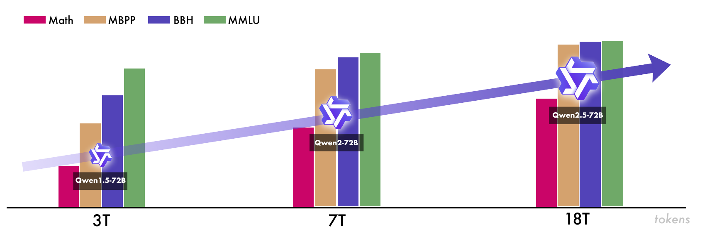

# Qwen2.5

## Executive answer

A dense baseline whose improvements combine data curation, SFT, fixed-pair DPO and sampled online GRPO.

## Visual overview

<!-- visual-id: V001 -->

**Figure 1.** The report's 72B generation comparison. Original report Figure 1; not a controlled scaling experiment.[^figure-source]

## Key findings

- **Data is an engineering system.** The reported corpus grows from Qwen2's 7T to 18T processed tokens, with domain balancing, stronger filtering and synthetic math/code material.[^pretraining]
- **Alignment has three different learning signals.** SFT teaches demonstrations, offline DPO learns from fixed preference pairs, and online GRPO uses new responses and a learned reward model.[^posttraining]
- **Context is a trained and served contract.** Late pretraining reaches 32K. The selected checkpoint's advertised 128K capability requires appropriate positional scaling and runtime settings; it is not the untouched default configuration.[^context][^card][^config]

## Detailed analysis

[Technical report](https://arxiv.org/pdf/2412.15115v2) · [Hugging Face: Qwen/Qwen2.5-7B-Instruct](https://huggingface.co/Qwen/Qwen2.5-7B-Instruct)

Qwen2.5 is useful precisely because its main lesson is not an exotic neural block. A familiar dense decoder becomes a stronger assistant through a larger, more carefully selected pretraining mixture and a post-training pipeline that moves from demonstrations to preferences to sampled experience.[^report]

### Highlights

- **Data is an engineering system.** The reported corpus grows from Qwen2's 7T to 18T processed tokens, with domain balancing, stronger filtering and synthetic math/code material.[^pretraining]
- **Alignment has three different learning signals.** SFT teaches demonstrations, offline DPO learns from fixed preference pairs, and online GRPO uses new responses and a learned reward model.[^posttraining]
- **Context is a trained and served contract.** Late pretraining reaches 32K. The selected checkpoint's advertised 128K capability requires appropriate positional scaling and runtime settings; it is not the untouched default configuration.[^context][^card][^config]

For a builder, this is a reference point for separating architecture, data, alignment and serving. That separation is our interpretation of the report, not a claim that any one ingredient alone explains its gains.

Study scope: report version 2 and the **7B Instruct** artifact. The report's 72B, Turbo and Plus results are not substituted for this checkpoint. Model card, configuration, tokenizer metadata and Transformers 4.57.1 decoder code inspected; no weights downloaded or inference executed. Evidence checked October 10, 2026.

### Model in numbers

| Dimension | Value and scope |
| --- | --- |
| Parameters | 7.61B total; 6.53B excluding embeddings, according to the selected model card.[^card] |
| Pretraining | 18T processed tokens for the general family recipe, not 18T verified unique source tokens.[^pretraining] |
| SFT | More than 1M examples; two epochs. This is not the preference or RL rollout count.[^posttraining] |
| Preferences | 150K DPO pairs; one epoch. Online GRPO samples eight responses per query.[^posttraining] |
| Context | 32,768 in the released config; card advertises 131,072 with suitable YaRN configuration. Maximum advertised generation is 8,192 tokens.[^config][^card] |
| Compute | Complete checkpoint training FLOPs, accelerator hours and hardware allocation are undisclosed.[^report] |

### What changed from Qwen2

The report emphasizes better data, not only more data. Filters based on Qwen2-Instruct score candidate text; domain classification changes the mixture. Repetitive commercial and entertainment web material receives less weight, while scientific and technical material receives more. Qwen2-72B-Instruct and specialized math models help generate synthetic examples, followed by quality or reward filtering.[^pretraining]

<!-- visual-id: V001 -->

**Figure 1.** The report's 72B generation comparison. Original report Figure 1; not a controlled scaling experiment.[^figure-source]

[Figure 1](#figure-1) supplies historical context, not the selected 7B evaluation. Its generations change data and training together, and the graphic does not provide a numerical benchmark axis. It cannot establish that increasing token exposure alone caused the improvement.[^figure-source]

### Architecture and one token's path

The representative decoder has 28 layers, hidden width 3,584, intermediate FFN width 18,944, 28 query heads and four KV heads of width 128. Input embeddings and the output projection are untied. A token enters a pre-normalized residual block: RMSNorm, causal grouped-query attention, residual addition, RMSNorm, SwiGLU FFN, then another residual addition. RoPE supplies attention positions; Q, K and V projections include biases.[^config][^code]

In the inspected attention path, the new keys and values are appended to the cache before the attention backend runs. Four KV heads are shared across 28 query heads. This saves persistent KV storage compared with storing 28 independent KV heads; it does not shorten the history or make attention linear in prompt length.[^code]

For sequence length $n$, batch one, BF16 keys and values, and no cache quantization, the ideal cache payload is a local derivation from the config:[^config]

$$
M_{\mathrm{KV}}=2\times28\times n\times4\times128\times2=57{,}344n\quad\text{bytes}\tag{1}
$$

The factors are keys/values, layers, tokens, KV heads, head width and bytes per element. At 131,072 tokens this is exactly 7 GiB of KV payload, before weights, activations and allocator overhead. It is not a measured deployment footprint.

The embedding/output allocation has 152,064 slots. The report's tokenizer discussion uses a different vocabulary count. An allocated matrix dimension and a tokenizer's enumerated vocabulary are not interchangeable counts.[^config][^pretraining]

### Training: demonstrations, preferences, experience

Pretraining starts at 4K and extends to 32K late in training. The RoPE base increases from 10,000 to 1,000,000. The report discusses YaRN and Dual Chunk Attention for operation beyond trained lengths. These are separate from the standard decoder's learned weights.[^context]

| Stage | What is optimized | Disclosed recipe |
| --- | --- | --- |
| SFT | Next-token likelihood of curated responses | More than 1M examples, two epochs, length 32,768, LR 7e-6 to 7e-7, weight decay 0.1 and gradient clipping 1.[^posttraining] |
| Offline DPO | Relative likelihood of preferred and rejected responses | 150K pairs, one epoch, LR 7e-7. The named Online Merging Optimizer does not turn the fixed-pair stage into online policy sampling.[^posttraining] |
| Online GRPO | Rewards on responses sampled from the evolving policy | Eight responses per query; global batch 2,048 query-response samples, not necessarily 2,048 distinct queries.[^posttraining] |

The SFT corpus is built for more than polite conversation. Long responses are back-translated into instructions; math answers use rejection sampling; code receives sandbox checks; structured outputs and constraint-heavy instructions receive programmatic verification. The report also describes approximately 70K logic queries, multilingual translation, diverse system prompts and multi-agent critique/filtering.[^posttraining]

DPO pairs combine human and automatic preferences. In verifiable tasks, sampled responses that pass tests can be preferred over those that fail. In online GRPO, a learned reward model scores truthfulness, helpfulness, conciseness, relevance and safety-related qualities. Queries with more reward variation receive priority because identical-quality rollouts provide less learning signal. The full reward-model dataset, all optimizer coefficients and every RL control parameter are not disclosed.[^posttraining]

This ordering addresses different weaknesses: demonstrations establish behavior; fixed preferences supply a comparison signal; on-policy sampling exposes mistakes made by the current policy. That causal interpretation is a learning aid, not an isolated ablation result.

### Inference and the 128K boundary

The artifact is a text-only Instruct model. Tokenization and the chat template establish role boundaries; prefill computes the prompt cache; decoding extends that cache and samples output tokens. Tools, retrieval and external execution remain application orchestration rather than new decoder modules.[^card][^code]

The config uses maximum positions 32,768 and no default RoPE scaling. Although a sliding-window field is present, sliding-window attention is disabled. To use the card's 131,072-token claim, its documentation configures YaRN with factor four and an original maximum of 32,768. A backend must actually honor that configuration. This page has not tested that runtime path.[^config][^card]

The report's **Turbo 1M** curriculum belongs to another variant. Do not treat it as this checkpoint's trained context. The separate [Qwen2.5-1M study](/architectures/models/qwen2-5-1m/) examines a publicly released million-token artifact and its inference system.

### Evidence and counterevidence

These are author-reported results under report evaluation settings, not measurements made here. They compare complete checkpoints, not isolated data or architecture changes.[^evaluation]

| Benchmark | Qwen2-7B-Instruct | Qwen2.5-7B-Instruct |
| --- | --- | --- |
| MMLU-Pro | 44.1 | 56.3 |
| MATH | 52.9 | 75.5 |
| HumanEval | 79.9 | 84.8 |
| IFEval | 54.7 | 71.2 |

The base-model comparison is less uniform: Qwen2.5-7B improves MMLU and MATH but HellaSwag decreases from 80.7 to 80.2 and Winogrande from 77.0 to 75.9. Stronger average capability is not improvement on every task.[^evaluation]

### Limits and transferable lessons

The report does not expose a fully reconstructable training dataset or compute ledger. Learned rewards can still favor misleading responses, and clean benchmark prompts do not cover every application schema, language or context distribution. The 7B results should not inherit 72B capability claims.[^report]

The durable lesson is to treat model improvement as a sequence of contracts: select and balance data, teach the task, verify what can be verified, compare alternatives, then evaluate the evolving policy's own mistakes. The network remains a useful dense baseline against which [Qwen3](/architectures/models/qwen3/)'s reasoning modes and expert variants can be understood.

## Counterevidence and uncertainty

- Complete compute and recipe not disclosed.
- Figure 1 is a 72B historical illustration, not a 7B controlled scaling experiment.
- 32K config versus card 128K requires YaRN/runtime configuration.

## Implications

A dense baseline whose improvements combine data curation, SFT, fixed-pair DPO and sampled online GRPO. The page separates reported results, selected artifact configuration, read-inspected implementation and local calculations.

## Open questions and future research

- Which undisclosed recipe and dataset decisions matter most for reproduction?
- Does the intended runtime preserve the same positional, cache and processor contracts under current serving implementations? No runtime execution performed in this task.
- Parent integration review must verify responsive rendering, themes, focus view and machine-readable exports before declaring the presentation complete.

## Sources

[^report]: Qwen Team. [Qwen2.5 Technical Report, version 2](https://arxiv.org/abs/2412.15115v2), submitted January 3, 2025; the first report version was December 19, 2024. Study uses this exact edition.
[^pretraining]: Qwen Team. [Report](https://arxiv.org/pdf/2412.15115v2), §2 and §3.1: architecture, vocabulary and pretraining data.
[^context]: Qwen Team. [Report](https://arxiv.org/pdf/2412.15115v2), §3.3: long-context training; Turbo's curriculum is a separate variant.
[^posttraining]: Qwen Team. [Report](https://arxiv.org/pdf/2412.15115v2), §§4.1–4.3: SFT, offline DPO and online GRPO.
[^card]: Qwen Team. [Qwen2.5-7B-Instruct model card](https://huggingface.co/Qwen/Qwen2.5-7B-Instruct/blob/a09a35458c702b33eeacc393d103063234e8bc28/README.md). Selected weights are Apache-2.0 licensed; this is not a license for report artwork.
[^config]: Qwen Team. [Released configuration](https://huggingface.co/Qwen/Qwen2.5-7B-Instruct/blob/a09a35458c702b33eeacc393d103063234e8bc28/config.json), inspected October 10, 2026.
[^code]: Hugging Face. [Qwen2 modeling implementation, Transformers 4.57.1](https://github.com/huggingface/transformers/blob/v4.57.1/src/transformers/models/qwen2/modeling_qwen2.py), Qwen2MLP, Qwen2Attention and Qwen2DecoderLayer. Read inspection only.
[^evaluation]: Qwen Team. [Report](https://arxiv.org/pdf/2412.15115v2), Tables 4 and 8: 7B base and Instruct comparisons; benchmark-specific protocols are in §5.
[^figure-source]: Qwen Team. [Report version 2](https://arxiv.org/pdf/2412.15115v2), Figure 1, PDF p. 1. Bounded original figure excerpt for critical analysis; original copyright retained. [Asset provenance and case-specific reuse assessment](/figures/model-studies/qwen2-5/SOURCES.md).

## Completed integration review

122 site tests pass, zero Astro diagnostics, 59-page static build and 59-doc lint clean. Fresh browser regression checks cover all 41 model pages plus the catalog and Foundations at 1440 px light, 390 px light and 320 px dark (129 views), reduced motion, desktop focus, active family navigation, figure order, loaded images and local anchors; narrow figures remain keyboard-pannable and link to full-size originals. All 41 Markdown/MDX exports and both agent manifests checked; representative search queries resolve. All 35 new desktop figure renders received manual contact-sheet review; dense focus/mobile views and resource-card/catalog layout received additional manual inspection. Existing bundler directive and philosophy-redirect indexing warnings remain. No model execution or benchmark reproduction.

Primary report, selected artifact, uncertainty and useful source figures are documented above and in the coverage audit.
