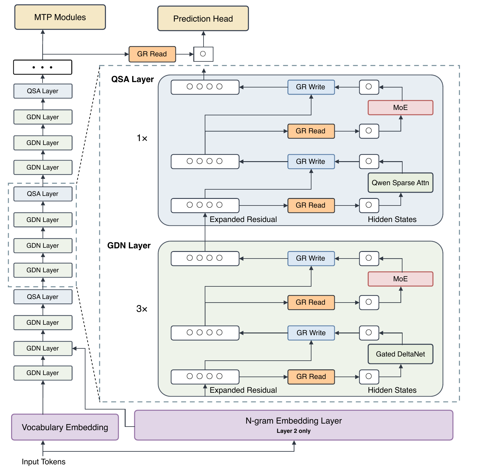
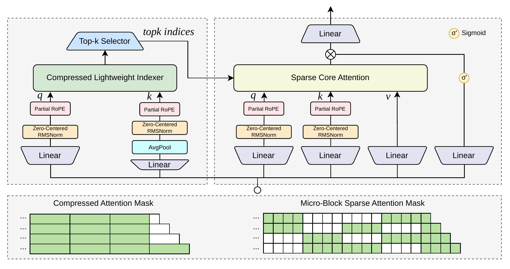
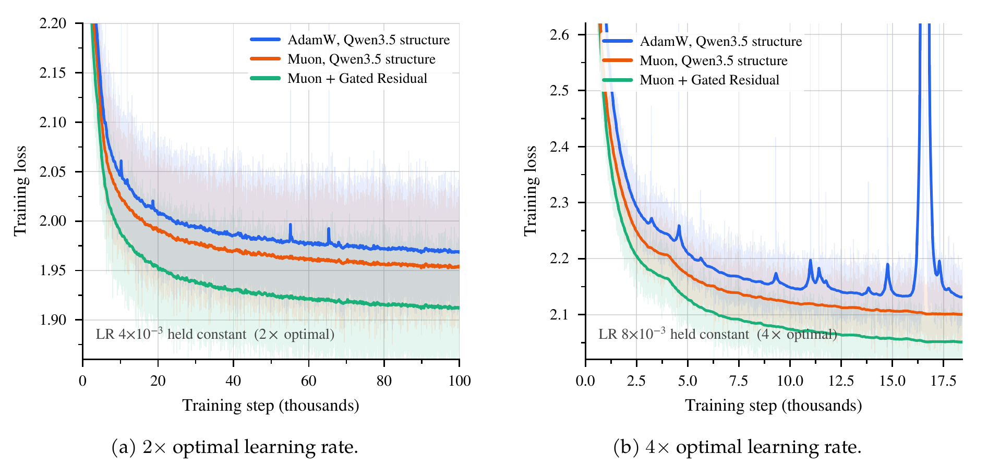

# Qwen3.8-Flash-Next

## Executive answer

Hybrid recurrent/sparse memory, four gated residual branches, local hashed embeddings and optimizer-specific stability are distinct design dimensions.

## Visual overview

<!-- visual-id: V001 -->

**Figure 1.** Recurrent state, sparse retrieval and gated residual branches. Original report Figure 1.[^figure-architecture]

<!-- visual-id: V002 -->

**Figure 2.** An indexer selects blocks; core attention reads original tokens. Original report Figure 3.[^figure-qsa]

<!-- visual-id: V003 -->

**Figure 3.** Deliberately stressful learning rates test robustness. Original report Figure 10.[^figure-stability]

## Key findings

- **Recurrence and retrieval coexist.** Three Gated DeltaNet layers alternate with one Qwen Sparse Attention layer, avoiding dense global attention in every layer.[^architecture]
- **Residual paths are learned gates.** Gated Residual reads from and writes to four expanded branches without an unconstrained branch-mixing matrix.[^gr]
- **Cheap capacity is not cheap residency.** A 51B n-gram embedding component supplements the 125B main network; six billion active parameters per token does not mean only six billion parameters must be stored.[^architecture][^ngram]
- **Stability is part of the architecture.** Muon, matrix-specific optimizer treatment and output/residual gating are studied with both ordinary and deliberately stressful learning rates.[^optimizer]

## Detailed analysis

[Technical report](https://arxiv.org/pdf/2608.30320v1) · [Hugging Face: Qwen/Qwen3.8-Flash-Next](https://huggingface.co/Qwen/Qwen3.8-Flash-Next)

Qwen3.8-Flash-Next spends capacity in several ways: recurrent state remembers recent computation, sparse attention retrieves selected past tokens, expert FFNs supply conditional capacity, and hashed n-gram embeddings supply inexpensive local context features. Its report asks how these parts can be made efficient **and trainable**, rather than treating low FLOPs as the whole design goal.[^report]

### Highlights

- **Recurrence and retrieval coexist.** Three Gated DeltaNet layers alternate with one Qwen Sparse Attention layer, avoiding dense global attention in every layer.[^architecture]
- **Residual paths are learned gates.** Gated Residual reads from and writes to four expanded branches without an unconstrained branch-mixing matrix.[^gr]
- **Cheap capacity is not cheap residency.** A 51B n-gram embedding component supplements the 125B main network; six billion active parameters per token does not mean only six billion parameters must be stored.[^architecture][^ngram]
- **Stability is part of the architecture.** Muon, matrix-specific optimizer treatment and output/residual gating are studied with both ordinary and deliberately stressful learning rates.[^optimizer]

Study scope: the report **On the Design of Qwen3.8-Next Architecture**, version 1, and the released **Flash-Next** checkpoint. Official repository, model card, config and a pinned current Transformers implementation were inspected. This report principally explains the language backbone and pretraining experiments; it does not fully disclose the released multimodal post-training recipe. No weights or inference executed. Evidence checked October 10, 2026.

### Model in numbers

| Dimension | Value and scope |
| --- | --- |
| Parameters | Reported 125B main network plus 51B n-gram embeddings; 176B is their locally derived sum. Reported active computation is about 6B parameters per token.[^architecture] |
| Backbone | 48 layers, width 2,560; three GDN layers per one QSA layer.[^config] |
| Experts | 512 routed experts, ten selected per token, plus a shared expert; expert intermediate width 640.[^config] |
| Sparse retrieval | Compression ratio four; 2,048-token selection budget, with an incomplete local tail handled separately.[^qsa][^config] |
| Context | Released config maximum 262,144, matching the report QSA continued-pretraining length. Reported 1M kernel measurements are a separate tested setting, not the default config.[^config][^qsa] |
| Training exposure | Full main-model token count and accelerator hours are undisclosed. The report compares base-model FLOPs with a prior flagship; it is not a full release cost ledger.[^evaluation] |
| License | Qwen Community License 1.0, not Apache-2.0. Particular large-scale and commercial service uses carry additional conditions.[^license] |

### Identity and evidence boundary

The first-party repository links both this report and this exact Hugging Face release. Its earlier repository PDF and the later arXiv version have different cover dates/layouts; this page consistently uses arXiv version 1 for claims and figures. The config's internal architecture name is Qwen4ExpForConditionalGeneration. That implementation identifier is not a separate consumer-facing release.[^repository][^config]

The released artifact contains a vision encoder and supports image/video inputs. However, the report's central architecture and controlled experiments concern the language backbone. Visual preprocessing, the complete multimodal curriculum, SFT and RL details should not be invented from another Qwen report. This study is therefore deep on the disclosed backbone, explicit about the missing release recipe.[^report][^card]

### Architecture: several forms of memory

<!-- visual-id: V001 -->

**Figure 1.** Recurrent state, sparse retrieval and gated residual branches. Original report Figure 1.[^figure-architecture]

[Figure 1](#figure-1) separates memories that are often conflated. GDN retains a recurrent matrix; QSA retains historical keys/values and indexer features; Gated Residual maintains feature branches within the network; n-gram lookup depends on a short token history. Residual branches are not a million-token cache.[^architecture][^code]

The tokenizer and chat template establish the input sequence. Token embeddings enter a four-branch residual stream. Each attention or MoE sublayer reads a gated 2,560-wide combination, computes its update, then writes through branch-specific gates. Final readout collapses the branches for the output head. The selected config includes a one-layer multi-token-prediction module that can be applied across speculative draft steps.[^config][^code]

### Gated DeltaNet: update a compact state

The selected GDN has 16 query/key heads and 48 value heads, each of width 128. A short depthwise convolution mixes local Q/K/V information; Q and K are L2-normalized for the delta update. Three value heads share each query/key head. The output is normalized and sigmoid-gated.[^config][^code][^architecture]

For one head, a compatible state orientation is $S_t\in\mathbb{R}^{d_k\times d_v}$ with normalized $k_t$. Decay first and correction second give:[^architecture][^code]

$$
S_t=\alpha_t(I-\beta_t k_tk_t^{\mathsf T})S_{t-1}+\beta_t k_tv_t^{\mathsf T},\qquad o_t=S_t^{\mathsf T}q_t\tag{1}
$$

The delta term corrects the value predicted from the current key instead of endlessly adding outer products. Decay controls retained history. GDN state size is fixed with sequence length, but the entire hybrid model's state is not fixed because QSA still stores token history. Training uses parallel/chunked kernels; decoding can use the recurrence.[^architecture][^code]

### QSA: cheap selection, exact attention on selected tokens

<!-- visual-id: V002 -->

**Figure 2.** An indexer selects blocks; core attention reads original tokens. Original report Figure 3.[^figure-qsa]

As [Figure 2](#figure-2) shows, compression belongs to selection. The indexer mean-pools four-token key blocks **before** normalization and RoPE, scores them with four query heads and one key head, and selects up to 512 complete blocks. The incomplete visible tail is added separately, so the practical selection can include up to three tokens beyond the nominal 2,048-token budget. Future-containing blocks are not valid candidates.[^qsa][^config][^code]

Core attention then uses original, unpooled keys and values. Its 24 query heads share two KV heads of width 256. Partial RoPE rotates 64 dimensions; the remaining dimensions are not rotated. A sigmoid output gate modulates the result.[^config][^code]

The compressed indexer still compares queries against the compressed past: its prefill work retains an $n^2/r$ component for compression ratio $r=4$. The core stage is approximately proportional to $nK$ for fixed selected-token budget $K$. Calling the whole model “linear attention” would hide this quadratic selection component. The inspected generic Transformers fallback also constructs a dense-shaped mask and uses explicit selection loops; production sparse-kernel performance cannot be inferred from that reference path.[^qsa][^code]

### Learn the selector before trusting it

QSA continued pretraining first freezes the backbone and trains the indexer for 1,000 steps on batches of eight 256K sequences, approximately 2B tokens, LR 1e-3. A joint stage follows for 8,000 steps with batches of 96 sequences, approximately 200B tokens, LR 2.5e-5. These disclosed stages are not the full original pretraining budget.[^qsa]

The selector learns from the attention distribution rather than from arbitrary top-k positions. The report's later experiments investigate reusing index selections across speculative MTP steps. That reduces repeated selection work; it does not remove verification of drafted tokens.[^qsa]

### Gated Residual and hashed n-grams

Four residual branches provide multiple feature routes. Branchwise normalization precedes a low-rank read-gate network of width 320; sigmoid gates weight each branch/channel, and the branches are averaged into the sublayer input. A separate scalar gate per branch, scaled as two times sigmoid, controls writing the update. There is no unconstrained learned matrix continuously remapping every residual branch into every other branch.[^gr][^config][^code]

The n-gram component hashes local bigrams and trigrams into multiple embedding tables: eight lookup heads per order, 16 total, injected at layer two. A base table size near 20M is a hash-table sizing parameter, not a 20M-word vocabulary. Hash collisions are possible. The component offers large stored capacity with sparse lookup; it still requires storing or moving those weights. Deterministic addressing allows host-memory offloading and asynchronous prefetch. Placement at layer two overlaps the prefetch with first-layer computation rather than requiring every table to reside on the accelerator.[^ngram][^config][^code]

The authors find that lower loss from larger n-gram tables is not uniformly matched by downstream gains. Restricting residual reads to the two highest-gated branches barely changes pretraining metrics but degrades quality after post-training, so the authors reject it. These negative results matter: not every seemingly efficient capacity mechanism survives alignment. For the adopted dense branch reads, the authors instead store residual branches in FP8 to halve residual traffic relative to BF16, and fuse normalization/read and write kernels. This is reported implementation behavior, not a precision experiment reproduced here.[^ngram][^gr]

### Optimization and stability

Muon handles suitable matrix parameters using a Nesterov-style momentum update and eight Polar Express/Newton–Schulz orthogonalization iterations. Fused matrices are split into meaningful head or gated-FFN components for optimizer treatment. Embeddings, output heads, routers and low-rank residual-gate parameters use AdamW; n-gram embeddings use Adam without weight decay.[^optimizer]

Optimizer state allocation and kernels are also redesigned around matrix shape, not only equal parameter counts. Distributed Polar Express scheduling and CUDA Graphs reduce communication/small-operation overhead. Batch-size and learning-rate scaling laws are refit for the changed architecture and optimizer. Starting at the target batch works as well as ramping it while avoiding the ramp's extra 18.8% optimizer steps in the reported comparison. The report's learning-rate sweeps are architecture experiments; their “optimal LR” should not be silently treated as the released checkpoint's complete training configuration.[^optimizer]

<!-- visual-id: V003 -->

**Figure 3.** Deliberately stressful learning rates test robustness. Original report Figure 10.[^figure-stability]

[Figure 3](#figure-3) is a controlled smaller-model experiment, not a loss trace from the final 125B backbone. In the 28-layer MoE four-times-LR stress setting, the combined Muon/Gated Residual design records zero counted loss spikes versus 183 for the AdamW prior structure per 10K steps. Separate gate-focused experiments help disentangle gating from changing the entire optimizer/architecture package.[^optimizer]

### Evaluation: separate ablations, release scores and kernels

| Question | Experiment and reported result |
| --- | --- |
| Does the hybrid help? | 25B-A3B, 28-layer ablation with 400B 4K plus 80B 32K exposure: nine-task mean 53.81 versus dense 49.87, but EvalPlus 49.71 versus 51.01.[^ablations] |
| Do residual gates help? | 25B-A3B, 560B-token experiment: mean 54.66 versus pre-norm 50.91; loss 1.590 versus 1.617. This is not an isolated flagship result.[^ablations] |
| Does sparse conversion preserve every score? | QSA comparison average 75.9 to 76.8, while MMMLU declines from 81.8 to 81.1.[^qsa] |
| How does the released base compare? | Report Table 11 leads its prior 397B-A17B base on eight of 14 tasks. The authors report about nine times fewer training FLOPs in that comparison; full training data/compute accounting is not disclosed.[^evaluation] |

The report gives 7.6× prefill and 4.9× decode kernel speedups at 1M against its FlashInfer dense baseline. Prefill measures the final 16K chunk at batch one; decode uses batch four and next-n four, including MTP. The paragraph does not identify enough hardware detail to turn these into portable latency promises, and they are not end-to-end application benchmarks.[^qsa]

### Limits and lessons

The backbone report does not fully disclose the released artifact's multimodal post-training data, preference/RL recipe or vision-to-language training. A NoPE variant reportedly develops problematic endless generation after post-training. N-gram scale, residual shortcuts and positional choices all require downstream checks, not only training loss.[^report]

The license also matters operationally: this is publicly downloadable, but not an unrestricted Apache-style artifact. Read its commercial-service and large-scale conditions before redistribution or deployment; no legal conclusion is supplied here.[^license]

The architectural lesson is to assign different jobs to different memories, then evaluate both quality and the stability of learning those jobs. Sparse compute, persistent storage and reference implementation overhead remain different quantities. [Architectural Evolution](/architectures/evolution/) provides the wider attention/memory context; [Qwen3](/architectures/models/qwen3/) supplies an earlier expert-model comparison.

## Counterevidence and uncertainty

- Full multimodal and post-training recipe absent from this architecture report.
- Config maximum 262144 differs from tested 1M kernel setting; single MTP layer can serve multiple speculative steps.
- GDN is recurrent but QSA indexer remains quadratic at reduced constant and the whole model retains history.
- Qwen Community License 1.0 is not Apache; no legal deployment conclusion supplied.

## Implications

Hybrid recurrent/sparse memory, four gated residual branches, local hashed embeddings and optimizer-specific stability are distinct design dimensions. The page separates reported results, selected artifact configuration, read-inspected implementation and local calculations.

## Open questions and future research

- Which undisclosed recipe and dataset decisions matter most for reproduction?
- Does the intended runtime preserve the same positional, cache and processor contracts under current serving implementations? No runtime execution performed in this task.
- Parent integration review must verify responsive rendering, themes, focus view and machine-readable exports before declaring the presentation complete.

## Sources

[^report]: Qwen Team. [On the Design of Qwen3.8-Next Architecture: Evaluation, Efficiency, and Training Stability, version 1](https://arxiv.org/abs/2608.30320v1), submitted August 31, 2026.
[^repository]: Qwen Team. [Official Qwen3.8-Flash-Next repository](https://github.com/QwenLM/Qwen3.8-Flash-Next), links the report and released checkpoint. The repository PDF and arXiv edition were separately inspected; this page cites the latter consistently.
[^architecture]: Qwen Team. [Report](https://arxiv.org/pdf/2608.30320v1), §2 and Figure 1: hybrid backbone and parameter accounting.
[^qsa]: Qwen Team. [Report](https://arxiv.org/pdf/2608.30320v1), §2.1.2: compressed indexer, sparse core, continued pretraining, kernel results and MTP index reuse.
[^gr]: Qwen Team. [Report](https://arxiv.org/pdf/2608.30320v1), §2.2: Gated Residual, read/write design and ablations.
[^ngram]: Qwen Team. [Report](https://arxiv.org/pdf/2608.30320v1), §2.3: hashed n-gram embeddings and scaling evidence.
[^optimizer]: Qwen Team. [Report](https://arxiv.org/pdf/2608.30320v1), §3: Muon, parameter-specific optimizers, distributed implementation and stability experiments.
[^ablations]: Qwen Team. [Report](https://arxiv.org/pdf/2608.30320v1), Tables 1 and 5: internal smaller-model architecture ablations. Their dimensions/exposure differ from the released flagship.
[^evaluation]: Qwen Team. [Report](https://arxiv.org/pdf/2608.30320v1), §4, Table 11: base-model comparison and relative compute claim; not a complete multimodal post-training evaluation.
[^card]: Qwen Team. [Selected model card](https://huggingface.co/Qwen/Qwen3.8-Flash-Next/blob/de4b8e4d43b917e7706784d8bb445c9af86a3540/README.md), inspected October 10, 2026. Thinking controls and application support do not disclose the whole training recipe.
[^config]: Qwen Team. [Released configuration](https://huggingface.co/Qwen/Qwen3.8-Flash-Next/blob/de4b8e4d43b917e7706784d8bb445c9af86a3540/config.json), inspected October 10, 2026.
[^code]: Hugging Face. [Pinned Transformers Qwen4Exp implementation](https://github.com/huggingface/transformers/blob/536ecc007387a50e77603bb5d92100e9b07514cc/src/transformers/models/qwen4_exp/modeling_qwen4_exp.py): GDN recurrence, QSA indexer/core, Gated Residual and n-gram embeddings. Read inspection only; runtime support and performance not tested.
[^license]: Qwen Team. [Qwen Community License 1.0](https://huggingface.co/Qwen/Qwen3.8-Flash-Next/blob/de4b8e4d43b917e7706784d8bb445c9af86a3540/LICENSE), covering the released materials. Additional terms concern certain scale thresholds and commercial MaaS/AI work-assistant services. Weight terms do not license unrelated report artwork.
[^figure-architecture]: Qwen Team. [Report version 1](https://arxiv.org/pdf/2608.30320v1), Figure 1, PDF p. 2. [Provenance and bounded analytical reuse assessment](/figures/model-studies/qwen3-8-flash-next/SOURCES.md).
[^figure-qsa]: Qwen Team. [Report version 1](https://arxiv.org/pdf/2608.30320v1), Figure 3, PDF p. 5. Original copyright retained; see [asset notice](/figures/model-studies/qwen3-8-flash-next/SOURCES.md).
[^figure-stability]: Qwen Team. [Report version 1](https://arxiv.org/pdf/2608.30320v1), Figure 10, PDF p. 19. The reproduced plots describe internal stress experiments, not final-checkpoint runs. [Asset notice](/figures/model-studies/qwen3-8-flash-next/SOURCES.md).

## Completed integration review

122 site tests pass, zero Astro diagnostics, 59-page static build and 59-doc lint clean. Fresh browser regression checks cover all 41 model pages plus the catalog and Foundations at 1440 px light, 390 px light and 320 px dark (129 views), reduced motion, desktop focus, active family navigation, figure order, loaded images and local anchors; narrow figures remain keyboard-pannable and link to full-size originals. All 41 Markdown/MDX exports and both agent manifests checked; representative search queries resolve. All 35 new desktop figure renders received manual contact-sheet review; dense focus/mobile views and resource-card/catalog layout received additional manual inspection. Existing bundler directive and philosophy-redirect indexing warnings remain. No model execution or benchmark reproduction.

Primary report, selected artifact, uncertainty and useful source figures are documented above and in the coverage audit.
