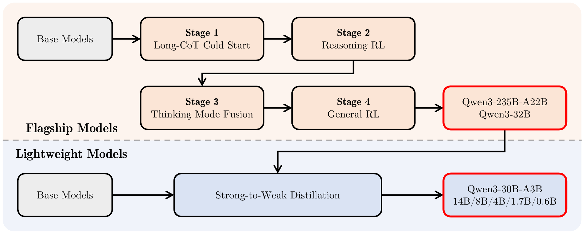
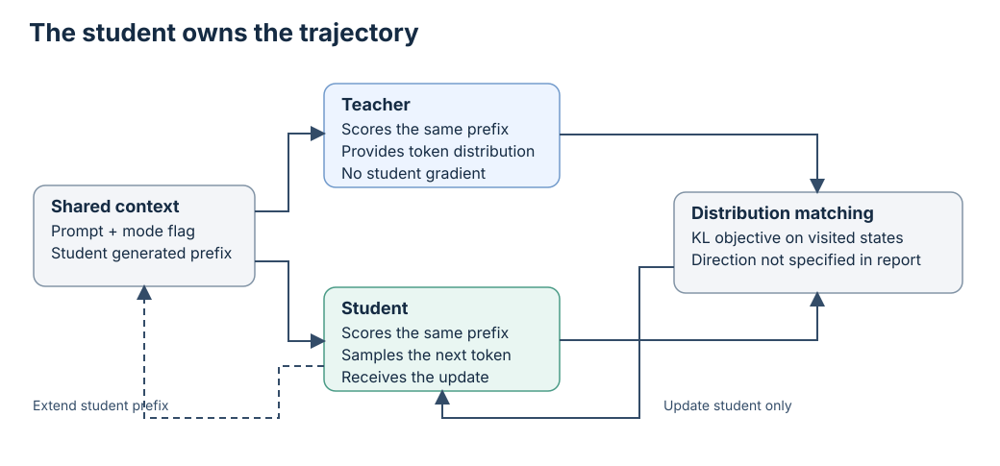

# Qwen3

## Executive answer

The original post-training figure distinguishes the four flagship stages from strong-to-weak student distillation. A separate logit-supervision diagram explains the student-generated trajectory.

[Technical report](https://arxiv.org/pdf/2505.09388v1) · [Hugging Face: Qwen/Qwen3-235B-A22B](https://huggingface.co/Qwen/Qwen3-235B-A22B)

## Visual overview

<!-- visual-id: V006 -->

<!-- visual-id: V005 -->

## Key findings

- **Thinking and nonthinking share weights.** Mode fusion combines reasoning and direct response data, then general RL reinforces useful behavior and format control.[^report]
- **Scale comes in dense and expert forms.** The original family spans 0.6B to 235B parameters. Its two expert models select eight of 128 experts per token and omit shared experts.[^report]
- **Smaller models learn from stronger policies.** Off policy response distillation is followed by teacher supervision on sequences the student itself generates.[^report]

## Detailed analysis

Qwen3 treats reasoning effort as a choice within one model. A complex task can receive a longer thinking sequence; a simple task can receive a direct answer. The network is not swapped when the mode changes. Training and prompt formatting teach the same policy to handle both behaviors.[^report]

### Highlights

- **Thinking and nonthinking share weights.** Mode fusion combines reasoning and direct response data, then general RL reinforces useful behavior and format control.[^report]
- **Scale comes in dense and expert forms.** The original family spans 0.6B to 235B parameters. Its two expert models select eight of 128 experts per token and omit shared experts.[^report]
- **Smaller models learn from stronger policies.** Off policy response distillation is followed by teacher supervision on sequences the student itself generates.[^report]

For builders, this is a useful case study in making quality and latency a task dependent choice. For researchers, it separates policy learning, mode control, and architecture instead of presenting “thinking” as a new neural block.[^report]

Study scope: original April/May 2025 family and **Qwen3-235B-A22B**, not the separate July Thinking and Instruct updates. Report, artifact configuration and chat template, Apache license, and Transformers 4.51.0 attention/router paths inspected; no execution. Evidence checked October 10, 2026.

### Model in numbers

| Dimension | Value and scope |
| --- | --- |
| Parameters | Flagship: 235B total, 22B active per token, as reported for the whole model.[^report] |
| Pretraining | Approximately 36T processed tokens across 119 languages and dialects; this does not establish 36T unique source tokens.[^report] |
| Reasoning RL | 3,995 query and verifier pairs in the disclosed reasoning stage. This is prompts, not rollout count or all post training data.[^report] |
| Compute | Full family and flagship training FLOPs or accelerator hours undisclosed. The 1,800 GPU hour distillation comparison belongs to an internal 8B experiment, not the flagship.[^report] |
| Context | Long context training at 32,768; flagship config maximum 40,960 with no RoPE scaling. Reported 128K evaluation uses YaRN factor four; these are different operating conditions.[^report][^config] |

### Architecture

The flagship has 94 layers, a 4,096 wide residual stream, 64 query heads and four KV heads, with head width 128. RMS normalization on queries and keys helps stabilize attention. RoPE supplies positions; expert SwiGLU FFNs operate after attention with normalized residual paths. The output head is untied.[^config][^code]

GQA reduces retained history relative to storing separate KV states for all 64 heads. It does not use MLA's joint content latent. The inspected Transformers path normalizes Q and K, applies RoPE, updates the KV cache, then calls the selected attention backend. Router softmax scores select eight experts, renormalize their weights, and sum the corresponding expert outputs. The reported training adds a global batch load balancing auxiliary loss, rather than forcing each sequence to use experts uniformly. QKV projections omit biases. The report describes 151,669 tokenizer vocabulary entries; the config allocates 151,936 output slots, a different artifact count.[^code][^pretraining][^config]

For one batch item, an ideal KV element count across all layers gives:[^config]

$$
N_{\mathrm{KV}}=2\times4\times128\times94\times n=96{,}256n\quad\text{elements}
\tag{1}
$$

This local derivation uses sequence length $n$, keys and values, four KV heads, and 94 layers. Bytes, allocator overhead, quantized formats, and backend metadata are separate. Low active expert count does not remove this sequence dependent cache.

### Data and training

Pretraining has three distinct exposures, not one uniform 36T mixture:[^pretraining]

| Stage | Data exposure and sequence regime |
| --- | --- |
| General foundation | More than 30T tokens at 4K, across 119 languages and dialects. |
| Reasoning intensive | Approximately 5T additional tokens at 4K, with more STEM, mathematics and code. |
| Long context | Hundreds of billions of tokens at 32K; 75% of the long context corpus is 16K–32K text and 25% is 4K–16K text. |

Qwen2.5-VL extracts text from documents; Qwen2.5 refines it, and specialized math/code models supply synthetic material. Proxy models test annotated data mixtures. This is a text model trained partly on text obtained from visual documents, not the separate Qwen3-VL network.[^pretraining]

Long context training changes the RoPE base from 10,000 to 1,000,000 using adjusted base frequency. Reported 128K operation additionally uses YaRN and Dual Chunk Attention. Training the base, scaling positions, and choosing a compatible attention backend are separate steps.[^pretraining]

#### Post-training: two paths through one family

<!-- visual-id: V006 -->

**Figure 1.** Flagship training and student distillation are different paths. Reproduced from Qwen Team, report Figure 1.[^figure-source]

The upper path in [Figure 1](#figure-1) develops the flagship policies. The
lower path transfers their behavior to smaller models; it does not claim every
small checkpoint independently repeats all four flagship stages. Thinking
and direct answering remain behaviors of the same deployed network, not two
decoder architectures.[^report]

Cold start examples are filtered for verifiability, difficulty, correctness, readability, and overlap with held out validation items. Reasoning RL uses GRPO on the 3,995 query/verifier pairs, chosen to be difficult, learnable, diverse and disjoint from cold start data. The report describes entropy control and reuse of some off policy samples, but does not supply every coefficient needed to reconstruct that optimizer. Reward construction and optimizer choices belong to training; `/think` is only a learned instruction or template choice at inference.[^report]

Mode fusion uses rejection sampled thinking examples plus direct answers across general tasks. Nonthinking examples preserve an empty thinking block for consistent formatting. General RL combines three different signals: rules, Qwen2.5-72B-Instruct judging with a reference answer, and a learned preference reward model without a reference. Tool rollouts receive real environment execution feedback, not merely plausible simulated observations. These sources cover more than 20 categories but have different failure modes.[^posttraining]

### Strong to weak distillation

Smaller models first learn from teacher responses in both modes. During on policy distillation, the student generates its own continuation and receives teacher logit supervision on that continuation, minimizing a KL divergence. The teacher is Qwen3-32B or Qwen3-235B-A22B. The report specifies matching logits with a KL objective, but not its direction or all loss coefficients; those details must not be invented. The rationale is to supervise states visited by the student rather than only teacher trajectories.[^distillation]

<!-- visual-id: V005 -->

**Figure 2.** The student chooses the trajectory; the teacher scores it. Independent diagram of on policy distillation, not a copied report figure.[^distillation]

[Figure 2](#figure-2) shows the important fork: both policies receive the same student generated prefix, but only the student supplies the next sampled token and receives the update. Teacher logits give denser supervision than a single scalar answer reward. This is a training arrangement, not two networks used for every deployed answer.[^distillation]

The report's eight billion parameter comparison starts both branches from the same off policy distilled checkpoint. On policy distillation uses 1,800 GPU hours versus 17,920 for the compared RL procedure, with AIME 2024 pass@1 of 74.4 versus 67.6. The roughly tenfold compute difference is specific to those math/code experiments, their teachers, and their measurement boundary.[^report]

### Inference control

The original tokenizer supports `enable_thinking=False` by opening an empty thinking block, while `/think` and `/no_think` can provide softer conversational instructions. The template also serializes tool descriptions, calls, and returned results; an external executor must actually run tools.[^template]

The authors describe intermediate budget handling as emerging from mode fusion, rather than explicit training for every possible budget. The report's thinking budget method interrupts the thinking sequence and inserts a stop thinking instruction before continuing the answer. A generic maximum output length is not automatically the same control: it may cut off the answer entirely. Preserving the intended template and reasoning boundaries matters for reproducible comparisons.[^report]

YaRN and the appropriate backend setup enable longer context than the unscaled config. A reported 128K score should therefore not be presented as evidence that any default loader accepts and uses 128K well.[^report][^config]

### Evidence and tradeoffs

The flagship reasoning RL experiment raises AIME 2024 from 70.1 to 85.1 over 170 reported training steps. This is a stage specific result under the report's protocol, not proof that its small set of prompts alone explains all final capabilities.[^report]

Table 22 supplies a further tradeoff in the **32B dense** model, not an isolated flagship ablation. From reasoning RL through mode fusion and general RL, AIME 2024 decreases from 83.8 to 81.9 to 81.4, while ThinkFollow rises from 88.7 after mode fusion to 98.9 after general RL. More versatile instruction behavior can cost a little specialized reasoning performance.[^tradeoffs]

The long context appendix is an important counterpoint to “more thinking is always better.” At 128K, flagship RULER is 90.6 in nonthinking mode and 86.0 in thinking mode, using YaRN factor four and an 8,192 thinking token budget. The authors hypothesize that additional reasoning can interfere with retrieval; the result is measured, the explanation is a hypothesis.[^report]

Many training mixture and full optimization details remain undisclosed. Eight selected experts still require a large stored weight pool and communication in distributed serving. Original Qwen3 weights use Apache 2.0, but the full training data and internal reward system are not made open by that license.[^license][^repo]

The transferable lesson is to make reasoning **conditional on the task and budget**, then test that control. Compare with [DeepSeek-R1](/architectures/models/deepseek-r1/) for a reasoning focused policy and [Transformer Foundations](/architectures/foundations/) for GQA, normalization and cache basics.

[^report]: Qwen Team. [Qwen3 Technical Report](https://arxiv.org/pdf/2505.09388v1), May 14, 2025 arXiv version; cover date May 15. Sections 2 to 4, Tables 2 and 21, and Appendix A.1.1; inspected October 10, 2026.

[^config]: Qwen Team. [Original Qwen3-235B-A22B configuration](https://huggingface.co/Qwen/Qwen3-235B-A22B/blob/8efa61729e24bd65b1d152b5ab5409052aa80e65/config.json), inspected October 10, 2026.

[^template]: Qwen Team. [Original flagship tokenizer configuration](https://huggingface.co/Qwen/Qwen3-235B-A22B/blob/8efa61729e24bd65b1d152b5ab5409052aa80e65/tokenizer_config.json), `chat_template`, same artifact revision.

[^code]: Hugging Face. [Qwen3 MoE implementation](https://github.com/huggingface/transformers/blob/v4.51.0/src/transformers/models/qwen3_moe/modeling_qwen3_moe.py), version 4.51.0; `Qwen3MoeAttention.forward` and `Qwen3MoeSparseMoeBlock.forward`; inspected without execution.

[^repo]: Qwen Team. [Qwen3 repository](https://github.com/QwenLM/Qwen3/tree/7a2f61ffc7a20d47efcd2bf97f6f2bf52729042e); original family versus later July updates.

[^license]: Qwen Team. [Flagship Apache 2.0 license](https://huggingface.co/Qwen/Qwen3-235B-A22B/blob/8efa61729e24bd65b1d152b5ab5409052aa80e65/LICENSE), inspected October 10, 2026.

[^pretraining]: Qwen Team. [Qwen3 report](https://arxiv.org/pdf/2505.09388v1), Sections 2 and 3: network choices, global batch auxiliary loss, vocabulary, data extraction, three training stages and long context methods.

[^posttraining]: Qwen Team. [Qwen3 report](https://arxiv.org/pdf/2505.09388v1), Sections 4.1–4.4: filtering, GRPO query selection, mode fusion, three reward categories and executed tool interactions.

[^distillation]: Qwen Team. [Qwen3 report](https://arxiv.org/pdf/2505.09388v1), Section 4.5 and Table 21: off policy response learning followed by student generated prefixes and teacher logit matching. KL direction is not specified there.

[^tradeoffs]: Qwen Team. [Qwen3 report](https://arxiv.org/pdf/2505.09388v1), Section 4.7, Table 22: post training stage comparison for Qwen3-32B.

[^figure-source]: Qwen Team. [Qwen3 Technical Report](https://arxiv.org/pdf/2505.09388v1#page=9), arXiv v1, Figure 1, p. 9. Artwork retained; surrounding prose and caption omitted. Original copyright retained; [source and reuse record](/figures/model-studies/qwen3/SOURCES.md).

## Counterevidence and uncertainty

Family recipes, selected artifacts, controlled ablations and optimized serving results remain distinct. Undisclosed training details and unexecuted runtime assumptions remain explicit in the analysis. Figure reuse is supported by a specific editorial assessment, not a newly verified artwork license or universal legal conclusion.

## Implications

Original report figures preserve the authors' structure; focused independent diagrams add exact contracts and calculations rather than redraw the same overview.

## Open questions and future research

Undisclosed mixtures and compute, runtime/application validation and future reuse or distribution changes require separate work. No model benchmark was replicated.

## Sources

Complete claim-local references are retained above. Exact source editions, crop geometry, checksums and exception assessments are in state/sources.jsonl and the per-model public SOURCES.md.

## What changed in this revision

1 original figure excerpts added or substituted. Prior figure choices are preserved in coverage-audit-revision-3.md and state/presentation-qa-revision-3.json. Revised guidance recognizes licenses, permission or assessed applicable exceptions without relabeling source artwork MIT. Full validation, fresh responsive/focus browser checks, manual figure review and complete exports passed.
