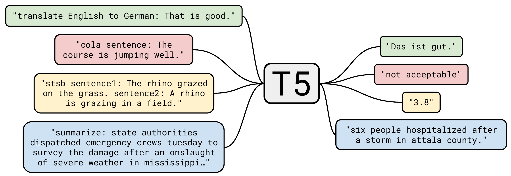
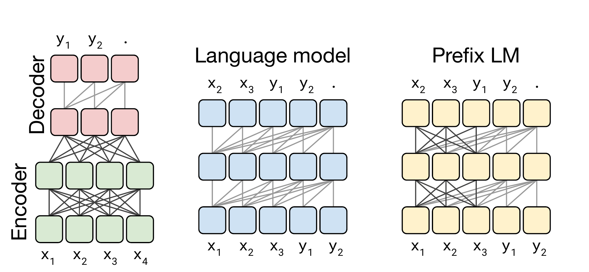
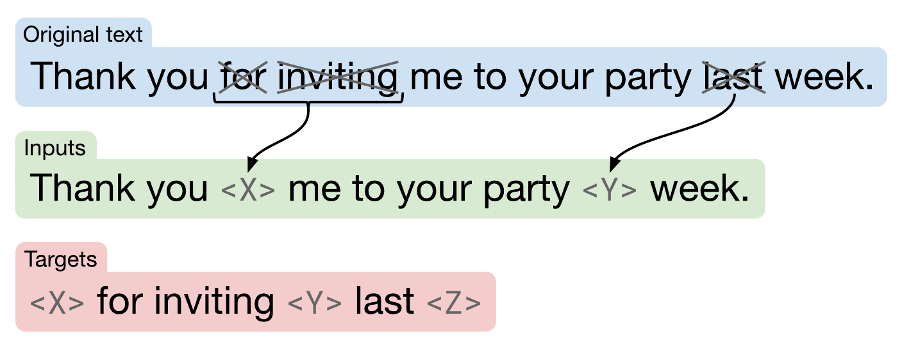
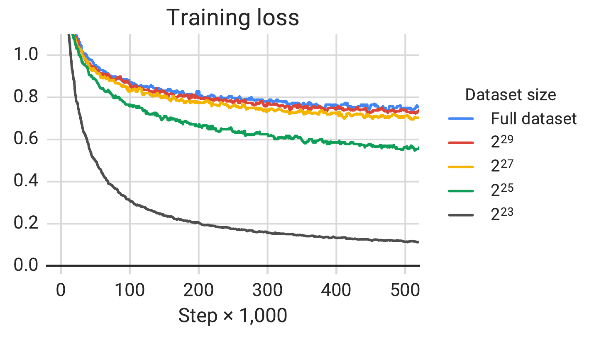

# T5

## Executive answer

[Technical report](https://arxiv.org/abs/1910.10683v4) · [Hugging Face: google-t5/t5-base](https://huggingface.co/google-t5/t5-base)

T5 turns language tasks into a common contract: read some text and generate the desired text. A task prefix can request translation, a summary or a label. Its encoder reads the input bidirectionally while its decoder produces the output causally. The interface unifies tasks without pretending that their data or evaluation are identical.[^report]

## Visual overview

Purposeful figures below cover the input contract, distinctive mechanism or bounded evidence; their captions identify provenance and scope.

## Key findings

- **One output language.** Classification labels and open ended answers are both text, so tasks share the same generation head.[^report]
- **Recover missing spans.** Pretraining replaces spans with distinct sentinels and asks the decoder to generate the removed pieces, reducing target length compared with reconstructing the whole passage.[^report]
- **A systematic research baseline.** The report studies objectives, data, architecture, transfer and scale rather than attribute its final results to one isolated trick.[^report]

Representative artifact: **original T5-Base**, not T5 v1.1, FLAN-T5 or an instruction aligned chat model. Report v4, configuration, release license and targeted Transformers functions checked October 10, 2026. No checkpoint executed.[^config][^release][^code]

## Detailed analysis

## Model in numbers

| Dimension | Value and scope |
| --- | --- |
| Model size | About 220 million parameters; 12 encoder and 12 decoder layers, width 768, FFN width 3,072.[^report][^config] |
| Corpus | C4, approximately 750 GB of cleaned English web text. Bytes are not token exposure.[^report] |
| Final training budget | One million steps with 2,048 length 512 sequences, about one trillion token positions in the report's final recipe; supervised and unsupervised tasks are mixed.[^report] |
| Survey baseline | About 34 billion tokens, 524,288 updates and batch 128. This is a smaller experimental budget, not the final T5 release recipe.[^report] |
| Compute | Cloud TPU v3 pod slices with model and data parallelism; a checkpoint specific FLOP or accelerator hour total is undisclosed in the inspected report.[^report] |
| Context and vocabulary | Length 512 used in training; 32,128 embedding entries and 32 relative position buckets in the hosted configuration.[^report][^config] |

## What changed

BERT produces representations for task heads. T5 retains a separate decoder and asks the model to express each target as text. This makes the interface reusable across classification, question answering, translation and summarization. A uniform interface still requires task formatting, training examples and a suitable metric. “Positive” as a label and a fluent summary have very different correctness criteria.[^report]

<!-- visual-id: V101 -->

**Figure 1.** Many tasks, one text interface. Reproduced from Raffel et al., Figure 1, JMLR 2020; figure crop, [CC BY 4.0](https://creativecommons.org/licenses/by/4.0/).[^jmlr]

In Figure 1, a class label and a numeric score are written as text just like a translation or summary. The interface is shared, not the meaning of correctness or the required training data.

## Architecture

The encoder reads all nonpadding input tokens. The decoder applies causal self attention to the known or generated target prefix, then cross attention to the encoder's memory. Its shared vocabulary projection produces logits for the next target token. Input and output lengths can differ.[^report][^code]

<!-- visual-id: V102 -->

**Figure 2.** Three attention contracts compared. Reproduced from Raffel et al., Figure 4, JMLR 2020; figure crop, [CC BY 4.0](https://creativecommons.org/licenses/by/4.0/).[^jmlr]

Read the left panel of Figure 2 as T5: source states communicate in both directions, target states see earlier targets, and every target can consult source memory. The middle and right panels are comparison architectures in the report, not extra modules inside T5. Dark lines indicate full visibility; lighter lines indicate causal visibility.

For source length S and target length T, states have shapes B × S × 768 and B × T × 768. Decoder self attention compares T with T; cross attention compares T with S. T5-Base has 12 heads with key and value width 64. The original FFN uses ReLU, not the gated activation of some later T5 variants.[^config][^code]

Layer normalization precedes each sublayer. In the inspected T5LayerNorm, normalization rescales by root mean square without subtracting the mean or adding a bias. Do not substitute the exact normalization contract from the original 2017 Transformer.[^code]

## Span corruption

Pretraining removes selected spans and replaces each gap with its own sentinel. The decoder generates only the missing spans, separated by those same markers, followed by a final sentinel. Distinct markers tell it which gap each piece fills.[^report]

<!-- visual-id: V103 -->

**Figure 3.** Generate removed spans, not the full passage. Reproduced from Raffel et al., Figure 2, JMLR 2020; figure crop, [CC BY 4.0](https://creativecommons.org/licenses/by/4.0/).[^jmlr]

Figure 3 replaces the adjacent words “for inviting” with one sentinel and “last” with another. The target emits those spans in order, each after its matching sentinel, then a final marker. The visible words remain context, not reconstruction targets.

Let x̃ be the corrupted input and y the sentinel delimited target. The decoder's loss follows:

$$
\mathcal{L}=-\sum_{t=1}^{|y|}\log p_\theta(y_t\mid y_{\lt t},\widetilde{x})
\tag{1}
$$

Equation (1) is an explanatory conditional sequence loss. It predicts the short removed span sequence, not every original token. In the final recipe the corruption rate is 15% and mean span length is three tokens.[^report]

The benefit is a useful conditional generation exercise with shorter targets. The tradeoff is that span reconstruction differs from real instructions and full document generation; transfer still needs appropriate supervised tasks. The report's objective study finds similar performance across several denoising variants, so span corruption should not be sold as a universal quality breakthrough.[^report]

## Relative bias without an absolute position table

For each attention head, T5 adds a learned scalar depending on the query to key offset. Small distances get more precise buckets; larger distances share logarithmically wider buckets. The report uses 32 buckets and a maximum distinguished offset of 128. Beyond that range, offsets share a bucket rather than making attention impossible.[^report][^code]

The bias changes attention logits; it does not add a position vector to the residual stream. The encoder preserves both offset directions, while the causal decoder only uses permitted history. Bias values are shared across layers within a stack in the reference design.[^report][^code]

A relative bias can be evaluated for a longer sequence, but that is not evidence of reliable long context performance. Training at 512 tokens remains an important boundary. See [Position and long context](/architectures/evolution/position-and-long-context/).

## Training and transfer

The final recipe combines span corruption on C4 with supervised task mixtures, then fine tunes individual tasks. It uses AdaFactor, dropout and an inverse square root learning rate schedule in pretraining. The report's early survey uses a shorter budget and greedy decoding; its final runs use more training and beam search for translation and summarization. Keep those conditions separate.[^report]

C4 cleaning includes language filtering, sentence and punctuation heuristics, deduplication and other content filters. Such choices define which English web text remains; a large corpus is not automatically representative. Its April 2019 Common Crawl cleaning retains lines with terminal punctuation and at least five words, pages with at least three sentences, and strongly classified English text. It removes duplicate three-sentence spans and applies additional content filters. Those heuristics are choices about corpus composition, not neutral guarantees of quality.[^report][^report]

### Task sampling is part of the recipe

Mixing tasks requires a sampling rule, not just a concatenated dataset. Section 3.5 compares equal task weights, weights proportional to example counts and temperature-smoothed weights. Its capped examples-proportional rule can be written as:[^report]

$$
r_m=\frac{\min(e_m,K)}{\sum_n\min(e_n,K)},\qquad q_m=\frac{r_m^{1/\tau}}{\sum_n r_n^{1/\tau}}
\tag{2}
$$

In Equation (2), e_m is the number of examples in task m and K limits the influence of very large datasets. The second expression describes temperature smoothing; τ greater than one flattens the mixture. These are sampling probabilities over examples, not token-budget fractions. They prevent the much larger C4 task from automatically overwhelming supervised tasks.[^report]

One shared model does not eliminate the transfer stage

At the matched survey budget, equal-weight multitask learning scores 63.37 on SuperGLUE versus 71.36 for the pretrain-then-fine-tune baseline. Multitask pretraining followed by task-specific fine tuning reaches 71.03. The final T5 recipe therefore combines mixed pretraining with individual task adaptation; those survey scores are not final released T5-Base results.[^report]

### Exposure is not unique data

The repetition experiment holds total pretraining exposure at approximately 34B tokens while shrinking the unique C4 subset. A 2²⁵-token subset repeated 1,024 times scores 64.76 on SuperGLUE; a 2²³-token subset repeated 4,096 times scores 59.29. Both can have lower training loss than the full corpus. The authors interpret this gap as memorization that does not translate into useful transfer.[^report]

<!-- visual-id: V201 -->

**Figure 4.** Lower training loss can conceal worse transfer. Reproduced from Raffel et al., Figure 6, JMLR 2020; figure crop, [CC BY 4.0](https://creativecommons.org/licenses/by/4.0/).[^jmlr]

Read Figure 4 together with Table 9, not as a transfer score. The smallest repeated subsets reach the lowest training loss but substantially worse downstream scores. Some repetition is harmless in this experiment: a 2²⁹-token subset repeated 64 times scores 72.03 on SuperGLUE versus 71.36 for the full-corpus baseline. The failure is excessive repetition under these conditions, not repetition itself.[^report]

Released artifact and implementation

The hosted configuration defines the selected model. Its decoder starts with the padding token ID 0, and EOS is ID 1. The vocabulary embedding count is not a claim that every ID is an ordinary word piece.[^config]

Targeted code inspection uses Transformers v4.57.1: T5LayerNorm, T5DenseActDense, T5Attention._relative_position_bucket, compute_bias and T5ForConditionalGeneration. The original T5 repository is Apache 2.0; the hosted artifact card also declares Apache 2.0. No checkpoint or training job was run.[^code][^release][^card]

## Inference

Choose the task prefix expected by the adapted model, tokenize the source and encode it once. Start the decoder with its designated start token, then generate until EOS or a length limit. Decoder self attention retains generated history; cross attention reads the fixed source memory. Beam search or sampling belongs to the generation wrapper, not the encoder itself.[^code][^config]

Text labels can be useful, but a model can also generate an invalid label or an unsupported answer. A deployment needs task specific validation. Original T5 is not FLAN-T5: a text to text architecture alone does not imply broad instruction following.

## Evaluation and ablations

Table 13 compares ways to spend roughly four times the baseline computation. On SuperGLUE validation, the 220M baseline scores 71.36; four times as many training steps scores 74.72; twice the model size with twice the steps scores 77.18; four times the model size with baseline steps scores 78.04.[^report]

These are author reported survey results under one transfer recipe, not four released T5-Base variants. Increasing model size and training time can both help, but their deployment costs differ. The largest final 11B model is another checkpoint; its headline scores cannot be assigned to T5-Base.[^report]

## Counterevidence and uncertainty

The selected model is primarily an English text model. Its 512 token training length and compressed relative distance buckets do not establish arbitrary length generalization. Generated answers may be incorrect, and formatting a task as text does not remove its data or evaluation requirements.[^report][^config]

The report is unusually broad, but many design choices are changed together in the final recipe. A final score therefore does not isolate the effect of span corruption, relative bias or larger scale. Exact reconstruction of the original data and hardware environment is outside this study.

## Implications

Separate the task interface from the learning objective and architecture. T5 shows why a common text interface can simplify research while encoder and decoder roles remain distinct. Compare [BERT](/architectures/models/bert/) for representation transfer and [LLaMA](/architectures/models/llama/) for a causal decoder trained with deployment cost in mind.

## Sources

[^report]: Colin Raffel et al. [Exploring the Limits of Transfer Learning with a Unified Text-to-Text Transformer](https://arxiv.org/abs/1910.10683v4), 2023 version 4, originally published in JMLR in 2020, sections 2, 3.1, 3.3 to 3.7; Tables 7 to 14 and Appendix E.

[^config]: Google T5. [T5-Base configuration](https://huggingface.co/google-t5/t5-base/blob/a9723ea7f1b39c1eae772870f3b547bf6ef7e6c1/config.json). Inspected October 10, 2026.

[^release]: Google Research. [T5 release](https://github.com/google-research/text-to-text-transfer-transformer/blob/139c64224f990f27726ed5a69d36f686edb3ae91/README.md) and [license](https://github.com/google-research/text-to-text-transfer-transformer/blob/139c64224f990f27726ed5a69d36f686edb3ae91/LICENSE).

[^card]: Hugging Face. [Hosted T5-Base card](https://huggingface.co/google-t5/t5-base/blob/a9723ea7f1b39c1eae772870f3b547bf6ef7e6c1/README.md), license metadata and intended tasks.

[^code]: Hugging Face. [T5 implementation](https://github.com/huggingface/transformers/blob/8cb5963cc22174954e7dca2c0a3320b7dc2f4edc/src/transformers/models/t5/modeling_t5.py), Transformers v4.57.1, targeted normalization, relative bias, FFN and generation functions.

[^jmlr]: Colin Raffel et al. [Exploring the Limits of Transfer Learning with a Unified Text-to-Text Transformer](https://www.jmlr.org/papers/v21/20-074.html), JMLR 21(140), 2020, Figures 1, 2, 4 and 6. The [published PDF](https://www.jmlr.org/papers/volume21/20-074/20-074.pdf) states [CC BY 4.0](https://creativecommons.org/licenses/by/4.0/) on page 1.

## Open questions and future research

See coverage-audit.md for the mechanism-by-mechanism audit, exact source locators, justified omissions and remaining artifact-access gaps. No weights or runtime benchmarks were executed. Renewed rendered and export QA passed; see the revision 3 presentation record.

## What changed in this revision

Revision 3: C4 heuristics; examples-proportional task mixing and temperature equation; task-specific adaptation evidence; unique-data versus repeated exposure with a source loss figure and bounded transfer scores. Earlier evidence and visual-review history remain in the ledgers.

## Revision 3 presentation verification

106 automated tests, zero Astro diagnostics, the static build and all 43 docs lint checks passed. The collection passed 81 fresh browser views; this page was checked at 1440px light, 390px light and 320px dark, with desktop focus, active family navigation, caption order, anchors, image decoding, resource cards and no page overflow. Complete source figures fit desktop, while narrow frames support keyboard panning and full-size access. Search and Markdown/MDX exports preserve citations, figures and source links. All 66 model figure renders were inspected, with full-size review of new dense diagrams. See state/presentation-qa.json for exact page checksums and evidence. No model benchmark was reproduced. Existing bundler and redirect warnings remain.
