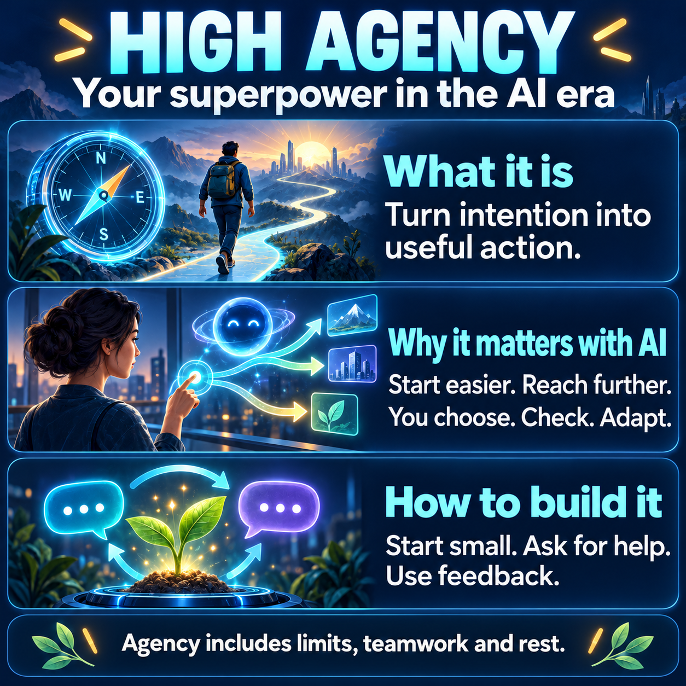

# High Agency: Your superpower in the AI era

**A comprehensive source for thoughtful podcasts and videos**

Latent Light | Expanded source edition, version 2 | October 11, 2026

This document explains what high agency means, why it matters with AI, and how to practise it. It supplies the concepts, study context, limitations, and examples needed for a thoughtful podcast or video. No outside reading is required to understand its argument. References provide optional verification and attribution. It combines inspected research with clearly identified interpretation and original examples.

<!-- visual-id: V001 -->

**Figure 1.** High agency in the AI era. AI generated illustration of Latent Light's synthesis. The image is an overview, not a measurement or scientific model.[^bandura][^teammate][^frontier][^monitoring]

<!-- pagebreak -->

## Start here: the argument in one minute

**AI can expand your reach. Agency helps you turn that reach into useful action.**

High agency, as used here, means choosing a worthwhile direction, looking for legitimate ways to influence what happens, taking an appropriate next step, and learning from the result. It is a useful working definition assembled from popular usage and psychological accounts of intentional action. There is no single standardized "high agency" construct established by the evidence reviewed in this document.[^weinstein][^bandura]

The term is visible in contemporary technology culture, including discussion of hiring in the AI era. That visibility does not establish how popular it is across the public, whether interest is growing at a particular rate, or whether the label predicts success. This document makes no quantitative trend claim.[^wired]

Calling agency a "superpower" describes a practical possibility: a person can use AI assistance to attempt useful work that previously felt out of reach. The evidence supports benefits in specific tasks and settings. It also shows errors, learning costs, and differences between producing options and selecting well. No study cited here directly establishes that people classified as high agency gain more from AI than people classified as low agency.[^aiwork][^frontier][^teammate][^learning]

The practical goal is to develop observable habits: clarify the outcome, find an appropriate next move, seek help, check substantive results, and adapt. Doing less, obtaining permission, or stopping can be thoughtful exercises of agency. Health, relationships, resources, and institutions affect what action is possible.

### How to use this source

Sections 1 and 2 establish the meaning and psychological foundations. Sections 3 to 5 explain the value of agency and examine AI evidence, including how to interpret the study methods and numbers. Sections 6 and 7 turn the argument into decisions and practices. Sections 8 to 11 offer cases, social context, a filled practice record, and common questions. Appendix A defines key terms. Appendix B supplies an optional media brief.

The numbered references document where findings came from. Every finding needed for the argument is explained here, including its relevant comparison and limitation. Opening a link is optional. This is a selective, evidence-informed guide, not an exhaustive systematic review or a validated personality assessment. Unresolved questions are stated as unresolved rather than delegated to further reading.

All scenarios, prompts, checklists, diagrams, and the two week schedule are original teaching examples or proposals unless explicitly described as study findings. They are not reports of real participants, tested interventions, or guaranteed outcomes. The empirical evidence was assembled on October 10, 2026, including foundational sources on autonomous motivation and goal adjustment. This October 11 revision adds explanation and rechecks selected study details; it does not refresh every claim about contemporary AI. Older AI studies remain historical evidence, not benchmarks of every tool available today.

## 1. What high agency means

### A concrete beginning

Imagine wanting to organize a beginner workshop in your neighbourhood. You have an idea, but no venue, no teaching experience, and no certainty that anyone will attend. One response is to keep reading about events, refining a plan, and waiting until everything feels settled. Another is to ask three potential participants what they need, prepare a short sample lesson, and request a room for a small trial.

The second response creates information. You might discover that people want a different topic, that a partner can offer a room, or that the sample is too difficult. An attempt can disappoint and still improve your next decision. The useful difference is participation in shaping the situation, with attention to what the situation reveals.

This example also shows why agency cannot be equated with speed. Sending an inaccurate invitation immediately may make the project worse. A deliberate conversation tomorrow may be the better next action. The question is whether you are choosing and learning in relation to a worthwhile outcome.

### Popular language and scientific constructs

An influential modern use of "high agency" appeared in Eric Weinstein's January 2016 conversation with Tim Ferriss. Apparent impossibility became a reason to search for another route. This provides context for the popular phrase; it does not establish its earliest coinage or a scientific definition.[^weinstein]

For practical purposes, this document treats agency as a process with several parts. You select a direction, examine your actual room to act, make a reasonable attempt, and revise through feedback. These parts can come apart. A person can have a clear goal but lack a feasible next step. Another can be very active while pursuing a poorly chosen goal. A third can identify good options but struggle to follow through.

It is more useful to locate the difficulty than to assign a permanent identity. "I have not found a way to ask for help" suggests a next move. "I am a low agency person" can conceal the concrete problem. The working definition is intended to make action understandable, not to sort people by worth.

### Important distinctions

| Concept | What it concerns | Why the distinction matters |
| --- | --- | --- |
| Agency | Choosing, acting, and revising within actual circumstances | Activity alone does not establish thoughtful direction. |
| Self efficacy | Belief about being able to perform particular actions | Feeling capable is different from starting or choosing well.[^efficacy] |
| Personal initiative | Beginning action, anticipating opportunities, and persisting through obstacles | Initiative is one component of the broader process.[^initiative] |
| Autonomy | Experiencing an action as volitional and personally endorsed | A chosen cooperative commitment can be autonomous.[^motivation] |
| Confidence | How certain you feel about yourself or an answer | Certainty needs evidence and can be mistaken. |
| Independence | Doing something without relying on other people | Asking for help can increase your ability to act. |
| Persistence | Continuing effort over time | A changed situation can justify a changed goal. |
| Productivity | Output relative to resources such as time | Producing more does not establish that the goal is useful. |

The table combines research definitions with ordinary conceptual distinctions. It is not a psychometric framework, and its rows should not be treated as quantities that can simply be added into an agency score.

### Agency can be quiet

A person who speaks little may still prepare carefully, make a specific request, and follow through. A person who sounds decisive may avoid verification. Public visibility and verbal assertiveness are therefore poor substitutes for inspecting the actual behaviour in a particular situation. This is a practical distinction, not a claim that the research establishes a particular personality profile.

A thoughtful pause can also serve a goal. You may need a colleague's consent, a missing fact, or recovery. Agency is present in how you recognize the condition and decide what to do about it. An indefinite delay that never examines the condition is different from a deliberate wait with a reason and a review point.

## 2. Psychological foundations: intention, capability, and choice

### Four functions of intentional action

Bandura's account identifies intentionality, forethought, self-reactiveness, and self-reflectiveness. In plain language, these concern forming intentions, anticipating consequences, regulating action, and examining one's capabilities and choices. His framework also situates personal action within social systems, and distinguishes personal, proxy, and collective agency.[^bandura]

For the workshop, those functions suggest different questions. What do I intend to contribute? What could happen if I try this format? How will I carry out and review the attempt? What does the result tell me about my approach? These questions translate the concepts into an original teaching example; they are not a validated assessment instrument.

The useful feature of this account is that action includes reflection. A person does not become more agentic simply by executing every initial impulse. Examining whether a project is worthwhile, how it affects others, and whether the result matches the intention is part of the work.

### Capability beliefs should be specific

Self efficacy concerns perceived capability for particular actions. The APA's review describes successful experience, observing others, social persuasion, and physiological or emotional information as sources of such beliefs. It also reviews debate about whether some measures mix perceived ability with motivation.[^efficacy]

Here is what those four sources mean in an original workshop example. **Successful experience** is evidence from doing something: you explained one exercise and the learner completed it. **Observing others** means seeing how someone else approaches the task: a fellow beginner demonstrates a manageable teaching format. **Social persuasion** includes another person's encouragement or assessment: a teacher identifies what your sample already does well. **Emotional and bodily information** includes how you interpret tension or fatigue: feeling nervous may influence your capability belief, but nervousness alone does not settle whether you can teach. These are influences on belief, not four guarantees of competence.

Applied to everyday practice, this suggests asking a narrow question. "Can I explain this idea to one beginner?" can be investigated through an attempt. "Am I a capable person?" is too broad to resolve with a single performance. Build a record that distinguishes what you can do reliably, what you can do with help, and what you still need to learn.

The first attempt need not be effortless. You might discover that the opening explanation works but the example fails. That is more informative than either global self criticism or indiscriminate reassurance. Improve the example and test it again.

### Valuing the goal is different from enjoying every step

Ryan and Deci's self-determination theory distinguishes **autonomous motivation**, acting with willingness and personal endorsement, from **controlled motivation**, acting under pressure such as a demand or fear of disapproval. It identifies three psychological needs: **autonomy**, experiencing choice and endorsement; **competence**, feeling effective in one's activity; and **relatedness**, feeling connected to and cared for by others. Autonomy does not mean independence or individualism.[^motivation]

**Intrinsic motivation** means doing an activity because it is interesting or enjoyable. **Extrinsic motivation** means doing it for a separable outcome. An extrinsic reason can become personally endorsed: you may willingly do an uninteresting task because you value what it enables. Thus, autonomous action need not be fun, solitary, or free of obligations.[^motivation]

A workshop organizer may dislike administrative forms and still willingly complete them because accessible community learning matters to them. Another may organize the same event mainly to avoid feeling inferior to a peer. The visible activity can look similar while the reasons differ. This example illustrates the conceptual distinction; it does not predict an individual's outcome from a guessed motive.

One useful reflection is: "If nobody could see this effort, would I still consider its outcome worthwhile?" The answer need not exclude recognition, income, or duty. It can help you notice when a project has become detached from what you want to contribute.

### A process shaped by circumstances

Someone may take initiative comfortably in a familiar role and hesitate in a setting with unclear authority. Inspect the difference: missing knowledge, social expectations, consequences, support, or available time. Treating agency as a process keeps those explanations visible. It also makes it possible to improve the environment instead of placing every burden on the individual.

## 3. Why agency matters beyond AI

### Action can resolve uncertainty that planning cannot

A plan can identify a hypothesis, but it cannot supply every answer about other people. You need to ask whether neighbours want the workshop. A sample lesson can reveal whether the explanation makes sense. A modest trial can show whether the format fits the available room and time.

This does not mean every uncertainty calls for an experiment. Some questions are already answered by a reliable source or a person with relevant authority. Reading the venue rules may be the appropriate action. So may asking an experienced teacher to review an exercise. Choose a way of learning that fits the uncertainty.

An original distinction used throughout this document is between **preparation** and **contact with reality**. Preparation builds material for an attempt. Contact with reality supplies information that could change your belief or decision. The two support each other. Trouble arises when preparation continues indefinitely without testing the assumption on which the project depends.

### Some relevant behaviours can be developed

A randomized study assigned 1,500 existing small business owners in Togo by chance to three groups of 500: personal initiative training, traditional business training, or a control group offered neither programme. Initiative training taught participants to identify opportunities, set goals, plan, seek feedback, and work through obstacles. Traditional training addressed business practices such as financial management and marketing. Both programmes included 36 hours of classes and follow up visits.[^initiative]

Over approximately two years, the initiative group's average profits were about 30% higher relative to control. The traditional group's estimated 11% increase was not statistically significant: the analysis did not distinguish it sufficiently from no effect, which is different from proving no effect. The comparison concerns a substantial programme for selected business owners, not reading a motivational slogan.[^initiative]

That finding supports trainability in that setting. It does not establish a universal return from adopting the phrase "high agency." A World Bank investigator's account of a follow up after roughly seven years reports larger profit effects for men than women, with the reasons unresolved. The longer horizon makes constraints and opportunities harder to ignore.[^followup]

Look for the support behind a successful intervention. A slogan, an essay, a coached programme, and repeated practice with feedback are different experiences. The cited experiment cannot tell us that reading this document produces the same effect as receiving the training.

### Agency offers participation, not complete control

When an invitation is declined, you can improve the timing or format, ask whether another topic would help, or decide the project is not viable. You cannot require people to attend. Your actions are inputs to an outcome involving other people and circumstances.

This distinction makes responsibility more precise. You can take responsibility for sending an accurate invitation, listening well, and reviewing the result. You need not pretend to control every response. A good process can encounter an unfavourable outcome; a fortunate outcome can occur despite a weak process. Evaluate the decision with attention to what was knowable at the time, as well as what happened afterward.

## 4. Why it can be a superpower in the AI era

### What AI assistance means here

Artificial intelligence, abbreviated **AI**, is a broad term for computer systems performing tasks such as recognizing patterns, making predictions, or generating responses. This document focuses on **generative AI**, systems that produce material such as text or images using patterns learned from data. A **large language model**, abbreviated **LLM**, is a model used to process and generate language. GPT-4 is the name of the historical language model used in several studies discussed below.[^aiwork]

For this argument, the important distinction is between receiving a generated explanation or draft and establishing that it is correct or useful. A **prompt** is the request and context given to the system. Changing a prompt may change its response; it does not by itself verify the response. A tool that can access additional sources or execute actions needs those capabilities to be assessed separately. No particular product subscription or technical setup is required to understand the examples here.

### More capability creates more choices

AI assistance can sometimes reduce the cost of drafting, explanation, analysis, and exploring alternatives. Workplace and field experiments provide evidence of benefits in particular settings. Their results also show that tool usefulness depends on the task and on how success is defined.[^aiwork][^teammate][^frontier]

The connection to agency is this document's synthesis: if some steps become easier, a person who chooses a useful direction and tests an appropriate attempt has more ways to pursue it. This is a conditional argument. More assistance creates an opportunity; the user must still decide whether and how to act on it.

<!-- visual-id: V002 -->

**Figure 2.** How expanded capability can become useful action. Original Latent Light synthesis, informed by task-specific AI evidence.[^aiwork][^teammate][^frontier]

**Text equivalent:** AI expands options through explanations, drafts, and alternatives. A person chooses a worthwhile goal, checks relevant claims, and attempts a bounded step. Real feedback informs whether to revise, continue, seek support, or stop. The route can return to the goal, not only to the next draft. This is an explanatory process, not a tested causal model.

### Start with less friction

The workshop organizer may be stuck on the invitation rather than on the idea. AI can offer a draft and explain why different versions suit different audiences. The organizer can choose a version, remove inaccurate promises, and ask one potential participant whether it is clear.

The gain is concrete: assistance may remove a local obstacle to an appropriate first attempt. You need not delegate the entire project. Ask: "Which specific step is preventing me from learning something important?" Ask for help with that step, then test whether the help actually resolves it.

### Reach across unfamiliar work

A small project can involve teaching, writing, scheduling, budgeting, and communication. AI may help you produce a provisional plan outside your usual skill. That plan can improve the question you bring to a knowledgeable person.

Ask AI to explain differences between three workshop formats, then ask an experienced organizer which constraints you have missed. The human conversation becomes more specific. Broader participation is valuable when it connects to expertise; a fluent draft should not be mistaken for having mastered every contributing discipline.

### Make room for earlier feedback

If drafting becomes quicker, you can use some of the saved time to ask a participant, test an exercise, or verify a critical fact. This is a proposed use of the opportunity, not an experimentally established rule about how people allocate saved time.

Consider two uses of the same hour. One produces ten polished variants of an untested invitation. Another produces a reasonable version and spends the remaining time finding out whether people understand and want the event. The second path answers a different question. The number of generated drafts does not measure how much uncertainty has been resolved.

### Choose among abundant options

When generating ideas is easy, selecting a worthwhile one remains a separate task. In the P&G study, better generated ideas did not come with improved selection of the best idea. Give selection its own criteria, rather than assuming stronger material automatically improves the choice.[^teammate]

For the workshop, criteria might be demand, accessibility, preparation effort, and what participants can do afterward. AI can help list options against the criteria, but the organizer needs relevant facts and a reasoned decision. A beautifully described format may lose because the actual audience cannot attend it.

### Retain direction when delegating

Human agency concerns choosing and shaping action. An AI agent is software that may execute delegated steps. These meanings overlap in ordinary language but should not be treated as equivalent concepts. Delegating a sequence of actions does not settle whether the purpose is useful, the boundaries are appropriate, or the result is correct.

Before delegating, specify the outcome, the information the tool may use, the decisions it may make, and what requires review. Drafting possible invitations is different from sending them in your name. That is a practical distinction about responsibility and consent.

The "superpower" is the combination of expanded assistance and deliberate direction. It does not mean immunity from mistakes, competition, institutional constraints, or job displacement. None of the evidence reviewed here proves those protections.

## 5. What the AI evidence does and does not show

These studies measure different outcomes in different populations. Their percentages should not be combined into a single estimate of AI's value. Several use historical GPT-4 systems; publication in 2026 does not mean the experiment tests the latest model.

### How to read the evidence without a statistics background

A study needs a **comparison** to estimate what changed. A **control group** supplies the condition against which another group is compared. It may receive ordinary resources rather than no help at all. In a **randomized experiment**, assignment to conditions is made by chance. This helps prevent prior differences, such as experience or motivation, from systematically deciding who receives the treatment. It strengthens a causal comparison within the study, while remaining subject to problems such as missing participants or imperfect adherence.

An **observational study** examines what happens without using random assignment to create the main comparison. Researchers can account for measured differences, but an unmeasured factor may still affect the result. A **correlation** or **association** means two measures vary together; it does not by itself show that one caused the other. For example, reported trust in AI and reported thinking effort might both depend on task difficulty. This is an illustrative possibility, not a finding about the survey below.

**Self report** means participants describe their own experience. It can reveal perceptions, but does not automatically measure objective skill or actual time accurately. **Cross-sectional** evidence compares measurements taken over a limited period rather than following a randomized change over time. It cannot reliably establish which related condition came first.

An **average effect** describes a group result. It can coexist with smaller gains, no gains, or losses for particular people. A study's number therefore needs its population, task, tool, comparison, and outcome attached. Faster customer support does not establish better mathematics learning. A one day workshop does not settle the functioning of a team over a year.

**Percent** and **percentage points** answer different questions. Suppose a fictional success rate falls from 80% to 61%. The fall is 19 percentage points, because 80 minus 61 equals 19. Relative to the original 80%, the fall is 19 divided by 80, or 23.75%. Those are two descriptions of the same hypothetical change, not the actual consulting group's rates. Likewise, a fictional average exam grade of 60 reduced by 17% becomes 49.8, not 43. These arithmetic examples explain the units; they are not extra study results.

**Statistical significance** concerns whether a result is sufficiently inconsistent with a no-effect explanation under an analysis's assumptions and criterion. It does not establish that an effect is large, useful, or certain. A result that is not statistically significant may be too imprecisely estimated to rule out no effect; it does not prove that the treatment has no effect. These distinctions matter when reading both benefits and failures.

### Customer support: assistance in a specific workflow

Brynjolfsson, Li, and Raymond studied a staggered rollout covering 5,172 customer support agents: the assistant became available at different times. It suggested replies during customer chats, and workers could edit or ignore them. The author version reports about 15% more issues resolved per hour on average, with larger gains among less experienced workers. The main comparison used the rollout, rather than random assignment of all workers to AI or no AI.[^aiwork]

**What it helps establish:** assistance can improve a measured work outcome in an established workflow. **What it leaves open:** transfer to your tasks, effects over longer periods, and the relationship to a supposed high agency trait.

### Consulting: benefit and failure across the task boundary

In an experiment with 758 consultants, researchers compared performance with and without GPT-4 assistance. On tasks within the system's capabilities, AI users completed 12.2% more tasks and took 25.1% less time. On one task outside that boundary, AI users were about 19 percentage points less likely to reach the correct answer. The boundary concerns whether the system handles a particular task reliably, not whether the task sounds easy or difficult to a person.[^frontier]

**What it helps establish:** performance depends on the task, and persuasive output can accompany substantive error. **What it leaves open:** the location of that boundary for current systems or a task the study did not examine.

### Product innovation: broader contribution, bounded teamwork claim

The published analysis at Procter & Gamble, abbreviated **P&G**, covers 791 professionals in a one day product innovation workshop. It compared four conditions: individuals and two person teams, each with or without AI. The AI package included GPT-4 and training. Individuals with AI produced solutions of comparable quality to teams without AI; their proposals better balanced commercial and technical perspectives. AI improved generated idea quality without improving selection of the best idea.[^teammate]

**What it helps establish:** AI can support broader contributions in this bounded setting. **What it leaves open:** replacement of the coordination, trust, accountability, and continuing work of an established team. Earlier working papers used a different participant count; this document uses the published analysis.

### Mathematics: assisted performance is not retained learning

A randomized study involving nearly 1,000 Turkish high school mathematics students compared three practice conditions: ordinary course resources without AI, a general GPT-4 chat interface called **GPT Base**, and a customized interface called **GPT Tutor**. The tutor received teacher-prepared solutions, common mistakes, and hints, with instructions to help without giving the complete answer. These are the study's instructional safeguards, also called guardrails.[^learning]

AI groups did better during assisted practice. When all groups then took exams without assistance, the base group's average grades were 17% lower relative to control. The guarded tutor avoided that harm without a demonstrated exam gain. The exam measured performance after practice, not learning retained over months or years.[^learning]

**What it helps establish:** assistance that makes practice easier can fail to produce learning that survives removal of the tool. **What it leaves open:** effects of other tutors, subjects, learners, and instructional designs. The result is not proof that all AI assisted learning is harmful.

### Critical thinking: reported effort and confidence

A survey of 319 knowledge workers collected 936 examples of AI use. Higher confidence in AI was associated with less reported critical thinking effort. It was a self report survey, not an experiment establishing that AI causes permanent skill loss.[^critical]

**What it helps establish:** confidence and reported effort can vary together in actual use. **What it leaves open:** causal direction, objective skill change, and long term consequences. A confident answer is not a substitute for inspecting evidence.

### Newer tools do not remove the measurement problem

The AI evaluation research group METR's February 2026 investigator update describes problems in measuring developer productivity. Some developers declined participation or withheld tasks because they did not want to work without AI. This creates **selection effects**: the people and tasks measured can differ from those missing. Concurrent work also complicated timing; someone might do another task while software worked on the first one.[^metr]

The practical lesson is methodological: an old estimate may be stale, while a newer estimate may be biased. A testimonial that a tool feels indispensable does not settle its effect on total time, quality, or learning. Evaluate the outcome you care about with a meaningful comparison for that task.

### Three separate outcomes to inspect

| Question | Useful evidence | Possible confusion |
| --- | --- | --- |
| Is the output better? | Independent accuracy checks or audience results | Fluency can resemble correctness. |
| Can the person do more? | Useful tasks completed with an acceptable total effort | A faster draft may require more review. |
| Is the person learning? | Performance or explanation without assistance | Assisted practice can hide dependence. |

This table is an original evaluation aid, informed by the different study outcomes rather than a validated testing protocol. A project may legitimately prioritize one outcome, but it should not claim the others without checking them.

### What remains unknown within this argument

The inspected evidence does not establish one high agency trait score, an extra AI benefit caused by that trait, or a career guarantee. It does not tell us the effect of every current AI tool on every task. It also does not validate the complete practice sequence proposed in this document. These are limits on the conclusion itself. Further reading is optional; no missing external answer is needed to understand why the claims remain bounded.

The supported conclusion is narrower: some structured practices improve relevant behaviours in particular settings, and AI assistance can help some tasks while harming others. The proposed connection is to use assistance with deliberate goals, appropriate checks, and feedback. That recommendation is an interpretation of the evidence, with its reasoning supplied here.

## 6. Failure modes: when more action makes things worse

### Accelerating a weak goal

AI may help you carry out a plan before you have asked whether it deserves effort. An event nobody needs can acquire a polished website, an impressive syllabus, and a schedule. The issue is the unresolved question about value.

A proposed remedy is to state one important assumption before generating more material. "Five neighbours want to learn this skill" is something you can investigate. If it fails, reconsider the offer rather than automatically increasing promotion. This is an original planning recommendation.

### Confusing simulated agreement with feedback

An AI response can help you anticipate objections, but it is not the response of your actual participant, customer, colleague, or community. Ask for possible objections to prepare a conversation, then have the conversation. Keep the distinction between an imagined audience and an observed response visible.

You can ask AI to criticize an idea and still remain inside a simulation. The criticism becomes useful when it suggests an assumption to check, a source to inspect, or a question for someone with relevant experience. It cannot establish demand by producing arguments on both sides.

### Borrowing certainty from a polished answer

The consulting and confidence studies motivate checking substance separately from presentation. They do not prove that any particular confident answer is false. Identify which claims matter and choose checks that could discover an error.[^frontier][^critical]

Verify factual statements against suitable sources and test whether a novice can follow the example. If the subject is beyond your competence to assess, bring the draft to someone qualified. Repeatedly asking the same system whether it is sure does not provide an independent check.

### Persisting after the reason has disappeared

Persistence can keep a useful effort alive, but an obsolete goal can absorb attention that other needs require. Wrosch and colleagues' three cross-sectional studies found associations between capacities for disengaging from unattainable goals, engaging with alternatives, and aspects of well-being. Their design does not establish that quitting causes better well-being.[^adjustment]

The practical interpretation is to review continuation deliberately. What evidence would justify another attempt? Has the goal changed? Is the cost still acceptable? Could the underlying value be served differently? A workshop can become a short resource guide, or it can be discontinued. The decision need not become a verdict about your identity.

### Crossing other people's boundaries

Resourcefulness does not grant authority over another person's time, consent, information, or responsibilities. A request can be useful; repeated pressure after a refusal may be harmful. When an obstacle is a legitimate boundary, appropriate action can mean finding an alternative or accepting the limit.

Use the consequence to determine how much preparation is needed. A private draft is easy to revise. A public commitment affects other people. This original distinction helps decide which attempts can be small and reversible, and which require agreement or expert review.

### Turning agency into constant performance

A standard of perpetual activity can make every pause feel like failure. A more useful standard is a justified next decision. Rest, maintenance, caregiving, and reliable follow through can serve valued outcomes without looking dramatic. Do not use the concept to demand endless escalation from yourself or someone else.

## 7. How to develop agency in practice

These practices combine ideas from agency theory, obstacle planning, and progress monitoring. The complete sequence has not been tested as an intervention. Choose a part that addresses a real difficulty, rather than trying to transform every behaviour at once.[^bandura][^planning][^monitoring]

<!-- visual-id: V003 -->

**Figure 3.** A proposed action and learning loop. Original Latent Light synthesis, rather than a validated training programme.[^bandura][^planning][^monitoring]

**Text equivalent:** Choose an outcome. Find room to act or support to seek. Try a bounded step. Check the result and adjust. Feedback can change the next step, the support needed, or the goal itself. Limits and other people's consent remain relevant throughout.

### 1. Define a result you can recognize

"Become high agency" does not tell you what to do today. "Find out whether this workshop would help five neighbours" does. State who benefits, what would change, and what observation would count as progress. Keep the result small enough to examine.

An illustrative statement is: "Within two weeks, I want to know whether a beginner session is wanted and whether my sample explanation is understandable." This distinguishes a learning goal from a commitment to run a large event. Learning that the event is unsuitable can fulfill the inquiry.

### 2. Map action, influence, and constraints

Separate what you can do now from outcomes you can only influence and conditions that require support. Preparing a question is available action. Another person's willingness to attend is influence. Venue authorization is a condition involving someone else.

This three part map is a planning aid proposed here. It avoids assuming you control every outcome and assuming that a constraint removes every choice. Sometimes the best next step is to request a resource, clarify authority, work with others, reduce the scope, or pause.

### 3. Choose an attempt that teaches something

Size the attempt around a question. A sample lesson can test comprehensibility; a conversation can test interest; an experienced person's review can identify missing preparation. Choose the smallest reasonable attempt that can answer the important question.

Small does not mean careless. If another person faces a cost, unclear promise, or factual error, account for it before proceeding. For sensitive work, a review may be the first attempt. The method should fit the stakes and the people affected.

### 4. Plan for a recurring obstacle

Mental contrasting with implementation intentions combines an imagined desired future, an obstacle in present reality, and an if-then response. A meta-analysis of 21 studies found a small to moderate average effect on goal attainment, with variation and possible publication bias. It supports a bounded planning technique, not a promise that every plan succeeds.[^planning]

A **meta-analysis** combines estimates from multiple studies to examine the average result and differences between studies. It can provide broader evidence than one experiment, but still depends on the quality and availability of the studies included. **Publication bias** means available findings may differ systematically from findings that remain unpublished; for example, positive results may be easier to find. The average reported benefit may therefore overstate what a new person should expect. "Small to moderate" describes the research effect size, not the probability that your particular goal will succeed.

An original example is: "If I start rewriting the invitation for the third time, I will ask one trusted person whether the current version is clear." Another is: "If I do not know who can approve the room, I will ask the coordinator for the correct contact."

The response should be feasible and linked to the obstacle. An if-then statement cannot supply missing money or guarantee agreement. If the obstacle is exhaustion or lack of authority, rest or a request for support may be more appropriate than a stronger productivity rule.

### 5. Make help easier to provide

Ask for a specific contribution: a review of one paragraph, an introduction, clarification of a rule, or feedback on an example. Explain the purpose and give the person an easy way to decline. Cate Hall's practitioner essay recommends requests and feedback; it supplies experience-based advice rather than experimental proof.[^hall]

Compare "Can you help me with my project?" with "Could you spend ten minutes telling me which part of this sample lesson would confuse a beginner?" The second request gives the helper a defined task. It also makes the information easier to use.

### 6. Give AI a specific supporting job

Ask for help with the actual obstacle: alternative explanations, a draft, a comparison of formats, or possible missing assumptions. State the goal and limits. Avoid replacing a decision with an indefinite request for more ideas.

One illustrative prompt is: "I want to test whether a beginner workshop would help neighbours. Help me draft three questions for a short conversation. Identify assumptions in my plan. Suggest one manageable next step and explain what it would help me learn."

Review the response against the task. Remove invented facts and promises. Treat suggested assumptions as candidates to investigate. The prompt is an example, not a tested formula, and its value depends on subsequent action.

### 7. Preserve learning when learning is the goal

The classroom experiment makes it necessary to distinguish tool-supported work from unaided understanding. A proposed practice is to try first, ask for a hint, explain the reasoning in your own words, and attempt a fresh problem without looking. This is an extrapolation, not a universally validated tutoring sequence.[^learning]

Use the objective to choose a check. If you need to understand a concept, explain it without the answer visible. If the objective is a useful public handout, source accuracy and audience comprehension may matter more than memorizing every sentence. Different objectives call for different evidence.

### 8. Record the attempt and the result

Harkin and colleagues' meta-analysis of 138 randomized studies, involving 19,951 participants, found that increasing progress monitoring improved goal attainment on average. Studies with recording or reporting showed stronger effects, but those moderator comparisons do not independently establish the mechanism.[^monitoring]

A **moderator comparison** asks whether an effect differs across groups or conditions. Here, comparing studies that included recording with studies that did not is different from randomly assigning otherwise identical people to recording alone. Other study differences could contribute. Monitoring has experimental support; the precise reason some study groups benefited more remains less certain.

Use three notes: What did I attempt? What happened? What will I change? Record information that affects the next choice. "Sent three invitations; two people want a shorter session" is more useful than "Worked hard on the project." A brief record is enough for a modest task.

### 9. Decide how to continue

At the review point, choose among continuing, revising, requesting support, pausing, and stopping. Write the reason in one sentence. "I will shorten the sample because both reviewers struggled with the middle section" connects the decision to evidence.

Inspect what was under your control, what surprised you, and whether the next attempt is worthwhile. Develop a better process while recognizing that the world does not owe the process a favourable outcome.

## 8. Four worked examples

These are fictional teaching cases created for this document. They illustrate decisions and tradeoffs; they are not evidence that the suggested approach succeeds in every setting.

### Case 1: The community workshop

**Situation:** You want to teach a beginner session, but are unsure about interest and format. You have limited time and cannot reserve a venue yourself.

**Initial mistake:** Ask AI for an elaborate curriculum before speaking to anyone. Treat the quality of the plan as evidence that the event is needed.

**A useful attempt:** Ask three people what task they would like to be able to do. Prepare a ten minute sample for one person. Ask the coordinator about availability and authorization. Use AI to draft questions and offer alternative explanations.

**Evidence to seek:** Do people name a common need? Can the sample learner carry out the task? Is there a legitimate venue option? If the audience wants a written guide, revise the format. If demand is absent, reconsider the topic.

**Agency lesson:** Initiative connects the idea to people, while feedback changes the plan. A smaller or different outcome can serve the same purpose.

### Case 2: Presenting an unfamiliar topic

**Situation:** You need to explain high agency at a club meeting. AI produces a fluent script, but you cannot answer a basic question about it. This document supplies the material for the example; the task does not require finding another source.

**Initial mistake:** Rehearse the wording until it sounds confident, without checking the reasoning. Performance looks better while understanding remains uncertain.

**A useful attempt:** Identify three claims from this document: agency involves choosing and learning; AI benefits depend on the task; assisted work and unaided learning are different outcomes. Review the definitions in Section 1 and the evidence in Section 5. Ask AI for questions about those claims. Explain the concept aloud without the script, then ask someone to summarize what they understood.

**Evidence to seek:** Can you explain that easier drafting creates an opportunity rather than a guaranteed useful result? Can you say why the mathematics finding cannot be generalized to every tutor? Can the listener distinguish the fictional workshop from a study result? If the checks fail, return to the relevant explanation here, narrow the talk, or get help.

**Agency lesson:** The objective is an explanation you can responsibly give. Tool fluency is material to work with, while understanding supplies another kind of evidence.

### Case 3: Improving a workplace handoff

**Situation:** Information is often missing when a task passes between teams. You notice the problem, but changing the process requires agreement.

**Initial mistake:** Write a new policy with AI and distribute it as if you have authority to impose it. The document may be sensible while the action creates friction.

**A useful attempt:** Ask the process owner whether you may test a short checklist on a limited set of handoffs. Collect examples appropriate to share. Use AI only with information permitted for that tool, and ask colleagues which fields are useful.

**Evidence to seek:** Does the trial reduce missing information without adding excessive effort? Which team bears the cost? Are exceptions handled? Review the result with the people responsible before proposing broader adoption.

**Agency lesson:** Initiative can involve a bounded proposal and collaboration. Authority, information boundaries, and other people's workload are part of the problem.

### Case 4: Changing course under real constraints

**Situation:** You planned a large volunteer project, but caring responsibilities reduce your time. The ambitious schedule is no longer feasible.

**Initial mistake:** Treat scaling down as a failure of character. Ask AI to optimize an unrealistic week and keep every commitment.

**A useful attempt:** Identify the contribution that matters most and the time you can actually offer. Discuss the change with collaborators. Offer a smaller responsibility, document the work for a replacement, or step back with enough notice for others to adapt.

**Evidence to seek:** Can the revised commitment be fulfilled without sacrificing essential obligations? Do collaborators understand the change? Does the new role still serve a purpose you value?

**Agency lesson:** Deliberately reshaping a goal can protect both the person and the project. Reconsidering is part of thoughtful action, not an exception to it.

## 9. Collective agency and the conditions around it

### Acting through and with other people

Bandura's distinction among personal, proxy, and collective agency makes help and coordination central to the account. Direct action is one route; asking someone with access or authority to act is another; joint effort is a third.[^bandura]

You might develop the workshop explanation yourself, ask a coordinator to approve a room, and work with another volunteer to welcome participants. These contribute differently. Help does not remove your participation in the outcome.

Ask what level the obstacle belongs to. If several volunteers lack access to a room, the issue may require a shared arrangement. Coaching each person to be more confident does not itself change access. A coordinated request might.

### Safety to surface uncertainty

Edmondson's study of 51 manufacturing teams found psychological safety associated with learning behaviour. The study used surveys and qualitative investigation; it did not randomly assign a safety intervention.[^safety]

For a leader, a practical interpretation is to make questions, mistakes, and uncertainty discussable. If people expect humiliation for surfacing a problem, telling them to take initiative may create a conflicting instruction. The next improvement might be a clear escalation path and a respectful response when it is used.

### Resources and authority are concrete

Before asking someone to "figure it out," make the outcome, resources, decision authority, and review conditions understandable. A person can exercise better judgment when they know what they may decide and which consequences others must review.

For an original workplace example, "Improve the handoff" becomes actionable when a team knows which workflow to examine, who can approve a trial, what information may be used, and when the result will be reviewed. The instruction leaves room for initiative while supplying conditions it needs.

### Autonomy can include responsibility to others

Self-determination theory's autonomy concerns volition and endorsement, rather than isolation. It can coexist with relatedness and cooperation.[^motivation]

The practical interpretation is that a person can freely endorse a shared duty. Choosing to support a family member, honour a team agreement, or maintain a community resource can be meaningful action. Agency need not look like breaking away or launching a venture.

### Avoid blaming people for structural barriers

Money, health, time, discrimination, caring obligations, rules, and access can affect the range and cost of choices. This document does not estimate each barrier's contribution. It treats the distinction as necessary for honest planning: identify the condition before attributing an outcome to mindset.

An appropriate response may involve resources, collective action, accommodation, a smaller commitment, or institutional change. Individual practice and environmental change can both matter. A person's worth is not established by how much visible output their circumstances allow.

## 10. A two week practice experiment

This is an original proposal informed by planning and monitoring research. It has not been validated as a two week programme and does not promise a personality transformation.[^planning][^monitoring]

Choose one manageable goal. For the workshop, test interest and one short explanation. For a learning project, try to explain a concept accurately without the answer visible. Fit the schedule to your circumstances; a daily streak is unnecessary.

| Period | Attempt | Record |
| --- | --- | --- |
| Days 1-2 | Choose an outcome, identify the main uncertainty and a real constraint, make one reasonable first attempt. | Starting situation, what would count as progress, and what the attempt revealed. |
| Days 3-6 | Make attempts around the same question. Prepare an if-then response to a recurring obstacle. | What you tried, what changed, and which obstacle remains. |
| Days 7-10 | Seek substantive help or feedback. If learning is the goal, attempt the task without AI afterward. | Which feedback changed your approach and what you can now do. |
| Days 11-14 | Review the result and cost. Continue, revise, seek support, pause, or stop. | The reason for that choice and the next review point, if needed. |

### A compact review record

- **Outcome:** What useful difference was I trying to make?
- **Attempt:** What did I actually do?
- **Evidence:** What did I observe, and how reliable is it?
- **Constraint:** What condition limited the attempt?
- **Decision:** What will I change, continue, request, or stop?

These are informal reflection tools, not a validated scale. Do not score yourself against another person's opportunities. Look for specific improvements: a clearer outcome, less unnecessary delay, a better question, more appropriate support, or a justified change of course.

### A filled example, including the decision

The following record is entirely fictional. All its background and observations are supplied here.

**Outcome:** Find out whether a beginner workshop on explaining an unfamiliar topic would be useful, rather than committing to a full event immediately.

**Starting facts and constraint:** I have two hours this week, no authority to book a room, and access to three interested neighbours. I assume they want a live session. My next step must fit the time and cannot promise a venue.

**Attempt:** I ask each neighbour what format would help, use AI to prepare a short invitation draft, remove the unconfirmed venue promise, and test a five minute explanation with one person. My if-then plan is: if I start polishing another draft, I will first record what question the next revision answers.

**Evidence:** Two neighbours prefer a one page guide; one prefers a live session. The sample listener can repeat the definition but mistakes "superpower" for a guarantee of success. These observations come from three people and one sample, so they cannot establish wider demand or general teaching effectiveness.

**Decision:** Prepare a short guide instead of booking an event. Add the line "AI can help with an attempt; useful results still depend on the goal, checks, and circumstances." Ask the sample listener to explain that distinction after reading. Review next week; stop expanding the project if no one finds the guide useful.

The agency lies in making a feasible attempt and revising the format and explanation in response. AI contributed preparation. It did not establish audience demand, grant venue authority, or make the decision.

### A practice you can do using only this document

Choose the outcome "Explain high agency accurately in two minutes." Set the PDF aside and give a short explanation including a definition, one possible AI benefit, one risk, and one appropriate next step. Then reopen Sections 1, 5, and 7 and compare. Did you treat the workshop as fictional? Did you keep the superpower claim conditional? Did you distinguish output from learning? Write one correction and try again. This is an original learning exercise, not a validated test or an agency score.

## 11. Questions worth answering carefully

### Is high agency an innate trait?

The phrase combines concepts research studies separately. Some related behaviours can be developed, as initiative training and monitoring evidence indicate. That does not establish a single trainable personality trait or the effectiveness of every piece of popular advice. Work on a specific behaviour in a specific situation.[^initiative][^monitoring]

### Does agency mean never accepting "no"?

No. Investigate whether a barrier is a misunderstanding, a missing resource, a legitimate boundary, or an impossibility. Asking for clarification can be useful. Ignoring informed refusal or pretending to have authority can harm others. Resourcefulness includes finding an acceptable alternative.

### Can an introvert have high agency?

Nothing in this working definition requires public assertiveness or constant social activity. A thoughtful email, a reliable contribution, a specific request, or quiet practice can fit it. This is a conceptual observation, rather than a personality comparison established by the studies.

### How can I act when I do not feel confident?

Choose a feasible attempt whose consequence you can manage. Ask for support with a particular gap. Use the result to update a specific capability belief. Confidence is not a prerequisite for every action; an attempt can provide information about what you can do. This is a practical interpretation of self efficacy theory.[^efficacy]

### How do I avoid overconfidence?

Define the check before relying on the answer. For facts, inspect suitable evidence. For usefulness, ask the people involved. For learning, attempt unaided work. State what you do not know. These are proposed practices motivated by task failures and learning distinctions in the AI evidence.[^frontier][^learning]

### Does AI reduce or increase human agency?

The evidence does not supply one universal answer. Assistance can expand what a person can attempt, while reliance can coexist with error or weaker unaided performance. Effects depend on the task, tool, purpose, checks, and surrounding conditions. How you use assistance matters, but individual choice does not explain every effect of an institutional deployment.[^aiwork][^learning]

### Will agency protect my career?

This document does not establish that it prevents displacement or guarantees employment. It proposes useful capacities for directing and evaluating tools. Career outcomes also depend on demand, organizational decisions, institutions, and opportunity. Treat the phrase as a guide to practice rather than a promise of immunity.

### What if I have little time or energy?

Choose a smaller worthwhile commitment, identify support, or pause. Limited capacity is a planning condition, not moral failure. If the goal requires resources you do not have, consider whether its underlying value can be served another way. Do not let the vocabulary demand more than the situation can sustain.

### How will I know whether practice is helping?

Look for a change in an outcome or process specified in advance. Did you test an assumption? Did feedback change the decision? Can you explain or perform something more reliably? Did the effort help someone? These informal questions keep evaluation concrete without inventing an agency score.

## Appendix A. Concepts and research terms

**Human agency:** Participation in shaping action and circumstances through intentions, anticipation, regulation, and reflection; it operates within social conditions.[^bandura]

**High agency:** The working phrase used here for deliberate direction, resourcefulness, appropriate action, and learning. A synthesis, not a single established measurement construct.

**Self efficacy:** Belief about one's capability to perform particular actions. More specific than general confidence.[^efficacy]

**Personal initiative:** Beginning action, anticipating possibilities, and persisting through obstacles; studied in a structured training context.[^initiative]

**Autonomous motivation:** Acting with volition and personal endorsement. Can include a valued duty or instrumental task.[^motivation]

**Volition:** Willing choice or endorsement. It does not imply unlimited options or freedom from every constraint.

**Mental contrasting with implementation intentions:** Connecting a desired future and a present obstacle to a feasible if-then plan.[^planning]

**Progress monitoring:** Checking actions or results against a goal; monitoring interventions have been examined experimentally.[^monitoring]

**Psychological safety:** A shared sense that a team is safe for interpersonal risk taking, associated with learning behaviour in the cited study.[^safety]

**Goal adjustment:** Disengaging from an unattainable goal and engaging with an alternative; studied in association with well-being.[^adjustment]

**AI agent:** Software that carries out delegated actions. Execution capability is a different question from the human purposes and judgment directing it.

**Generative AI and LLM:** Generative AI produces material using patterns learned from data. A large language model, or LLM, processes and generates language. A generated response is not automatically verified evidence.

**Prompt and guardrails:** A prompt is the request and context supplied to an AI system. Guardrails are design features or instructions intended to constrain its behaviour; their presence alone does not prove they work. The mathematics tutor's specific safeguards are explained in Section 5.

**Contact with reality:** This document's phrase for information from a suitable source, actual person, or attempt that can change a belief or decision.

**Randomized experiment and control:** An experiment assigns conditions by chance to strengthen comparison. The control condition supplies the baseline against which a treatment is evaluated.

**Observational and cross-sectional evidence:** Observational work examines events without random assignment creating the main comparison. Cross-sectional measurements cover a limited period; associations do not reliably determine what caused what.

**Self report and association:** A self report describes a participant's experience or perception. An association means measured features vary together; it is not by itself proof of causation.

**Percentage points and relative percent:** Moving from a fictional 80% rate to 61% is a fall of 19 percentage points and a relative fall of 23.75%. Section 5 shows the arithmetic. These are illustrative rates, not extra findings.

**Statistical significance:** A result meets an analysis's criterion for inconsistency with a no-effect explanation. It is different from practical importance; not meeting the criterion does not prove no effect.

**Meta-analysis and publication bias:** A meta-analysis combines study estimates. Publication bias can arise when the available studies systematically differ from unpublished ones, limiting how representative the combined estimate is.

**Moderator and selection effects:** A moderator concerns variation in an effect across groups or conditions. Selection effects arise when measured people or tasks systematically differ from those not measured. Either can complicate interpretation.

## Appendix B. Optional podcast and video production brief

This appendix is editorial guidance for creating media from the document. It is separate from the empirical evidence. It does not describe current product controls or guarantee that a generation tool will follow the brief.

### Source boundary

This PDF is sufficient to explain the declared topic: meaning, importance with AI, practices, and limits. Use the definitions, study summaries, numerical explanations, fictional examples, and cautions contained here. The references supply attribution and an optional way to verify the source record. They are not instructions to retrieve additional material. If a question goes beyond what this document establishes, state the uncertainty or omit the claim rather than fill the gap with an invented answer.

### Core story

Open with the community workshop dilemma. Explain agency through choosing, acting, and learning. Show how AI helps with preparation and unfamiliar work. Introduce the tension: easier output is different from better judgment or retained understanding. Use the evidence selectively, then return to practical action, collaboration, and limits.

The central line is: **AI can expand your reach. Agency helps you turn that reach into useful action.** Explain "superpower" as a metaphor for useful capability, not a scientific trait effect or career guarantee.

### Suggested emphasis

- Define the phrase in ordinary language before discussing psychology.
- Include a benefit example and a failure example from the AI studies.
- Distinguish output quality, task capacity, and learning.
- Use one worked case to show a goal, an attempt, feedback, and a revision.
- Finish with one manageable next action and one condition that might justify seeking help or stopping.

For video, Figures 2 and 3 supply process diagrams. The concept table and three outcome questions can become comparisons. The cyber-future overview is a metaphorical illustration. Present evidence separately if creating charts. Do not use equal-length bars to compare numbers with different units or baselines.

### Suggested customization text

> Create an accessible, thoughtful explanation of High Agency: Your superpower in the AI era using only the material contained in this PDF. No retrieval of linked references is needed. Begin with the fictional community workshop example. Explain what agency means, why AI can expand useful possibilities, and how to practise deliberate action with feedback. Keep the distinction between study findings and the document's original interpretation. Include benefits, errors, learning risks, collaboration, and real constraints. Explain unfamiliar terms using the definitions here. Describe superpower as a metaphor. Present the two week practice plan as an unvalidated suggestion. Do not invent quotations, studies, biographies, or success stories. State unresolved questions as unresolved. Do not claim that high agency guarantees wealth, employment, independence, or immunity to AI disruption. Preserve the units, comparisons, and limitations of any statistics you use.

### Review before adding media to the page

Check every number against the inline study summary and comparison in Sections 3, 5, and 7. Preserve "19 percentage points" for the consulting correctness result and "17% lower relative to control" for the classroom result. Do not merge the studies into one productivity effect. Historical GPT-4 results should not be presented as current universal limits. No external reference reading is needed for this check.

If publishing generated media, include a transcript, source links, and disclosure of AI generation. Retain the article's essential explanation in text so readers can understand it without playback. These are editorial recommendations consistent with Latent Light's media standards.

## References and source notes

Numbers at the point of use link to these optional attribution and verification entries. The preceding text contains the concepts, relevant findings, comparisons, and limitations needed for the argument. Notes identify the inspected editions and limits of access. Original inspections date to October 10, 2026; selected design details were rechecked on October 11 for this revision. The document paraphrases selected findings and contains original synthesis; it does not reproduce the papers.

[^weinstein]: Eric Weinstein and Tim Ferriss. [The Tim Ferriss Show, episode 131](https://tim.blog/2016/01/13/eric-weinstein/), January 13, 2016. [Official transcript](https://tim.blog/wp-content/uploads/2018/08/131-eric-weinstein.pdf), pages 16-17. Influential popular usage, not proof of earliest origin.

[^bandura]: Albert Bandura. [Social Cognitive Theory: An Agentic Perspective](https://www.annualreviews.org/content/journals/10.1146/annurev.psych.52.1.1). Annual Review of Psychology 52, 2001, pages 1-26. Publisher abstract inspected for four functions, three modes, and social context; full article not accessed.

[^efficacy]: Kirsten Weir. [Self-efficacy: The theory at the heart of human agency](https://www.apa.org/research-practice/conduct-research/self-efficacy-human-agency). American Psychological Association, October 22, 2025. Professional review of definitions, sources, and measurement debate, rather than the original 1977 paper.

[^initiative]: Francisco Campos, Michael Frese, Markus Goldstein, Leonardo Iacovone, Hillary Johnson, David McKenzie, and Mona Mensmann. [Teaching personal initiative beats traditional training in boosting small business in West Africa](https://documents1.worldbank.org/curated/en/865931506094667006/pdf/119938-REVISED-Teaching-personal-initiative-beats-traditional-training-in-boosting-small-business-in-West-Africa-Working-Paper.pdf). Science 357, 2017, pages 1287-1290. Author manuscript; abstract, sample, design, and intervention inspected.

[^motivation]: Richard M. Ryan and Edward L. Deci. [Self-Determination Theory and the Facilitation of Intrinsic Motivation, Social Development, and Well-Being](https://www.selfdeterminationtheory.org/SDT/documents/2000_RyanDeci_SDT.pdf). American Psychologist 55, 2000, pages 68-78. Pages 68-71 on motivation and needs, and 73-74 on internalization and autonomy distinguished from independence.

[^wired]: Maxwell Zeff. [Are You 'Agentic' Enough for the AI Era?](https://www.wired.com/story/silicon-valley-agentic-individuals-future-of-work/). WIRED, February 26, 2026. Used only for visibility in technology discourse; no public popularity time series collected.

[^followup]: David McKenzie. [Personal initiative training continues to yield positive benefits after 7 years, but impacts vary with gender](https://blogs.worldbank.org/en/impactevaluations/personal-initiative-training-continues-to-yield-positive-benefit). World Bank Development Impact, March 3, 2025. Investigator's account; complete follow up paper not accessed. Reasons for the gender divergence unresolved.

[^aiwork]: Erik Brynjolfsson, Danielle Li, and Lindsey Raymond. [Generative AI at Work](https://arxiv.org/abs/2304.11771v2). Author version, November 2024; published The Quarterly Journal of Economics, 2025. Abstract and Section 2.4 on adoption. Staggered rollout among 5,172 support agents; use the inspected version's estimate.

[^teammate]: Fabrizio Dell'Acqua et al. [The Cybernetic Teammate: A Field Experiment on Generative AI and Teamwork](https://pubsonline.informs.org/doi/pdf/10.1287/orsc.2025.20702). Organization Science 37, 2026, pages 1217-1242; online June 12, 2026. Sections 3, 5.1-5.2, 5.4.1, and 6; endnote 8. Published analysis of 791 participants; 776 completed all postexperiment surveys. One company, one day workshop, GPT-4 plus training.

[^frontier]: Fabrizio Dell'Acqua et al. [Navigating the Jagged Technological Frontier: Field Experimental Evidence of the Effects of AI on Knowledge Worker Productivity and Quality](https://www.hbs.edu/ris/Publication%20Files/dell-acqua-et-al-2026-navigating-the-jagged-technological-frontier_5c589c8c-fbb5-458f-b285-c944746cd717.pdf). Organization Science, online March 11, 2026. Historical GPT-4 experiment with 758 consultants. Section 4.2 expresses the decrease in correctness in percentage points.

[^learning]: Hamsa Bastani et al. [Generative AI without guardrails can harm learning: Evidence from high school mathematics](https://www.pnas.org/doi/10.1073/pnas.2422633122). PNAS 122, 2025, e2422633122. Randomized GPT Base and GPT Tutor treatments and subsequent exams without AI. Subject and system-specific learning result.

[^critical]: Hao Ping Lee et al. [The Impact of Generative AI on Critical Thinking: Self-Reported Reductions in Cognitive Effort and Confidence Effects From a Survey of Knowledge Workers](https://www.microsoft.com/en-us/research/wp-content/uploads/2025/01/lee_2025_ai_critical_thinking_survey.pdf). CHI 2025. Survey of 319 workers and 936 examples; results and Section 6.3. Correlation and self report, not a causal demonstration of lasting skill loss.

[^metr]: Joel Becker et al. [We are Changing our Developer Productivity Experiment Design](https://metr.org/blog/2026-02-24-uplift-update/). METR, February 24, 2026. Investigator update on selection effects and measurement problems in newer developer productivity estimates.

[^adjustment]: Carsten Wrosch, Michael F. Scheier, Gregory E. Miller, Richard Schulz, and Charles S. Carver. [Adaptive Self-Regulation of Unattainable Goals: Goal Disengagement, Goal Reengagement, and Subjective Well-Being](https://www.cmu.edu/dietrich/psychology/pdf/scales/GAS_article.pdf). Personality and Social Psychology Bulletin 29, 2003, pages 1494-1508. Three cross-sectional studies; discussion and limitations on pages 1505-1506. Associations cannot establish causal effects of disengaging or reengaging.

[^planning]: Guoxia Wang, Yi Wang, and Xiaosong Gai. [A Meta-Analysis of the Effects of Mental Contrasting With Implementation Intentions on Goal Attainment](https://www.frontiersin.org/journals/psychology/articles/10.3389/fpsyg.2021.565202/full). Frontiers in Psychology 12, 2021, 565202. Methods, effects, and publication bias; 21 studies, 24 independent effects. Not a test of this document's complete practice sequence.

[^hall]: Cate Hall. [How to be more agentic](https://usefulfictions.substack.com/p/how-to-be-more-agentic). Useful Fictions, January 10, 2024. Practitioner advice about requests and feedback.

[^monitoring]: Benjamin Harkin, Thomas Webb, Betty Chang, Andrew Prestwich, Mark Conner, Ian Kellar, Yael Benn, and Paschal Sheeran. [Does monitoring goal progress promote goal attainment? A meta-analysis of the experimental evidence](https://www.apa.org/pubs/journals/releases/bul-bul0000025.pdf). Psychological Bulletin 142, 2016, pages 198-229. Abstract, experimental inclusion, and moderators. Recording and reporting moderator differences do not independently establish mechanisms.

[^safety]: Amy Edmondson. [Psychological Safety and Learning Behavior in Work Teams](https://web.mit.edu/curhan/www/docs/Articles/15341_Readings/Organizational_Learning_and_Change/Edmondson_1999_Psychological_safety.pdf). Administrative Science Quarterly 44, 1999, pages 350-383. Observational team study with surveys and qualitative research, rather than a randomized intervention.
